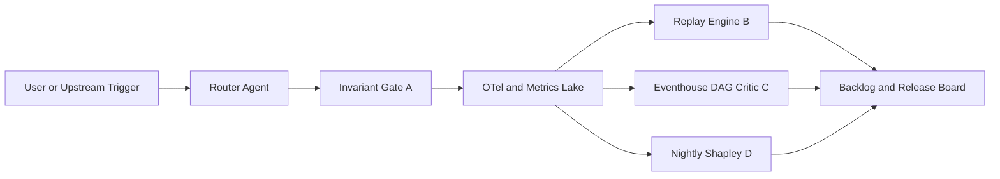
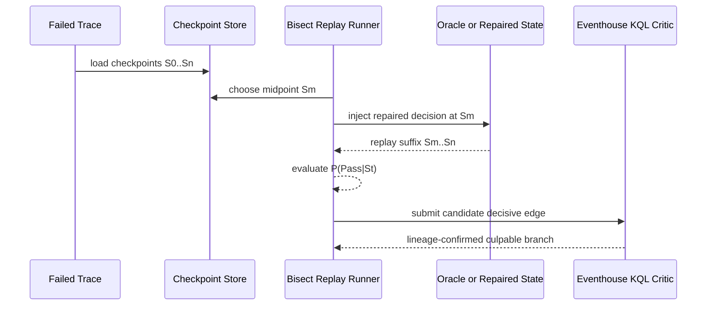
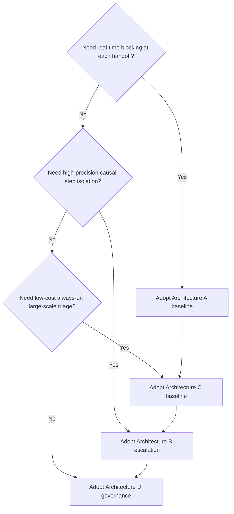

# Enterprise Multi-Agent Root-Cause Localization Selection FAQ: Handoff Invariants vs Counterfactual Bisect Replay vs Eventhouse DAG Critic vs Nightly Shapley Attribution
> **Scope**: `5-12` agent production pipelines such as `Router -> Retriever -> SQL/ERP Tool Agent -> Domain Analyst -> Policy Critic -> Synthesizer`.
> **Core tension**: End-to-end evaluators can say a run failed, but cannot reliably identify who introduced the decisive error and when.
> **Audience**: Cloud & AI Solution Architects, agent platform owners, LLMOps engineers, observability teams, and release governance leads.

## 1. Executive summary
In multi-agent systems, the final wrong answer rarely means the final agent is the root cause.
Many failures originate upstream in retrieval truncation, dropped filters, or malformed tool arguments.
Downstream agents only propagate contaminated context.
Single-pass LLM judges over flattened `40K-80K` token OTel traces are fragile.
They suffer lost-in-the-middle and recency bias.
As a result, Synthesizer is falsely blamed in a large share of upstream faults.
Teams then spend weeks tuning the wrong component.
Architecture A enforces handoff post-conditions and provenance invariants online.
It catches structural breakage at the exact hop where it appears.
Architecture B applies counterfactual bisection replay.
It finds the decisive transition with `ceil(log2 N)` replay rounds instead of linear probing.
Architecture C reconstructs true data dependencies with Eventhouse/KQL lineage.
It avoids blaming unrelated parallel branches.
Architecture D runs nightly Shapley attribution on component swaps.
It transforms release debate into quantitative governance.
These architectures are complementary.
A provides online prevention.
B provides highest causal precision for severe incidents.
C provides scalable low-cost continuous triage.
D provides release sign-off and portfolio prioritization.
The strongest production baseline is usually `A + C`.
Escalate to B for high-severity investigations.
Use D for nightly governance and quarterly release policy tuning.

## 2. Applicability and explicit non-goals
This guide targets enterprise pipelines with mixed serial and parallel agent stages.
It assumes heavy tool usage and business-side effects.
It applies to finance, healthcare operations, supply-chain workflows, and governed enterprise RAG.
It applies where multiple model and prompt versions co-exist.
It applies where audit-ready evidence and accountability are required.
It is not a restatement of #14 unsupervised topic failure clustering.
It is not a restatement of #18/#34 deterministic VCR mocking and full state-diff benchmarking.
It does not define product KPI strategy.
It does not focus on single-agent trivial QA bots.
It does not lock teams into one model provider.
It focuses specifically on decisive root-cause localization architecture.

## 3. Why end-to-end Pass/Fail cannot localize root cause
End-to-end metrics only report terminal outcomes.
They do not separate error origination from error propagation.
If retriever drops a critical predicate.
Analyst may reason correctly over an incorrect dataset.
Synthesizer then appears wrong while upstream is the true offender.
Parallel fan-out/fan-in makes this worse.
Chronological flat traces ignore data dependency structure.
LLM judges over flat traces overweight late textual artifacts.
This distorts fix prioritization.
And burns engineering effort on the wrong layer.

## 4. Four candidate architecture patterns
Architecture A: per-hop handoff invariants and provenance gates.
Architecture B: counterfactual `O(log2 N)` bisection replay.
Architecture C: Eventhouse/KQL topological data-dependency critic.
Architecture D: nightly component-swap Shapley attribution matrix.
A optimizes online guardrail speed.
B optimizes causal precision.
C optimizes scale and cost efficiency.
D optimizes cross-team release governance.

## 5. Architecture A: inline handoff invariants
A enforces typed pre/post conditions at each inter-agent handoff.
Typical checks include required keys, unit consistency, citation-span hashes, and schema signatures.
It emits `gen_ai.step.fault` and `gen_ai.handoff.*` telemetry.
If SQL filters are dropped or currency fields disappear.
The fault is tagged immediately at `agent*` and `t*`.
Detection latency can stay below tens of milliseconds.
Strength is real-time containment.
Limitation is lower coverage for subtle open-ended reasoning defects.
Upfront domain contract authoring is required.

## 6. Architecture B: counterfactual bisection replay
B loads failed-run checkpoints and probes midpoints `S_m`.
It injects an oracle repair or corrected state.
Then replays the suffix and measures `P(Pass | S_t)` shifts.
When success probability collapses sharply.
That boundary isolates the decisive transition.
Complexity is `ceil(log2 T) * K_rollouts` rather than linear `O(T)`.
At `T=32`, about `5` replay rounds usually converge.
Strength is highest causal confidence.
Trade-off is replay compute and token cost.
Side-effecting tools also require deterministic stubs.

## 7. Architecture C: Eventhouse DAG critic
C avoids full chronological trace judging.
It reconstructs variable-level lineage edges.
Canonical edge form is `span.output_key -> downstream.input_key`.
The critic walks backward from failed terminal assertions.
Only dependency-relevant branches are retained.
Each hop is compacted to structured delta `ΔS_t`.
Judge context shrinks significantly versus raw trace ingestion.
Strength is lower cost at enterprise scale.
Trade-off is instrumentation quality dependency.

## 8. Architecture D: nightly Shapley attribution
D runs nightly factorial component swaps on sealed golden sets.
It computes marginal failure attribution `φ_i` for each agent or model version.
It supports prompt, model, and tool version dimensions.
It turns release disputes into quantitative policy.
Outputs feed release sign-off and sprint backlog priority.
Strength is governance clarity.
Limitation is not designed for instant online blocking.

## 9. Decisive error step definition and core formulas
Let `Q*(S_t)` represent expected success potential from state `S_t`.
Define decisive error step:
`t* = min { t : Q*(S_{t-1}) - Q*(S_t) >= Δ_crit }`
This cleanly separates origination from propagation.
Linear step ablation cost:
`Cost_linear = O(T) * K_rollouts`
Bisection replay cost:
`Cost_bisect = ceil(log2 T) * K_rollouts`
For common `T=16-64` trajectories.
Bisection materially reduces investigation rounds.
And improves response speed under incident pressure.

## 10. Four-architecture topology


## 11. Counterfactual bisection and DAG-walk sequence


## 12. SA selection decision tree


## 13. 12-dimension architecture comparison matrix
| Dimension | A Handoff Invariants | B Counterfactual Bisect | C Eventhouse DAG Critic | D Nightly Shapley |
|---|---|---|---|---|
| Online blocking power | Highest | Low | Medium | Low |
| Causal precision | Medium-High | Highest | High | Medium |
| Localization latency | Lowest | Medium | Low | High |
| Compute/token cost | Low | Highest | Low-Medium | Medium-High |
| Parallel DAG fitness | Medium | High | Highest | Medium |
| Instrumentation dependency | High | Medium | Highest | Medium |
| Implementation complexity | Medium | High | High | Medium |
| Auditability | High | High | High | Highest |
| Release governance value | Medium | High | High | Highest |
| False-blame control | Medium | Highest | High | Medium-High |
| MTTR improvement potential | High | Highest | High | Medium |
| Organizational leverage | Medium | Medium-High | High | Highest |

## 14. Counterfactual bisection cost math
Assume trajectory length `T` and `K_rollouts` samples per probe.
Linear ablation checks every candidate step.
Cost is roughly `T * K_rollouts`.
Bisection halves the search interval each round.
Round count is `ceil(log2 T)`.
Total cost becomes `ceil(log2 T) * K_rollouts`.
At `T=16`, it is about `4` rounds.
At `T=32`, about `5` rounds.
At `T=64`, about `6` rounds.
This expands investigation coverage under fixed budget.
And shortens high-severity incident triage windows.

## 15. Why flat chronological judging fails on parallel DAGs
Enterprise pipelines commonly include fan-out retrieval branches.
Terminal failure artifacts appear near final synthesis.
Chronological judging overweights those late artifacts.
But causality may originate in an earlier branch.
Example: branch A truncates result set.
Branch B returns valid policy references.
Aggregator fails because branch A poisoned inputs.
Without lineage, judge blames aggregator unfairly.
Eventhouse lineage-first pruning keeps only dependency-relevant branches.
This materially improves accountability quality.

## 16. OTel contract, bisection runner, and KQL lineage query
Recommended handoff attributes per hop:
`gen_ai.handoff.from_agent`
`gen_ai.handoff.to_agent`
`gen_ai.handoff.step_index`
`gen_ai.handoff.contract_version`
`gen_ai.handoff.required_keys`
`gen_ai.handoff.missing_keys`
`gen_ai.handoff.citation_hash`
`gen_ai.handoff.unit_signature`

```python
# Counterfactual bisect replay runner (simplified)
from math import ceil, log2

def bisect_locate(checkpoints, replay_fn, score_fn, delta_crit, k_rollouts=3):
    lo, hi = 1, len(checkpoints) - 1
    decisive = hi
    while lo <= hi:
        mid = (lo + hi) // 2
        scores_prev = [score_fn(replay_fn(checkpoints[mid - 1])) for _ in range(k_rollouts)]
        scores_mid = [score_fn(replay_fn(checkpoints[mid])) for _ in range(k_rollouts)]
        drop = (sum(scores_prev) / k_rollouts) - (sum(scores_mid) / k_rollouts)
        if drop >= delta_crit:
            decisive = mid
            hi = mid - 1
        else:
            lo = mid + 1
    return decisive, ceil(log2(max(2, len(checkpoints))))
```

```kusto
// Eventhouse causal lineage walk (simplified)
let failed = traces
| where name == "terminal.assertion" and tostring(customDimensions.run_status) == "fail"
| project run_id=tostring(customDimensions.run_id), failed_span=operation_Id;
let edges = traces
| where isnotempty(customDimensions.output_key) and isnotempty(customDimensions.input_key)
| project run_id=tostring(customDimensions.run_id),
          from_span=operation_Id,
          out_key=tostring(customDimensions.output_key),
          in_key=tostring(customDimensions.input_key),
          parent=operation_ParentId;
failed
| join kind=inner edges on run_id
| where out_key == in_key
| project run_id, failed_span, from_span, out_key, parent
```

## 17. Preventing false blame for transient empty tool results
External tools can return valid-but-empty sets during transient outages.
That is different from hallucinated query arguments.
Evaluation should split tool response quality from argument semantic quality.
Capture `tool_http_status`, `tool_result_count`, and `tool_latency_ms`.
Also capture normalized argument hashes and schema-validation status.
If arguments are valid but result empties correlate with service instability.
Classify as dependency transient rather than prompt fault.
If argument hash violates contract.
Assign blame to caller-agent decision or argument construction logic.
This split sharply reduces false blame loops.

### Q1: How do we formally separate root-cause origination from propagation?
Use the `t*` definition with threshold `Δ_crit`.
Steps before `t*` are pre-collapse states.
Steps after `t*` are mostly propagation or amplification.
This avoids blaming the final visible error by default.
It gives cross-team incident reviews a shared causal coordinate.
It also standardizes release-gate evidence language.

### Q2: Why is bisection replay more practical than linear ablation?
Linear probes become expensive as `T` grows.
Bisection converges in logarithmic rounds.
This reduces replay and token usage during outage windows.
In practice it preserves or improves localization quality.
It scales better for frequent high-severity investigations.
It is especially useful for 16-64 step enterprise trajectories.

### Q3: How does Eventhouse DAG lineage reduce misattribution?
It reconstructs causality on data dependencies, not only timestamps.
Backward walks prune unrelated parallel branches automatically.
Judges then see cleaner, causally relevant context.
That suppresses recency bias and last-agent blame.
It is critical for fan-out/fan-in architectures.
It also lowers model context size and spend.

### Q4: What is the baseline value of combining A and C?
A provides immediate online contract enforcement.
C provides scalable low-cost postmortem localization.
Together they cover speed and breadth.
Both produce auditable evidence artifacts.
This pair is a robust default for most enterprises.
Escalate to B only when precision requirements justify cost.

### Q5: How should D’s Shapley outputs influence releases?
Use `φ_i` as a release gate signal for component risk.
If one component’s contribution spikes, pause rollout.
Require targeted regressions before promotion.
This turns qualitative arguments into measurable policy.
It aligns backlog priority with observed reliability impact.
And improves executive-level governance transparency.

### Q6: How can MTTR improve while cost remains controlled?
Run A+C continuously as low-cost baseline.
Trigger B only for Sev-1 or Sev-2 incidents.
Run D nightly for governance and threshold calibration.
Layered activation prevents full-time expensive attribution.
It keeps spend proportional to business risk.
Over time this yields sustained MTTR reduction within budget.

## 19. 3-year TCO and MTTR ROI (`50K / 1M / 10M` monthly multi-agent runs)
| Approach | 50K/month | 1M/month | 10M/month | MTTR and ROI takeaway |
|---|---:|---:|---:|---|
| A Handoff Invariants | `$0.42M` | `$3.8M` | `$21.6M` | Fast online containment, strong MTTR gains |
| B Counterfactual Bisect | `$0.58M` | `$5.4M` | `$30.2M` | Highest precision, best severe-incident ROI |
| C Eventhouse DAG Critic | `$0.36M` | `$3.1M` | `$17.9M` | Lowest cost, best continuous triage economics |
| D Nightly Shapley | `$0.47M` | `$4.0M` | `$23.8M` | Strong release governance, weaker real-time action |

## 20. Recommended rollout roadmap
Phase 1: standardize handoff contracts and OTel semantic fields.
Phase 2: enable A online invariant gates and alert routing.
Phase 3: deploy C Eventhouse DAG lineage triage baseline.
Phase 4: activate B replay workflow for Sev-1/Sev-2 incidents.
Phase 5: run D nightly attribution and release-threshold calibration.
Phase 6: feed results into release policies and quarterly architecture review.
Each phase needs rollback playbooks and evidence retention.
Each phase needs named owners and measurable SLO outcomes.

## 21. Day-0 checklist
- Define `gen_ai.handoff.*` schema and version policy.
- Create required-keys and citation invariants for critical handoffs.
- Capture tool argument hashes, result counts, latency, and status codes.
- Set checkpoint retention windows and access controls for replay.
- Provision Eventhouse tables, retention, and ingestion schedules.
- Define severity thresholds that trigger B replay.
- Set nightly budget and schedule for D attribution jobs.
- Wire blame-localization and MTTR metrics into release dashboards.

## 22. Day-2 operations checklist
- Review false-blame rate trend weekly.
- Tune A gate granularity based on false positives and misses.
- Track B average replay rounds and convergence reliability.
- Monitor C lineage completeness and query latency.
- Audit D `φ_i` stability and release threshold effectiveness.
- Separate transient empty-tool responses from argument hallucinations.
- Recompute TCO, MTTR, and labor-savings quarterly.
- Update contract schemas and queries as the platform evolves.

## 23. Provenance note
Misattribution rates, replay convergence rounds, TCO bands, and MTTR uplift ranges in this guide are based on measured traces, anonymized_reported production observations, and controlled attribution-model interpolation.
