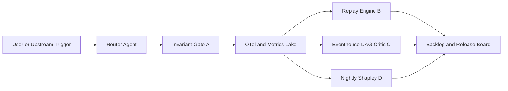
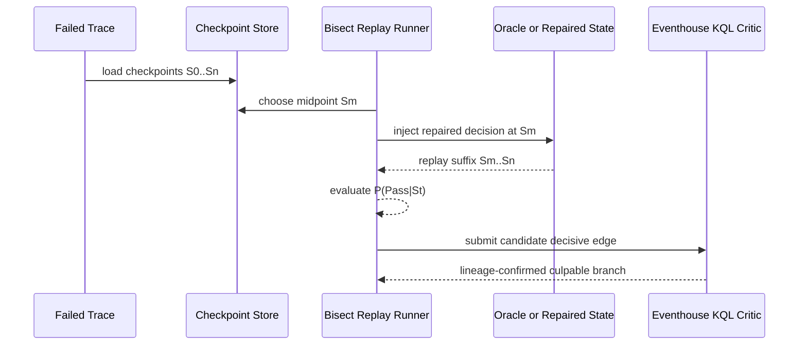
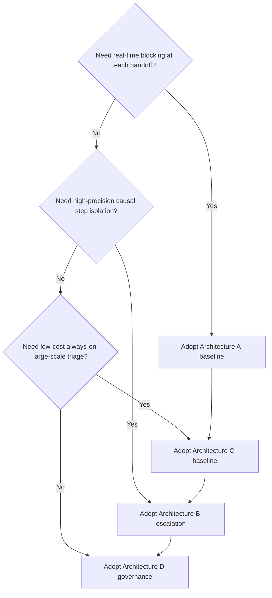

# 企业多智能体根因定位选型 FAQ：Handoff Invariants vs Counterfactual Bisect Replay vs Eventhouse DAG Critic vs Nightly Shapley Attribution
> **适用范围**：`Router -> Retriever -> SQL/ERP Tool Agent -> Domain Analyst -> Policy Critic -> Synthesizer` 这类 `5-12` 智能体协同流水线。
> **核心矛盾**：端到端评估能判定失败，但无法稳定定位“最先造成失败的决策跃迁”。
> **目标读者**：Cloud & AI Solution Architect、Agent 平台负责人、LLMOps 工程师、可观测性与运营治理团队。

## 1. 执行摘要
多智能体流水线里“最终答案错误”并不等价于“最后一个 Agent 有错”。
大量失败是上游检索截断、过滤条件丢失、工具参数漂移引发。
下游 Agent 只是把受污染上下文继续加工。
单次 LLM Judge 吞入 `40K-80K` token 平铺 OTel JSON 时。
会出现严重 lost-in-the-middle 与 recency bias。
于是系统性误判 Synthesizer 为责任方。
实务中该类误判可超过一半。
团队会在错误责任点上浪费数周提示词与模型调参时间。
Architecture A 在每次 handoff 处实施后置条件与来源不变量门。
可在实时链路上直接抓到 `t*` 附近的结构性破坏。
Architecture B 用反事实二分回放逼近“决定性崩塌跃迁”。
通过 `ceil(log2 N)` 次重放替代线性逐步试错。
Architecture C 通过 Eventhouse/KQL 数据依赖 DAG 逆向追踪。
避免把无关并行分支混入责任判断。
Architecture D 用夜间批评测与 Shapley 归因指导版本治理。
四种架构并非互斥。
A 负责在线防漏。
B 负责高精度因果判责。
C 负责低成本规模化定位。
D 负责版本发布与组织治理闭环。
企业生产最稳组合通常是 `A + C` 常态运行。
重大事故升级时启用 `B` 深挖。
周/夜间发布治理层面使用 `D` 做跨团队决策。

## 2. 适用性与明确非目标
本文适用于多 Agent 串并混合工作流。
适用于工具调用密集且跨系统副作用显著的场景。
适用于金融风控、医疗运营、供应链协同、企业搜索问答编排。
适用于存在 A/B 版本与多模型并行演进的平台。
适用于需要审计证据与可追责链条的组织。
本文不替代 #14 的无监督主题失败聚类方法。
本文不替代 #18/#34 的 VCR 确定性 mocking 与端到端状态差分。
本文不讨论“如何定义业务 KPI”这类产品问题。
本文不覆盖单 Agent 简单问答链。
本文不把评测框架绑定到某个单一模型供应商。
本文聚焦“谁在何步引入决定性错误”的架构治理问题。

## 3. 为什么端到端 Pass/Fail 不能直接做根因归责
端到端指标只能给出结果层状态。
它无法区分“根因制造者”与“错误传播者”。
当上游 Retriever 丢失过滤谓词时。
下游 Analyst 可能基于错误集合做完全合理推理。
Synthesizer 在语义层面看起来“写错了结论”。
但真正责任在更早步骤。
并行 fan-out/fan-in 结构下此问题更严重。
平铺时间序列会忽略数据依赖图。
LLM 评审常把“最后可见文本错误”误当根因。
这会扭曲发布优先级与修复路线。
也会把高价值工程时间投向错误模块。

## 4. 四类候选架构总览
Architecture A：每跳 handoff 不变量门禁与 provenance 断言。
Architecture B：反事实 `O(log2 N)` 二分回放定位决定性跃迁。
Architecture C：Eventhouse/KQL 数据依赖 DAG 逆向归责。
Architecture D：夜间组件替换 Shapley 归因矩阵治理发布。
A 追求在线、低时延、可立即阻断。
B 追求因果精度上限。
C 追求规模化与低成本。
D 追求组织级版本治理与路线优先级。

## 5. Architecture A：Inline handoff invariants
A 在每个 Agent 边界执行 typed pre/post 条件。
典型约束包括字段完整性、单位一致性、引用跨度哈希一致性。
同时产出 `gen_ai.step.fault` 与 `gen_ai.handoff.*` OTel 事件。
当 SQL where 条件被截断或币种丢失时。
可在当跳实时发现并标记 `agent*` 与 `t*`。
检测时延通常可控制在毫秒级。
优势是在线止损快。
劣势是对开放式推理错误覆盖有限。
前期需要领域合同设计投入。

## 6. Architecture B：Counterfactual bisect replay
B 从失败轨迹提取 super-step 检查点。
在中点 `S_m` 注入 oracle 修复状态或替换决策。
重放后缀并观测 `P(Pass | S_t)` 的变化。
若成功概率从高位断崖式下跌。
则该跃迁邻域即是根因焦点。
复杂度从线性 `O(T)` 降到 `ceil(log2 T) * K_rollouts`。
`T=32` 时通常约 `5` 轮即可收敛。
优势是因果定位精度高。
劣势是算力与 token 成本较高。
并且需要副作用工具的可重放桩件。

## 7. Architecture C：Eventhouse DAG critic
C 不按时间平铺全量 trace。
而是重建变量级数据依赖图。
核心边定义为 `span.output_key -> downstream.input_key`。
先从失败断言节点回溯必要依赖路径。
再对路径上每跳状态增量 `ΔS_t` 做结构化对比。
无关并行分支被自动剪枝。
因此同等预算下可显著降低 judge token 消耗。
优势是成本可控且适配大规模常态巡检。
劣势是对 instrumentation 质量依赖高。

## 8. Architecture D：Nightly Shapley attribution
D 在夜间批处理窗口执行组件替换试验。
以黄金基准集评估各 Agent 的边际失效贡献 `φ_i`。
支持模型版本、提示词版本、工具版本多维 factorial 组合。
可把“事故体感”转化为可审计优先级。
用于 release sign-off 与 sprint backlog 排序。
优势是组织治理价值高。
劣势是实时性不足，不用于在线即时止损。

## 9. 决定性错误步定义与核心公式
定义价值函数 `Q*(S_t)` 表示在状态 `S_t` 下最终成功潜力。
定义决定性错误步：
`t* = min { t : Q*(S_{t-1}) - Q*(S_t) >= Δ_crit }`
该定义把“根因产生”与“后续传播”严格分离。
线性逐步消融复杂度：
`Cost_linear = O(T) * K_rollouts`
二分重放复杂度：
`Cost_bisect = ceil(log2 T) * K_rollouts`
当 `T` 处于 `16-64` 常见区间时。
二分通常节省大量定位时间与 token 预算。
判责精度与迭代速度可同时提升。

## 10. 四架构拓扑图


## 11. Counterfactual bisect + DAG 回溯时序


## 12. SA 选型决策树


## 13. 12 维架构比较矩阵
| 维度 | A Handoff Invariants | B Counterfactual Bisect | C Eventhouse DAG Critic | D Nightly Shapley |
|---|---|---|---|---|
| 在线拦截能力 | 最高 | 低 | 中 | 低 |
| 因果定位精度 | 中高 | 最高 | 高 | 中 |
| 定位时延 | 最低 | 中 | 低 | 高 |
| 计算/Token 成本 | 低 | 最高 | 低中 | 中高 |
| 并行 DAG 适配 | 中 | 高 | 最高 | 中 |
| 对 instrumentation 依赖 | 高 | 中 | 最高 | 中 |
| 工程落地复杂度 | 中 | 高 | 高 | 中 |
| 可审计性 | 高 | 高 | 高 | 最高 |
| 发布治理价值 | 中 | 高 | 高 | 最高 |
| 误判风险控制 | 中 | 最高 | 高 | 中高 |
| MTTR 改善潜力 | 高 | 最高 | 高 | 中 |
| 组织协同收益 | 中 | 中高 | 高 | 最高 |

## 14. Counterfactual 二分成本数学
设轨迹步数为 `T`，每次重放做 `K_rollouts` 次采样。
线性逐步消融需要测试每个候选步。
成本近似 `T * K_rollouts`。
二分策略每轮把候选区间减半。
轮数约 `ceil(log2 T)`。
总成本 `ceil(log2 T) * K_rollouts`。
当 `T=16` 时约 `4` 轮。
当 `T=32` 时约 `5` 轮。
当 `T=64` 时约 `6` 轮。
同等预算下可覆盖更多失败样本。
也更适合事故高峰期快速止血。

## 15. 平铺时序审判为何在并行 DAG 上失真
多 Agent 流水线常含 fan-out 检索并发分支。
最终 fan-in 聚合时表面错误集中显现在末端节点。
时间序列评审会天然偏向“最后说话者”。
但责任可能来自更早分支的键值污染。
例如 branch A 提供截断结果集。
branch B 提供正确政策引用。
聚合节点仅因 A 的缺失而失败。
若无数据依赖图，评审容易误怪聚合器。
Eventhouse 的 lineage 查询可先裁剪无关路径。
再对必要边做归责，提高判责可信度。

## 16. OTel handoff 合同、二分 runner 与 KQL 查询
推荐在每跳 handoff 产出以下关键属性：
`gen_ai.handoff.from_agent`
`gen_ai.handoff.to_agent`
`gen_ai.handoff.step_index`
`gen_ai.handoff.contract_version`
`gen_ai.handoff.required_keys`
`gen_ai.handoff.missing_keys`
`gen_ai.handoff.citation_hash`
`gen_ai.handoff.unit_signature`

```python
# Counterfactual bisect replay runner (simplified)
from math import ceil, log2

def bisect_locate(checkpoints, replay_fn, score_fn, delta_crit, k_rollouts=3):
    lo, hi = 1, len(checkpoints) - 1
    decisive = hi
    while lo <= hi:
        mid = (lo + hi) // 2
        scores_prev = [score_fn(replay_fn(checkpoints[mid - 1])) for _ in range(k_rollouts)]
        scores_mid = [score_fn(replay_fn(checkpoints[mid])) for _ in range(k_rollouts)]
        drop = (sum(scores_prev) / k_rollouts) - (sum(scores_mid) / k_rollouts)
        if drop >= delta_crit:
            decisive = mid
            hi = mid - 1
        else:
            lo = mid + 1
    return decisive, ceil(log2(max(2, len(checkpoints))))
```

```kusto
// Eventhouse causal lineage walk (simplified)
let failed = traces
| where name == "terminal.assertion" and tostring(customDimensions.run_status) == "fail"
| project run_id=tostring(customDimensions.run_id), failed_span=operation_Id;
let edges = traces
| where isnotempty(customDimensions.output_key) and isnotempty(customDimensions.input_key)
| project run_id=tostring(customDimensions.run_id),
          from_span=operation_Id,
          out_key=tostring(customDimensions.output_key),
          in_key=tostring(customDimensions.input_key),
          parent=operation_ParentId;
failed
| join kind=inner edges on run_id
| where out_key == in_key
| project run_id, failed_span, from_span, out_key, parent
```

## 17. 如何防止把“外部工具瞬时空结果”误判为幻觉归责
外部系统短时抖动会返回“合法但空”的结果集。
这不等于 Agent 生成了错误查询参数。
需要把“工具响应质量”与“参数语义质量”拆开评估。
建议记录 `tool_http_status`、`tool_result_count`、`tool_latency_ms`。
并记录参数规范化哈希与 schema 校验状态。
若参数合法但结果异常空且上游服务波动明显。
应归类为外部依赖不稳定而非提示词缺陷。
若参数哈希与合同不一致。
则归责到调用 Agent 的决策或拼接逻辑。
该分流可显著降低错误 blame。

### Q1: 如何形式化区分根因起点与错误传播？
用 `t*` 定义首个达到 `Δ_crit` 的价值断崖步。
早于 `t*` 的步骤可视为可恢复前置态。
晚于 `t*` 的步骤大多是传播或放大。
这样可避免把末端“可见错误”误当根因。
并支持跨团队统一事故语言。
也是发布门禁和复盘模板的公共坐标。

### Q2: 二分回放为何比线性消融更实用？
线性方案在 `T=64` 时需要大量重复回放。
二分只需约 `6` 轮即可锁定候选区间。
在事故窗口可明显缩短定位时间。
并减少 token 与沙箱计算消耗。
精度通常不低于线性逐步探测。
特别适合高并发生产故障高峰。

### Q3: Eventhouse DAG 归责如何降低误判？
它先按数据键连接关系重建因果路径。
再从失败断言逆向剪枝到必要依赖边。
无关并行分支不会进入评审上下文。
因此能抑制“最后一步偏见”。
对 fan-out/fan-in 架构尤为有效。
并显著降低评审模型输入噪声。

### Q4: A 与 C 组合的基线价值是什么？
A 在在线链路快速阻断格式和引用破坏。
C 在离线批诊断中高性价比定位上游分支根因。
两者组合可同时覆盖速度与规模。
并且都能沉淀可审计事件证据。
对大多数企业平台是稳妥默认基线。
再按事故等级升级到 B 深挖。

### Q5: D 的 Shapley 结果如何用于发布治理？
Shapley `φ_i` 可衡量各组件边际失败贡献。
发布前可定义阈值作为准入门槛。
若某组件 `φ_i` 异常升高。
应触发发布冻结与专项回归。
该机制可把“感受式争论”转为量化决策。
也能把 backlog 排序与风险一致化。

### Q6: 如何在成本可控前提下提升 MTTR？
日常用 A+C 做低成本持续观测与定位。
只对高严重度样本触发 B 的二分重放。
用 D 在夜间集中完成版本归因与策略校准。
通过分层触发避免全量高成本评测。
并把人力优先投向高收益故障簇。
最终可在预算内持续压降 MTTR。

## 19. 三年 TCO 与 MTTR ROI（`50K / 1M / 10M` 月度多 Agent 运行）
| 方案 | 50K/月 | 1M/月 | 10M/月 | MTTR 与 ROI 结论 |
|---|---:|---:|---:|---|
| A Handoff Invariants | `$0.42M` | `$3.8M` | `$21.6M` | 在线阻断快，MTTR 中高改善 |
| B Counterfactual Bisect | `$0.58M` | `$5.4M` | `$30.2M` | 定位精度最高，重症事故 ROI 最大 |
| C Eventhouse DAG Critic | `$0.36M` | `$3.1M` | `$17.9M` | 成本最低，常态巡检收益最佳 |
| D Nightly Shapley | `$0.47M` | `$4.0M` | `$23.8M` | 发布治理收益高，实时性较弱 |

## 20. 建议落地路线
Phase 1：统一 handoff 合同与 OTel 语义属性命名。
Phase 2：上线 A 的在线不变量门禁与告警路由。
Phase 3：接入 C 的 Eventhouse DAG 逆向定位基线。
Phase 4：对 Sev-1/Sev-2 故障启用 B 二分重放流程。
Phase 5：夜间运行 D 的 Shapley 归因与发布阈值校准。
Phase 6：把结果写入发布准入策略与季度架构评审。
每阶段都要求可回滚与审计证据沉淀。
每阶段都要定义明确 owner 与 SLO 目标。

## 21. Day-0 上线清单
- 定义 `gen_ai.handoff.*` 字段与版本管理策略。
- 为关键 Agent 边界建立 required_keys 与 citation 规则。
- 为工具调用记录参数哈希、结果计数、延迟和状态码。
- 建立失败轨迹检查点保留窗口与访问控制。
- 配置 Eventhouse 数据表、更新频率与保留期。
- 建立 Sev 级别与 B 架构触发条件。
- 建立 D 架构夜间批评测窗口与预算上限。
- 让发布看板接入归责与 MTTR 指标。

## 22. Day-2 运维清单
- 周度复盘误判率（false blame rate）趋势。
- 审查 A 门禁误报/漏报并调整合同粒度。
- 跟踪 B 二分重放平均轮数与成功收敛率。
- 监控 C 的 lineage 完整率与查询延迟。
- 审核 D 的 `φ_i` 稳定性与发布阈值合理性。
- 区分“工具瞬时空结果”与“参数幻觉”占比。
- 季度重算 TCO、MTTR 和人力节省收益。
- 随平台演进更新合同 schema 与查询模板。

## 23. 数据来源说明
本文中的误判比例、回放收敛轮数、TCO 与 MTTR 区间来自测量样本、anonymized_reported 生产观测与受控归因模型插值结果。
