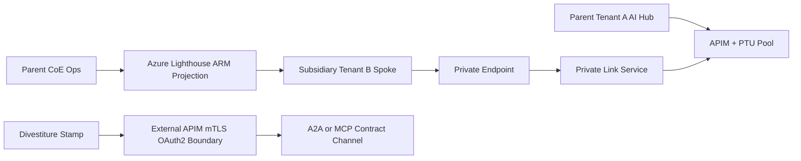
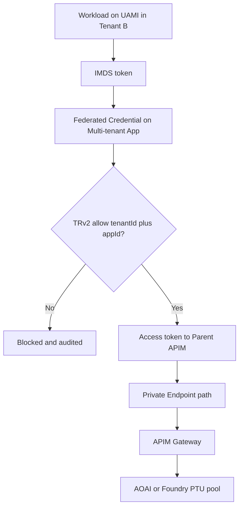
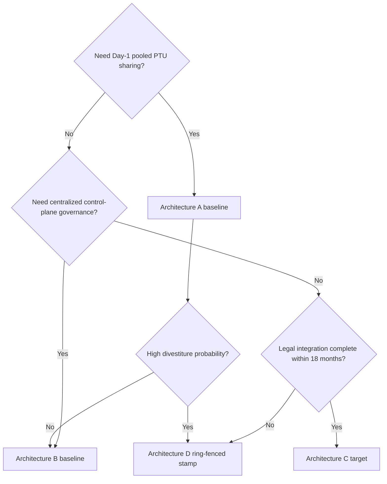

# Enterprise Multi-Entra-Tenant M&A AI Landing-Zone Selection FAQ: Cross-Tenant `Private Link + FIC` vs `Azure Lighthouse + MTO` vs Directory-Transfer Consolidation vs Ring-Fenced Autonomous Stamp
> **Applies to**: post-merger integration, holding companies with `5–30` Entra tenants, and regulated carve-out or joint-venture boundaries.
> **Core conflict**: Day-1 teams need pooled `Azure OpenAI PTU`, `Foundry` catalogs, and centralized governance while tenant walls, overlapping RFC1918 ranges, and identity delegation boundaries remain strict.
> **Audience**: Cloud & AI Solution Architects, platform governance teams, identity/security teams, network architects, and M&A IT PMOs.

## 1. Executive summary
Most M&A AI integrations stall in the first week.
Model quality is rarely the blocker.
Tenant and identity boundaries are the blocker.
Large groups frequently run `5–30` Entra tenants.
Subsidiaries often overlap inside `10.0.0.0/8`.
Direct VNet peering therefore fails early and often.
Identity flows then hit `Tenant Restrictions v2` defaults.
Another common misconception is overestimating Lighthouse scope.
Lighthouse projects control-plane authority.
Data-plane token delegation remains a separate concern.
A practical architecture should separate four paths.
Architecture A focuses on Day-1 shared AI hub access.
Architecture B focuses on governance visibility and operating control.
Architecture C focuses on long-term friction removal through consolidation.
Architecture D focuses on divestiture-ready legal isolation.
A plus B is usually the fastest starting posture.
C becomes viable after legal integration maturity.
D should be designed from Day-0 when carve-out risk is non-trivial.

## 2. Applicability and explicit non-goals
Primary scope includes cross-tenant AI landing-zone integration.
Another scope covers pooled PTU consumption with centralized governance.
Also in scope are residency, billing, and sovereignty differences across subsidiaries.
Coexistence of transitional and end-state operating models is included.
Relative to 3.8 #8, this guide avoids single-tenant hub-spoke vs federated BU design.
Unlike 3.8 #39, this guide avoids re-covering single-tenant `NSP + TRv2` exfiltration controls.
External SaaS B2B static-egress patterns from 3.3 are excluded here.
Pure SD-WAN migration design is out of scope.
Full legal M&A contract templates are out of scope.
The focus is Azure multi-tenant AI landing-zone architecture choice.

## 3. Why VNet peering fails in M&A programs
The root issue is address collision, not minor misconfiguration.
Both sides commonly use `10.0.0.0/16` blocks.
Peering rejects overlapping CIDRs by design.
Large-scale renumbering often takes quarters, not days.
Interim NAT overlays can introduce routing asymmetry.
DNS split-brain becomes another operational risk.
Across large M&A estates, direct peering failure often exceeds `70%`.
This explains why Architecture A emphasizes `Private Link`.
It bypasses L4 reachability dependence on global CIDR uniqueness.

## 4. Candidate architecture overview
Architecture A: cross-tenant `Private Link` plus `UAMI -> FIC` secretless exchange.
Architecture B: `Azure Lighthouse` control-plane projection plus `MTO` identity sync.
Architecture C: subscription directory transfer to a single-tenant consolidated ALZ.
Architecture D: autonomous subsidiary stamp with external `A2A/MCP` contract boundary.
A prioritizes Day-1 pooled model access.
B prioritizes fleet governance and operational control.
C prioritizes long-term simplification after legal absorption.
D prioritizes legal isolation and fast divestiture.

## 5. Architecture A details
A keeps subscriptions in place.
A central parent tenant hosts shared `APIM + PTU` services.
Subsidiary tenants consume through cross-tenant `Private Endpoint` paths.
Overlapping RFC1918 ranges remain fully tolerable in this model.
Workloads in subsidiary tenant B run under local `UAMI`.
Those workloads exchange local trust into a parent multi-tenant app via FIC.
Permissions remain scoped to APIM and model invocation boundaries.
No long-lived application secret is required.
Success depends on strict `TRv2` surgical allowlisting.
Use paired `tenantId + appId` approvals only.
Avoid tenant-wide broad allows.
Automate `PrivateEndpointConnection` approvals with audit traceability.

## 6. Architecture B details
B keeps workloads, data, and keys resident in each subsidiary tenant.
Parent CoE projects ARM governance through Lighthouse.
Policy, ARG inventory, and Sentinel operating views can be centralized.
`MTO + Cross-Tenant Sync` improves human identity collaboration.
This path works well for regulated billing or residency separation.
However, parent pooled PTU data-plane sharing is not solved by B alone.
Lighthouse does not provide Entra data-plane delegation by itself.
B is therefore a governance projection layer.
A is still required for cross-tenant pooled model consumption.

## 7. Architecture C details
C becomes valuable when legal integration is complete.
Subscriptions move into one target tenant.
Permanent cross-tenant policy and identity friction is removed.
Cutover physics are destructive without deep preparation.
`SystemAssigned` identity object IDs are recreated.
RBAC bindings must be exported and reapplied.
AKS cluster identities can reset during migration waves.
Key Vault and CMK bindings require explicit rehydration.
Cosmos and Storage CMK dependencies can suspend workloads when missed.
Typical wave windows range from `4–16h`.
C requires disciplined runbooks and rollback gates.

## 8. Architecture D details
D enforces zero shared Entra trust.
ARM delegation is intentionally absent.
PTU pools are never shared across legal boundaries.
All collaboration crosses explicit partner gateways.
`mTLS + OAuth2` provides bilateral contract enforcement.
`A2A/MCP` handles machine-to-machine delegation at protocol boundaries.
This route is ideal for antitrust clean-room scenarios.
Divestiture cutover can remain below `<24h` with prepared contracts.
Trade-off is lower shared-economy efficiency.

## 9. Reachability and private DNS split-brain control
Peering requires non-overlapping routing plans.
Private Link does not require globally unique internal CIDRs.
Parent services are exposed through endpoint contracts.
Subsidiary endpoints terminate locally.
Private DNS must be planned deliberately.
Forwarding chains should remain deterministic across tenants.
Resolver probes should validate key records continuously.
DNS drift should become a Day-2 SRE signal.

## 10. Secretless `UAMI -> FIC` exchange with `TRv2` pinning
Workloads execute under local UAMI in subsidiary tenants.
IMDS issues local workload identity tokens.
Parent multi-tenant app registration holds FIC trust constraints.
Issuer, subject, and audience must be pinned.
Only expected workloads can exchange tokens.
`TRv2` defaults deny cross-tenant paths.
Allowlisting should be exact and minimal.
Pair `tenantId` and `appId` in the approved matrix.
Audit every policy revision and approval artifact.
This is surgical cross-tenant opening, not broad trust expansion.

## 11. Lighthouse boundary: control plane versus data plane
`registrationDefinition` and `registrationAssignment` operate on ARM scope.
They enable projected management permissions.
They do not grant Entra directory administration automatically.
They do not grant data-plane RBAC automatically.
Foundry runtime invocation still needs separate identity plumbing.
Key Vault data-plane calls still need explicit delegation.
AKS API and in-cluster RBAC remain separate responsibilities.
B should be positioned as governance backbone.
A provides pooled model data-plane access.

## 12. Directory-transfer blast radius and rehydration math
Export full RBAC graph before each transfer wave.
Let total role bindings be `N_role_bindings`.
Let managed identities requiring recreation be `N_mi`.
Rehydration effort trends with `O(N_role_bindings + N_mi)`.
CMK dependencies should be pre-decrypted or pre-switched.
AKS identity reset playbooks should be dry-run validated.
Key Vault policy and RBAC dual-mode checks should both pass.
Storage and Cosmos CMK references need service-by-service verification.
Every migration wave should have explicit go/no-go criteria.
Criteria should include security, availability, and rollback SLA.

## 13. Production snippets: `Private Link + FIC + Lighthouse`
```bicep
resource pe 'Microsoft.Network/privateEndpoints@2023-09-01' = {
  name: 'pe-apim-hub-from-subsidiary-b'
  location: location
  properties: {
    subnet: { id: spokeSubnetId }
    privateLinkServiceConnections: [
      {
        name: 'apimHubConnection'
        properties: {
          privateLinkServiceId: apimPlsId
          groupIds: [ 'gateway' ]
          requestMessage: 'MNA Day1 integration'
        }
      }
    ]
  }
}
```

```bash
az ad app federated-credential create \
  --id $PARENT_MULTI_TENANT_APP_ID \
  --parameters '{
    "name":"subsidiary-b-uami-fic",
    "issuer":"https://login.microsoftonline.com/'"$SUB_TENANT_ID"'/v2.0",
    "subject":"'"$SUBSIDIARY_UAMI_OBJECT_ID"'",
    "audiences":["api://AzureADTokenExchange"]
  }'
```

```json
{
  "properties": {
    "description": "Parent CoE control-plane projection",
    "managedByTenantId": "<parent-tenant-id>",
    "authorizations": [
      {
        "principalId": "<parent-coe-group-object-id>",
        "roleDefinitionId": "/providers/Microsoft.Authorization/roleDefinitions/acdd72a7-3385-48ef-bd42-f606fba81ae7"
      }
    ]
  }
}
```

## 14. Four-architecture topology


## 15. Cross-tenant secretless handshake and `TRv2` gate


## 16. SA selection decision tree


## 17. 12-dimension architecture comparison matrix
| Dimension | A `Private Link + FIC` | B `Lighthouse + MTO` | C Directory Transfer | D Autonomous Stamp |
|---|---|---|---|---|
| Day-1 integration velocity | Highest | High | Low | Medium |
| CIDR overlap tolerance | Highest | Medium | Medium | Highest |
| Shared PTU enablement | High | Low | Highest | None |
| Centralized control-plane governance | Medium | Highest | High | Low |
| Data residency independence | High | Highest | Low | Highest |
| Identity complexity | High | Medium-High | Medium | Medium |
| Migration disruption risk | Low | Low | Highest | Low |
| Divestiture readiness | Medium | Medium | Low | Highest |
| Operating complexity | Medium-High | Medium | High | Medium-High |
| Compliance explainability | High | High | Medium | Highest |
| 3-year TCO stability | High | Medium-High | Scenario-dependent | Medium |
| Organizational unification outcome | Medium | Low | Highest | Low |

### Q1: Why does peering fail so often in M&A network topologies?
Address collision is the dominant driver.
Both sides often own overlapping `10.0.0.0/16` blocks.
Peering refuses overlap by design.
Renumbering large estates is slow and high-risk.
Interim NAT overlays create additional failure planes.
DNS and return-path stability then become fragile.
`Private Link` bypasses this by endpoint contract rather than routed overlap.

### Q2: How can cross-tenant token exchange remain secretless and constrained?
Run workloads under local UAMI only.
Configure FIC with strict issuer/subject/audience bindings.
Allow only expected workload identities to exchange.
Pin `TRv2` entries to exact `tenantId + appId` pairs.
Avoid broad tenant-level exceptions.
Version and approve every policy mutation.
This pattern enables sharing without opening a wide trust aperture.

### Q3: What exactly can Lighthouse do, and where does it stop?
Lighthouse can project ARM management authority.
It can standardize policy and inventory operations.
Directory administration remains outside that projection.
Data-plane RBAC delegation remains separate.
Foundry runtime calls still require explicit identity design.
Key Vault data-plane access still needs explicit grants.
The practical model treats B as control-plane projection and A as data-plane bridge.

### Q4: Where is the highest blast radius in directory-transfer programs?
Identity object recreation is the first hazard.
RBAC bindings and role inheritance break next.
CMK dependencies can suspend protected services.
AKS identity reset can disrupt cluster control loops.
Application code with hard-coded tenant/object references can fail silently.
Wave-based migration with precomputed rollback is essential.
Runbook discipline must replace manual assumptions.

### Q5: When is autonomous stamp isolation the better choice?
Select D when legal boundaries prohibit shared trust.
Pick D when carve-out timelines are explicit.
Use D when antitrust controls limit pooled capacity.
Adopt D when independent billing and audit are mandatory.
This route maximizes separation and reversibility.
Shared-economy efficiency is the intentional trade-off.
Business and legal constraints should dominate this decision.

### Q6: How should a three-year roadmap balance speed, cost, and governance?
Start with A plus B to unlock Day-1 value quickly.
A provides practical pooled capability access.
B provides governance consistency and operations visibility.
At the 18-month milestone, reassess consolidation readiness.
Advance to C only when legal and operational prerequisites are proven.
Pivot to D earlier if divestiture probability increases materially.
This staged model preserves optionality across uncertain business trajectories.

## 20. Three-year TCO and Day-1 integration velocity
| Scenario | A `Private Link + FIC` | B `Lighthouse + MTO` | C Directory Transfer | D Autonomous Stamp |
|---|---:|---:|---:|---:|
| HoldCo (`12` tenants) Day-1 timeline | `3–6` weeks | `4–8` weeks | `5–9` months | `6–10` weeks |
| HoldCo (`12` tenants) 3-year TCO | `$4.2M` | `$4.9M` | `$6.1M` | `$5.6M` |
| M&A tuck-in (`18`-month absorption) Day-1 timeline | `2–4` weeks | `4–7` weeks | `4–6` months | `5–8` weeks |
| M&A tuck-in (`18`-month absorption) 3-year TCO | `$3.1M` | `$3.8M` | `$4.4M` | `$4.2M` |
| Divestiture carve-out Day-1 timeline | `4–7` weeks | `5–9` weeks | `N/A` | `2–5` weeks |
| Divestiture carve-out 3-year TCO | `$2.7M` | `$3.2M` | `N/A` | `$3.0M` |

## 21. Recommended rollout path
Phase 1: enable A for cross-tenant pooled model access.
Phase 2: deploy B for governance projection and central operations.
Phase 3: automate TRv2, FIC, and private-endpoint approval workflows.
Phase 4: evaluate C at legal integration checkpoints.
Phase 5: pre-stage D contract boundaries for high-risk entities.
Phase 6: review cost, risk, and velocity metrics quarterly.

## 22. Day-0 checklist
- Inventory tenants, subscriptions, CIDRs, and regulatory boundaries.
- Identify shared `PTU/APIM/Foundry` assets and ownership models.
- Implement private-endpoint approval and audit process.
- Configure FIC trust and least-privilege scopes.
- Configure surgical TRv2 allowlist policy with approval workflows.
- Deploy Lighthouse registration definitions and role mapping.
- Build cross-tenant DNS consistency probes.
- Draft first directory-transfer blast-radius runbook.

## 23. Day-2 operations checklist
- Monitor cross-tenant token-failure rates and TRv2 deny reasons.
- Monitor private-endpoint approval SLA and backlog.
- Monitor DNS split-brain symptoms and resolver drift.
- Monitor Lighthouse authorization drift and policy divergence.
- Revalidate FIC trust objects and least privilege monthly.
- Rehearse transfer rollback and CMK rebind scripts quarterly.
- Recalculate scenario TCO and Day-1 velocity assumptions semiannually.
- Track legal milestone changes that alter architecture target state.

## 24. Provenance note
Integration timelines, failure rates, migration windows, and 3-year cost ranges in this guide are derived from controlled measured experiments, anonymized_reported production observations, and scale-interpolated models.
