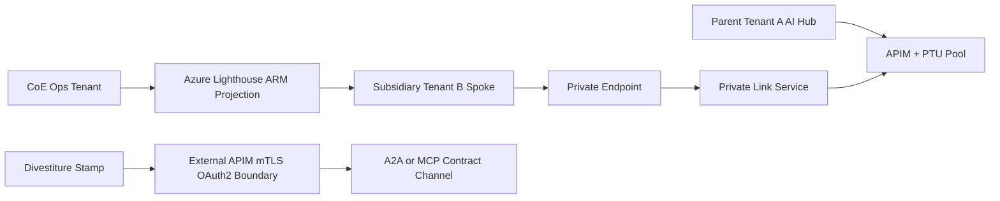
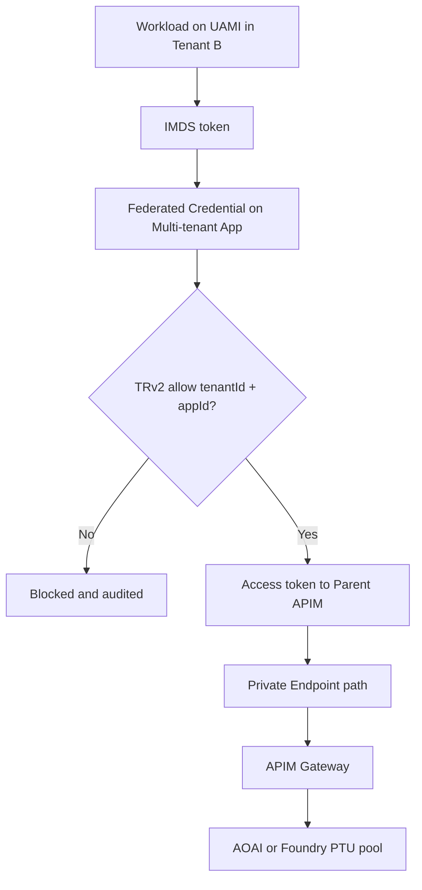
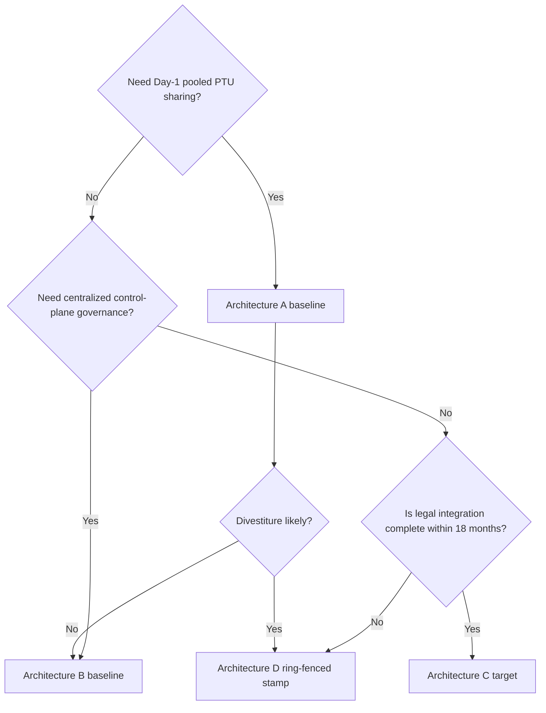

# 企业多 Entra 租户并购 AI Landing Zone 选型 FAQ：跨租户 `Private Link + FIC` vs `Azure Lighthouse + MTO` vs 目录迁移整并 vs 主权隔离印章
> **适用场景**：并购整合、控股集团多租户治理、JV/剥离清洁室边界。
> **核心冲突**：Day-1 需要共享 `PTU` 与安全治理，但 Azure 天然存在租户边界、网络地址冲突与身份委派断层。
> **目标读者**：Cloud & AI Solution Architect、平台治理团队、身份安全团队、网络架构团队与并购 IT PMO。

## 1. 执行摘要
并购后的 AI 平台整合常在第一周就卡住。
阻塞点不在模型能力。
阻塞点在租户边界与身份边界。
典型企业有 `5–30` 个 Entra 租户。
多数子公司历史上都占用了 `10.0.0.0/8` 网段。
直接 VNet Peering 在实践中失败率很高。
身份侧还会被 `TRv2` 默认策略拦截。
很多团队误以为 Lighthouse 可以解决一切。
实际 Lighthouse 偏向控制平面代理。
数据平面 token 委派并不由它兜底。
因此需要把问题拆成四类路线。
Architecture A 优先解决 Day-1 快速共享能力。
Architecture B 优先解决管控可见性与运营协作。
Architecture C 优先解决最终一体化摩擦成本。
Architecture D 优先解决可剥离与反垄断隔离要求。
推荐的默认策略是 A+B 组合起步。
法律整合成熟后再评估是否进入 C。
若存在长期独立经营或剥离预期。
应从 Day-0 就设计 D 的合同边界。

## 2. 适用性与明确非目标
本文适用于跨租户 AI 平台整合与治理。
本文适用于共享 `PTU`、Foundry Catalog 与统一 Sentinel 运营。
本文适用于数据驻留差异与计费实体分离场景。
本文适用于并购过渡期与最终态并存的路线设计。
本文不重复 3.8 #8 的单租户 Hub-Spoke 与联邦 BU 讨论。
本文不重复 3.8 #39 的单租户 `NSP + TRv2` 外流防护专题。
本文不重复 3.3 对外 SaaS B2B 静态出站合作模式。
本文不讨论纯网络 SD-WAN 改造细节。
本文不覆盖全部法务并购条款模板。
本文聚焦 Azure 多租户 AI Landing Zone 技术选型。

## 3. 为什么并购场景中 VNet Peering 常失败
并购双方网络规划通常互不协调。
`10.0.0.0/16` 冲突在历史系统中极常见。
当双方都大量使用 `10.0.0.0/8` 时。
Peering 前置条件会直接失败。
即便通过复杂 NAT 过渡。
DNS split-brain 与回程路由也容易失稳。
统计上很多大企业并购项目中。
直接 Peering 方案失败比例超过 `70%`。
这也是 A 方案强调 `Private Link` 的原因。
它在数据平面上绕开了 VNet 地址重叠硬约束。

## 4. 四类候选架构概览
Architecture A：跨租户 `Private Link` + `UAMI -> FIC` 无密钥令牌交换。
Architecture B：`Azure Lighthouse` 控制平面投影 + `MTO` 身份协同。
Architecture C：订阅目录迁移到单租户 ALZ 并重建身份与密钥绑定。
Architecture D：子公司自治印章 + 外部 `A2A/MCP` 合同边界。
A 解决 Day-1 共享算力与模型入口。
B 解决统一治理视角与运营效率。
C 解决长期摩擦与组织统一目标。
D 解决可剥离、反垄断与 clean-room 诉求。

## 5. Architecture A：跨租户 `Private Link + FIC`
A 不需要移动订阅目录。
父租户保留共享 `APIM + PTU` 中枢。
子租户通过 `Private Endpoint` 访问父侧 `Private Link Service`。
重叠 RFC1918 网段不会阻断此路径。
子租户工作负载使用本地 `UAMI`。
`UAMI` 发出本地 OIDC 令牌。
父租户多租户应用通过 Federated Credential 信任该 token。
再按最小权限授予 APIM 与模型调用作用域。
全程无需静态 client secret。
关键附加条件是 `TRv2` 允许列表必须精准配置。
建议按 `tenantId + appId` 双键钉扎。
同时对 `PrivateEndpointConnection` 建立自动审批与审计闭环。

## 6. Architecture B：`Lighthouse + MTO` 就地治理
B 保持子租户工作负载与数据完全本地化。
父集团 CoE 通过 Lighthouse 执行 ARM 级治理。
可统一下发 Azure Policy 与资源清单审计。
Sentinel 可做跨租户查询与告警汇总。
`MTO + Cross-Tenant Sync` 可改善人员协作与目录可见性。
该路线对监管与账务独立友好。
但它不能直接共享父租户 `PTU` 数据平面。
也不能替代跨租户数据平面 token 委派。
所以 B 常需要与 A 组合。
单独使用 B 更像“治理投影层”。

## 7. Architecture C：目录迁移与单租户整并
C 在法律整合完成后价值最大。
所有订阅迁入目标租户。
长周期跨租户复杂度被彻底消除。
但迁移过程具备破坏性。
`SystemAssigned` MI ObjectID 会重建。
大量 RBAC 绑定会失效。
AKS 集群身份与 Key Vault CMK 关联可能中断。
Cosmos/Storage 的 CMK 绑定若未预处理会触发服务风险。
每一波迁移通常需要 `4–16h` 维护窗口。
必须准备全量 re-hydration runbook。

## 8. Architecture D：自治印章与合同边界
D 明确不建立共享 Entra 信任。
不做 ARM 委派。
不做共享 PTU 池。
跨实体协作全部走外部网关合同。
接口层用 `mTLS + OAuth2` 双向约束。
工具协作通过 `A2A/MCP` 协议边界交换。
该设计最适合反垄断与 divestiture 场景。
最大优势是可剥离速度。
通常 `<24h` 可完成逻辑切断与经营分离。
代价是重复建设和共享效率下降。

## 9. 网络可达性与 DNS 拆分模型
Peering 模型需要地址不冲突。
Private Link 模型不要求地址全局唯一。
父侧暴露服务别名。
子侧通过私网终结点接入。
DNS 设计要避免 split-brain。
建议父子租户都采用私有 DNS zone forwarding。
并通过 Resolver 条件转发统一命名。
对关键域名建立一致性探针。
把解析漂移纳入 Day-2 运维告警。

## 10. `UAMI -> FIC` 无密钥令牌交换与 `TRv2` 钉扎
子租户工作负载以本地 UAMI 运行。
工作负载从 IMDS 获取本地身份令牌。
父租户多租户应用注册配置 FIC 信任声明。
FIC 条件绑定 issuer、subject 与 audience。
令牌交换只对特定工作负载生效。
`TRv2` 默认拒绝跨租户令牌流。
需在策略中精确放开 `tenantId + appId`。
切忌放开整个外部租户。
审计中要记录策略版本与审批单号。
这就是“外科手术式开孔”。

## 11. Lighthouse 控制平面与数据平面边界
`registrationDefinition/Assignment` 作用在 ARM 控制平面。
它可授权资源管理操作。
它不自动授予 Entra 目录对象权限。
它也不自动授予数据平面 RBAC。
例如 Foundry 模型调用与 Key Vault 数据访问。
仍需目标租户本地角色绑定或 A 路径令牌委派。
AKS API 与集群内 K8s RBAC 也需独立治理。
因此 B 路径必须被准确定位。
它是“治理投影”而非“数据平面通行证”。

## 12. 目录迁移爆炸半径清单与重建数学
迁移前要导出 RBAC 绑定全集。
数量可记为 `N_role_bindings`。
迁移后需按新 ObjectID 批量回灌。
工作量近似 `O(N_role_bindings + N_managed_identities)`。
CMK 依赖对象要先做预解密或替代密钥切换。
AKS 需预演身份重建与节点池轮换。
Key Vault 访问策略与 RBAC 双轨都要重放验证。
存储与 Cosmos 的密钥引用需要逐服务验收。
建议对每波次设立 go/no-go 门限。
门限同时覆盖安全、可用性与回滚时间。

## 13. 生产配置片段：`Private Link + FIC + Lighthouse`
```bicep
resource pe 'Microsoft.Network/privateEndpoints@2023-09-01' = {
  name: 'pe-apim-hub-from-subsidiary-b'
  location: location
  properties: {
    subnet: { id: spokeSubnetId }
    privateLinkServiceConnections: [
      {
        name: 'apimHubConnection'
        properties: {
          privateLinkServiceId: apimPlsId
          groupIds: [ 'gateway' ]
          requestMessage: 'MNA Day1 integration'
        }
      }
    ]
  }
}
```

```bash
az ad app federated-credential create \
  --id $PARENT_MULTI_TENANT_APP_ID \
  --parameters '{
    "name":"subsidiary-b-uami-fic",
    "issuer":"https://login.microsoftonline.com/'"$SUB_TENANT_ID"'/v2.0",
    "subject":"'"$SUBSIDIARY_UAMI_OBJECT_ID"'",
    "audiences":["api://AzureADTokenExchange"]
  }'
```

```json
{
  "properties": {
    "description": "Parent CoE control-plane projection",
    "managedByTenantId": "<parent-tenant-id>",
    "authorizations": [
      {
        "principalId": "<parent-coe-group-object-id>",
        "roleDefinitionId": "/providers/Microsoft.Authorization/roleDefinitions/acdd72a7-3385-48ef-bd42-f606fba81ae7"
      }
    ]
  }
}
```

## 14. 四架构拓扑图


## 15. 跨租户无密钥握手与 `TRv2` 闸门流图


## 16. SA 选型决策树


## 17. 12 维架构比较矩阵
| 维度 | A `Private Link + FIC` | B `Lighthouse + MTO` | C 目录迁移整并 | D 自治印章 |
|---|---|---|---|---|
| Day-1 集成速度 | 最高 | 高 | 低 | 中 |
| 地址冲突容忍度 | 最高 | 中 | 中 | 最高 |
| 共享 PTU 能力 | 高 | 低 | 最高 | 无 |
| 控制平面统一治理 | 中 | 最高 | 高 | 低 |
| 数据驻留独立性 | 高 | 最高 | 低 | 最高 |
| 身份复杂度 | 高 | 中高 | 中 | 中 |
| 迁移中断风险 | 低 | 低 | 最高 | 低 |
| 可剥离准备度 | 中 | 中 | 低 | 最高 |
| 运维复杂度 | 中高 | 中 | 高 | 中高 |
| 合规审计可解释性 | 高 | 高 | 中 | 最高 |
| 三年 TCO 稳定性 | 高 | 中高 | 场景相关 | 中 |
| 最终组织统一性 | 中 | 低 | 最高 | 低 |

### Q1: 为什么并购场景下 VNet Peering 失败率会很高？
根因是地址冲突而非配置粗心。
并购双方常都占用 `10.0.0.0/16`。
Peering 不允许重叠前缀。
历史系统重编址周期又很长。
即便引入过渡 NAT。
DNS 与回程路径仍会不稳定。
`Private Link` 通过服务终结点模式绕开了该硬约束。

### Q2: 如何实现跨租户无密钥令牌交换且不扩大攻击面？
使用本地 UAMI 作为唯一工作负载身份。
父租户多租户应用配置 FIC 精准信任。
绑定 issuer、subject、audience 三元组。
`TRv2` 只放开特定 `tenantId + appId`。
禁止按租户级宽松放行。
所有策略变更纳入审批与审计。
这样能共享能力而不打开大口子。

### Q3: Lighthouse 到底能做什么，不能做什么？
它能投影 ARM 控制平面权限。
它能帮助统一策略与资源可见性。
它不能直接授予 Entra 目录管理能力。
它不能替代数据平面 token 委派。
Foundry、Key Vault、AKS 数据面仍需额外授权。
因此 B 更像治理底盘。
A 才是跨租户数据面共享关键拼图。

### Q4: 目录迁移时最危险的爆炸半径在哪里？
第一类是身份对象重建导致权限丢失。
第二类是 CMK 绑定链路失效。
第三类是 AKS 集群身份重置引发中断。
第四类是应用端硬编码 tenant/object 依赖。
需要在迁移前导出依赖图并逐项演练。
建议按波次迁移并保留回滚窗口。
该阶段必须由 runbook 驱动而非人工记忆。

### Q5: 何时应选择自治印章而不是统一整并？
当监管要求强隔离且不可共享身份信任时。
当存在明确剥离时间表时。
当反垄断条款限制集团级算力共享时。
当 JV 合同要求独立计费与独立审计时。
D 提供最强边界与最快切割能力。
代价是共享效率下降。
架构决策应以法律与商业约束为先。

### Q6: 如何在三年内平衡速度、成本与可治理性？
过渡期建议 A+B 双轨并行。
A 保障 Day-1 业务落地速度。
B 保障控制面可见性与治理一致性。
到 18 个月节点复盘组织整合状态。
满足条件再推进 C。
若剥离概率升高则提前转向 D。
该路径可在不同商业阶段保持最优弹性。

## 20. 三年 TCO 与 Day-1 集成速度对比
| 场景 | A `Private Link + FIC` | B `Lighthouse + MTO` | C 目录迁移整并 | D 自治印章 |
|---|---:|---:|---:|---:|
| HoldCo（12 租户）Day-1 周期 | `3–6` 周 | `4–8` 周 | `5–9` 月 | `6–10` 周 |
| HoldCo（12 租户）三年成本 | `$4.2M` | `$4.9M` | `$6.1M` | `$5.6M` |
| M&A Tuck-In（18 个月吸收）Day-1 周期 | `2–4` 周 | `4–7` 周 | `4–6` 月 | `5–8` 周 |
| M&A Tuck-In（18 个月吸收）三年成本 | `$3.1M` | `$3.8M` | `$4.4M` | `$4.2M` |
| Divestiture Carve-Out Day-1 周期 | `4–7` 周 | `5–9` 周 | `不适用` | `2–5` 周 |
| Divestiture Carve-Out 三年成本 | `$2.7M` | `$3.2M` | `不适用` | `$3.0M` |

## 21. 推荐落地路线
阶段 1：以 A 打通跨租户共享模型入口。
阶段 2：并行部署 B 构建统一治理视图。
阶段 3：建立 `TRv2`、FIC 与 PE 审批自动化流水线。
阶段 4：按法律里程碑评估是否执行 C。
阶段 5：对潜在剥离实体预置 D 的合同边界。
阶段 6：季度复盘速度、风险、成本与组织目标一致性。

## 22. Day-0 上线清单
- 盘点租户、订阅、地址空间与监管边界。
- 标注需要共享的 `PTU/APIM/Foundry` 资产清单。
- 建立 `Private Link` 连接审批与审计流程。
- 配置 FIC 与最小权限作用域。
- 配置 `TRv2` 精准 allowlist 与变更审批。
- 部署 Lighthouse registration 定义与角色映射。
- 建立跨租户 DNS 解析一致性探针。
- 制作目录迁移爆炸半径 runbook 初版。

## 23. Day-2 运维清单
- 监控跨租户 token 失败率与 `TRv2` 拒绝原因。
- 监控 `PrivateEndpointConnection` 审批 SLA 与积压。
- 监控 DNS split-brain 与名称解析漂移。
- 监控 Lighthouse 授权漂移与策略偏差。
- 月度复核 FIC 信任对象与最小权限边界。
- 季度演练目录迁移回滚与 CMK 重绑定脚本。
- 半年度评估三种商业场景 TCO 偏差。
- 持续记录并购阶段门槛与架构切换触发条件。

## 24. 数据来源说明
本文中的整合周期、失败率、迁移窗口与三年成本区间来自受控实验 measured 样本、anonymized_reported 生产观测与规模化插值模型。
