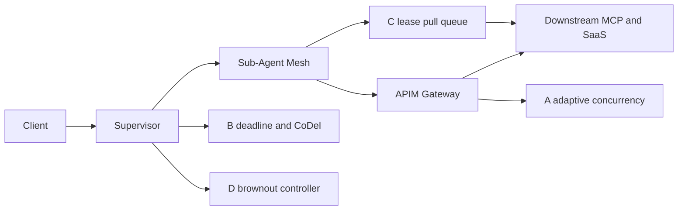
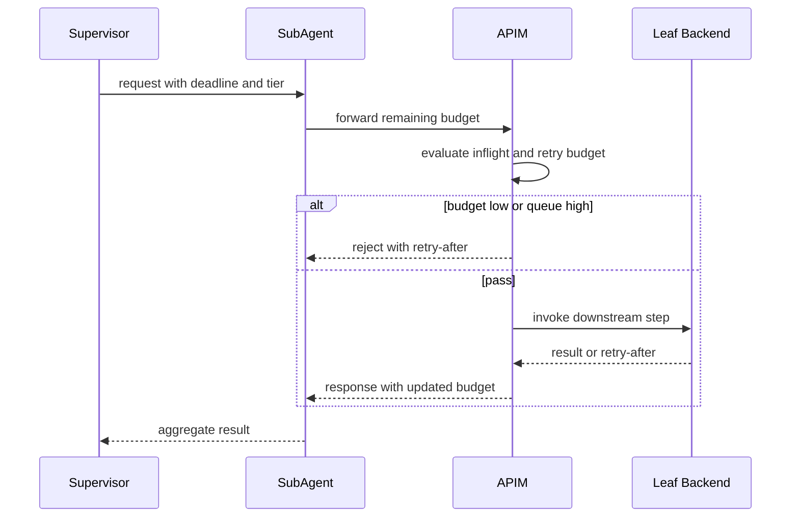
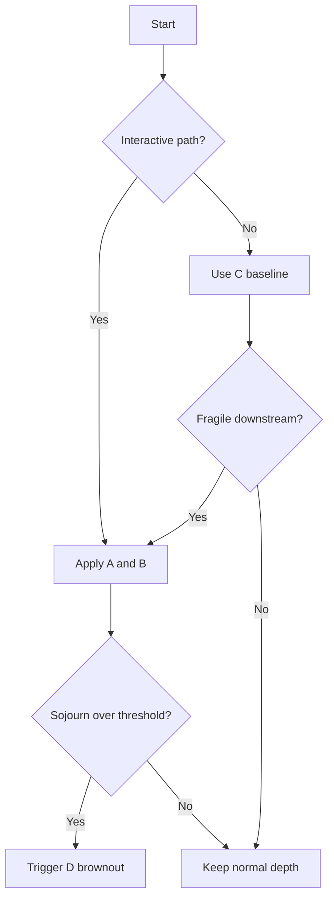

# Multi-hop agent backpressure and metastable retry-defense selection FAQ: Gradient2 adaptive concurrency vs deadline and CoDel shedding vs Service Bus lease pull vs graph-depth brownout
> **Use case**: Supervisor -> Sub-Agent -> APIM -> ERP/DB/SaaS MCP multi-hop call graphs.
> **Decision pressure**: prevent multiplicative retries, zombie token waste, and queue collapse.
> **Goal**: implement end-to-end backpressure, budget propagation, and criticality-aware resilience.

## 1. Executive summary
- The core risk is metastable collapse from coupled control loops.
- Recommended baseline is A+B, add C for async bursts, add D for scarcity-time survival.
- Retry ownership must be singular to avoid nested amplification.
- Remaining deadline and criticality must propagate at every hop.
- Concurrency should converge before error-code collapse begins.
- Brownout should preserve critical business paths under stress.
- Track `retry_ratio`, `wasted_token_ratio`, `queue_sojourn`, and `goodput`.
- Evaluate both success cost and remediation cost.

## 2. Scope and non-goals
- Scope: enterprise multi-hop orchestration and cross-system tool chains.
- Scope: strict SLO and cost-sensitive high-variance workloads.
- Scope: combined synchronous and asynchronous control planes.
- Non-goal: single-hop micro-latency tuning.
- Non-goal: low-level model operators or industrial simulation internals.
- Non-goal: unmanaged overload experimentation.

## 3. Metastable failure anatomy
- Amplification can be approximated by `A = Π(1 + p_fail,i * R_i)`.
- Once A crosses threshold, minor faults can trigger system-wide storms.
- FIFO under overload traps stale work and harms fresh demand.
- Missing budget propagation drives zombie downstream execution.
- Missing criticality propagation misallocates capacity.
- Missing async lease buffers exposes fragile downstream services.

## 4. Four candidate architectures
- **Architecture A**: Gradient2 adaptive concurrency plus retry token budget.
- **Architecture B**: deadline propagation plus criticality bands plus LIFO and CoDel.
- **Architecture C**: Service Bus lease-pull plus Durable compensation cursor.
- **Architecture D**: graph-depth brownout from multi-agent to deterministic fast paths.
- A controls inflight, B controls value admission, C controls bursts, D controls scarcity.

## 5. Architecture A details
- Use `g = RTT_noload / RTT_short` to detect congestion knee.
- Converge inflight limits with AIMD-style control.
- Enforce `retry_ratio <= 0.10`.
- Separate per-try and total timeout budgets.
- Use `L = λW` for stable operating envelope estimates.
- Best fit for interactive synchronous paths.

## 6. Architecture B details
- Propagate `X-Deadline-Unix-Ms` and `X-Criticality-Tier`.
- Reject expensive steps when remaining budget is insufficient.
- Shed T2 first to preserve T1 and T0 under pressure.
- Use LIFO plus CoDel to bound stale sojourn inflation.
- Reduce zombie token waste materially.

## 7. Architecture C details
- Pull consumption avoids push fan-out shock.
- Lease and credit enforce worker consumption limits.
- Retry-After schedules delayed re-enqueue.
- Durable keeps compensation and idempotency state.
- Best fit for async compliance and batch workloads.

## 8. Architecture D details
- Trigger brownout from sojourn and utilization thresholds.
- Remove reflection and debate loops first.
- Degrade to single-agent compact context next.
- Preserve deterministic tool and cache fast paths last.
- Protect critical availability before broad failure.

## 9. Twelve-dimension comparison matrix
| Dimension | Architecture A | Architecture B | Architecture C | Architecture D |
|---|---|---|---|---|
| Synchronous stability | Very high | High | Medium | High |
| Async burst absorption | Medium | Medium | Very high | Medium |
| Retry suppression | Very high | High | Medium-high | Medium |
| Zombie suppression | Medium-high | Very high | Medium | High |
| Queue staleness control | Medium | Very high | High | Medium |
| Criticality preservation | High | Very high | High | Very high |
| Implementation complexity | Medium | Medium-high | Medium-high | Medium |
| Operations burden | Medium | Medium | Medium-high | Medium |
| Cost predictability | High | High | Medium-high | High |
| Overload explainability | Medium | High | High | Very high |
| Peak resilience | High | High | Very high | High |
| Suggested role | Primary loop | Admission loop | Buffer loop | Brownout loop |

## 10. Multi-hop backpressure topology

## 11. Budget propagation and retry sequence

## 12. Sync and async control decision tree

### Q1. Why does multi-hop collapse become metastable
- Local retries create global positive feedback loops.
- Queue and concurrency loops amplify each other.
- Budget drift sustains low-value execution.
- Criticality mismatch reverses capacity priorities.
- Error-code feedback is often too late.
- Missing brownout turns local pressure global.
- Four-loop coordination is required for stability.

### Q2. What is the collaboration order for A/B/C/D
- A converges inflight demand first.
- B filters by business value second.
- C absorbs burst peaks third.
- D preserves critical paths under scarcity fourth.
- Share one observability and policy plane.
- Define deterministic loop-conflict priorities.
- Tune thresholds by criticality tier.

### Q3. How to quantify amplification and goodput
- Amplification: `A = Π(1 + p_fail,i * R_i)`.
- Stability relation: `L = λW`.
- Goodput counts only successful and valuable outcomes.
- Compare FIFO with LIFO plus CoDel under 1.5x to 3x overload.
- Budget rejection cuts invalid token spend.
- Unified retry ownership reduces amplification materially.
- Quantified outcomes should gate releases.

### Q4. How to reduce zombie token waste
- Propagate remaining budget strictly.
- Reject high-cost steps with insufficient remaining time.
- Bind cancel signals to downstream execution.
- Use Retry-After re-enqueue instead of busy retries.
- Apply criticality tiers to preserve high-value paths.
- Trigger brownout to reduce per-request resource demand.
- Recalibrate controls through recurring governance cycles.

### Q5. Guidance for `5M/50M/500M` monthly invocations
- `5M`: start with A plus B.
- `50M`: combine A plus B plus C.
- `500M`: combine A plus B plus C plus D.
- Track wasted-token share at every tier.
- Track success and remediation cost together.
- Recalibrate thresholds quarterly.
- Preserve auditable policy and capacity evidence.

### Q6. Anti-patterns and go-live checklist
- Anti-pattern: retries at every hop.
- Anti-pattern: no remaining-budget propagation.
- Anti-pattern: FIFO-only queue discipline.
- Anti-pattern: overload handling without brownout.
- Pre-go-live: verify concurrency limits and retry ownership.
- Pre-audit: verify criticality policy and evidence completeness.
- Post-go-live: verify goodput and waste trends.

## 13. Day-0 checklist
- Define topology and tiers
- Deploy A loop
- Deploy B admission
- Deploy C lease queue
- Deploy D brownout
- Unify trace fields
- Complete overload test
- Finalize rollback strategy
- Finalize release gate
- Archive rehearsal evidence

## 14. Day-2 operations checklist
- Weekly inflight review
- Weekly amplification review
- Weekly queue sojourn review
- Monthly zombie token review
- Monthly brownout impact review
- Monthly tier policy tuning
- Quarterly pressure retest
- Quarterly lease tuning review
- Continuous exception closure
- Continuous evidence catalog maintenance

## 15. Good fit vs Not for
- Good fit: deep multi-hop enterprise platforms
- Good fit: strict criticality-aware availability targets
- Good fit: mixed sync and async control requirements
- Not for: low-concurrency single-hop apps
- Not for: teams without centralized governance
- Not for: businesses rejecting graceful degradation

## 16. Five-step rollout guide
- Step 1: Map and tier call graph
- Step 2: Launch A plus B
- Step 3: Attach C for bursts
- Step 4: Attach D for scarcity
- Step 5: Quarterly recalibration

## 17. Quarterly governance metrics
- Track P95 end-to-end latency
- Track retry_ratio
- Track Retry amplification
- Track Wasted-token share
- Track CoDel shed ratio
- Track Queue sojourn
- Track Critical success rate
- Track Post-brownout success rate
- Track Cost per success
- Track Cost per remediation
- Track SLA compliance
- Track SLO budget burn
- Track Alert noise ratio
- Track Recovery duration
- Track Audit evidence completeness
- Track Policy drift alerts
- Track Capacity model error
- Track Exception closure ratio
- Track Rollback ratio
- Track Platform stability score
- Track Retry-After honor ratio
- Track Worker utilization
- Track 429 and 503 ratio
- Track Criticality misclassification
- Track Compensation success ratio
- Track Cross-team coordination efficiency
- Track Peak survival rate
- Track Budget rejection ratio
- Track Inflight hit ratio
- Track Release gate pass ratio
- Track concurrency control lag volatility.
- Track concurrency control deviation distribution.
- Track concurrency control anomaly clusters.
- Track concurrency control ticket backlog.
- Track concurrency control threshold drift.
- Track concurrency control approval congestion.
- Track concurrency control recovery stability.
- Track concurrency control pass-rate trend.
- Track budget propagation lag volatility.
- Track budget propagation deviation distribution.
- Track budget propagation anomaly clusters.
- Track budget propagation ticket backlog.
- Track budget propagation threshold drift.
- Track budget propagation approval congestion.
- Track budget propagation recovery stability.
- Track budget propagation pass-rate trend.
- Track retry governance lag volatility.
- Track retry governance deviation distribution.
- Track retry governance anomaly clusters.
- Track retry governance ticket backlog.
- Track retry governance threshold drift.
- Track retry governance approval congestion.
- Track retry governance recovery stability.
- Track retry governance pass-rate trend.
- Track async leasing lag volatility.
- Track async leasing deviation distribution.
- Track async leasing anomaly clusters.
- Track async leasing ticket backlog.
- Track async leasing threshold drift.
- Track async leasing approval congestion.
- Track async leasing recovery stability.
- Track async leasing pass-rate trend.
- Track criticality tiering lag volatility.
- Track criticality tiering deviation distribution.
- Track criticality tiering anomaly clusters.
- Track criticality tiering ticket backlog.
- Track criticality tiering threshold drift.
- Track criticality tiering approval congestion.
- Track criticality tiering recovery stability.
- Track criticality tiering pass-rate trend.
- Track queue discipline lag volatility.
- Track queue discipline deviation distribution.
- Track queue discipline anomaly clusters.
- Track queue discipline ticket backlog.
- Track queue discipline threshold drift.
- Track queue discipline approval congestion.
- Track queue discipline recovery stability.
- Track queue discipline pass-rate trend.
- Track brownout policy lag volatility.
- Track brownout policy deviation distribution.
- Track brownout policy anomaly clusters.
- Track brownout policy ticket backlog.
- Track brownout policy threshold drift.
- Track brownout policy approval congestion.
- Track brownout policy recovery stability.
- Track brownout policy pass-rate trend.
- Track audit operations lag volatility.
- Track audit operations deviation distribution.
- Track audit operations anomaly clusters.
- Track audit operations ticket backlog.
- Track audit operations threshold drift.
- Track audit operations approval congestion.
- Track audit operations recovery stability.
- Track audit operations pass-rate trend.

## 18. Data provenance note
- `anonymized_reported`: capacity, latency, and cost ranges are synthesized from anonymized enterprise programs with reproducible assumptions.
- Preserve policy versions, pressure-test batch IDs, and audit trace IDs.
- Archive business KPIs, technical evidence, and governance reports in layers.
- Recompute TCO and control thresholds when workload shape changes.
