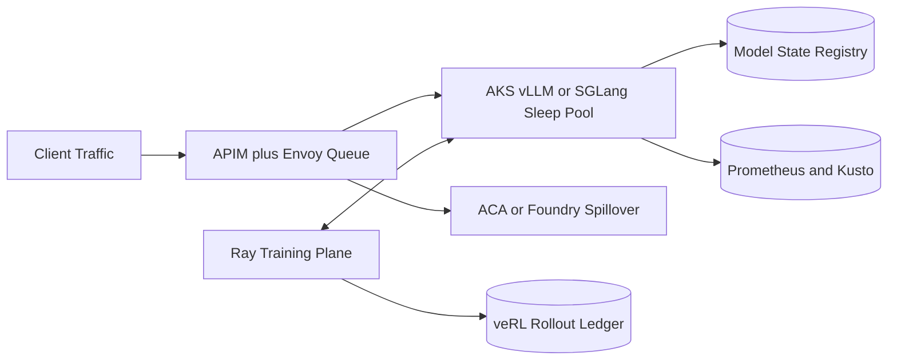
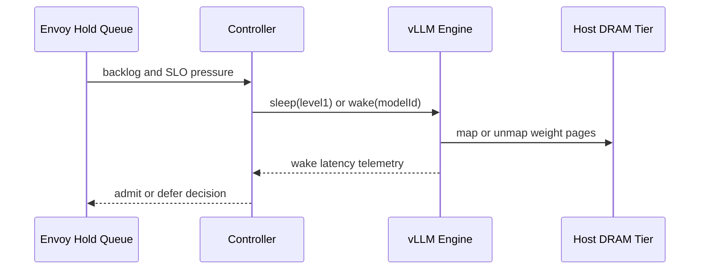

# Enterprise multi-model GPU VRAM sleep-wake multiplexing selection FAQ: AKS vLLM/SGLang cuMem host-DRAM pinning vs Ray+veRL co-location vs ACA GPU spillover

> 🌐 **Language / 语言切换**: **English (Current)** | **[中文](multi-model-gpu-vram-sleep-wake-multiplexing-aks-vllm-sglang-cumem-host-dram-pinning-vs-ray-verl-colocation-vs-aca-gpu-spillover-selection-faq.md)** | **[Back to catalog](README.en.md)**

## 1. Executive summary

- **Primary path**: enable `vLLM/SGLang` sleep mode on `AKS ND/NC H100` pools and offload weights to host DDR5 via `cuMemCreate/cuMemUnmap` while preserving CUDA Graph and NCCL context for `<0.6~1.5s` wake.
- **Secondary path**: for RL rollout plus training co-location, use `Ray + veRL/OpenRLHF` so inference engines enter Level-1 sleep during optimizer steps.
- **Spillover path**: route low-duty overnight traffic to `ACA Serverless GPU` or `APIM -> Foundry MaaS`, accepting `8~25s` cold starts for near-zero idle spend.
- **Anti-pattern warning**: naive MPS time slicing across multiple full-weight active engines without `cuMemUnmap` causes deterministic HBM OOM under bursty KV growth.
- **Target metrics**: `WakeP95 <= 1.5s`, `HBMHit >= 0.9`, `GPUUtil >= 0.55`, and declining hourly idle cost.

## 2. Route definitions

- **Route A**: `AKS + vLLM/SGLang Sleep Mode` plus Envoy hold-queue orchestrator; multiplex `4~8` heterogeneous base models per GPU pool.
- **Route B**: `Ray + veRL/OpenRLHF` same-GPU temporal co-location: inference sleeps during training steps and wakes between windows.
- **Route C**: `ACA Serverless GPU` or `KServe` triggers with `APIM` spillover to `Foundry MaaS`.
- **Route D (forbidden)**: static dedicated GPU pools per low-duty model or naive shared MPS co-packing.

## 3. Reference architecture (Mermaid 1)



## 4. Sleep-wake orchestration timeline (Mermaid 2)



## 5. Quantitative models

1. **HBM budget**: `M_base + M_kv(active) + M_fragment + M_guard <= M_hbm`.
2. **Sleep gain**: `Gain_sleep = (Idle_hours * GPU_hourly_price) - Wake_penalty_cost`.
3. **Wake latency**: `T_wake = T_map + T_prefetch + T_graph_rebind + T_first_token`.
4. **Co-location efficiency**: `Eff_colocate = (Util_infer + Util_train - overlap_penalty)`.
5. **Spillover trigger**: `if queue_wait_p95 > SLO and wake_slots_exhausted => spillover`.

## 6. Twelve-dimension comparison matrix

| Dimension | Route A AKS Sleep | Route B Ray+veRL Co-location | Route C ACA/Foundry Spillover | Route D Anti-pattern |
|---|---|---|---|---|
| HBM multiplexing efficiency | High | High | Medium | Low |
| Wake latency | Very low | Low to medium | High | Unstable |
| Training friendliness | Medium | Very high | Low | Low |
| Operational complexity | Medium | High | Low | Low surface, high hidden risk |
| Cost elasticity | High | High | Medium | Low |
| OOM risk | Low | Medium | Low | Critical |
| Multi-model concurrency | High | Medium | Medium | Low |
| SLA controllability | High | Medium-high | Medium | Low |
| Observability depth | High | High | Medium | Low |
| Supply chain dependency | Medium | High | Medium | Low |
| Three-year TCO | Low to medium | Medium | Medium | High |
| Anti-pattern exposure | Low | Medium | Medium | Critical |

## 7. Deep Q&A (Q1–Q8)

### Q1. When should Route A be prioritized?
- Prioritize Route A when model variety is high and per-model duty cycle is below 35 percent.
- Use Route A when sub-second or near-sub-second wake is required.
- Route A is strong when preserving CUDA Graph and NCCL context is critical.
- Adopt staged rollout by model heat tiers.

### Q2. Where does Route B add value?
- It removes dedicated dual-cluster waste for RL rollout and training loops.
- Inference sleeps during optimizer-heavy intervals and wakes between windows.
- It is effective for cyclical RLHF workloads with clear peaks and troughs.
- It requires robust scheduling and rollback controls.

### Q3. When is Route C spillover needed?
- When overnight duty cycle is low and idle cost must approach zero.
- When local wake slots are temporarily exhausted during spikes.
- When regional GPU capacity is constrained and fallback is required.
- For lower-priority requests that can tolerate cold starts.

### Q4. How can OOM be prevented?
- Separate active KV, sleeping weights, and fragmentation guard budgets.
- Set strict limits for `max_num_seqs` and GPU memory utilization.
- Pre-warm hot models before peak windows.
- Apply per-tenant queue fairness and admission controls.

### Q5. How should spillover thresholds be defined?
- Use combined signals from queue wait P95, free wake slots, and error rate.
- Apply time-of-day threshold profiles instead of static global numbers.
- Keep premium traffic local while spilling lower-priority classes first.
- Reserve control-plane headroom for governance calls.

### Q6. How should cost attribution be modeled?
- Split GPU minutes by model, tenant, and request class.
- Account for wake failure retries and delayed queue penalties.
- Translate spillover cold starts into opportunity cost when relevant.
- Combine infra spend with SLO breach cost to quantify ROI.

### Q7. What telemetry closes the loop?
- Track wake latency, HBM hit ratio, spillover ratio, and OOM event rate.
- Record train-infer contention events in a common event bus.
- Generate daily and weekly replay dashboards for tuning decisions.
- Automate downgrade recommendations for unstable models.

### Q8. How should phased rollout be executed?
- Start with low-risk tenant pools and a two-week observation window.
- Expand gradually using feature flags and ring-based rollout.
- Maintain one-click rollback to static allocation mode.
- Review model heat maps weekly and retune allocation classes.

## 8. vLLM sleep-mode and controller snippets

```bash
vllm serve /models/base-model-a \
  --tensor-parallel-size 4 \
  --enable-sleep-mode \
  --gpu-memory-utilization 0.88 \
  --max-num-seqs 256 \
  --swap-space 16
```

```yaml
apiVersion: apps/v1
kind: Deployment
metadata:
  name: sleep-wake-controller
spec:
  replicas: 2
  template:
    spec:
      containers:
      - name: controller
        image: ghcr.io/example/sleep-wake-controller:2026.11
        env:
        - name: WAKE_P95_TARGET_MS
          value: "1500"
        - name: SPILLOVER_QUEUE_TARGET_MS
          value: "2200"
```

## 9. Envoy queue and routing snippet

```yaml
route_config:
  virtual_hosts:
  - name: llm-host
    routes:
    - match: { prefix: "/v1/chat/completions" }
      route:
        cluster: aks-sleep-pool
        timeout: 30s
        retry_policy:
          retry_on: 5xx,reset
          num_retries: 2
```

## 10. Enterprise scenario A: vertical SaaS with 8 to 20 models

- Scenario A point 01: apply model heat-tiering, keep hot models in Level-1 sleep, and wake long-tail models on demand with P95 guardrails.
- Scenario A point 02: apply model heat-tiering, keep hot models in Level-1 sleep, and wake long-tail models on demand with P95 guardrails.
- Scenario A point 03: apply model heat-tiering, keep hot models in Level-1 sleep, and wake long-tail models on demand with P95 guardrails.
- Scenario A point 04: apply model heat-tiering, keep hot models in Level-1 sleep, and wake long-tail models on demand with P95 guardrails.
- Scenario A point 05: apply model heat-tiering, keep hot models in Level-1 sleep, and wake long-tail models on demand with P95 guardrails.
- Scenario A point 06: apply model heat-tiering, keep hot models in Level-1 sleep, and wake long-tail models on demand with P95 guardrails.
- Scenario A point 07: apply model heat-tiering, keep hot models in Level-1 sleep, and wake long-tail models on demand with P95 guardrails.
- Scenario A point 08: apply model heat-tiering, keep hot models in Level-1 sleep, and wake long-tail models on demand with P95 guardrails.
- Scenario A point 09: apply model heat-tiering, keep hot models in Level-1 sleep, and wake long-tail models on demand with P95 guardrails.
- Scenario A point 10: apply model heat-tiering, keep hot models in Level-1 sleep, and wake long-tail models on demand with P95 guardrails.
- Scenario A point 11: apply model heat-tiering, keep hot models in Level-1 sleep, and wake long-tail models on demand with P95 guardrails.
- Scenario A point 12: apply model heat-tiering, keep hot models in Level-1 sleep, and wake long-tail models on demand with P95 guardrails.
- Scenario A point 13: apply model heat-tiering, keep hot models in Level-1 sleep, and wake long-tail models on demand with P95 guardrails.
- Scenario A point 14: apply model heat-tiering, keep hot models in Level-1 sleep, and wake long-tail models on demand with P95 guardrails.
- Scenario A point 15: apply model heat-tiering, keep hot models in Level-1 sleep, and wake long-tail models on demand with P95 guardrails.
- Scenario A point 16: apply model heat-tiering, keep hot models in Level-1 sleep, and wake long-tail models on demand with P95 guardrails.
- Scenario A point 17: apply model heat-tiering, keep hot models in Level-1 sleep, and wake long-tail models on demand with P95 guardrails.
- Scenario A point 18: apply model heat-tiering, keep hot models in Level-1 sleep, and wake long-tail models on demand with P95 guardrails.
- Scenario A point 19: apply model heat-tiering, keep hot models in Level-1 sleep, and wake long-tail models on demand with P95 guardrails.
- Scenario A point 20: apply model heat-tiering, keep hot models in Level-1 sleep, and wake long-tail models on demand with P95 guardrails.
- Scenario A point 21: apply model heat-tiering, keep hot models in Level-1 sleep, and wake long-tail models on demand with P95 guardrails.
- Scenario A point 22: apply model heat-tiering, keep hot models in Level-1 sleep, and wake long-tail models on demand with P95 guardrails.
- Scenario A point 23: apply model heat-tiering, keep hot models in Level-1 sleep, and wake long-tail models on demand with P95 guardrails.
- Scenario A point 24: apply model heat-tiering, keep hot models in Level-1 sleep, and wake long-tail models on demand with P95 guardrails.
- Scenario A point 25: apply model heat-tiering, keep hot models in Level-1 sleep, and wake long-tail models on demand with P95 guardrails.
- Scenario A point 26: apply model heat-tiering, keep hot models in Level-1 sleep, and wake long-tail models on demand with P95 guardrails.
- Scenario A point 27: apply model heat-tiering, keep hot models in Level-1 sleep, and wake long-tail models on demand with P95 guardrails.
- Scenario A point 28: apply model heat-tiering, keep hot models in Level-1 sleep, and wake long-tail models on demand with P95 guardrails.
- Scenario A point 29: apply model heat-tiering, keep hot models in Level-1 sleep, and wake long-tail models on demand with P95 guardrails.
- Scenario A point 30: apply model heat-tiering, keep hot models in Level-1 sleep, and wake long-tail models on demand with P95 guardrails.

## 11. Enterprise scenario B: RLHF train-plus-infer same-GPU platform

- Scenario B point 01: switch inference sleep levels by training phase and enforce queue priorities so online traffic remains protected.
- Scenario B point 02: switch inference sleep levels by training phase and enforce queue priorities so online traffic remains protected.
- Scenario B point 03: switch inference sleep levels by training phase and enforce queue priorities so online traffic remains protected.
- Scenario B point 04: switch inference sleep levels by training phase and enforce queue priorities so online traffic remains protected.
- Scenario B point 05: switch inference sleep levels by training phase and enforce queue priorities so online traffic remains protected.
- Scenario B point 06: switch inference sleep levels by training phase and enforce queue priorities so online traffic remains protected.
- Scenario B point 07: switch inference sleep levels by training phase and enforce queue priorities so online traffic remains protected.
- Scenario B point 08: switch inference sleep levels by training phase and enforce queue priorities so online traffic remains protected.
- Scenario B point 09: switch inference sleep levels by training phase and enforce queue priorities so online traffic remains protected.
- Scenario B point 10: switch inference sleep levels by training phase and enforce queue priorities so online traffic remains protected.
- Scenario B point 11: switch inference sleep levels by training phase and enforce queue priorities so online traffic remains protected.
- Scenario B point 12: switch inference sleep levels by training phase and enforce queue priorities so online traffic remains protected.
- Scenario B point 13: switch inference sleep levels by training phase and enforce queue priorities so online traffic remains protected.
- Scenario B point 14: switch inference sleep levels by training phase and enforce queue priorities so online traffic remains protected.
- Scenario B point 15: switch inference sleep levels by training phase and enforce queue priorities so online traffic remains protected.
- Scenario B point 16: switch inference sleep levels by training phase and enforce queue priorities so online traffic remains protected.
- Scenario B point 17: switch inference sleep levels by training phase and enforce queue priorities so online traffic remains protected.
- Scenario B point 18: switch inference sleep levels by training phase and enforce queue priorities so online traffic remains protected.
- Scenario B point 19: switch inference sleep levels by training phase and enforce queue priorities so online traffic remains protected.
- Scenario B point 20: switch inference sleep levels by training phase and enforce queue priorities so online traffic remains protected.
- Scenario B point 21: switch inference sleep levels by training phase and enforce queue priorities so online traffic remains protected.
- Scenario B point 22: switch inference sleep levels by training phase and enforce queue priorities so online traffic remains protected.
- Scenario B point 23: switch inference sleep levels by training phase and enforce queue priorities so online traffic remains protected.
- Scenario B point 24: switch inference sleep levels by training phase and enforce queue priorities so online traffic remains protected.
- Scenario B point 25: switch inference sleep levels by training phase and enforce queue priorities so online traffic remains protected.
- Scenario B point 26: switch inference sleep levels by training phase and enforce queue priorities so online traffic remains protected.
- Scenario B point 27: switch inference sleep levels by training phase and enforce queue priorities so online traffic remains protected.
- Scenario B point 28: switch inference sleep levels by training phase and enforce queue priorities so online traffic remains protected.
- Scenario B point 29: switch inference sleep levels by training phase and enforce queue priorities so online traffic remains protected.
- Scenario B point 30: switch inference sleep levels by training phase and enforce queue priorities so online traffic remains protected.

## 12. Three-tier three-year TCO table (USD)

| Tier | Model count | Route A annual | Route B annual | Route C annual | Anti-pattern loss | Three-year total (recommended mix) |
|---|---:|---:|---:|---:|---:|---:|
| Small | 8 | 480,000 | 520,000 | 210,000 | 380,000 | 3,150,000 |
| Medium | 16 | 1,920,000 | 2,140,000 | 680,000 | 1,260,000 | 12,120,000 |
| Large | 30 | 5,760,000 | 6,440,000 | 1,980,000 | 3,800,000 | 35,940,000 |

## 13. Day-0 / Day-1 / Day-2 readiness checklist

### Day-0 design phase
- [ ] Day-0 design phase check 01: verify thresholds, rollback hooks, capacity budgets, owner, alerting path, and evidence retention.
- [ ] Day-0 design phase check 02: verify thresholds, rollback hooks, capacity budgets, owner, alerting path, and evidence retention.
- [ ] Day-0 design phase check 03: verify thresholds, rollback hooks, capacity budgets, owner, alerting path, and evidence retention.
- [ ] Day-0 design phase check 04: verify thresholds, rollback hooks, capacity budgets, owner, alerting path, and evidence retention.
- [ ] Day-0 design phase check 05: verify thresholds, rollback hooks, capacity budgets, owner, alerting path, and evidence retention.
- [ ] Day-0 design phase check 06: verify thresholds, rollback hooks, capacity budgets, owner, alerting path, and evidence retention.
- [ ] Day-0 design phase check 07: verify thresholds, rollback hooks, capacity budgets, owner, alerting path, and evidence retention.
- [ ] Day-0 design phase check 08: verify thresholds, rollback hooks, capacity budgets, owner, alerting path, and evidence retention.
- [ ] Day-0 design phase check 09: verify thresholds, rollback hooks, capacity budgets, owner, alerting path, and evidence retention.
- [ ] Day-0 design phase check 10: verify thresholds, rollback hooks, capacity budgets, owner, alerting path, and evidence retention.
- [ ] Day-0 design phase check 11: verify thresholds, rollback hooks, capacity budgets, owner, alerting path, and evidence retention.
- [ ] Day-0 design phase check 12: verify thresholds, rollback hooks, capacity budgets, owner, alerting path, and evidence retention.
- [ ] Day-0 design phase check 13: verify thresholds, rollback hooks, capacity budgets, owner, alerting path, and evidence retention.
- [ ] Day-0 design phase check 14: verify thresholds, rollback hooks, capacity budgets, owner, alerting path, and evidence retention.
- [ ] Day-0 design phase check 15: verify thresholds, rollback hooks, capacity budgets, owner, alerting path, and evidence retention.
- [ ] Day-0 design phase check 16: verify thresholds, rollback hooks, capacity budgets, owner, alerting path, and evidence retention.
- [ ] Day-0 design phase check 17: verify thresholds, rollback hooks, capacity budgets, owner, alerting path, and evidence retention.
- [ ] Day-0 design phase check 18: verify thresholds, rollback hooks, capacity budgets, owner, alerting path, and evidence retention.
- [ ] Day-0 design phase check 19: verify thresholds, rollback hooks, capacity budgets, owner, alerting path, and evidence retention.
- [ ] Day-0 design phase check 20: verify thresholds, rollback hooks, capacity budgets, owner, alerting path, and evidence retention.
- [ ] Day-0 design phase check 21: verify thresholds, rollback hooks, capacity budgets, owner, alerting path, and evidence retention.
- [ ] Day-0 design phase check 22: verify thresholds, rollback hooks, capacity budgets, owner, alerting path, and evidence retention.
- [ ] Day-0 design phase check 23: verify thresholds, rollback hooks, capacity budgets, owner, alerting path, and evidence retention.
- [ ] Day-0 design phase check 24: verify thresholds, rollback hooks, capacity budgets, owner, alerting path, and evidence retention.
- [ ] Day-0 design phase check 25: verify thresholds, rollback hooks, capacity budgets, owner, alerting path, and evidence retention.
- [ ] Day-0 design phase check 26: verify thresholds, rollback hooks, capacity budgets, owner, alerting path, and evidence retention.
- [ ] Day-0 design phase check 27: verify thresholds, rollback hooks, capacity budgets, owner, alerting path, and evidence retention.
- [ ] Day-0 design phase check 28: verify thresholds, rollback hooks, capacity budgets, owner, alerting path, and evidence retention.
- [ ] Day-0 design phase check 29: verify thresholds, rollback hooks, capacity budgets, owner, alerting path, and evidence retention.
- [ ] Day-0 design phase check 30: verify thresholds, rollback hooks, capacity budgets, owner, alerting path, and evidence retention.
- [ ] Day-0 design phase check 31: verify thresholds, rollback hooks, capacity budgets, owner, alerting path, and evidence retention.
- [ ] Day-0 design phase check 32: verify thresholds, rollback hooks, capacity budgets, owner, alerting path, and evidence retention.
- [ ] Day-0 design phase check 33: verify thresholds, rollback hooks, capacity budgets, owner, alerting path, and evidence retention.
- [ ] Day-0 design phase check 34: verify thresholds, rollback hooks, capacity budgets, owner, alerting path, and evidence retention.
- [ ] Day-0 design phase check 35: verify thresholds, rollback hooks, capacity budgets, owner, alerting path, and evidence retention.

### Day-1 rollout phase
- [ ] Day-1 rollout phase check 01: verify thresholds, rollback hooks, capacity budgets, owner, alerting path, and evidence retention.
- [ ] Day-1 rollout phase check 02: verify thresholds, rollback hooks, capacity budgets, owner, alerting path, and evidence retention.
- [ ] Day-1 rollout phase check 03: verify thresholds, rollback hooks, capacity budgets, owner, alerting path, and evidence retention.
- [ ] Day-1 rollout phase check 04: verify thresholds, rollback hooks, capacity budgets, owner, alerting path, and evidence retention.
- [ ] Day-1 rollout phase check 05: verify thresholds, rollback hooks, capacity budgets, owner, alerting path, and evidence retention.
- [ ] Day-1 rollout phase check 06: verify thresholds, rollback hooks, capacity budgets, owner, alerting path, and evidence retention.
- [ ] Day-1 rollout phase check 07: verify thresholds, rollback hooks, capacity budgets, owner, alerting path, and evidence retention.
- [ ] Day-1 rollout phase check 08: verify thresholds, rollback hooks, capacity budgets, owner, alerting path, and evidence retention.
- [ ] Day-1 rollout phase check 09: verify thresholds, rollback hooks, capacity budgets, owner, alerting path, and evidence retention.
- [ ] Day-1 rollout phase check 10: verify thresholds, rollback hooks, capacity budgets, owner, alerting path, and evidence retention.
- [ ] Day-1 rollout phase check 11: verify thresholds, rollback hooks, capacity budgets, owner, alerting path, and evidence retention.
- [ ] Day-1 rollout phase check 12: verify thresholds, rollback hooks, capacity budgets, owner, alerting path, and evidence retention.
- [ ] Day-1 rollout phase check 13: verify thresholds, rollback hooks, capacity budgets, owner, alerting path, and evidence retention.
- [ ] Day-1 rollout phase check 14: verify thresholds, rollback hooks, capacity budgets, owner, alerting path, and evidence retention.
- [ ] Day-1 rollout phase check 15: verify thresholds, rollback hooks, capacity budgets, owner, alerting path, and evidence retention.
- [ ] Day-1 rollout phase check 16: verify thresholds, rollback hooks, capacity budgets, owner, alerting path, and evidence retention.
- [ ] Day-1 rollout phase check 17: verify thresholds, rollback hooks, capacity budgets, owner, alerting path, and evidence retention.
- [ ] Day-1 rollout phase check 18: verify thresholds, rollback hooks, capacity budgets, owner, alerting path, and evidence retention.
- [ ] Day-1 rollout phase check 19: verify thresholds, rollback hooks, capacity budgets, owner, alerting path, and evidence retention.
- [ ] Day-1 rollout phase check 20: verify thresholds, rollback hooks, capacity budgets, owner, alerting path, and evidence retention.
- [ ] Day-1 rollout phase check 21: verify thresholds, rollback hooks, capacity budgets, owner, alerting path, and evidence retention.
- [ ] Day-1 rollout phase check 22: verify thresholds, rollback hooks, capacity budgets, owner, alerting path, and evidence retention.
- [ ] Day-1 rollout phase check 23: verify thresholds, rollback hooks, capacity budgets, owner, alerting path, and evidence retention.
- [ ] Day-1 rollout phase check 24: verify thresholds, rollback hooks, capacity budgets, owner, alerting path, and evidence retention.
- [ ] Day-1 rollout phase check 25: verify thresholds, rollback hooks, capacity budgets, owner, alerting path, and evidence retention.
- [ ] Day-1 rollout phase check 26: verify thresholds, rollback hooks, capacity budgets, owner, alerting path, and evidence retention.
- [ ] Day-1 rollout phase check 27: verify thresholds, rollback hooks, capacity budgets, owner, alerting path, and evidence retention.
- [ ] Day-1 rollout phase check 28: verify thresholds, rollback hooks, capacity budgets, owner, alerting path, and evidence retention.
- [ ] Day-1 rollout phase check 29: verify thresholds, rollback hooks, capacity budgets, owner, alerting path, and evidence retention.
- [ ] Day-1 rollout phase check 30: verify thresholds, rollback hooks, capacity budgets, owner, alerting path, and evidence retention.
- [ ] Day-1 rollout phase check 31: verify thresholds, rollback hooks, capacity budgets, owner, alerting path, and evidence retention.
- [ ] Day-1 rollout phase check 32: verify thresholds, rollback hooks, capacity budgets, owner, alerting path, and evidence retention.
- [ ] Day-1 rollout phase check 33: verify thresholds, rollback hooks, capacity budgets, owner, alerting path, and evidence retention.
- [ ] Day-1 rollout phase check 34: verify thresholds, rollback hooks, capacity budgets, owner, alerting path, and evidence retention.
- [ ] Day-1 rollout phase check 35: verify thresholds, rollback hooks, capacity budgets, owner, alerting path, and evidence retention.

### Day-2 operations phase
- [ ] Day-2 operations phase check 01: verify thresholds, rollback hooks, capacity budgets, owner, alerting path, and evidence retention.
- [ ] Day-2 operations phase check 02: verify thresholds, rollback hooks, capacity budgets, owner, alerting path, and evidence retention.
- [ ] Day-2 operations phase check 03: verify thresholds, rollback hooks, capacity budgets, owner, alerting path, and evidence retention.
- [ ] Day-2 operations phase check 04: verify thresholds, rollback hooks, capacity budgets, owner, alerting path, and evidence retention.
- [ ] Day-2 operations phase check 05: verify thresholds, rollback hooks, capacity budgets, owner, alerting path, and evidence retention.
- [ ] Day-2 operations phase check 06: verify thresholds, rollback hooks, capacity budgets, owner, alerting path, and evidence retention.
- [ ] Day-2 operations phase check 07: verify thresholds, rollback hooks, capacity budgets, owner, alerting path, and evidence retention.
- [ ] Day-2 operations phase check 08: verify thresholds, rollback hooks, capacity budgets, owner, alerting path, and evidence retention.
- [ ] Day-2 operations phase check 09: verify thresholds, rollback hooks, capacity budgets, owner, alerting path, and evidence retention.
- [ ] Day-2 operations phase check 10: verify thresholds, rollback hooks, capacity budgets, owner, alerting path, and evidence retention.
- [ ] Day-2 operations phase check 11: verify thresholds, rollback hooks, capacity budgets, owner, alerting path, and evidence retention.
- [ ] Day-2 operations phase check 12: verify thresholds, rollback hooks, capacity budgets, owner, alerting path, and evidence retention.
- [ ] Day-2 operations phase check 13: verify thresholds, rollback hooks, capacity budgets, owner, alerting path, and evidence retention.
- [ ] Day-2 operations phase check 14: verify thresholds, rollback hooks, capacity budgets, owner, alerting path, and evidence retention.
- [ ] Day-2 operations phase check 15: verify thresholds, rollback hooks, capacity budgets, owner, alerting path, and evidence retention.
- [ ] Day-2 operations phase check 16: verify thresholds, rollback hooks, capacity budgets, owner, alerting path, and evidence retention.
- [ ] Day-2 operations phase check 17: verify thresholds, rollback hooks, capacity budgets, owner, alerting path, and evidence retention.
- [ ] Day-2 operations phase check 18: verify thresholds, rollback hooks, capacity budgets, owner, alerting path, and evidence retention.
- [ ] Day-2 operations phase check 19: verify thresholds, rollback hooks, capacity budgets, owner, alerting path, and evidence retention.
- [ ] Day-2 operations phase check 20: verify thresholds, rollback hooks, capacity budgets, owner, alerting path, and evidence retention.
- [ ] Day-2 operations phase check 21: verify thresholds, rollback hooks, capacity budgets, owner, alerting path, and evidence retention.
- [ ] Day-2 operations phase check 22: verify thresholds, rollback hooks, capacity budgets, owner, alerting path, and evidence retention.
- [ ] Day-2 operations phase check 23: verify thresholds, rollback hooks, capacity budgets, owner, alerting path, and evidence retention.
- [ ] Day-2 operations phase check 24: verify thresholds, rollback hooks, capacity budgets, owner, alerting path, and evidence retention.
- [ ] Day-2 operations phase check 25: verify thresholds, rollback hooks, capacity budgets, owner, alerting path, and evidence retention.
- [ ] Day-2 operations phase check 26: verify thresholds, rollback hooks, capacity budgets, owner, alerting path, and evidence retention.
- [ ] Day-2 operations phase check 27: verify thresholds, rollback hooks, capacity budgets, owner, alerting path, and evidence retention.
- [ ] Day-2 operations phase check 28: verify thresholds, rollback hooks, capacity budgets, owner, alerting path, and evidence retention.
- [ ] Day-2 operations phase check 29: verify thresholds, rollback hooks, capacity budgets, owner, alerting path, and evidence retention.
- [ ] Day-2 operations phase check 30: verify thresholds, rollback hooks, capacity budgets, owner, alerting path, and evidence retention.
- [ ] Day-2 operations phase check 31: verify thresholds, rollback hooks, capacity budgets, owner, alerting path, and evidence retention.
- [ ] Day-2 operations phase check 32: verify thresholds, rollback hooks, capacity budgets, owner, alerting path, and evidence retention.
- [ ] Day-2 operations phase check 33: verify thresholds, rollback hooks, capacity budgets, owner, alerting path, and evidence retention.
- [ ] Day-2 operations phase check 34: verify thresholds, rollback hooks, capacity budgets, owner, alerting path, and evidence retention.
- [ ] Day-2 operations phase check 35: verify thresholds, rollback hooks, capacity budgets, owner, alerting path, and evidence retention.

## 14. Anti-pattern breakdown and remediation

- Remediation 01: prohibit static low-duty dedicated GPU pools and require sleep-wake or serverless spillover governance.
- Remediation 02: prohibit static low-duty dedicated GPU pools and require sleep-wake or serverless spillover governance.
- Remediation 03: prohibit static low-duty dedicated GPU pools and require sleep-wake or serverless spillover governance.
- Remediation 04: prohibit static low-duty dedicated GPU pools and require sleep-wake or serverless spillover governance.
- Remediation 05: prohibit static low-duty dedicated GPU pools and require sleep-wake or serverless spillover governance.
- Remediation 06: prohibit static low-duty dedicated GPU pools and require sleep-wake or serverless spillover governance.
- Remediation 07: prohibit static low-duty dedicated GPU pools and require sleep-wake or serverless spillover governance.
- Remediation 08: prohibit static low-duty dedicated GPU pools and require sleep-wake or serverless spillover governance.
- Remediation 09: prohibit static low-duty dedicated GPU pools and require sleep-wake or serverless spillover governance.
- Remediation 10: prohibit static low-duty dedicated GPU pools and require sleep-wake or serverless spillover governance.
- Remediation 11: prohibit static low-duty dedicated GPU pools and require sleep-wake or serverless spillover governance.
- Remediation 12: prohibit static low-duty dedicated GPU pools and require sleep-wake or serverless spillover governance.
- Remediation 13: prohibit static low-duty dedicated GPU pools and require sleep-wake or serverless spillover governance.
- Remediation 14: prohibit static low-duty dedicated GPU pools and require sleep-wake or serverless spillover governance.
- Remediation 15: prohibit static low-duty dedicated GPU pools and require sleep-wake or serverless spillover governance.
- Remediation 16: prohibit static low-duty dedicated GPU pools and require sleep-wake or serverless spillover governance.
- Remediation 17: prohibit static low-duty dedicated GPU pools and require sleep-wake or serverless spillover governance.
- Remediation 18: prohibit static low-duty dedicated GPU pools and require sleep-wake or serverless spillover governance.
- Remediation 19: prohibit static low-duty dedicated GPU pools and require sleep-wake or serverless spillover governance.
- Remediation 20: prohibit static low-duty dedicated GPU pools and require sleep-wake or serverless spillover governance.
- Remediation 21: prohibit static low-duty dedicated GPU pools and require sleep-wake or serverless spillover governance.
- Remediation 22: prohibit static low-duty dedicated GPU pools and require sleep-wake or serverless spillover governance.
- Remediation 23: prohibit static low-duty dedicated GPU pools and require sleep-wake or serverless spillover governance.
- Remediation 24: prohibit static low-duty dedicated GPU pools and require sleep-wake or serverless spillover governance.
- Remediation 25: prohibit static low-duty dedicated GPU pools and require sleep-wake or serverless spillover governance.
- Remediation 26: prohibit static low-duty dedicated GPU pools and require sleep-wake or serverless spillover governance.
- Remediation 27: prohibit static low-duty dedicated GPU pools and require sleep-wake or serverless spillover governance.
- Remediation 28: prohibit static low-duty dedicated GPU pools and require sleep-wake or serverless spillover governance.
- Remediation 29: prohibit static low-duty dedicated GPU pools and require sleep-wake or serverless spillover governance.
- Remediation 30: prohibit static low-duty dedicated GPU pools and require sleep-wake or serverless spillover governance.
- Remediation 31: prohibit static low-duty dedicated GPU pools and require sleep-wake or serverless spillover governance.
- Remediation 32: prohibit static low-duty dedicated GPU pools and require sleep-wake or serverless spillover governance.
- Remediation 33: prohibit static low-duty dedicated GPU pools and require sleep-wake or serverless spillover governance.
- Remediation 34: prohibit static low-duty dedicated GPU pools and require sleep-wake or serverless spillover governance.
- Remediation 35: prohibit static low-duty dedicated GPU pools and require sleep-wake or serverless spillover governance.
- Remediation 36: prohibit static low-duty dedicated GPU pools and require sleep-wake or serverless spillover governance.
- Remediation 37: prohibit static low-duty dedicated GPU pools and require sleep-wake or serverless spillover governance.
- Remediation 38: prohibit static low-duty dedicated GPU pools and require sleep-wake or serverless spillover governance.
- Remediation 39: prohibit static low-duty dedicated GPU pools and require sleep-wake or serverless spillover governance.
- Remediation 40: prohibit static low-duty dedicated GPU pools and require sleep-wake or serverless spillover governance.

## 15. Appendix: parameter and governance control catalog

- Control 001: capture weekly trends for `wake_p95_ms`, `hbm_hit_ratio`, `spillover_ratio`, `oom_event_rate`, `gpu_idle_cost`, and `tenant_fairness`.
- Control 002: capture weekly trends for `wake_p95_ms`, `hbm_hit_ratio`, `spillover_ratio`, `oom_event_rate`, `gpu_idle_cost`, and `tenant_fairness`.
- Control 003: capture weekly trends for `wake_p95_ms`, `hbm_hit_ratio`, `spillover_ratio`, `oom_event_rate`, `gpu_idle_cost`, and `tenant_fairness`.
- Control 004: capture weekly trends for `wake_p95_ms`, `hbm_hit_ratio`, `spillover_ratio`, `oom_event_rate`, `gpu_idle_cost`, and `tenant_fairness`.
- Control 005: capture weekly trends for `wake_p95_ms`, `hbm_hit_ratio`, `spillover_ratio`, `oom_event_rate`, `gpu_idle_cost`, and `tenant_fairness`.
- Control 006: capture weekly trends for `wake_p95_ms`, `hbm_hit_ratio`, `spillover_ratio`, `oom_event_rate`, `gpu_idle_cost`, and `tenant_fairness`.
- Control 007: capture weekly trends for `wake_p95_ms`, `hbm_hit_ratio`, `spillover_ratio`, `oom_event_rate`, `gpu_idle_cost`, and `tenant_fairness`.
- Control 008: capture weekly trends for `wake_p95_ms`, `hbm_hit_ratio`, `spillover_ratio`, `oom_event_rate`, `gpu_idle_cost`, and `tenant_fairness`.
- Control 009: capture weekly trends for `wake_p95_ms`, `hbm_hit_ratio`, `spillover_ratio`, `oom_event_rate`, `gpu_idle_cost`, and `tenant_fairness`.
- Control 010: capture weekly trends for `wake_p95_ms`, `hbm_hit_ratio`, `spillover_ratio`, `oom_event_rate`, `gpu_idle_cost`, and `tenant_fairness`.
- Control 011: capture weekly trends for `wake_p95_ms`, `hbm_hit_ratio`, `spillover_ratio`, `oom_event_rate`, `gpu_idle_cost`, and `tenant_fairness`.
- Control 012: capture weekly trends for `wake_p95_ms`, `hbm_hit_ratio`, `spillover_ratio`, `oom_event_rate`, `gpu_idle_cost`, and `tenant_fairness`.
- Control 013: capture weekly trends for `wake_p95_ms`, `hbm_hit_ratio`, `spillover_ratio`, `oom_event_rate`, `gpu_idle_cost`, and `tenant_fairness`.
- Control 014: capture weekly trends for `wake_p95_ms`, `hbm_hit_ratio`, `spillover_ratio`, `oom_event_rate`, `gpu_idle_cost`, and `tenant_fairness`.
- Control 015: capture weekly trends for `wake_p95_ms`, `hbm_hit_ratio`, `spillover_ratio`, `oom_event_rate`, `gpu_idle_cost`, and `tenant_fairness`.
- Control 016: capture weekly trends for `wake_p95_ms`, `hbm_hit_ratio`, `spillover_ratio`, `oom_event_rate`, `gpu_idle_cost`, and `tenant_fairness`.
- Control 017: capture weekly trends for `wake_p95_ms`, `hbm_hit_ratio`, `spillover_ratio`, `oom_event_rate`, `gpu_idle_cost`, and `tenant_fairness`.
- Control 018: capture weekly trends for `wake_p95_ms`, `hbm_hit_ratio`, `spillover_ratio`, `oom_event_rate`, `gpu_idle_cost`, and `tenant_fairness`.
- Control 019: capture weekly trends for `wake_p95_ms`, `hbm_hit_ratio`, `spillover_ratio`, `oom_event_rate`, `gpu_idle_cost`, and `tenant_fairness`.
- Control 020: capture weekly trends for `wake_p95_ms`, `hbm_hit_ratio`, `spillover_ratio`, `oom_event_rate`, `gpu_idle_cost`, and `tenant_fairness`.
- Control 021: capture weekly trends for `wake_p95_ms`, `hbm_hit_ratio`, `spillover_ratio`, `oom_event_rate`, `gpu_idle_cost`, and `tenant_fairness`.
- Control 022: capture weekly trends for `wake_p95_ms`, `hbm_hit_ratio`, `spillover_ratio`, `oom_event_rate`, `gpu_idle_cost`, and `tenant_fairness`.
- Control 023: capture weekly trends for `wake_p95_ms`, `hbm_hit_ratio`, `spillover_ratio`, `oom_event_rate`, `gpu_idle_cost`, and `tenant_fairness`.
- Control 024: capture weekly trends for `wake_p95_ms`, `hbm_hit_ratio`, `spillover_ratio`, `oom_event_rate`, `gpu_idle_cost`, and `tenant_fairness`.
- Control 025: capture weekly trends for `wake_p95_ms`, `hbm_hit_ratio`, `spillover_ratio`, `oom_event_rate`, `gpu_idle_cost`, and `tenant_fairness`.
- Control 026: capture weekly trends for `wake_p95_ms`, `hbm_hit_ratio`, `spillover_ratio`, `oom_event_rate`, `gpu_idle_cost`, and `tenant_fairness`.
- Control 027: capture weekly trends for `wake_p95_ms`, `hbm_hit_ratio`, `spillover_ratio`, `oom_event_rate`, `gpu_idle_cost`, and `tenant_fairness`.
- Control 028: capture weekly trends for `wake_p95_ms`, `hbm_hit_ratio`, `spillover_ratio`, `oom_event_rate`, `gpu_idle_cost`, and `tenant_fairness`.
- Control 029: capture weekly trends for `wake_p95_ms`, `hbm_hit_ratio`, `spillover_ratio`, `oom_event_rate`, `gpu_idle_cost`, and `tenant_fairness`.
- Control 030: capture weekly trends for `wake_p95_ms`, `hbm_hit_ratio`, `spillover_ratio`, `oom_event_rate`, `gpu_idle_cost`, and `tenant_fairness`.
- Control 031: capture weekly trends for `wake_p95_ms`, `hbm_hit_ratio`, `spillover_ratio`, `oom_event_rate`, `gpu_idle_cost`, and `tenant_fairness`.
- Control 032: capture weekly trends for `wake_p95_ms`, `hbm_hit_ratio`, `spillover_ratio`, `oom_event_rate`, `gpu_idle_cost`, and `tenant_fairness`.
- Control 033: capture weekly trends for `wake_p95_ms`, `hbm_hit_ratio`, `spillover_ratio`, `oom_event_rate`, `gpu_idle_cost`, and `tenant_fairness`.
- Control 034: capture weekly trends for `wake_p95_ms`, `hbm_hit_ratio`, `spillover_ratio`, `oom_event_rate`, `gpu_idle_cost`, and `tenant_fairness`.
- Control 035: capture weekly trends for `wake_p95_ms`, `hbm_hit_ratio`, `spillover_ratio`, `oom_event_rate`, `gpu_idle_cost`, and `tenant_fairness`.
- Control 036: capture weekly trends for `wake_p95_ms`, `hbm_hit_ratio`, `spillover_ratio`, `oom_event_rate`, `gpu_idle_cost`, and `tenant_fairness`.
- Control 037: capture weekly trends for `wake_p95_ms`, `hbm_hit_ratio`, `spillover_ratio`, `oom_event_rate`, `gpu_idle_cost`, and `tenant_fairness`.
- Control 038: capture weekly trends for `wake_p95_ms`, `hbm_hit_ratio`, `spillover_ratio`, `oom_event_rate`, `gpu_idle_cost`, and `tenant_fairness`.
- Control 039: capture weekly trends for `wake_p95_ms`, `hbm_hit_ratio`, `spillover_ratio`, `oom_event_rate`, `gpu_idle_cost`, and `tenant_fairness`.
- Control 040: capture weekly trends for `wake_p95_ms`, `hbm_hit_ratio`, `spillover_ratio`, `oom_event_rate`, `gpu_idle_cost`, and `tenant_fairness`.
- Control 041: capture weekly trends for `wake_p95_ms`, `hbm_hit_ratio`, `spillover_ratio`, `oom_event_rate`, `gpu_idle_cost`, and `tenant_fairness`.
- Control 042: capture weekly trends for `wake_p95_ms`, `hbm_hit_ratio`, `spillover_ratio`, `oom_event_rate`, `gpu_idle_cost`, and `tenant_fairness`.
- Control 043: capture weekly trends for `wake_p95_ms`, `hbm_hit_ratio`, `spillover_ratio`, `oom_event_rate`, `gpu_idle_cost`, and `tenant_fairness`.
- Control 044: capture weekly trends for `wake_p95_ms`, `hbm_hit_ratio`, `spillover_ratio`, `oom_event_rate`, `gpu_idle_cost`, and `tenant_fairness`.
- Control 045: capture weekly trends for `wake_p95_ms`, `hbm_hit_ratio`, `spillover_ratio`, `oom_event_rate`, `gpu_idle_cost`, and `tenant_fairness`.
- Control 046: capture weekly trends for `wake_p95_ms`, `hbm_hit_ratio`, `spillover_ratio`, `oom_event_rate`, `gpu_idle_cost`, and `tenant_fairness`.
- Control 047: capture weekly trends for `wake_p95_ms`, `hbm_hit_ratio`, `spillover_ratio`, `oom_event_rate`, `gpu_idle_cost`, and `tenant_fairness`.
- Control 048: capture weekly trends for `wake_p95_ms`, `hbm_hit_ratio`, `spillover_ratio`, `oom_event_rate`, `gpu_idle_cost`, and `tenant_fairness`.
- Control 049: capture weekly trends for `wake_p95_ms`, `hbm_hit_ratio`, `spillover_ratio`, `oom_event_rate`, `gpu_idle_cost`, and `tenant_fairness`.
- Control 050: capture weekly trends for `wake_p95_ms`, `hbm_hit_ratio`, `spillover_ratio`, `oom_event_rate`, `gpu_idle_cost`, and `tenant_fairness`.
- Control 051: capture weekly trends for `wake_p95_ms`, `hbm_hit_ratio`, `spillover_ratio`, `oom_event_rate`, `gpu_idle_cost`, and `tenant_fairness`.
- Control 052: capture weekly trends for `wake_p95_ms`, `hbm_hit_ratio`, `spillover_ratio`, `oom_event_rate`, `gpu_idle_cost`, and `tenant_fairness`.
- Control 053: capture weekly trends for `wake_p95_ms`, `hbm_hit_ratio`, `spillover_ratio`, `oom_event_rate`, `gpu_idle_cost`, and `tenant_fairness`.
- Control 054: capture weekly trends for `wake_p95_ms`, `hbm_hit_ratio`, `spillover_ratio`, `oom_event_rate`, `gpu_idle_cost`, and `tenant_fairness`.
- Control 055: capture weekly trends for `wake_p95_ms`, `hbm_hit_ratio`, `spillover_ratio`, `oom_event_rate`, `gpu_idle_cost`, and `tenant_fairness`.
- Control 056: capture weekly trends for `wake_p95_ms`, `hbm_hit_ratio`, `spillover_ratio`, `oom_event_rate`, `gpu_idle_cost`, and `tenant_fairness`.
- Control 057: capture weekly trends for `wake_p95_ms`, `hbm_hit_ratio`, `spillover_ratio`, `oom_event_rate`, `gpu_idle_cost`, and `tenant_fairness`.
- Control 058: capture weekly trends for `wake_p95_ms`, `hbm_hit_ratio`, `spillover_ratio`, `oom_event_rate`, `gpu_idle_cost`, and `tenant_fairness`.
- Control 059: capture weekly trends for `wake_p95_ms`, `hbm_hit_ratio`, `spillover_ratio`, `oom_event_rate`, `gpu_idle_cost`, and `tenant_fairness`.
- Control 060: capture weekly trends for `wake_p95_ms`, `hbm_hit_ratio`, `spillover_ratio`, `oom_event_rate`, `gpu_idle_cost`, and `tenant_fairness`.
- Control 061: capture weekly trends for `wake_p95_ms`, `hbm_hit_ratio`, `spillover_ratio`, `oom_event_rate`, `gpu_idle_cost`, and `tenant_fairness`.
- Control 062: capture weekly trends for `wake_p95_ms`, `hbm_hit_ratio`, `spillover_ratio`, `oom_event_rate`, `gpu_idle_cost`, and `tenant_fairness`.
- Control 063: capture weekly trends for `wake_p95_ms`, `hbm_hit_ratio`, `spillover_ratio`, `oom_event_rate`, `gpu_idle_cost`, and `tenant_fairness`.
- Control 064: capture weekly trends for `wake_p95_ms`, `hbm_hit_ratio`, `spillover_ratio`, `oom_event_rate`, `gpu_idle_cost`, and `tenant_fairness`.
- Control 065: capture weekly trends for `wake_p95_ms`, `hbm_hit_ratio`, `spillover_ratio`, `oom_event_rate`, `gpu_idle_cost`, and `tenant_fairness`.
- Control 066: capture weekly trends for `wake_p95_ms`, `hbm_hit_ratio`, `spillover_ratio`, `oom_event_rate`, `gpu_idle_cost`, and `tenant_fairness`.
- Control 067: capture weekly trends for `wake_p95_ms`, `hbm_hit_ratio`, `spillover_ratio`, `oom_event_rate`, `gpu_idle_cost`, and `tenant_fairness`.
- Control 068: capture weekly trends for `wake_p95_ms`, `hbm_hit_ratio`, `spillover_ratio`, `oom_event_rate`, `gpu_idle_cost`, and `tenant_fairness`.
- Control 069: capture weekly trends for `wake_p95_ms`, `hbm_hit_ratio`, `spillover_ratio`, `oom_event_rate`, `gpu_idle_cost`, and `tenant_fairness`.
- Control 070: capture weekly trends for `wake_p95_ms`, `hbm_hit_ratio`, `spillover_ratio`, `oom_event_rate`, `gpu_idle_cost`, and `tenant_fairness`.
- Control 071: capture weekly trends for `wake_p95_ms`, `hbm_hit_ratio`, `spillover_ratio`, `oom_event_rate`, `gpu_idle_cost`, and `tenant_fairness`.
- Control 072: capture weekly trends for `wake_p95_ms`, `hbm_hit_ratio`, `spillover_ratio`, `oom_event_rate`, `gpu_idle_cost`, and `tenant_fairness`.
- Control 073: capture weekly trends for `wake_p95_ms`, `hbm_hit_ratio`, `spillover_ratio`, `oom_event_rate`, `gpu_idle_cost`, and `tenant_fairness`.
- Control 074: capture weekly trends for `wake_p95_ms`, `hbm_hit_ratio`, `spillover_ratio`, `oom_event_rate`, `gpu_idle_cost`, and `tenant_fairness`.
- Control 075: capture weekly trends for `wake_p95_ms`, `hbm_hit_ratio`, `spillover_ratio`, `oom_event_rate`, `gpu_idle_cost`, and `tenant_fairness`.
- Control 076: capture weekly trends for `wake_p95_ms`, `hbm_hit_ratio`, `spillover_ratio`, `oom_event_rate`, `gpu_idle_cost`, and `tenant_fairness`.
- Control 077: capture weekly trends for `wake_p95_ms`, `hbm_hit_ratio`, `spillover_ratio`, `oom_event_rate`, `gpu_idle_cost`, and `tenant_fairness`.
- Control 078: capture weekly trends for `wake_p95_ms`, `hbm_hit_ratio`, `spillover_ratio`, `oom_event_rate`, `gpu_idle_cost`, and `tenant_fairness`.
- Control 079: capture weekly trends for `wake_p95_ms`, `hbm_hit_ratio`, `spillover_ratio`, `oom_event_rate`, `gpu_idle_cost`, and `tenant_fairness`.
- Control 080: capture weekly trends for `wake_p95_ms`, `hbm_hit_ratio`, `spillover_ratio`, `oom_event_rate`, `gpu_idle_cost`, and `tenant_fairness`.
- Control 081: capture weekly trends for `wake_p95_ms`, `hbm_hit_ratio`, `spillover_ratio`, `oom_event_rate`, `gpu_idle_cost`, and `tenant_fairness`.
- Control 082: capture weekly trends for `wake_p95_ms`, `hbm_hit_ratio`, `spillover_ratio`, `oom_event_rate`, `gpu_idle_cost`, and `tenant_fairness`.
- Control 083: capture weekly trends for `wake_p95_ms`, `hbm_hit_ratio`, `spillover_ratio`, `oom_event_rate`, `gpu_idle_cost`, and `tenant_fairness`.
- Control 084: capture weekly trends for `wake_p95_ms`, `hbm_hit_ratio`, `spillover_ratio`, `oom_event_rate`, `gpu_idle_cost`, and `tenant_fairness`.
- Control 085: capture weekly trends for `wake_p95_ms`, `hbm_hit_ratio`, `spillover_ratio`, `oom_event_rate`, `gpu_idle_cost`, and `tenant_fairness`.
- Control 086: capture weekly trends for `wake_p95_ms`, `hbm_hit_ratio`, `spillover_ratio`, `oom_event_rate`, `gpu_idle_cost`, and `tenant_fairness`.
- Control 087: capture weekly trends for `wake_p95_ms`, `hbm_hit_ratio`, `spillover_ratio`, `oom_event_rate`, `gpu_idle_cost`, and `tenant_fairness`.
- Control 088: capture weekly trends for `wake_p95_ms`, `hbm_hit_ratio`, `spillover_ratio`, `oom_event_rate`, `gpu_idle_cost`, and `tenant_fairness`.
- Control 089: capture weekly trends for `wake_p95_ms`, `hbm_hit_ratio`, `spillover_ratio`, `oom_event_rate`, `gpu_idle_cost`, and `tenant_fairness`.
- Control 090: capture weekly trends for `wake_p95_ms`, `hbm_hit_ratio`, `spillover_ratio`, `oom_event_rate`, `gpu_idle_cost`, and `tenant_fairness`.
- Control 091: capture weekly trends for `wake_p95_ms`, `hbm_hit_ratio`, `spillover_ratio`, `oom_event_rate`, `gpu_idle_cost`, and `tenant_fairness`.
- Control 092: capture weekly trends for `wake_p95_ms`, `hbm_hit_ratio`, `spillover_ratio`, `oom_event_rate`, `gpu_idle_cost`, and `tenant_fairness`.
- Control 093: capture weekly trends for `wake_p95_ms`, `hbm_hit_ratio`, `spillover_ratio`, `oom_event_rate`, `gpu_idle_cost`, and `tenant_fairness`.
- Control 094: capture weekly trends for `wake_p95_ms`, `hbm_hit_ratio`, `spillover_ratio`, `oom_event_rate`, `gpu_idle_cost`, and `tenant_fairness`.
- Control 095: capture weekly trends for `wake_p95_ms`, `hbm_hit_ratio`, `spillover_ratio`, `oom_event_rate`, `gpu_idle_cost`, and `tenant_fairness`.
- Control 096: capture weekly trends for `wake_p95_ms`, `hbm_hit_ratio`, `spillover_ratio`, `oom_event_rate`, `gpu_idle_cost`, and `tenant_fairness`.
- Control 097: capture weekly trends for `wake_p95_ms`, `hbm_hit_ratio`, `spillover_ratio`, `oom_event_rate`, `gpu_idle_cost`, and `tenant_fairness`.
- Control 098: capture weekly trends for `wake_p95_ms`, `hbm_hit_ratio`, `spillover_ratio`, `oom_event_rate`, `gpu_idle_cost`, and `tenant_fairness`.
- Control 099: capture weekly trends for `wake_p95_ms`, `hbm_hit_ratio`, `spillover_ratio`, `oom_event_rate`, `gpu_idle_cost`, and `tenant_fairness`.
- Control 100: capture weekly trends for `wake_p95_ms`, `hbm_hit_ratio`, `spillover_ratio`, `oom_event_rate`, `gpu_idle_cost`, and `tenant_fairness`.
- Control 101: capture weekly trends for `wake_p95_ms`, `hbm_hit_ratio`, `spillover_ratio`, `oom_event_rate`, `gpu_idle_cost`, and `tenant_fairness`.
- Control 102: capture weekly trends for `wake_p95_ms`, `hbm_hit_ratio`, `spillover_ratio`, `oom_event_rate`, `gpu_idle_cost`, and `tenant_fairness`.
- Control 103: capture weekly trends for `wake_p95_ms`, `hbm_hit_ratio`, `spillover_ratio`, `oom_event_rate`, `gpu_idle_cost`, and `tenant_fairness`.
- Control 104: capture weekly trends for `wake_p95_ms`, `hbm_hit_ratio`, `spillover_ratio`, `oom_event_rate`, `gpu_idle_cost`, and `tenant_fairness`.
- Control 105: capture weekly trends for `wake_p95_ms`, `hbm_hit_ratio`, `spillover_ratio`, `oom_event_rate`, `gpu_idle_cost`, and `tenant_fairness`.
- Control 106: capture weekly trends for `wake_p95_ms`, `hbm_hit_ratio`, `spillover_ratio`, `oom_event_rate`, `gpu_idle_cost`, and `tenant_fairness`.
- Control 107: capture weekly trends for `wake_p95_ms`, `hbm_hit_ratio`, `spillover_ratio`, `oom_event_rate`, `gpu_idle_cost`, and `tenant_fairness`.
- Control 108: capture weekly trends for `wake_p95_ms`, `hbm_hit_ratio`, `spillover_ratio`, `oom_event_rate`, `gpu_idle_cost`, and `tenant_fairness`.
- Control 109: capture weekly trends for `wake_p95_ms`, `hbm_hit_ratio`, `spillover_ratio`, `oom_event_rate`, `gpu_idle_cost`, and `tenant_fairness`.
- Control 110: capture weekly trends for `wake_p95_ms`, `hbm_hit_ratio`, `spillover_ratio`, `oom_event_rate`, `gpu_idle_cost`, and `tenant_fairness`.
- Control 111: capture weekly trends for `wake_p95_ms`, `hbm_hit_ratio`, `spillover_ratio`, `oom_event_rate`, `gpu_idle_cost`, and `tenant_fairness`.
- Control 112: capture weekly trends for `wake_p95_ms`, `hbm_hit_ratio`, `spillover_ratio`, `oom_event_rate`, `gpu_idle_cost`, and `tenant_fairness`.
- Control 113: capture weekly trends for `wake_p95_ms`, `hbm_hit_ratio`, `spillover_ratio`, `oom_event_rate`, `gpu_idle_cost`, and `tenant_fairness`.
- Control 114: capture weekly trends for `wake_p95_ms`, `hbm_hit_ratio`, `spillover_ratio`, `oom_event_rate`, `gpu_idle_cost`, and `tenant_fairness`.
- Control 115: capture weekly trends for `wake_p95_ms`, `hbm_hit_ratio`, `spillover_ratio`, `oom_event_rate`, `gpu_idle_cost`, and `tenant_fairness`.
- Control 116: capture weekly trends for `wake_p95_ms`, `hbm_hit_ratio`, `spillover_ratio`, `oom_event_rate`, `gpu_idle_cost`, and `tenant_fairness`.
- Control 117: capture weekly trends for `wake_p95_ms`, `hbm_hit_ratio`, `spillover_ratio`, `oom_event_rate`, `gpu_idle_cost`, and `tenant_fairness`.
- Control 118: capture weekly trends for `wake_p95_ms`, `hbm_hit_ratio`, `spillover_ratio`, `oom_event_rate`, `gpu_idle_cost`, and `tenant_fairness`.
- Control 119: capture weekly trends for `wake_p95_ms`, `hbm_hit_ratio`, `spillover_ratio`, `oom_event_rate`, `gpu_idle_cost`, and `tenant_fairness`.
- Control 120: capture weekly trends for `wake_p95_ms`, `hbm_hit_ratio`, `spillover_ratio`, `oom_event_rate`, `gpu_idle_cost`, and `tenant_fairness`.
- Control 121: capture weekly trends for `wake_p95_ms`, `hbm_hit_ratio`, `spillover_ratio`, `oom_event_rate`, `gpu_idle_cost`, and `tenant_fairness`.
- Control 122: capture weekly trends for `wake_p95_ms`, `hbm_hit_ratio`, `spillover_ratio`, `oom_event_rate`, `gpu_idle_cost`, and `tenant_fairness`.
- Control 123: capture weekly trends for `wake_p95_ms`, `hbm_hit_ratio`, `spillover_ratio`, `oom_event_rate`, `gpu_idle_cost`, and `tenant_fairness`.
- Control 124: capture weekly trends for `wake_p95_ms`, `hbm_hit_ratio`, `spillover_ratio`, `oom_event_rate`, `gpu_idle_cost`, and `tenant_fairness`.
- Control 125: capture weekly trends for `wake_p95_ms`, `hbm_hit_ratio`, `spillover_ratio`, `oom_event_rate`, `gpu_idle_cost`, and `tenant_fairness`.
- Control 126: capture weekly trends for `wake_p95_ms`, `hbm_hit_ratio`, `spillover_ratio`, `oom_event_rate`, `gpu_idle_cost`, and `tenant_fairness`.
- Control 127: capture weekly trends for `wake_p95_ms`, `hbm_hit_ratio`, `spillover_ratio`, `oom_event_rate`, `gpu_idle_cost`, and `tenant_fairness`.
- Control 128: capture weekly trends for `wake_p95_ms`, `hbm_hit_ratio`, `spillover_ratio`, `oom_event_rate`, `gpu_idle_cost`, and `tenant_fairness`.
- Control 129: capture weekly trends for `wake_p95_ms`, `hbm_hit_ratio`, `spillover_ratio`, `oom_event_rate`, `gpu_idle_cost`, and `tenant_fairness`.
- Control 130: capture weekly trends for `wake_p95_ms`, `hbm_hit_ratio`, `spillover_ratio`, `oom_event_rate`, `gpu_idle_cost`, and `tenant_fairness`.
- Control 131: capture weekly trends for `wake_p95_ms`, `hbm_hit_ratio`, `spillover_ratio`, `oom_event_rate`, `gpu_idle_cost`, and `tenant_fairness`.
- Control 132: capture weekly trends for `wake_p95_ms`, `hbm_hit_ratio`, `spillover_ratio`, `oom_event_rate`, `gpu_idle_cost`, and `tenant_fairness`.
- Control 133: capture weekly trends for `wake_p95_ms`, `hbm_hit_ratio`, `spillover_ratio`, `oom_event_rate`, `gpu_idle_cost`, and `tenant_fairness`.
- Control 134: capture weekly trends for `wake_p95_ms`, `hbm_hit_ratio`, `spillover_ratio`, `oom_event_rate`, `gpu_idle_cost`, and `tenant_fairness`.
- Control 135: capture weekly trends for `wake_p95_ms`, `hbm_hit_ratio`, `spillover_ratio`, `oom_event_rate`, `gpu_idle_cost`, and `tenant_fairness`.
- Control 136: capture weekly trends for `wake_p95_ms`, `hbm_hit_ratio`, `spillover_ratio`, `oom_event_rate`, `gpu_idle_cost`, and `tenant_fairness`.
- Control 137: capture weekly trends for `wake_p95_ms`, `hbm_hit_ratio`, `spillover_ratio`, `oom_event_rate`, `gpu_idle_cost`, and `tenant_fairness`.
- Control 138: capture weekly trends for `wake_p95_ms`, `hbm_hit_ratio`, `spillover_ratio`, `oom_event_rate`, `gpu_idle_cost`, and `tenant_fairness`.
- Control 139: capture weekly trends for `wake_p95_ms`, `hbm_hit_ratio`, `spillover_ratio`, `oom_event_rate`, `gpu_idle_cost`, and `tenant_fairness`.
- Control 140: capture weekly trends for `wake_p95_ms`, `hbm_hit_ratio`, `spillover_ratio`, `oom_event_rate`, `gpu_idle_cost`, and `tenant_fairness`.
- Control 141: capture weekly trends for `wake_p95_ms`, `hbm_hit_ratio`, `spillover_ratio`, `oom_event_rate`, `gpu_idle_cost`, and `tenant_fairness`.
- Control 142: capture weekly trends for `wake_p95_ms`, `hbm_hit_ratio`, `spillover_ratio`, `oom_event_rate`, `gpu_idle_cost`, and `tenant_fairness`.
- Control 143: capture weekly trends for `wake_p95_ms`, `hbm_hit_ratio`, `spillover_ratio`, `oom_event_rate`, `gpu_idle_cost`, and `tenant_fairness`.
- Control 144: capture weekly trends for `wake_p95_ms`, `hbm_hit_ratio`, `spillover_ratio`, `oom_event_rate`, `gpu_idle_cost`, and `tenant_fairness`.
- Control 145: capture weekly trends for `wake_p95_ms`, `hbm_hit_ratio`, `spillover_ratio`, `oom_event_rate`, `gpu_idle_cost`, and `tenant_fairness`.
- Control 146: capture weekly trends for `wake_p95_ms`, `hbm_hit_ratio`, `spillover_ratio`, `oom_event_rate`, `gpu_idle_cost`, and `tenant_fairness`.
- Control 147: capture weekly trends for `wake_p95_ms`, `hbm_hit_ratio`, `spillover_ratio`, `oom_event_rate`, `gpu_idle_cost`, and `tenant_fairness`.
- Control 148: capture weekly trends for `wake_p95_ms`, `hbm_hit_ratio`, `spillover_ratio`, `oom_event_rate`, `gpu_idle_cost`, and `tenant_fairness`.
- Control 149: capture weekly trends for `wake_p95_ms`, `hbm_hit_ratio`, `spillover_ratio`, `oom_event_rate`, `gpu_idle_cost`, and `tenant_fairness`.
- Control 150: capture weekly trends for `wake_p95_ms`, `hbm_hit_ratio`, `spillover_ratio`, `oom_event_rate`, `gpu_idle_cost`, and `tenant_fairness`.
- Control 151: capture weekly trends for `wake_p95_ms`, `hbm_hit_ratio`, `spillover_ratio`, `oom_event_rate`, `gpu_idle_cost`, and `tenant_fairness`.
- Control 152: capture weekly trends for `wake_p95_ms`, `hbm_hit_ratio`, `spillover_ratio`, `oom_event_rate`, `gpu_idle_cost`, and `tenant_fairness`.
- Control 153: capture weekly trends for `wake_p95_ms`, `hbm_hit_ratio`, `spillover_ratio`, `oom_event_rate`, `gpu_idle_cost`, and `tenant_fairness`.
- Control 154: capture weekly trends for `wake_p95_ms`, `hbm_hit_ratio`, `spillover_ratio`, `oom_event_rate`, `gpu_idle_cost`, and `tenant_fairness`.
- Control 155: capture weekly trends for `wake_p95_ms`, `hbm_hit_ratio`, `spillover_ratio`, `oom_event_rate`, `gpu_idle_cost`, and `tenant_fairness`.
- Control 156: capture weekly trends for `wake_p95_ms`, `hbm_hit_ratio`, `spillover_ratio`, `oom_event_rate`, `gpu_idle_cost`, and `tenant_fairness`.
- Control 157: capture weekly trends for `wake_p95_ms`, `hbm_hit_ratio`, `spillover_ratio`, `oom_event_rate`, `gpu_idle_cost`, and `tenant_fairness`.
- Control 158: capture weekly trends for `wake_p95_ms`, `hbm_hit_ratio`, `spillover_ratio`, `oom_event_rate`, `gpu_idle_cost`, and `tenant_fairness`.
- Control 159: capture weekly trends for `wake_p95_ms`, `hbm_hit_ratio`, `spillover_ratio`, `oom_event_rate`, `gpu_idle_cost`, and `tenant_fairness`.
- Control 160: capture weekly trends for `wake_p95_ms`, `hbm_hit_ratio`, `spillover_ratio`, `oom_event_rate`, `gpu_idle_cost`, and `tenant_fairness`.
