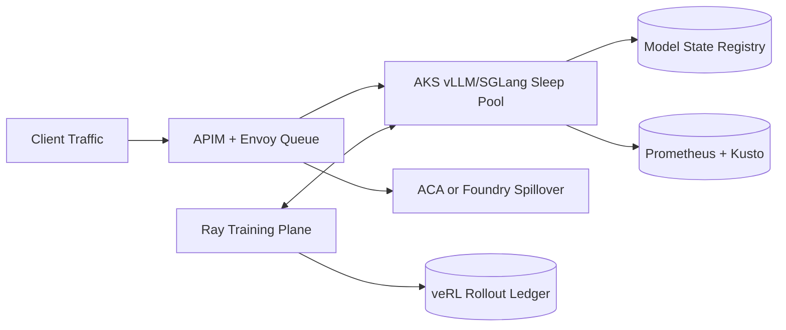
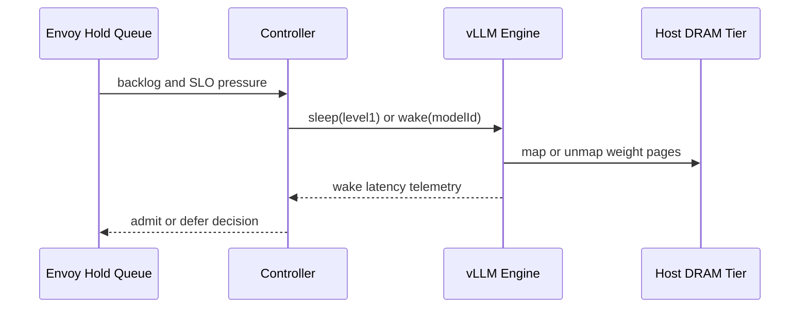

# 企业多模型 GPU VRAM Sleep/Wake 复用选型 FAQ：AKS vLLM/SGLang cuMem Host-DRAM Pinning vs Ray+veRL 同卡共址 vs ACA GPU 溢出

> 🌐 **Language / 语言切换**: **中文版（当前）** | **[English](multi-model-gpu-vram-sleep-wake-multiplexing-aks-vllm-sglang-cumem-host-dram-pinning-vs-ray-verl-colocation-vs-aca-gpu-spillover-selection-faq.en.md)** | **[返回目录](README.md)**

## 1. 一页结论（Executive Summary）

- **推荐主路径**：在 `AKS ND/NC H100` 池启用 `vLLM/SGLang Sleep Mode`，以 `cuMemCreate/cuMemUnmap` 将权重迁移至主机 DDR5，保持 CUDA Graph 与 NCCL 上下文，实现 `<0.6~1.5s` 唤醒。
- **第二路径**：对 RL rollout + 训练共址场景，用 `Ray + veRL/OpenRLHF` 把推理引擎在优化步进入 Level-1 睡眠，减少双集群冗余。
- **溢出路径**：低占空比夜间流量由 `ACA Serverless GPU` 或 `APIM -> Foundry MaaS` 承接，接受 `8~25s` 冷启动换取空闲成本清零。
- **反模式警告**：多个全权重活跃引擎简单 MPS 分时而不做 `cuMemUnmap`，在突发 KV 增长下几乎必然 OOM。
- **目标指标**：`WakeP95 <= 1.5s`、`HBMHit >= 0.9`、`GPUUtil >= 0.55`、`IdleCost/hour` 连续下降。

## 2. 路线定义

- **Route A**：`AKS + vLLM/SGLang Sleep Mode` + Envoy hold-queue 协调器，支持每 GPU 池复用 `4~8` 异构基础模型。
- **Route B**：`Ray + veRL/OpenRLHF` 同卡时分共址：训练步推理休眠，推理步训练让渡。
- **Route C**：`ACA Serverless GPU` 或 `KServe` 触发 + `APIM` 溢出到 `Foundry MaaS`。
- **Route D（禁用）**：静态按模型划独占 GPU 池，或 naive MPS 共包导致 HBM 不可控。

## 3. 参考架构（Mermaid 1）



## 4. Sleep/Wake 编排时序（Mermaid 2）



## 5. 定量模型

1. **HBM 预算**：`M_base + M_kv(active) + M_fragment + M_guard <= M_hbm`。
2. **睡眠收益**：`Gain_sleep = (Idle_hours * GPU_hourly_price) - Wake_penalty_cost`。
3. **唤醒延迟**：`T_wake = T_map + T_prefetch + T_graph_rebind + T_first_token`。
4. **共址效率**：`Eff_colocate = (Util_infer + Util_train - overlap_penalty)`。
5. **溢出阈值**：`if queue_wait_p95 > SLO and wake_slots_exhausted => spillover`。

## 6. 12 维度对比矩阵

| 维度 | Route A AKS Sleep | Route B Ray+veRL 共址 | Route C ACA/Foundry 溢出 | Route D 反模式 |
|---|---|---|---|---|
| HBM 复用效率 | 高 | 高 | 中 | 低 |
| 唤醒延迟 | 很低 | 低-中 | 高 | 不稳定 |
| 训练共址友好 | 中 | 很高 | 低 | 低 |
| 运营复杂度 | 中 | 高 | 低 | 低(表面) |
| 成本弹性 | 高 | 高 | 中 | 低 |
| OOM 风险 | 低 | 中 | 低 | 极高 |
| 多模型并发 | 高 | 中 | 中 | 低 |
| SLA 可控性 | 高 | 中-高 | 中 | 低 |
| 可观测性 | 高 | 高 | 中 | 低 |
| 供应链依赖 | 中 | 高 | 中 | 低 |
| 三年 TCO（中规模） | 低-中 | 中 | 中 | 高 |
| 反模式暴露 | 低 | 中 | 中 | 极高 |

## 7. 深度问答（Q1–Q8）

### Q1. 何时优先 Route A？
- 当模型种类多且单模型占空比低于 35% 时，Route A 通常收益最高。
- 当业务要求亚秒级恢复而不接受容器级冷启动时，优先 Sleep/Wake。
- 当需要保留 CUDA Graph/NCCL 上下文避免重建开销时，Route A 更稳。
- 建议先按模型热度做 A/B 分层，再逐步扩池。

### Q2. Route B 的价值在哪里？
- 训练与 rollout 同卡共址可减少双集群冗余。
- 在优化步期间让推理休眠，可回收显存给梯度与优化器。
- 适合 RLHF 周期性波峰波谷明显的团队。
- 需强化调度与回滚策略，避免资源抢占抖动。

### Q3. 何时需要 Route C 溢出？
- 夜间低流量希望接近零闲置成本时。
- 突发活动导致本地池唤醒槽位不足时。
- 区域容量受限时作为备用路径。
- 适合非严格低延迟请求分层接入。

### Q4. 如何避免 OOM？
- 显式区分活跃 KV、睡眠权重、碎片缓冲三类预算。
- 设置 `max_num_seqs` 与 `gpu_memory_utilization` 上限。
- 突发前预热热点模型，降低同时唤醒风暴。
- 启用按租户队列限流，避免单租户击穿。

### Q5. 如何定义 spillover 阈值？
- 以 `queue_wait_p95`、`wake_slot_free`、`error_rate` 联合判断。
- 阈值按业务时段动态调整，避免单一静态阈值误判。
- 对高价值请求保留本地优先级，低价值请求先溢出。
- 保留 5~10% 保底本地容量处理控制面请求。

### Q6. 如何做成本归因？
- 按模型、租户、请求类型拆分 GPU 分钟。
- 将唤醒失败重试计入隐藏成本。
- 把 Route C 的冷启动损失转为机会成本展示。
- 结合 SLO 违约成本形成完整 ROI。

### Q7. 如何做可观测闭环？
- 统一采集 wake latency、HBM usage、spillover ratio。
- 将训练与推理同卡冲突事件写入事件总线。
- 建立日/周容量回放报表用于调参。
- 对异常模型生成自动降级建议。

### Q8. 如何落地分阶段推广？
- 先在低风险租户池验证 2 周。
- 通过灰度开关逐步扩大到高峰流量。
- 保持回退到静态池的一键能力。
- 每周评审模型热度分布并更新策略。

## 8. vLLM Sleep Mode 与控制器配置片段

```bash
vllm serve /models/base-model-a \
  --tensor-parallel-size 4 \
  --enable-sleep-mode \
  --gpu-memory-utilization 0.88 \
  --max-num-seqs 256 \
  --swap-space 16
```

```yaml
apiVersion: apps/v1
kind: Deployment
metadata:
  name: sleep-wake-controller
spec:
  replicas: 2
  template:
    spec:
      containers:
      - name: controller
        image: ghcr.io/example/sleep-wake-controller:2026.11
        env:
        - name: WAKE_P95_TARGET_MS
          value: "1500"
        - name: SPILLOVER_QUEUE_TARGET_MS
          value: "2200"
```

## 9. Envoy 队列与路由策略片段

```yaml
route_config:
  virtual_hosts:
  - name: llm-host
    routes:
    - match: { prefix: "/v1/chat/completions" }
      route:
        cluster: aks-sleep-pool
        timeout: 30s
        retry_policy:
          retry_on: 5xx,reset
          num_retries: 2
```

## 10. 企业场景 A：多行业垂直模型 SaaS（8~20 模型）

- 场景A要点01：以租户热度分层，热点模型常驻 Level-1，长尾模型按需唤醒并监控 P95。

## 11. 企业场景 B：RLHF 训练 + 推理同卡共址平台

- 场景B要点01：训练窗口切换推理引擎睡眠级别，结合队列优先级保证线上请求不饿死。

## 12. 三档三年 TCO（单位：USD）

| 规模 | 模型数 | Route A 年成本 | Route B 年成本 | Route C 年成本 | 反模式损失 | 三年总计（推荐组合） |
|---|---:|---:|---:|---:|---:|---:|
| Small | 8 | 480,000 | 520,000 | 210,000 | 380,000 | 3,150,000 |
| Medium | 16 | 1,920,000 | 2,140,000 | 680,000 | 1,260,000 | 12,120,000 |
| Large | 30 | 5,760,000 | 6,440,000 | 1,980,000 | 3,800,000 | 35,940,000 |

## 13. Day-0 / Day-1 / Day-2 上线核查清单

### Day-0 设计阶段
- [ ] Day-0 设计阶段 校验阈值、回滚、容量预算、告警责任人与证据保留路径。

### Day-1 发布阶段
- [ ] Day-1 发布阶段 校验阈值、回滚、容量预算、告警责任人与证据保留路径。

### Day-2 运营阶段
- [ ] Day-2 运营阶段 校验阈值、回滚、容量预算、告警责任人与证据保留路径。

## 14. 反模式剖析与纠偏

- 纠偏建议01：禁止长期静态独占 GPU 池，要求启用 sleep/wake 或 serverless 溢出策略。

## 15. 附录：参数与治理控制目录

- 记录 `wake_p95_ms`、`hbm_hit_ratio`、`spillover_ratio`、`oom_event_rate`、`gpu_idle_cost`、`tenant_fairness` 的周趋势。
