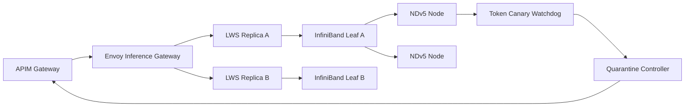
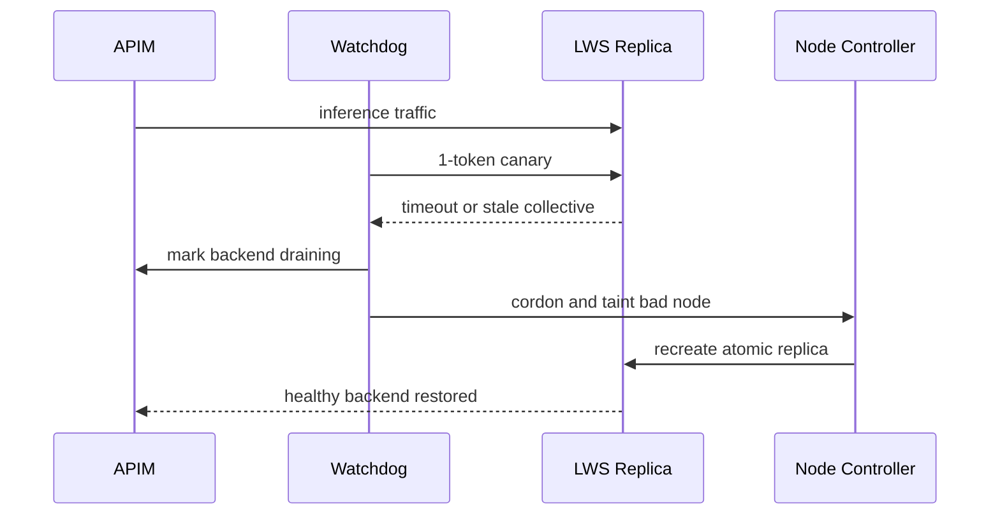

# Enterprise multi-node frontier and MoE serving selection FAQ
> Topic ID: #476
> Section: 3.2 model hosting, tiered routing, and GPU orchestration
> Audience: enterprise AI platform architects, GPU cluster SRE teams, and inference engineering teams
> Goal: provide stable online inference for `400B` to `1T` scale models under private-network and regulated constraints

## 1 Production problem and multi-node instability root causes
Serving `405B` to `671B` class models with `128K` context often exceeds single-node `8 × H100` memory and requires `2` to `4` nodes per inference replica.
The challenge is not only adding nodes, but keeping communication topology, fault detection, and atomic recovery aligned.
On standard Ethernet, cross-node `TP=16` or `EP=16` can dominate decode latency and collapse interactive throughput.
Even on `NDv5` InfiniBand, topology-blind placement can scatter ranks across distant racks and amplify `AllToAll` tail latency.
A subtle failure mode is silent collective hang, where one degraded rank drives group throughput to `0 tok/s` while basic HTTP health still returns success.
Without active token-path validation, upstream gateways continue routing to dead backends and blackhole traffic for extended periods.
Production architecture must therefore combine topology-aligned scheduling, end-to-end generation canaries, atomic group recreation, and fast traffic failover.

## 2 Why traditional Kubernetes deployment semantics fail at frontier scale
Conventional `Deployment` semantics optimize independent pod elasticity, not tightly coupled multi-rank lifecycle guarantees.
In multi-node inference, one failed rank invalidates the whole replica, so partial pod survival is operationally misleading.
Basic port or lightweight HTTP probes do not verify true forward-pass collective health and often miss `NCCL` deadlocks.
Default schedulers also lack explicit fabric-topology objectives, which can increase hop count and communication variance.
Frontier serving therefore requires group-aware and topology-aware control, not a direct reuse of stateless microservice patterns.

## 3 Four architecture patterns
Pattern A uses `AKS NDv5 + InfiniBand RDMA + LeaderWorkerSet + Kueue` with active `NCCL` watchdog and quarantine automation.
Pattern B uses `Azure AI Foundry` managed `PTU/Serverless`, offloading multi-node fabric and replacement operations to managed control planes.
Pattern C uses `NC` series Ethernet pools with `PP=2/4`, targeting batch-heavy or latency-relaxed workloads.
Pattern D anti pattern uses cross-node TCP `TP=16` with plain `Deployment` and static liveness probing.

## 4 Twelve dimension quantified comparison matrix
| Dimension | Pattern A NDv5 IB topology aligned | Pattern B Foundry managed | Pattern C NC Ethernet PP | Pattern D anti pattern |
|---|---|---|---|---|
| Interactive `TPOT P95` | `18` to `24 ms` | `20` to `32 ms` | `48` to `75 ms` | `140` to `290 ms` |
| `tok/s/GPU` | high | high to medium | medium | low |
| Effective cross-node fabric | `3.2 Tbps/node` class | managed abstraction | `50` to `80 Gbps` | `50` to `80 Gbps` |
| Silent hang recovery MTTR | below `90 s` | managed replacement | `5` to `15 min` | above `30 min` |
| Atomic group restart semantics | strong | managed | medium | weak |
| Private-weight control | high | catalog dependent | high | high |
| Sovereign compliance fit | strong | medium to high | medium | weak |
| Minimum fleet commitment | medium high | low to medium | medium | low |
| SRE skill bar | high | low | medium | appears low then high |
| Failure blast radius | low controlled | medium | medium | high |
| Three year blended TCO | `7M` to `22M` | `6M` to `20M` | `5M` to `16M` | `9M` to `27M` |
| Recommendation | sovereign primary path | managed-first scenarios | latency-tolerant supplement | disallow and migrate |

## 5 Pattern A primary path NDv5 InfiniBand with group-aware scheduling
Pattern A treats each model-parallel replica as the scheduling unit rather than independent pods.
`LeaderWorkerSet` enforces leader-worker lifecycle coherence so degraded groups are rebuilt atomically instead of lingering half alive.
`Kueue` with topology labels can pack group members onto the same InfiniBand leaf domain to reduce cross-rack hop penalties.
A common strategy keeps intra-node `TP=8` on NVLink and uses cross-node `EP` or higher `TP` over `3.2 Tbps` class fabric.
Health is validated through active `1-token` generation canaries instead of passive HTTP probes.
On repeated canary failures, controllers drain gateway traffic, taint degraded nodes, and recreate groups for fast service restoration.
This pattern is appropriate where enterprises must control model weights, network boundaries, and audit evidence end to end.
In large multi-tenant estates, mapping replica groups to business-priority labels helps reserve low-hop topology domains for latency-critical tenants during peak contention windows.
It is also important to version `NCCL` tuning profiles together with firmware, drivers, and network-operator releases so performance regressions are traceable rather than anecdotal.

## 6 Pattern B primary path Foundry managed multi-node serving
Pattern B externalizes complex multi-node orchestration and replacement logic to managed service layers.
Teams can focus on model onboarding, capacity governance, and policy controls instead of low-level fabric operations.
For catalog-supported frontier models, managed `PTU/Serverless` can significantly shorten platform delivery cycles.
Limitations appear when organizations need proprietary `671B` continued-pretrained weights or unsupported custom runtime stacks.
In practice, many enterprises use Pattern B for standard models and retain Pattern A or C for specialized sovereign workloads.
Even with managed serving, teams should keep a minimum self-hosted recovery baseline to validate migration paths, policy portability, and evidence-export workflows.
For audit-heavy sectors, the key question is not only SLA attainment but also whether tenant-isolation traces and abnormal-event artifacts remain continuously queryable.

## 7 Pattern C path NC-series Ethernet pipeline parallelism
Pattern C leverages broader regional availability of `NC` pools and constrains cross-node communication through pipeline boundaries.
By emphasizing `PP=2/4`, it avoids the high-frequency `AllToAll` cost of MoE expert parallel interactive serving.
For batch-heavy and latency-relaxed processing, this can be cost-efficient with acceptable throughput.
For low-latency agent interactions, however, `TPOT` remains materially higher than InfiniBand-first designs.
Pattern C is best treated as a secondary-region or batch supplement, not the sole interactive primary path.
If interactive traffic must partially land on C, strict request-class routing is recommended so long-context and high-complexity prompts remain on A or B pools.
Dynamic microbatch tuning by time-of-day can further balance throughput during low load and queue latency during spikes.

## 8 Pattern D anti pattern risks
The first anti pattern forces cross-node TCP `TP=16`, where communication cost overwhelms decode efficiency.
The second anti pattern runs multi-node replicas under plain `Deployment`, leaving zombie partial groups after failures.
The third anti pattern relies on static port probes that cannot detect collective-path deadlocks.
The fourth anti pattern omits automated quarantine, allowing degraded nodes to keep receiving traffic.
These configurations may appear acceptable in small tests but are unstable in real peak and fault conditions.

## 9 Mermaid sovereign multi-node serving topology


## 10 Mermaid silent hang detection and atomic recovery sequence


## 11 Quantitative Q1 to Q6 worked examples
Q1 cross-node communication time.
`T_comm = 2 * Bytes_act / BW_fabric + Latency_hop`.
With high-bandwidth RDMA this can stay near sub-millisecond per layer, while lower-bandwidth TCP can rise to multi-millisecond.
Q2 per-token communication accumulation.
If decode requires communication across `80` layers, per-layer gaps accumulate linearly into large `TPOT` differences.
Q3 availability capacity formula.
`N_total = R_replicas * K_nodes_per_replica + 1_hot_spare`.
A hot spare reduces rebuild wait and improves failure recovery predictability.
Q4 watchdog boundary condition.
`T_watchdog < T_gateway_timeout`.
If gateway timeout is `5 s`, watchdog should detect and trigger draining within a smaller bound.
Q5 failure blast radius behavior.
Group semantics contain failure to one replica group, while non-group orchestration can amplify queueing globally.
Q6 efficiency decision metric.
Track `tok/s/GPU` together with `TPOT P95` to avoid throughput-only optimization that harms interactive quality.

## 12 Code block one LeaderWorkerSet two-node serving unit
```yaml
apiVersion: leaderworkerset.x-k8s.io/v1
kind: LeaderWorkerSet
metadata:
  name: frontier-671b
spec:
  replicas: 3
  leaderWorkerTemplate:
    size: 2
    leaderTemplate:
      spec:
        containers:
          - name: vllm
            image: ghcr.io/org/frontier-671b:2026.11.27
            resources:
              limits:
                nvidia.com/gpu: "8"
            startupProbe:
              httpGet: { path: /health_generate, port: 8080 }
    workerTemplate:
      spec:
        containers:
          - name: worker
            image: ghcr.io/org/frontier-671b:2026.11.27
            resources:
              limits:
                nvidia.com/gpu: "8"
```

## 13 Code block two Bicep NDv5 pool with spare capacity
```bicep
resource aks 'Microsoft.ContainerService/managedClusters@2024-02-01' existing = {
  name: aksName
}

resource ndpool 'Microsoft.ContainerService/managedClusters/agentPools@2024-02-01' = {
  name: '${aks.name}/ndv5pool'
  properties: {
    vmSize: 'Standard_ND96isr_H100_v5'
    count: 7
    mode: 'User'
    availabilityZones: [
      '1'
      '2'
    ]
    osDiskType: 'Ephemeral'
    scaleDownMode: 'Delete'
    nodeLabels: {
      ib_topology: 'leaf-a'
      frontier_role: 'inference'
    }
  }
}
```

## 14 Code block three active generation watchdog and quarantine loop
```python
import time
import requests

def health_generate(url: str, timeout_s: float = 3.5) -> bool:
    payload = {"prompt": "ping", "max_tokens": 1, "temperature": 0.0}
    t0 = time.time()
    try:
        r = requests.post(url, json=payload, timeout=timeout_s)
        if r.status_code != 200:
            return False
        ok = "choices" in r.json()
    except Exception:
        return False
    dt = time.time() - t0
    return ok and dt < timeout_s

def quarantine(node_name: str, k8s):
    k8s.cordon(node_name)
    k8s.taint(node_name, "nccl-hang=true:NoSchedule")

def reconcile(endpoint: str, node: str, k8s):
    if not health_generate(endpoint):
        quarantine(node, k8s)
        k8s.restart_leaderworkerset("frontier-671b")
```

## 15 Enterprise scenarios and three year TCO
### 15.1 Scenario A sovereign European banking legal and regulatory reasoning
This platform serves a continued-pretrained `671B` model inside private VNet with three two-node LWS replicas on `ND96isr_H100_v5`.
Before topology-aware controls, peak windows saw `TPOT P95` spikes above `180 ms` and repeated silent collective outages.
After moving to Pattern A with leaf-aligned scheduling and token canary quarantine, `TPOT P95` stabilized near `22 ms`.
Recovery shifted from manual multi-minute diagnosis to automated sub-minute to minute-level failover behavior.
After stabilization, the team introduced weekly topology-drift reports that compare intended versus observed rack placement and correlate deviation with latency anomalies.
This made tail-jitter investigations faster and reduced repeated paging caused by hidden placement drift.
### 15.2 Scenario B global retail hybrid managed strategy
This organization places standard frontier workloads on Pattern B managed `PTU/Serverless` for operational simplicity.
For unsupported proprietary models, it maintains a limited Pattern C batch pool in secondary regions.
The resulting hybrid profile balances latency, regional availability, and platform operating burden.
From a financial perspective, the organization tracks managed spend, quota scarcity premiums, and on-call engineering cost in one decision model.
Product stakeholders receive a dual-axis dashboard that explains why certain requests must stay on high-performance paths despite higher unit cost.
### 15.3 Three tier three year blended TCO
| Tier | Model and replica scale | Recommended mix | Three year blended TCO |
|---|---:|---|---:|
| Tier 1 | `405B` dual replica | Pattern B primary | `6.8M` USD |
| Tier 2 | `671B` triple replica | Pattern A primary | `13.6M` USD |
| Tier 3 | `671B+` multi-region | Pattern A plus C | `21.9M` USD |
### 15.4 D0 D1 D2 runbook with 18 actions
- **D0-1** Define model memory envelope and parallelism boundaries.
- **D0-2** Plan `NDv5` quota, region, and zone placement.
- **D0-3** Publish LWS group-semantic templates and release gates.
- **D0-4** Define IB topology labels and scheduling constraints.
- **D0-5** Define token canary thresholds and alert severity mapping.
- **D0-6** Reserve hot spare nodes and failover contracts.
- **D1-1** Roll out LWS and Kueue topology queue in canary mode.
- **D1-2** Validate leaf-aligned placement hit ratio and fabric metrics.
- **D1-3** Execute silent-hang fault injection and auto-recovery drills.
- **D1-4** Integrate APIM backend draining and restore controls.
- **D1-5** Calibrate watchdog timeout against gateway timeout budgets.
- **D1-6** Standardize incident evidence and audit trail templates.
- **D2-1** Review weekly `TPOT P95` and `tok/s/GPU` trends.
- **D2-2** Review weekly cross-node communication error and jitter.
- **D2-3** Review monthly quarantine trigger quality and precision.
- **D2-4** Review monthly hot spare utilization and cost profile.
- **D2-5** Review quarterly managed versus self-hosted mix strategy.
- **D2-6** Review quarterly threat and recovery drill scripts.
Over time these controls convert frontier multi-node serving from fragile black-box behavior into observable and recoverable operations.
Governance should track model version, communication stack version, and driver version together to prevent hidden incompatibility drift.
When communication tails rise, inspect topology drift and link health before increasing GPU count.
High-priority business lines should maintain recurring failure drills covering silent hang, link degradation, and node loss.
The strategic target is stable low-latency frontier interaction under sovereign and compliance boundaries.

Sources fetched on 2026 11 27
AKS GPU and NDv5 guidance
https://learn.microsoft.com/azure/aks/gpu-cluster
Kubernetes LeaderWorkerSet
https://github.com/kubernetes-sigs/lws
Kueue gang scheduling
https://kueue.sigs.k8s.io/
Azure AI Foundry model hosting
https://learn.microsoft.com/azure/ai-foundry/
NCCL user guide
https://docs.nvidia.com/deeplearning/nccl/user-guide/docs/
