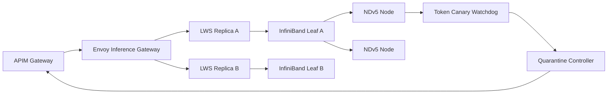
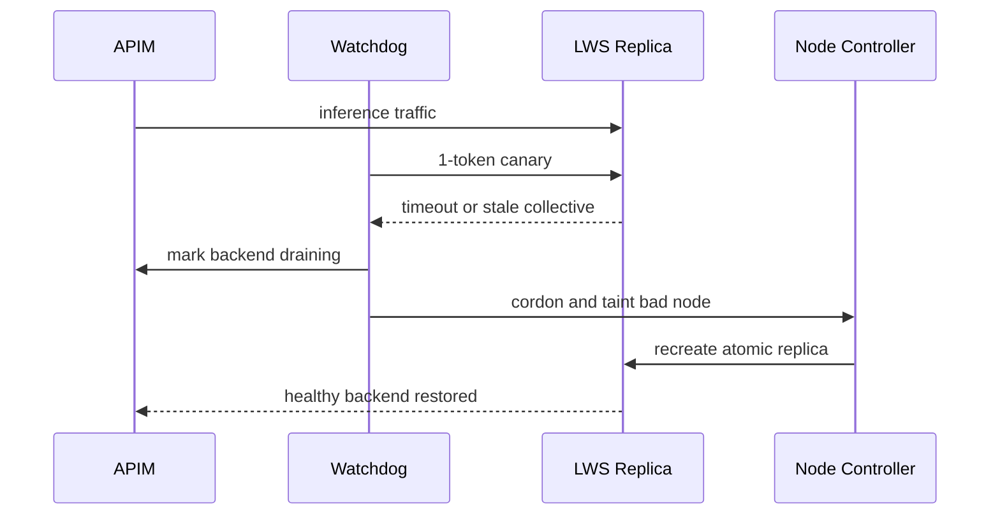

# 企业多节点 Frontier 与 MoE 模型服务选型 FAQ
> Topic ID: #476
> Section: 3.2 模型托管、分级路由与 GPU 编排
> Audience: 企业 AI 平台架构师、GPU 集群 SRE 与推理工程团队
> Goal: 在私有网络与强监管前提下稳定承载 `400B` 到 `1T` 级模型在线推理

## 1 生产问题与跨节点推理失稳根因
当企业服务 `405B` 到 `671B` 级模型并要求 `128K` 上下文时，单机 `8 × H100` 显存通常不足，需要 `2` 到 `4` 节点组成一个推理副本。
问题并不止于“多加节点”，而是跨节点通信、拓扑放置、故障探测和原子重建必须同时成立。
在标准以太网下直接做跨节点 `TP=16` 或 `EP=16`，每 token 都会叠加高通信开销，导致 `TPOT` 大幅恶化。
即便切到 `NDv5` InfiniBand，若调度器忽略机架与 TOR 拓扑，副本可能被散布到远距离链路，`AllToAll` 尾延迟显著抬升。
更隐蔽的风险是集体通信静默挂死，某个 rank 卡住后全组吞吐跌为 `0 tok/s`，但 rank-0 HTTP 健康探针仍可能返回 `200`。
这类黑洞会让上层网关持续把流量打到失活后端，直到人工介入才恢复，实际中断常以十分钟计。
因此生产架构必须实现“拓扑对齐调度 + 端到端 token 活性探针 + 原子组重建 + 快速流量切换”的闭环。

## 2 传统 Kubernetes 部署范式为何在 Frontier 规模失效
传统 `Deployment` 语义强调单 Pod 弹性，不保证多 Pod 同时就绪与同生共死，不适合跨节点强耦合集体推理。
在多节点推理中，任一 rank 不可用都会使整体服务不可用，部分 Pod 仍存活没有价值，反而误导健康系统。
常规 `livenessProbe` 只检查端口或轻量 HTTP，不验证真实前向计算路径，难以发现 `NCCL` 集体死锁。
此外默认调度策略缺少网络拓扑约束，可能把同副本节点放在跨叶交换路径上，抬高通信 hop 数。
这说明 Frontier 在线服务不是简单“把训练集群改成推理集群”，而是要引入面向组语义与拓扑语义的调度控制。

## 3 四种架构路径总览
Pattern A 采用 `AKS NDv5 + InfiniBand RDMA + LeaderWorkerSet + Kueue`，并配套 `NCCL` 活性看门狗与自动隔离。
Pattern B 采用 `Azure AI Foundry` 托管 `PTU/Serverless`，把多节点织网与故障替换运维外包给托管平台。
Pattern C 采用 `NC` 系列以太网节点做 `PP=2/4` 管线并行，适合批处理或延迟容忍场景。
Pattern D 反模式是跨节点 TCP `TP=16` 加普通 `Deployment`，再依赖静态端口探针判断健康。

## 4 十二维量化对比矩阵
| 维度 | Pattern A NDv5 IB 拓扑对齐 | Pattern B Foundry 托管 | Pattern C NC 以太网 PP | Pattern D 反模式 |
|---|---|---|---|---|
| `TPOT P95` 交互推理 | `18` 到 `24 ms` | `20` 到 `32 ms` | `48` 到 `75 ms` | `140` 到 `290 ms` |
| `tok/s/GPU` | 高 | 高到中 | 中 | 低 |
| 跨节点带宽有效值 | `3.2 Tbps/node` 级 | 托管抽象 | `50` 到 `80 Gbps` | `50` 到 `80 Gbps` |
| 集体挂死恢复 MTTR | `< 90 s` | 托管侧控制 | `5` 到 `15 min` | `30 min+` |
| 组语义原子重建 | 强 | 托管内建 | 中 | 弱 |
| 私有权重可控性 | 高 | 受目录支持约束 | 高 | 高 |
| Sovereign 合规适配 | 强 | 中到高 | 中 | 弱 |
| 最小承诺资源 | 中高 | 低到中 | 中 | 低 |
| SRE 技能门槛 | 高 | 低 | 中 | 表面低后期高 |
| 故障爆炸半径 | 低可控 | 中 | 中 | 高 |
| 三年综合 TCO | `7M` 到 `22M` | `6M` 到 `20M` | `5M` 到 `16M` | `9M` 到 `27M` |
| 推荐结论 | Sovereign 主路径 | 托管优先场景 | 延迟容忍补充 | 禁用并迁移 |

## 5 Pattern A 主路径 NDv5 InfiniBand 与组语义调度
Pattern A 的核心是把“模型并行组”视为调度最小单元，而不是把 Pod 视为独立实例。
`LeaderWorkerSet` 提供组内 leader 与 worker 生命周期一致性，任一关键成员失活可触发整组重建，避免僵尸半活副本。
`Kueue` 结合拓扑标签可约束同一推理组优先落在同 IB 叶交换域，减少跨机架 hop 造成的尾延迟放大。
推理并行通常采用单机 `TP=8` 走 NVLink，跨节点采用 `EP` 或更高 `TP`，借助 `3.2 Tbps` 级链路维持低通信占比。
端到端健康不再只看 HTTP，而是通过 `1-token` 生成 canary 验证前向路径与集体通信是否真实可用。
当 canary 连续失败，控制器会先摘除网关流量，再 taint 问题节点并触发组级重建，实现秒级到分钟级恢复。
该路径适合必须掌控权重、网络与审计边界的金融、政企、医疗等高监管场景。
在大规模多租户环境中，建议将副本组与业务租户映射关系显式建模到调度标签中，使高优先级租户优先占用低 hop 拓扑域，避免低价值离线作业挤占关键交互副本的链路质量。
此外应把 `NCCL` 参数模板与节点硬件清单绑定版本发布，确保驱动、固件、网络算子和容器镜像同步演进，减少“配置漂移导致性能突降”这类难定位问题。

## 6 Pattern B 主路径 Foundry 托管多节点能力
Pattern B 把复杂多节点编排交给托管平台，企业主要关注模型接入、容量规划与策略治理。
托管能力可降低自建 `NCCL`、网络拓扑与节点修复运维负担，缩短上线周期并减少平台值班复杂度。
对于目录内支持模型，`PTU` 与 Serverless 能提供较快落地路径，特别适合想先验证业务价值的团队。
限制在于自定义权重或特殊架构支持范围，若企业要承载专有 `671B` 持续预训练模型，托管目录未必覆盖。
因此 Pattern B 常作为标准模型主线，而超定制模型仍需 Pattern A 或 C 兜底。
采用 Pattern B 时也应保留最小自建能力作为灾备演练基线，至少验证模型回迁、提示词安全策略迁移与审计证据导出流程，避免在托管能力变更时出现治理盲区。
对金融审计团队而言，托管模型的关键不是仅看 SLA，而是验证租户隔离、访问留痕与异常解释数据是否可持续获取，否则后续合规复盘会受到取证颗粒度限制。

## 7 Pattern C 路径 NC 系列以太网管线并行
Pattern C 使用 `NC` 系列在更广区域获得 GPU 供给，通过 `PP=2/4` 降低跨节点通信密度。
该方案把跨节点通信限制在激活传递，避免 MoE `AllToAll` 的高频高体积交换，适合离线批处理和延迟容忍任务。
在交互式低延迟场景，`TPOT` 往往明显高于 IB 方案，体验与吞吐难与 Pattern A 持平。
若企业受区域配额限制且业务可接受更高延迟，Pattern C 是成本与可获得性折中路径。
建议把 C 作为次级区域或批处理池，而非唯一主生产路径。
若必须在 C 上承载部分交互请求，应引入严格的请求分类路由，把长上下文高复杂问题留在 A 或 B，把短上下文可降级请求下沉到 C，以避免整体体验被最慢链路拖累。
同时可对 PP microbatch 尺寸做动态调优，在流量低谷提升吞吐，在高峰时段压低排队延迟，形成更可控的时段化性能治理策略。

## 8 Pattern D 反模式风险
反模式第一类是跨节点 TCP 强行 `TP=16`，通信占比吞噬推理时间，吞吐与时延双重恶化。
反模式第二类是用普通 `Deployment` 承载多节点推理组，出现部分 Pod 存活导致误判健康。
反模式第三类是只看端口探针，不做实际生成探测，集体死锁无法快速暴露。
反模式第四类是缺少自动隔离与流量摘除，问题节点可持续吸收请求形成黑洞。
这些配置在小压测可能可用，但在生产高峰与故障条件下极不稳定。

## 9 Mermaid Sovereign 多节点推理拓扑


## 10 Mermaid 静默挂死检测与原子恢复时序


## 11 量化推导 Q1 到 Q6
Q1 跨节点通信时间。
`T_comm = 2 * Bytes_act / BW_fabric + Latency_hop`。
在 IB RDMA 下单位层通信可接近亚毫秒，而低带宽 TCP 下会放大到毫秒级。
Q2 全 token 通信开销。
若每 token 需跨 `80` 层通信，单层差异会被线性累积并直接抬高 `TPOT`。
Q3 可用性容量公式。
`N_total = R_replicas * K_nodes_per_replica + 1_hot_spare`。
热备节点能显著缩短组级重建等待时间。
Q4 看门狗超时边界。
`T_watchdog < T_gateway_timeout`。
若网关超时 `5 s`，看门狗应在更短窗口识别失活并触发摘流。
Q5 故障爆炸半径。
有组语义时故障局限于单副本组，无组语义时可能扩散为全局排队。
Q6 成本效率判定。
建议同时跟踪 `tok/s/GPU` 与 `TPOT P95`，避免只追求吞吐忽略交互体验。

## 12 代码块一 LeaderWorkerSet 双节点推理组
```yaml
apiVersion: leaderworkerset.x-k8s.io/v1
kind: LeaderWorkerSet
metadata:
  name: frontier-671b
spec:
  replicas: 3
  leaderWorkerTemplate:
    size: 2
    leaderTemplate:
      spec:
        containers:
          - name: vllm
            image: ghcr.io/org/frontier-671b:2026.11.27
            resources:
              limits:
                nvidia.com/gpu: "8"
            startupProbe:
              httpGet: { path: /health_generate, port: 8080 }
    workerTemplate:
      spec:
        containers:
          - name: worker
            image: ghcr.io/org/frontier-671b:2026.11.27
            resources:
              limits:
                nvidia.com/gpu: "8"
```

## 13 代码块二 Bicep NDv5 节点池与热备
```bicep
resource aks 'Microsoft.ContainerService/managedClusters@2024-02-01' existing = {
  name: aksName
}

resource ndpool 'Microsoft.ContainerService/managedClusters/agentPools@2024-02-01' = {
  name: '${aks.name}/ndv5pool'
  properties: {
    vmSize: 'Standard_ND96isr_H100_v5'
    count: 7
    mode: 'User'
    availabilityZones: [
      '1'
      '2'
    ]
    osDiskType: 'Ephemeral'
    scaleDownMode: 'Delete'
    nodeLabels: {
      ib_topology: 'leaf-a'
      frontier_role: 'inference'
    }
  }
}
```

## 14 代码块三 端到端生成看门狗与隔离控制
```python
import time
import requests

def health_generate(url: str, timeout_s: float = 3.5) -> bool:
    payload = {"prompt": "ping", "max_tokens": 1, "temperature": 0.0}
    t0 = time.time()
    try:
        r = requests.post(url, json=payload, timeout=timeout_s)
        if r.status_code != 200:
            return False
        ok = "choices" in r.json()
    except Exception:
        return False
    dt = time.time() - t0
    return ok and dt < timeout_s

def quarantine(node_name: str, k8s):
    k8s.cordon(node_name)
    k8s.taint(node_name, "nccl-hang=true:NoSchedule")

def reconcile(endpoint: str, node: str, k8s):
    if not health_generate(endpoint):
        quarantine(node, k8s)
        k8s.restart_leaderworkerset("frontier-671b")
```

## 15 企业落地场景与三年 TCO
### 15.1 场景 A 欧洲主权银行法律与监管推理平台
该平台在私有 VNet 内服务持续预训练的 `671B` 模型，部署为 `3` 组双节点 LWS 副本，总计 `6` 台 `ND96isr_H100_v5`。
早期拓扑无约束部署导致 `TPOT P95` 在业务高峰抖动到 `180 ms` 以上，并出现多次静默集体挂死。
切换 Pattern A 后通过同叶调度与 token canary 自动隔离，`TPOT P95` 稳定在 `22 ms` 左右。
故障恢复由人工分钟级排障缩短到自动化亚分钟到分钟级切换，显著降低黑洞持续时间。
平台上线后还建立了“拓扑漂移周报”，每周自动比对实际落位与目标叶交换域一致率，并把偏移事件与延迟异常做关联分析，从源头减少看似随机的尾延迟抖动问题。
针对监管问询，该团队可直接出具每次故障的自动摘流时间线、组重建事件和流量恢复证据，显著降低跨部门解释成本并提升审计通过效率。
### 15.2 场景 B 全球零售企业混合托管策略
该企业标准工作负载优先放在 Pattern B 托管 `PTU/Serverless`，以降低平台运维负担与交付周期。
对未被托管目录覆盖的专有模型，保留小规模 Pattern C 批处理池作为区域补充。
通过分层策略，企业在性能、可获得性与治理成本之间取得平衡，并保持跨区域业务连续性。
在采购与预算层面，该企业把托管成本、配额稀缺性成本与值班人力成本统一纳入同一财务模型，每季度复盘组合比例，避免单一成本项驱动导致架构偏离业务目标。
面向业务方沟通时，平台团队提供“体验与成本双轴看板”，帮助产品团队理解为何某些请求必须走 A 路径而不能全部下沉到低成本池，从而减少策略争议。
### 15.3 三档三年综合 TCO
| 档位 | 模型与副本规模 | 推荐组合 | 三年综合 TCO |
|---|---:|---|---:|
| Tier 1 | `405B` 双副本 | Pattern B 主线 | `6.8M` 美元 |
| Tier 2 | `671B` 三副本 | Pattern A 主路径 | `13.6M` 美元 |
| Tier 3 | `671B+` 多区域 | Pattern A 加 C | `21.9M` 美元 |
### 15.4 D0 D1 D2 运行手册共 18 项
- **D0-1** 明确目标模型显存需求与并行策略边界。
- **D0-2** 规划 `NDv5` 配额、区域与可用区分布。
- **D0-3** 建立 LWS 组语义部署模板与发布门禁。
- **D0-4** 定义 IB 拓扑标签与调度约束策略。
- **D0-5** 设计 token canary 与告警阈值体系。
- **D0-6** 预留热备节点并定义故障切换流程。
- **D1-1** 灰度上线 LWS 与 Kueue 拓扑队列。
- **D1-2** 验证同叶放置命中率与通信指标。
- **D1-3** 执行静默挂死注入与自动恢复演练。
- **D1-4** 对接 APIM 后端摘流与恢复逻辑。
- **D1-5** 校准看门狗超时与网关超时关系。
- **D1-6** 固化故障证据与审计追踪模板。
- **D2-1** 每周复核 `TPOT P95` 与 `tok/s/GPU`。
- **D2-2** 每周复核跨节点通信错误率与抖动。
- **D2-3** 每月复核自动隔离触发质量。
- **D2-4** 每月复核热备容量利用率与成本。
- **D2-5** 每季度复核托管与自建组合策略。
- **D2-6** 每季度更新威胁模型与恢复演练脚本。
通过持续运行上述机制，企业可把多节点 Frontier 推理从“高风险黑盒”转化为可观测、可恢复、可审计的工程系统。
平台治理应同步覆盖模型版本、通信栈版本与驱动版本，避免版本漂移诱发隐性集体故障。
当检测到跨节点通信尾延迟持续抬升，应优先排查拓扑漂移与链路健康，而非盲目增配 GPU。
对重要业务线建议建立专属故障演练日历，把静默挂死、链路退化、节点失联列为必测项。
最终目标是在主权与合规边界内，实现高参数模型的稳定低延迟交互服务能力，并把这一能力沉淀为可复制的企业级标准平台资产，支持后续更多高价值智能体场景以更低风险、更高确定性接入。
若企业希望把这一能力规模化复制到更多业务线，建议同步建设统一的多节点推理架构评审机制，将模型并行策略、拓扑落位、主动健康探测、自动隔离恢复、容量热备预算、网关摘流策略、审计证据留存、托管与自建组合决策全部纳入同一评审模板，并要求每次版本升级前完成最坏链路故障演练与回滚演练，通过可量化门禁确保平台在扩容、故障、合规三重压力下仍保持一致可靠行为。
同时可建立跨团队知识库记录每次 `TPOT` 回归与 `NCCL` 事件的根因和修复动作，把经验固化为可执行检查清单并反哺到 IaC 与发布流水线，从组织层面持续降低重复性事故概率与夜间值班压力。
在年度容量规划时，建议把多节点推理的网络健康预算、热备节点预算和演练时间预算写入正式经营计划，以确保架构可靠性目标得到持续资源保障而非临时应急投入。
通过把这些治理要求制度化并与季度评审挂钩，平台团队能够持续保持性能稳定与恢复韧性的双重达标。

来源抓取日期 2026 11 27
AKS GPU and NDv5 guidance
https://learn.microsoft.com/azure/aks/gpu-cluster
Kubernetes LeaderWorkerSet
https://github.com/kubernetes-sigs/lws
Kueue gang scheduling
https://kueue.sigs.k8s.io/
Azure AI Foundry model hosting
https://learn.microsoft.com/azure/ai-foundry/
NCCL user guide
https://docs.nvidia.com/deeplearning/nccl/user-guide/docs/
