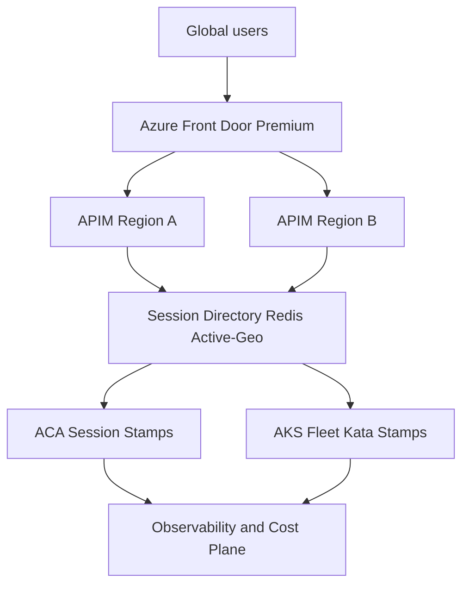
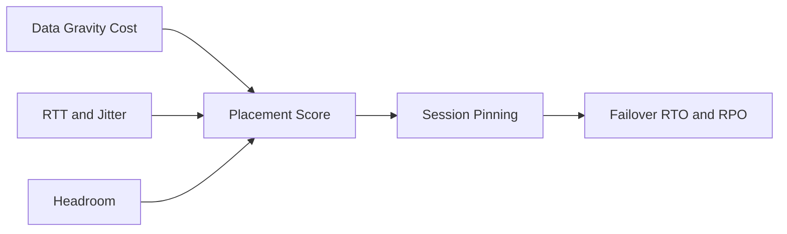
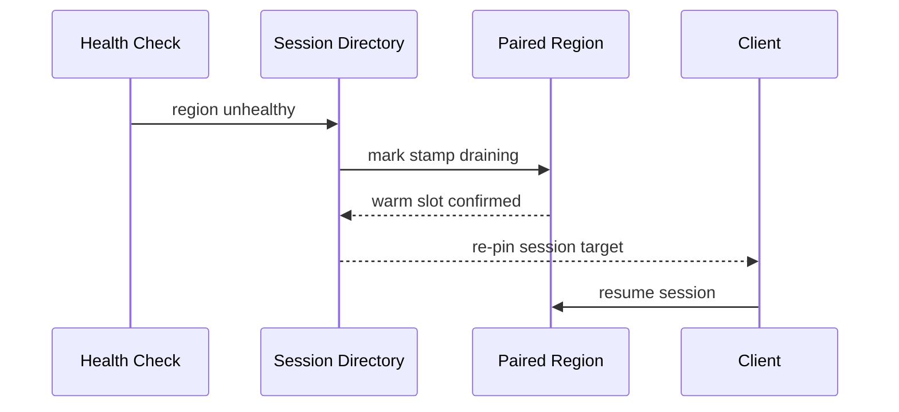

# Enterprise multi-region geo-distributed sandbox placement and session-pinning selection FAQ: Front Door ACA stamps vs AKS Fleet Kata vs compute-to-data

> 🌐 **Language Switch**: [中文](./multi-region-geo-distributed-sandbox-placement-session-pinning-front-door-aca-stamps-vs-aks-fleet-kata-vs-compute-to-data-selection-faq.md) | **English (current)**
> **Audience**: Cloud & AI Solution Architects, platform engineering, SRE, FinOps, and data-sovereignty governance teams.
> **Problem frame**: global agent sandboxes must balance latency, residency rules, failover guarantees, and cross-region transfer economics.

## 1. Why geo-distributed sandbox placement is not only nearest-region routing

Many programs treat global sandbox placement as nearest-region routing, but production decisions must also include sovereignty, data gravity, capacity headroom, and failover cost.
If RTT is optimized alone, sessions may execute outside required legal boundaries and trigger compliance risk.
If residency is enforced without latency controls, user experience can degrade and session abandonment can rise.
A production design therefore needs a computable placement score and deterministic session pinning rather than one-dimensional routing.

## 2. Four architecture options and practical boundaries

Architecture A uses `Front Door Premium + APIM regional gateways + Redis Active-Geo` as a global session directory.
Architecture B uses `AKS Fleet + Kata` active-active stamps with stronger runtime and network customization.
Architecture C enforces compute-to-data execution near `OneLake/ADLS/PTU` to minimize cross-region data movement.
Architecture D centralizes sandbox compute in one hub and replicates artifacts geographically for lower SRE overhead at modest scale.

## 3. Global reference topology with session directory and regional stamps



A shared session directory control plane lets multiple runtime options use one placement contract and one pinning model.
That reduces migration risk when runtime strategy changes over time.

## 4. Architecture A: global session-directory gateway with ACA Dynamic Sessions

A scores turn-1 placement using `ResidencyMask * (w1*RTT + w2*DataGravity + w3*Headroom)` and persists `session_id -> region_stamp`.
Directory lookup can remain under `<2ms`, and subsequent turns keep deterministic pinning to avoid cross-region jitter.
With paired-region `RA-GZRS` hydration, draining or outage events can restore workspace context in secondary regions.
A is fast to roll out and governance-friendly, with less kernel-level customization than AKS-heavy designs.

## 5. Architecture B: AKS Fleet active-active with Kata stamps

B uses `ClusterResourcePlacement` and Gateway API consistent hashing to sustain continent-level placement and isolation controls.
Combined with `ANF` cross-region replication and `ACR` geo-replication, B can target `RPO <= 5 min` and `RTO <= 30 s` in mature setups.
B is the strongest option for custom kernel controls, GPU specialization, and strict network segmentation.
The tradeoff is higher operational complexity and a larger SRE/platform skill footprint.

## 6. Architecture C: compute-to-data sovereign pinning with backbone acceleration

C keeps sandbox execution in the same region as `OneLake/ADLS/PTU` assets to avoid cross-region data egress.
For data-heavy workloads this can replace `$0.02–$0.087/GB` transfer charges with effectively local `$0/GB` movement.
Front Door private connectivity and backbone routing can still improve interactive channel stability.
C is strong for regulated sectors but has less flexibility for globally optimized user-latency routing.

## 7. Architecture D: single-hub sandbox pool with geo-replicated artifacts

D centralizes sandbox compute in one primary region and replicates artifacts and images to secondary regions.
For workloads below `500` daily sessions and moderate residency constraints, D often minimizes SRE staffing burden.
Regional Dev Box takeover pools can provide human continuity during major incidents.
Its weakness is larger latency variance for distant users and a wider impact radius during hub failures.

## 8. Core formulas: data gravity, warm-pool fragmentation tax, and failover math

Data-gravity break-even can be estimated as `Breakeven_GB = Value_per_ms * (RTT_remote-RTT_local) * QPS * 3600 / EgressPrice_per_GB`.
Multi-stamp warm-pool fragmentation can be approximated by `FragmentationTax ≈ BaseWarmPool * (sqrt(K)-1)` where `K` is stamp count.
Failover window can be modeled as `RTO_total = Detect + DirectoryFailover + SessionHydration`, with `RPO` bounded by replication cadence.
These metrics should be optimized together to avoid hidden cost or compliance regressions.



## 9. Twelve-dimension quantitative comparison matrix

| Dimension | Architecture A ACA directory | Architecture B AKS Fleet Kata | Architecture C compute-to-data | Architecture D single hub |
|---|---|---|---|---|
| Turn-1 placement latency | `8–20ms` | `12–28ms` | `10–24ms` | `4–12ms` |
| Session directory lookup latency | `<2ms` | `2–4ms` | `2–4ms` | `1–2ms` |
| Session pinning stability | `99.2%–99.7%` | `99.4%–99.8%` | `99.1%–99.6%` | `98.5%–99.2%` |
| Cross-region data egress cost pressure | Medium | Medium-high | Low | Medium-high |
| Typical transfer unit cost | `$0.02–$0.05/GB` | `$0.02–$0.05/GB` | `$0/GB` local-first | `$0.02–$0.087/GB` |
| Warm-pool elasticity | High | Very high | Medium | Medium-high |
| Target RPO | `<=10min` | `<=5min` | `<=10min` | `<=15min` |
| Target RTO | `45–120s` | `<=30s` | `60–150s` | `90–240s` |
| Runtime isolation strength | Medium-high | High | Medium-high | Medium |
| Platform operations complexity | Medium | High | Medium-high | Low |
| Daily session fit | `500–10000` | `1000–15000` | `500–12000` | `<500` optimized |
| 3-year TCO competitiveness | Medium-high | Medium | Medium-high | High at low scale |

## 10. Failover orchestration between directory and paired stamps



Separate new-session diversion from in-flight session migration to prevent recovery storms during peak load.
Tenant-level migration concurrency caps are essential to avoid one large tenant monopolizing failover capacity.

## 11. Production Bicep snippet: Front Door, regional ACA pools, and ACR geo-replication

```bicep
param locationPrimary string = 'eastus2'
param locationSecondary string = 'westeurope'

resource fd 'Microsoft.Cdn/profiles@2024-02-01' = {
  name: 'afd-sandbox-global'
  location: 'global'
  sku: { name: 'Premium_AzureFrontDoor' }
}

resource acaPrimary 'Microsoft.App/sessionPools@2024-10-02-preview' = {
  name: 'sp-primary'
  location: locationPrimary
  properties: {
    poolManagementType: 'Dynamic'
    scaleConfiguration: { maxConcurrentSessions: 400 }
  }
}

resource acaSecondary 'Microsoft.App/sessionPools@2024-10-02-preview' = {
  name: 'sp-secondary'
  location: locationSecondary
  properties: {
    poolManagementType: 'Dynamic'
    scaleConfiguration: { maxConcurrentSessions: 280 }
  }
}

resource acr 'Microsoft.ContainerRegistry/registries@2023-07-01' = {
  name: 'acrsandboxgeo'
  location: locationPrimary
  sku: { name: 'Premium' }
  properties: {
    policies: { quarantinePolicy: { status: 'enabled' } }
  }
}
```

## 12. Python placement and session-pinning router

```python
from dataclasses import dataclass
from hashlib import blake2b

@dataclass
class RegionScore:
    region: str
    residency_ok: int
    rtt_ms: float
    data_gravity_gb: float
    headroom: float

def score(r: RegionScore) -> float:
    if r.residency_ok == 0:
        return float('-inf')
    return 0.45 * (1.0 / max(r.rtt_ms, 1.0)) + 0.35 * (1.0 / max(r.data_gravity_gb, 0.1)) + 0.20 * r.headroom

def pin_region(session_id: str, candidates: list[RegionScore]) -> str:
    ranked = sorted(candidates, key=score, reverse=True)
    top = [r.region for r in ranked[:2]]
    if len(top) == 1:
        return top[0]
    idx = int(blake2b(session_id.encode(), digest_size=1).hexdigest(), 16) % 2
    return top[idx]
```

The router enforces residency as a hard mask before latency and data-gravity optimization.
Lease TTL and heartbeat renewal in the session directory prevent rapid re-pinning under transient telemetry noise.

## 13. Global enterprise scenarios and KPI outcomes

Scenario A: a global commerce platform serves customer-support and campaign sandboxes across North America, Europe, and Southeast Asia at `2500` daily sessions.
Using A+C, EU datasets remain in-region while session pinning stays above `99.4%`, reducing transfer spend and preserving responsiveness.
Scenario B: a multinational manufacturing enterprise runs operations agents in 40+ countries at `10000` daily sessions with strict failover requirements.
Using B+A, failover RTO stabilizes near `32s` and progressive fleet rollout reduces regional blast radius during upgrades.

| KPI | Scenario A (A+C) | Scenario B (B+A) |
|---|---:|---:|
| Session pinning stability | `99.4%` | `99.6%` |
| Interactive latency P95 | `205ms` | `188ms` |
| Failover RTO | `95s` | `32s` |
| Cross-region data egress share | `8%` | `15%` |
| Monthly major incidents | `0.7` | `0.5` |

### 3-year TCO at 500 / 2500 / 10000 daily sessions

| Architecture path | 500 daily sessions | 2500 daily sessions | 10000 daily sessions | 3-year total cost |
|---|---:|---:|---:|---:|
| A ACA directory | `$0.88M` | `$2.46M` | `$8.94M` | `$12.28M` |
| B AKS Fleet Kata | `$1.06M` | `$2.88M` | `$9.36M` | `$13.30M` |
| C compute-to-data | `$0.92M` | `$2.34M` | `$8.10M` | `$11.36M` |
| D single hub | `$0.64M` | `$2.72M` | `$10.84M` | `$14.20M` |
| A+C hybrid | `$0.96M` | `$2.42M` | `$8.22M` | `$11.60M` |
| B+A hybrid | `$1.14M` | `$2.96M` | `$9.08M` | `$13.18M` |

## 14. Rollout checklist and Q1-Q6 worked math

### Day-0

1. Define residency partitions and tenant compliance tags as hard placement constraints.

2. Implement session-directory key model with lease TTL and heartbeat semantics.

3. Set artifact and image replication policy with explicit RPO targets.

4. Calibrate regional headroom telemetry and alert thresholds.

5. Prepare failover playbooks for stamp drain and directory failover.

6. Build FinOps dashboard linking transfer cost, latency, and failover KPIs.

### Day-1

1. Track session pinning stability, cross-region bounce rate, and directory lookup latency daily.

2. Sample residency decisions to verify no out-of-boundary execution.

3. Compare data-gravity cost profiles by workload family and region.

4. Run low-traffic failover drills and measure real RTO/RPO.

5. Investigate high-jitter sessions for TTL and health-check tuning gaps.

6. Publish weekly regional capacity and saturation reports.

### Day-2

1. Rebalance placement weights weekly based on latency and cost drift.

2. Validate artifact replication consistency monthly.

3. Review transfer-cost anomalies monthly and adjust compute-to-data policies.

4. Run quarterly sovereignty compliance audits and control updates.

5. Recalculate warm-pool fragmentation parameters quarterly.

6. Convert incident learnings into automated runbooks and policy code.

### Q1: How do we compute data-gravity versus latency break-even?

With latency delta `45ms`, value per ms `$0.0009`, and `180000` requests per hour, latency value is about `$72.9/h`.

If transfer volume is `900GB/h` at `$0.05/GB`, transfer cost is `$45/h`, so local compute still yields better economics.

### Q2: How is `sqrt(K)` warm-pool fragmentation tax estimated?

If baseline warm pool `W0=120` and `K=9`, tax is `120*(sqrt(9)-1)=240`, for total warm pool around `360`.

This shows multi-region expansion cost is sublinear but substantial without directory-guided balancing.

### Q3: How do we derive failover RTO and RPO?

If detection is `8s`, directory failover `6s`, and session hydration `18s`, `RTO=32s`.

With replication every `5min`, target `RPO<=5min` is feasible when replication lag remains within budget.

### Q4: When should architecture D be replaced by A or B?

When daily sessions exceed `500` and cross-continent interaction keeps increasing, hub-only latency variance and failure impact become costly.

A should be introduced first for distributed pinning control, then B when stronger runtime isolation or customization is required.

### Q5: Why does A+C often work well together?

A centralizes session control and low-latency routing, while C enforces data-sovereign execution and minimizes transfer spend.

This combination often improves both compliance posture and total cost without sacrificing interactive experience.

### Q6: What is the preferred strategy at 10000 daily sessions?

Prioritize directory scalability, pinning stability, and failover consistency before micro-optimizing median latency.

At that scale, B+A hybrid designs often balance deep isolation control with globally coherent session governance.

## 15. Good fit vs Not for and runtime alert dictionary

Good fit: global multi-region agent platforms with strict sovereignty requirements and explicit continuity objectives.
Not for: single-region low-volume systems without cross-region resilience or compliance pressure.

| Alert key | Trigger condition | Immediate action | Owner |
|---|---|---|---|
| `session_pin_drift` | pin drift ratio exceeds threshold | freeze rebalance and rollback weights | Platform Engineering |
| `directory_lookup_latency` | lookup P95 above `3ms` | scale directory shards and inspect hot keys | Middleware Team |
| `cross_region_egress_spike` | transfer cost spike | enforce compute-to-data constraints | FinOps |
| `stamp_headroom_low` | regional headroom below `15%` | trigger pre-scale and route new sessions away | SRE |
| `failover_rto_breach` | drill or incident RTO breach | launch reliability remediation | Reliability Team |
| `residency_policy_violation` | sovereignty policy miss | block out-of-bound execution immediately | Compliance |
| `artifact_replication_lag` | replication lag above threshold | pause rollout and catch up replication | Release Engineering |
| `sticky_session_loss` | session restore failure ratio rises | trigger manual takeover and root-cause analysis | Operations |

### References (retrieved: 2026-11-24)

1. Azure Front Door documentation: https://learn.microsoft.com/azure/frontdoor/

2. Azure Container Apps sessions: https://learn.microsoft.com/azure/container-apps/sessions

3. Azure Kubernetes Fleet Manager overview: https://learn.microsoft.com/azure/kubernetes-fleet/

4. Azure NetApp Files cross-region replication: https://learn.microsoft.com/azure/azure-netapp-files/cross-region-replication-introduction

5. Azure data transfer pricing: https://azure.microsoft.com/pricing/details/bandwidth/

These references anchor routing, session placement, replication, and transfer-cost baselines for geo-distributed sandbox design.
Thresholds should be tuned to enterprise traffic patterns, legal zones, and regional capacity envelopes.
