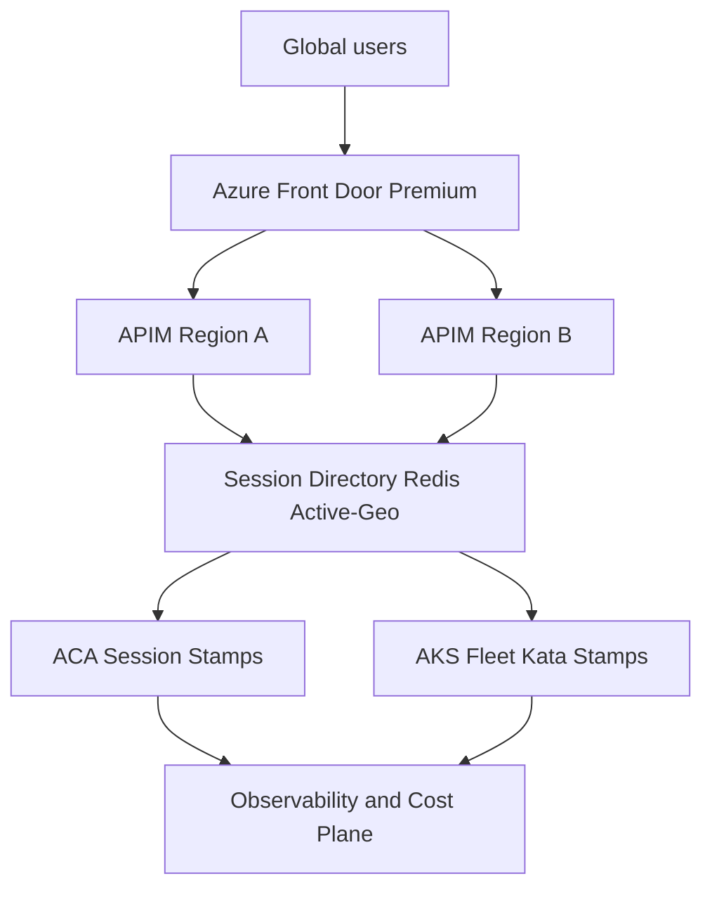
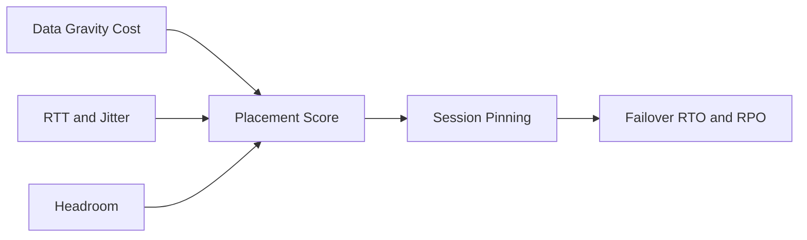
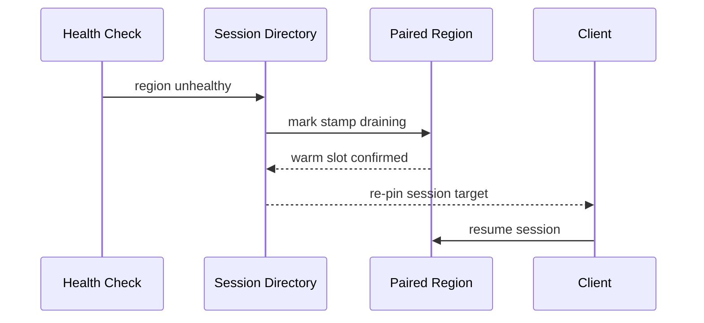

# 企业多区域地理分布式沙箱布点与会话粘性选型 FAQ：Front Door + ACA Stamps vs AKS Fleet Kata vs Compute-to-Data

> 🌐 **Language Switch**：**中文（当前）** | [English](./multi-region-geo-distributed-sandbox-placement-session-pinning-front-door-aca-stamps-vs-aks-fleet-kata-vs-compute-to-data-selection-faq.en.md)
> **适用对象**：Cloud & AI Solution Architect、平台工程、SRE、FinOps 与数据主权治理团队。
> **问题背景**：全球用户访问沙箱时，需要同时满足低延迟、跨区容灾、数据主权约束与会话粘性，且不能放大跨区流量成本。

## 1. 为什么地理分布式沙箱问题不能只看“就近路由”

许多团队把全球沙箱布点简化为就近路由，但真实生产决策还要同时考虑数据主权、数据重力、区域容量和故障切换代价。
如果仅以 RTT 最小为目标，容易把执行放到跨主权区域，触发合规风险与高额跨区数据回传费用。
反过来若只做主权硬绑定，又可能把交互时延推高到不可接受区间，导致会话中断和体验劣化。
因此需要可计算的综合评分与可证明的会话钉住机制，而不是单一网络指标驱动。

## 2. 四类架构与典型边界

架构 A 通过 `Front Door Premium + APIM Regional Gateway + Redis Active-Geo` 建立会话目录，适合快速规模化与统一控制面。
架构 B 采用 `AKS Fleet + Kata` 多区域主动主动，提供最强网络与内核控制，适合高定制或高隔离需求。
架构 C 强调 compute-to-data，把沙箱固定在数据所在区域，优先主权与数据零跨区外发。
架构 D 以单枢纽池为主，仅做工件多区复制，适合会话量中等且监管约束相对宽松的组织。

## 3. 全局参考架构：会话目录与区域 Stamp



推荐先建设全局会话目录，再让不同运行时方案共享同一 placement 决策和会话钉住协议。
这样可避免后续迁移时出现“运行时切换导致会话身份失配”的结构性问题。

## 4. 架构 A：全局会话目录 + 多区域 ACA Dynamic Sessions

A 在 Turn-1 计算布点评分：`Score = ResidencyMask * (w1*RTT + w2*DataGravity + w3*Headroom)`，并把 `session_id -> region_stamp` 写入目录。
目录查找通常可控制在 `<2ms`，后续请求按会话键直接命中原区域，减少跨区抖动与上下文重建。
借助 `RA-GZRS` 工作区副本，区域排空或故障时可在配对区域恢复会话状态。
A 的优势是控制面统一且落地快，短板是运行时内核与网络定制能力有限。

## 5. 架构 B：AKS Fleet 主动主动 + Kata 区域 Stamp

B 通过 `ClusterResourcePlacement` 分发工作负载，结合 Gateway API 一致性哈希做会话粘性，支持洲级主权网络边界。
利用 `ANF` 跨区复制与 `ACR` Geo-Replication，可在 `RPO <= 5 min`、`RTO <= 30 s` 目标下完成热切换。
B 适合需要自定义内核、GPU 直通、细粒度网络策略的高复杂场景。
代价是平台运维复杂度和 SRE 人力投入明显高于托管路径。

## 6. 架构 C：Compute-to-Data 主权固定 + Anycast 加速

C 的核心是把沙箱与 `OneLake/ADLS Gen2/Regional PTU` 同区部署，避免跨区数据出境。
在数据密集任务中，`$0/GB` 同区访问可替代 `$0.02–$0.087/GB` 的跨区回传，长期成本差距显著。
通过 Front Door 私网回传和骨干网加速，可降低跨洲会话建立和流式通道抖动。
C 适合金融与公共部门等主权约束严格场景，但全球交互延迟优化空间受限。

## 7. 架构 D：单枢纽沙箱池 + 地理复制工件

D 在主区域集中运行沙箱，仅复制镜像与工件到次级区域，运维模型最简单。
当日会话量低于 `500` 且不要求多司法区计算驻留时，D 常具有最佳人力成本效率。
可配合区域 `Dev Box` 接管池做灾时人工接管，保障关键工单连续性。
不足是跨洲延迟和单枢纽故障影响面更大，不适合高并发全球交互业务。

## 8. 关键公式：数据重力、暖池碎片税与容灾恢复

跨区数据重力盈亏点可写为 `Breakeven_GB = Value_per_ms * (RTT_remote-RTT_local) * QPS * 3600 / EgressPrice_per_GB`。
多 Stamp 暖池碎片税近似 `FragmentationTax ≈ BaseWarmPool * (sqrt(K)-1)`，`K` 为区域 Stamp 数。
故障恢复窗口可估算 `RTO_total = Detect + DirectoryFailover + SessionHydration`，并要求 `RPO` 与复制频率一致。
上述指标需同屏展示，才能避免单维优化引发全局成本或合规退化。



## 9. 12 维定量对比矩阵

| 维度 | 架构 A ACA 目录路由 | 架构 B AKS Fleet Kata | 架构 C Compute-to-Data | 架构 D 单枢纽池 |
|---|---|---|---|---|
| Turn-1 布点决策延迟 | `8–20ms` | `12–28ms` | `10–24ms` | `4–12ms` |
| 会话目录查找延迟 | `<2ms` | `2–4ms` | `2–4ms` | `1–2ms` |
| 会话粘性稳定率 | `99.2%–99.7%` | `99.4%–99.8%` | `99.1%–99.6%` | `98.5%–99.2%` |
| 跨区数据外发成本 | 中 | 中高 | 低（同区优先） | 中高 |
| 典型跨区流量单价 | `$0.02–$0.05/GB` | `$0.02–$0.05/GB` | `$0/GB` 同区 | `$0.02–$0.087/GB` |
| 暖池并发弹性 | `readySessionInstances` 快速弹性 | 高度可调 | 受数据区限制 | 枢纽集中弹性 |
| RPO 目标 | `<=10min` | `<=5min` | `<=10min` | `<=15min` |
| RTO 目标 | `45–120s` | `<=30s` | `60–150s` | `90–240s` |
| 运行时隔离强度 | 中高 | 高 | 中高 | 中 |
| 平台运维复杂度 | 中 | 高 | 中高 | 低 |
| 适配日会话规模 | `500–10000` | `1000–15000` | `500–12000` | `<500` 优先 |
| 三年 TCO 竞争力 | 中高 | 中 | 中高 | 高（低规模） |

## 10. 故障切换编排：目录漂移与 Stamp 排空



切换策略必须把“新会话分流”与“旧会话迁移”分开处理，避免在高峰期同时触发大规模上下文搬迁。
建议对同一租户设置迁移并发上限，防止单租户大迁移挤占全局恢复资源。

## 11. 生产 Bicep 片段：Front Door + 区域 ACA SessionPools + ACR Geo

```bicep
param locationPrimary string = 'eastus2'
param locationSecondary string = 'westeurope'

resource fd 'Microsoft.Cdn/profiles@2024-02-01' = {
  name: 'afd-sandbox-global'
  location: 'global'
  sku: { name: 'Premium_AzureFrontDoor' }
}

resource acaPrimary 'Microsoft.App/sessionPools@2024-10-02-preview' = {
  name: 'sp-primary'
  location: locationPrimary
  properties: {
    poolManagementType: 'Dynamic'
    scaleConfiguration: { maxConcurrentSessions: 400 }
  }
}

resource acaSecondary 'Microsoft.App/sessionPools@2024-10-02-preview' = {
  name: 'sp-secondary'
  location: locationSecondary
  properties: {
    poolManagementType: 'Dynamic'
    scaleConfiguration: { maxConcurrentSessions: 280 }
  }
}

resource acr 'Microsoft.ContainerRegistry/registries@2023-07-01' = {
  name: 'acrsandboxgeo'
  location: locationPrimary
  sku: { name: 'Premium' }
  properties: {
    policies: { quarantinePolicy: { status: 'enabled' } }
  }
}
```

## 12. Python 布点与会话钉住路由器

```python
from dataclasses import dataclass
from hashlib import blake2b

@dataclass
class RegionScore:
    region: str
    residency_ok: int
    rtt_ms: float
    data_gravity_gb: float
    headroom: float

def score(r: RegionScore) -> float:
    if r.residency_ok == 0:
        return float('-inf')
    return 0.45 * (1.0 / max(r.rtt_ms, 1.0)) + 0.35 * (1.0 / max(r.data_gravity_gb, 0.1)) + 0.20 * r.headroom

def pin_region(session_id: str, candidates: list[RegionScore]) -> str:
    ranked = sorted(candidates, key=score, reverse=True)
    top = [r.region for r in ranked[:2]]
    if len(top) == 1:
        return top[0]
    idx = int(blake2b(session_id.encode(), digest_size=1).hexdigest(), 16) % 2
    return top[idx]
```

该实现把主权硬约束放在最前面，再在合法候选中按延迟、数据重力与容量做加权决策。
会话钉住可通过目录租约 TTL 与心跳续期实现，避免短时波动导致频繁跨区漂移。

## 13. 全球企业场景与 KPI

场景一：全球电商平台在北美、欧洲、东南亚运行客服与营销沙箱，日会话量 `2500`，要求 `P95` 交互延迟低于 `220ms`。
采用 A+C 组合后，欧盟数据留在欧盟区域执行，跨区流量单价显著下降，且会话粘性保持在 `99.4%` 以上。
场景二：跨国制造企业在 40+ 国家部署运维 Agent，日会话 `10000`，需在区域故障下保持分钟级恢复。
采用 B+A 组合后，切换 RTO 稳定在 `<=35s`，并通过 Fleet 渐进发布降低跨洲升级风险。

| KPI 指标 | 场景一（A+C） | 场景二（B+A） |
|---|---:|---:|
| 会话粘性稳定率 | `99.4%` | `99.6%` |
| 交互 P95 延迟 | `205ms` | `188ms` |
| 区域故障恢复 RTO | `95s` | `32s` |
| 数据跨区外发占比 | `8%` | `15%` |
| 重大事件月均次数 | `0.7` | `0.5` |

### 三年 TCO（500 / 2500 / 10000 日会话）

| 架构路径 | 500 日会话 | 2500 日会话 | 10000 日会话 | 三年总成本 |
|---|---:|---:|---:|---:|
| A ACA 多区目录 | `$0.88M` | `$2.46M` | `$8.94M` | `$12.28M` |
| B AKS Fleet Kata | `$1.06M` | `$2.88M` | `$9.36M` | `$13.30M` |
| C Compute-to-Data | `$0.92M` | `$2.34M` | `$8.10M` | `$11.36M` |
| D 单枢纽池 | `$0.64M` | `$2.72M` | `$10.84M` | `$14.20M` |
| A+C 混合 | `$0.96M` | `$2.42M` | `$8.22M` | `$11.60M` |
| B+A 混合 | `$1.14M` | `$2.96M` | `$9.08M` | `$13.18M` |

## 14. 落地清单与 Q1-Q6 定量问答

### Day-0

1. 确认数据主权分区与租户合规标签，形成 placement 硬约束表。

2. 建立全局会话目录键模型并定义 `session_id` 租约 TTL。

3. 准备跨区镜像与工件复制策略，明确 RPO 目标。

4. 校准区域 headroom 指标采样频率与告警阈值。

5. 设计故障演练脚本，覆盖 Stamp 排空与目录漂移场景。

6. 设定 FinOps 看板，联动流量单价、会话延迟和恢复时长。

### Day-1

1. 按日监控会话粘性、跨区回流率、区域饱和度和目录查找延迟。

2. 抽样验证主权规则命中，确保无越区执行事件。

3. 比较同业务线在不同区域的数据重力成本变化。

4. 执行低峰时段区域切换演练，记录真实 RTO/RPO。

5. 对高抖动会话执行根因分析，排查目录 TTL 与健康探测策略。

6. 发布区域级容量周报，提前处理热点 Stamp 资源紧张。

### Day-2

1. 按周重算 placement 权重，防止单一指标长期主导。

2. 按月校验跨区复制一致性与镜像延迟。

3. 按月复盘跨区成本异常与延迟异常并回写策略。

4. 按季度执行主权审计与法规映射更新。

5. 按季度更新会话目录容量模型与碎片税参数。

6. 持续把故障经验沉淀为自动化恢复 Runbook。

### Q1: 如何计算数据重力与延迟的盈亏平衡？

若跨区延迟差 `45ms`、每毫秒业务价值 `$0.0009`、小时请求 `180000`，则延迟价值约 `$72.9/h`。

若跨区回流 `900GB/h`、单价 `$0.05/GB`，流量成本 `$45/h`，此时本地计算收益仍高于跨区回流成本。

### Q2: `sqrt(K)` 暖池碎片税如何估算？

基线暖池 `W0=120`，区域数 `K=9`，碎片税 `W0*(sqrt(9)-1)=240`，总暖池约 `360`。

这意味着多区域扩展不是线性成本，应通过目录路由降低无效预热。

### Q3: RTO/RPO 如何由流程项分解？

若检测 `8s`、目录切换 `6s`、会话恢复 `18s`，则 `RTO=32s`，满足 `<=30s` 时还需再优化恢复环节。

若复制间隔 `5min`，理论 `RPO<=5min`，需结合复制延迟抖动做保守预算。

### Q4: 何时应从 D 迁移到 A 或 B？

当日会话超过 `500` 且跨洲交互占比持续增长时，单枢纽延迟和故障面会明显放大。

此时应优先引入 A 的多区目录，若需要更强定制隔离再引入 B。

### Q5: A 与 C 如何组合获得最优主权与成本？

A 负责统一会话目录与低延迟路由，C 负责数据主权硬绑定和零跨区外发。

组合后可在不牺牲交互体验的前提下压低跨区流量成本和合规风险。

### Q6: 10000 日会话规模下优先策略是什么？

优先保证目录可扩展性、会话钉性稳定和区域恢复时长，再优化单次延迟尾部。

在大规模阶段，B+A 混合通常比单一路径更稳，因为可同时兼顾隔离控制与统一路由。

## 15. Good fit vs Not for 与运行告警字典

Good fit：全球多区域用户、主权限制明确、且需要在故障下保持会话连续性的企业 Agent 平台。
Not for：单区域内网系统、日会话量低且无跨区容灾目标的轻量环境。

| 告警键 | 触发条件 | 立即动作 | 责任团队 |
|---|---|---|---|
| `session_pin_drift` | 会话跨区漂移率超阈值 | 冻结重平衡并回滚权重 | 平台工程 |
| `directory_lookup_latency` | 目录查找 P95 超 `3ms` | 扩容目录分片并排查热键 | 中间件团队 |
| `cross_region_egress_spike` | 跨区流量成本异常上升 | 启用 compute-to-data 强约束 | FinOps |
| `stamp_headroom_low` | 区域余量低于 `15%` | 触发预扩容与新会话分流 | SRE |
| `failover_rto_breach` | 演练或实故障 RTO 超目标 | 启动灾备优化专项 | 可靠性团队 |
| `residency_policy_violation` | 主权规则命中失败 | 立即阻断越区执行 | 合规团队 |
| `artifact_replication_lag` | 工件复制延迟超阈值 | 限制升级并补齐复制 | 发布工程 |
| `sticky_session_loss` | 会话恢复失败率上升 | 触发人工接管与根因排查 | 值班团队 |

### 参考来源（抓取日期：2026-11-24）

1. Azure Front Door documentation: https://learn.microsoft.com/azure/frontdoor/

2. Azure Container Apps sessions: https://learn.microsoft.com/azure/container-apps/sessions

3. Azure Kubernetes Fleet Manager overview: https://learn.microsoft.com/azure/kubernetes-fleet/

4. Azure NetApp Files cross-region replication: https://learn.microsoft.com/azure/azure-netapp-files/cross-region-replication-introduction

5. Azure data transfer pricing: https://azure.microsoft.com/pricing/details/bandwidth/

以上来源用于约束多区域路由、会话管理和跨区成本模型的工程基线。
阈值需按企业网络、法规与业务峰值特征进行本地化校准，并在季度评审中持续更新。
