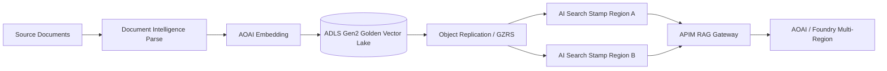
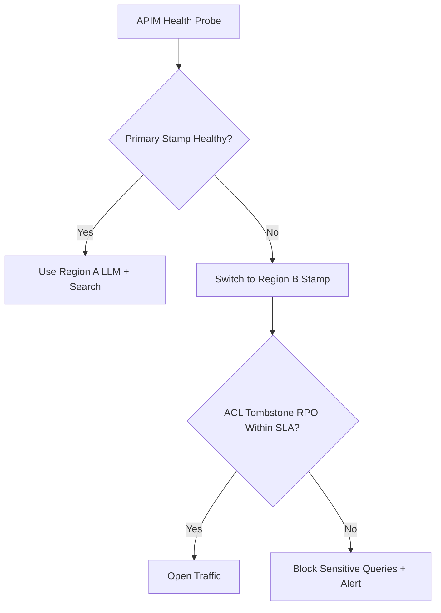

# Multi-Region RAG Continuity and AI Search BCDR Selection FAQ (Active-Active Search Stamps vs Pilot-Light Hydration vs Cosmos DiskANN)

> Audience: Cloud & AI Solution Architects, platform SRE leads, retrieval platform owners, and BCDR governance teams.
>
> Core problem: multi-region AOAI/Foundry failover does not guarantee RAG continuity if retrieval remains single-region. The hidden single point of failure is often the search index plane.

## 1. Executive summary

A common “false BCDR-ready” pattern looks healthy on slides:

- model endpoints are multi-region,
- gateway failover is configured,
- but retrieval index remains single-region.

Under a real regional outage, that pattern fails exactly where enterprise RAG depends on grounding:

- retrieval fails (`503`/timeouts),
- or system falls back to ungrounded generation paths,
- citation consistency and compliance posture collapse.

This guide compares four routes:

- **Route A**: active-active dual-region Azure AI Search stamps fed from a single-compute golden vector lake replicated through ADLS Gen2 GZRS/object replication.
- **Route B**: pilot-light warm-standby search with minimal always-on capacity and automated scale/hydration during failover.
- **Route C**: Cosmos DB for NoSQL DiskANN multi-region vector + metadata continuity model.
- **Route D**: anti-pattern baseline (multi-region LLM with single-region search, duplicate independent enrichment per region, or permanent cross-region retrieval hairpin).

Recommendation summary:

1. mission-critical regulated RAG generally starts with Route A,
2. cost-sensitive workloads that can tolerate `RTO 12–35 min` can use Route B,
3. workloads requiring vector retrieval and transactional state continuity in one failover boundary should evaluate Route C,
4. Route D should be explicitly prohibited in architecture standards.

## 2. Failure boundaries and outage modes

### 2.1 Failure mode 1: retrieval single point of failure

Even when LLM calls survive region failover, RAG breaks if retrieval fails.

Impact:

- no grounding context,
- poor citation fidelity,
- elevated hallucination and unsupported-answer risk.

### 2.2 Failure mode 2: duplicate enrichment pipelines by region

If each region performs OCR/chunking/embedding independently:

- enrichment cost doubles,
- chunk boundaries diverge,
- citation IDs drift and cross-region replay becomes fragile.

### 2.3 Failure mode 3: steady-state cross-region retrieval hairpin

If one region routinely queries another region’s index:

- baseline latency increases with WAN RTT,
- p95/p99 tails widen under load,
- network egress and reliability costs increase.

## 3. Route definitions

### 3.1 Route A: active-active dual-region Search stamps + golden vector lake

Core pattern:

- parse and embed once,
- persist immutable vector records in a golden lake,
- replicate lake artifacts across regions,
- ingest precomputed vectors into independent regional search stamps.

Expected outcomes:

- no double OCR/embedding tax,
- deterministic chunk and ACL parity,
- low failover RTO with consistent retrieval semantics.

Target envelope:

- `RTO < 15s`,
- `RPO < 2–5 min` for index update propagation.

### 3.2 Route B: pilot-light warm standby with prioritized hydration

Core pattern:

- maintain minimal secondary query floor (`1 replica`),
- on failover declaration, scale replicas and hydrate by corpus priority tier,
- keep Tier-0 runbooks/policy corpora hot at all times.

Benefits:

- materially lower standby spend than full active-active.

Trade-offs:

- failover capacity ramp window,
- hydration latency depends on corpus scale and indexing throughput.

### 3.3 Route C: Cosmos DiskANN multi-region continuity path

Core pattern:

- vector retrieval and operational metadata in one multi-region continuity fabric,
- session/bounded-staleness options for failover behavior,
- reduced dual-index orchestration complexity.

Trade-offs:

- weaker parity with AI Search semantic ranker and lexical analyzer stack,
- requires retrieval relevance design tuned for Cosmos vector path constraints.

### 3.4 Route D: anti-pattern baseline

Indicators:

- multi-region LLM endpoint with single-region search dependency,
- uncoordinated dual-region enrichment causing drift,
- steady-state cross-region retrieval traffic.

Consequences:

- false confidence in BCDR posture,
- higher cost with lower deterministic recovery quality,
- difficult compliance and incident explainability.

## 4. Quantitative engineering models

### 4.1 Search capacity and cost model

Definitions:

- `SU = Partitions × Replicas`,
- `C_su`: cost per search unit,
- `N_region`: number of regions.

Approximation:

- active-active: `Cost_AA ≈ 2 × SU_primary × C_su`,
- pilot-light: `Cost_PL ≈ (SU_primary + SU_standby_min) × C_su`.

Interpretation:

- Route A buys lower RTO with higher standby burn,
- Route B trades lower standby burn for slower full-capacity recovery.

### 4.2 Scale-out and index recovery time (`T_scale`)

Definitions:

- `V`: vector count,
- `R_target`: target replica count at failover,
- `I_rate`: sustained indexing throughput.

Approximation:

`T_scale ≈ f(V, R_target, I_rate, merge_overhead)`

Design implication:

- larger corpora need explicit tiered hydration strategy,
- failover drill must verify measured `T_scale` against SLA commitments.

### 4.3 ACL tombstone propagation bound (`RPO_acl`)

Definitions:

- `T_emit`: revoke/tombstone emission time,
- `T_apply_secondary`: secondary region apply time.

Bound:

`RPO_acl = T_apply_secondary - T_emit`

Security implication:

- stale ACL in secondary can become an unauthorized retrieval window if not bounded and monitored.

### 4.4 Citation consistency constraint

If chunk identity diverges by region:

- citations become non-comparable,
- replay and legal review are weakened,
- trust in failover outputs declines.

Therefore enforce:

- deterministic chunking policy,
- deterministic ID generation,
- deterministic ACL normalization.

## 5. Twelve-dimension comparison matrix

| Dimension | Route A Active-Active | Route B Pilot-Light | Route C Cosmos DiskANN | Route D Anti-Pattern |
|---|---|---|---|---|
| RTO capability | Very high | Medium | High | Low |
| RPO capability | High | Medium-high | High | Low |
| Retrieval quality ceiling | High | High | Medium | Unstable |
| Steady-state cost efficiency | Medium | High | Medium | Misleading |
| Drill verifiability | High | Medium-high | High | Low |
| ACL consistency controls | High | Medium-high | High | Low |
| Enrichment duplication waste | Low | Low | Medium | High |
| Ops complexity | High | Medium | Medium | Low (short-term) |
| Peak recovery throughput | High | Medium | High | Low |
| Compliance defensibility | High | Medium-high | High | Low |
| Long-term scalability | High | Medium-high | Medium-high | Low |
| Recommendation | ✅ | ✅ | ✅ (specific fit) | ⛔ |

## 6. Deep quantitative Q&A (Q1 to Q6)

### Q1: Why is multi-region LLM failover not equivalent to multi-region RAG continuity?

Because retrieval is a hard dependency in grounded-answer paths.

When retrieval fails, model availability alone does not preserve grounded response quality or compliance.

### Q2: Is Route A always too expensive?

Not necessarily.

Route A avoids duplicated enrichment spend and avoids drift-induced operational debt.

For high-availability workloads, avoided outage cost and avoided quality drift can outweigh additional standby search cost.

### Q3: How should Route B reduce failover risk despite slower full recovery?

Use:

- always-hot Tier-0 corpora,
- automatic replica scale-out runbooks,
- hydration priority ladders by business criticality.

This ensures critical workflows recover first while long-tail content catches up.

### Q4: When does Route C beat A/B?

Route C is compelling when:

- transactional state and vector retrieval must fail over atomically,
- operations prefer one continuity store plane,
- semantic ranking trade-offs are acceptable relative to continuity needs.

### Q5: How do we prove revoked access does not survive in secondary stamp?

Need three controls:

- tombstone event emission guarantees,
- measured secondary apply latency (`RPO_acl`) with alerting,
- periodic revoke/retrieve drill validation.

### Q6: Which metrics define true failover readiness?

At minimum:

- `RTO_service`,
- `RPO_acl`,
- `citation_consistency_rate`,
- `search_error_rate`,
- `failback_recovery_time`.

If any is missing, readiness evidence is incomplete.

## 7. Architecture diagrams (Mermaid)





## 8. Production example: APIM dual-stamp retrieval circuit policy

```xml
<policies>
  <inbound>
    <base />
    <set-variable name="primarySearch" value="https://search-a.contoso.net" />
    <set-variable name="secondarySearch" value="https://search-b.contoso.net" />
    <send-request mode="new" response-variable-name="probeA" timeout="2" ignore-error="true">
      <set-url>@($"{context.Variables["primarySearch"]}/healthz")</set-url>
      <set-method>GET</set-method>
    </send-request>
    <choose>
      <when condition="@(((IResponse)context.Variables["probeA"])?.StatusCode == 200)">
        <set-variable name="activeSearch" value="@((string)context.Variables["primarySearch"])" />
      </when>
      <otherwise>
        <set-variable name="activeSearch" value="@((string)context.Variables["secondarySearch"])" />
      </otherwise>
    </choose>
    <set-header name="x-active-search-stamp" exists-action="override">
      <value>@((string)context.Variables["activeSearch"])</value>
    </set-header>
  </inbound>
  <backend><base /></backend>
  <outbound><base /></outbound>
  <on-error><base /></on-error>
</policies>
```

## 9. Production example: Chaos Studio regional RAG failover drill snippet

```json
{
  "experimentName": "rag-regional-failover-drill",
  "selectors": [
    {
      "name": "search-region-a",
      "resourceType": "Microsoft.Search/searchServices",
      "regions": ["eastus"]
    }
  ],
  "steps": [
    {
      "name": "inject-search-outage",
      "actions": [
        {
          "type": "network-block",
          "duration": "PT10M"
        }
      ]
    },
    {
      "name": "measure-rto-rpo",
      "actions": [
        {
          "type": "metric-check",
          "metrics": ["RTO_service", "RPO_acl", "citation_consistency_rate"]
        }
      ]
    }
  ]
}
```

## 10. Enterprise scenarios (2+)

### Scenario A: Tier-1 retail banking 24/7 customer and branch-service copilot

Requirements:

- retrieval continuity through regional disruption,
- fast ACL revocation propagation across regions,
- citation traceability for regulated workflows.

Recommended pattern:

- Route A active-active baseline,
- strict ACL tombstone RPO guardrails before opening secondary traffic.

Outcome:

- low failover time with grounded-answer continuity,
- strong explainability during audit and incident review.

### Scenario B: global airline IROPS crew/dispatch BCDR copilot

Requirements:

- high-peak operational continuity,
- route/manual retrieval availability under regional disruptions,
- balanced spend across normal and disaster periods.

Recommended pattern:

- Route A for critical runbooks and dispatch corpora,
- Route B tiered hydration for long-tail archives.

Outcome:

- critical path restored first,
- cost controlled for non-critical knowledge layers.

### Scenario C: enterprise knowledge assistant with strict cost envelope

Requirements:

- moderate normal load,
- tolerance for `RTO < 30m`,
- bounded standby budget.

Recommended pattern:

- Route B pilot-light with strong hydration priority automation.

Outcome:

- lower standby cost,
- predictable though slower full-capacity failover.

## 11. Three-tier 3-year TCO (`5M / 50M / 500M` vectors)

| Vector scale | Route A Active-Active (`RTO < 15s`) | Route B Pilot-Light (`RTO < 30m`) | Route C Cosmos DiskANN | Hybrid A/B |
|---|---:|---:|---:|---:|
| 5M | 2,400,000 | 1,520,000 | 2,050,000 | 1,880,000 |
| 50M | 12,800,000 | 8,200,000 | 11,300,000 | 9,900,000 |
| 500M | 88,500,000 | 56,700,000 | 73,200,000 | 65,400,000 |

Interpretation:

- Route A pays for fastest continuity and strongest deterministic parity,
- Route B minimizes standby spend with larger recovery window,
- Route C favors continuity symmetry when vector + operational metadata coupling is required.

## 12. Day-0 / Day-1 / Day-2 checklist

### Day-0

- define deterministic chunk/ACL schema and ID generation,
- define golden lake replication policy and data contracts,
- set RTO/RPO targets and drill acceptance criteria.

### Day-1

- deploy dual-region search stamps,
- configure APIM health probes and failover policy routing,
- implement ACL tombstone propagation metrics and alerts.

### Day-2

- run regular Chaos Studio failover drills,
- tune pilot-light hydration and scale-out priorities,
- implement failback governance with post-recovery consistency checks.

## 13. Good fit vs Not for

### ✅ Good fit

- mission-critical enterprise RAG with strict continuity requirements,
- regulated environments requiring citation-consistent failover evidence,
- global operations that cannot tolerate retrieval-plane outage.

### ⛔ Not for

- low-stakes single-region prototypes,
- teams without cross-region consistency governance capacity,
- use cases where retrieval outage is business-tolerable.

## 14. Operational KPIs and alert policy

Track continuously:

- `search_failover_rto_seconds`,
- `acl_tombstone_rpo_seconds`,
- `citation_consistency_rate`,
- `index_hydration_backlog`,
- `cross_region_query_ratio`,
- `failback_validation_duration`.

Alert guidance:

1. if `acl_tombstone_rpo_seconds` breaches threshold, restrict sensitive retrieval paths until parity is restored,
2. if `citation_consistency_rate` declines, trigger deterministic chunking and ingestion contract verification,
3. if `cross_region_query_ratio` rises in normal operations, inspect for accidental steady-state hairpin routing,
4. if hydration backlog grows during drills, re-prioritize corpus tiers and indexing throughput plans.

## 15. Final recommendation

### 15.1 Default architecture posture

- Tier-1 critical RAG workloads: Route A baseline,
- cost-sensitive workloads with tolerant recovery windows: Route B,
- state/vector atomic continuity needs: evaluate Route C explicitly.

### 15.2 Anti-pattern avoidance rules

- never claim BCDR-ready if retrieval remains single-region,
- never duplicate enrichment independently across regions without deterministic contract controls,
- never run cross-region retrieval hairpin as permanent steady-state path.

### 15.3 One-sentence conclusion

True multi-region agent resilience is not “model endpoint failover,” but “provable retrieval continuity with deterministic ACL and citation parity across region transitions.”

## 16. Appendix: measurement scope and audit evidence pack

To avoid the common gap where drills pass but audit replay fails, preserve evidence in three explicit layers:

- **control-plane evidence**: fault-injection timestamps, APIM policy revision history, traffic-switch decisions, and approval records;
- **data-plane evidence**: dual-region index health samples, ACL tombstone propagation latency distributions, and citation-parity spot checks;
- **business evidence**: primary-vs-secondary answer deltas on critical task packs, error-budget burn during failover, and post-failback stabilization windows.

For production governance, keep at least `30` days of raw metric and log snapshots per drill cycle, and include quarterly sampled verification of `RTO_service`, `RPO_acl`, and `citation_consistency_rate`. This keeps regional RAG continuity defensible, replayable, and attributable under real incident pressure.

