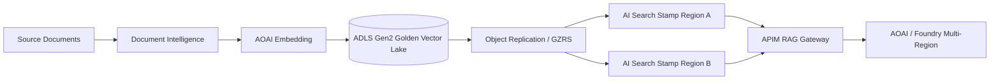
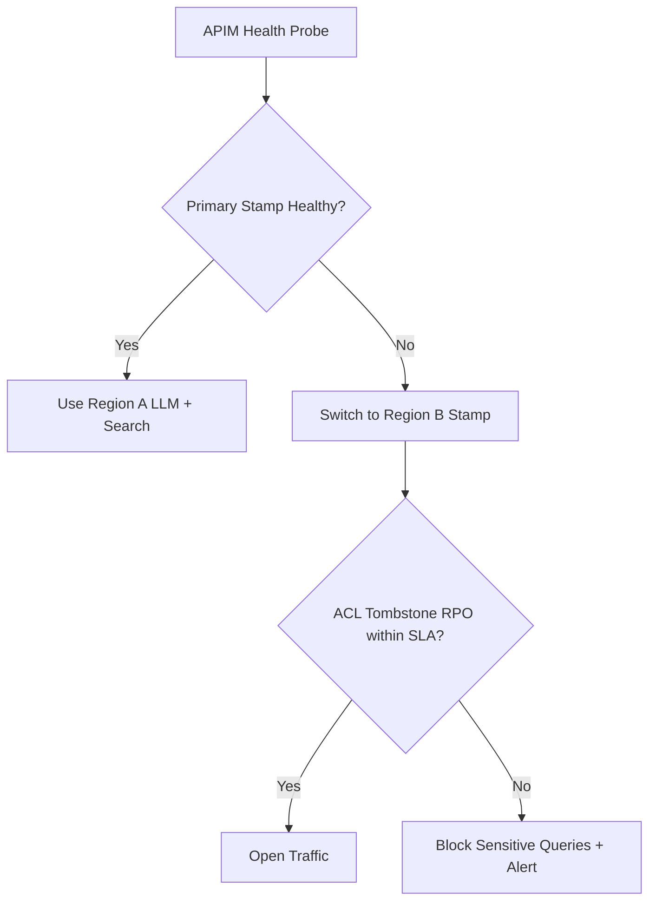

# 多区域 RAG 连续性与 AI Search 容灾选型 FAQ（Active-Active 双 Stamp vs Pilot-Light 水合 vs Cosmos DiskANN）

> 适用对象：Cloud & AI Solution Architect、平台 SRE、RAG 检索平台负责人、BCDR 负责人。
>
> 核心问题：仅做 AOAI/Foundry 端点多区域切换并不能保证 RAG 可用，因为 Azure AI Search 本身没有内建跨区域索引复制。真正的单点通常隐藏在检索层。

## 1. 执行摘要

企业最常见的“伪多活”现象：

- LLM 端点做了多区域。
- Search 索引仍单区域。
- 区域故障时生成可用、检索不可用。

结果是：

- `503` 检索失败。
- 或回退到无检索模式，出现“无依据回答”。

本指南比较四条路线：

- Route A：双区域 Active-Active AI Search Stamp + 单次计算的 Golden Vector Lake（ADLS GZRS/OR）。
- Route B：Pilot-Light Warm Standby（最小副本常驻 + 故障时快速扩副本与分层水合）。
- Route C：Cosmos DB NoSQL DiskANN 多区域事务+向量一体。
- Route D：AOAI 多区域 + 单区域 Search 的反模式，以及跨区域稳态回源 hairpin 反模式。

建议：

1. 关键业务默认 Route A。
2. 成本敏感且可接受 `RTO 12–35min` 的场景可用 Route B。
3. 需要向量检索与事务状态原子故障切换时考虑 Route C。
4. Route D 必须在架构评审中标记为不可接受。

## 2. 问题边界与失效模式

### 2.1 失效模式 1：检索层单点

即使 LLM 多区域可用，Search 区域故障仍会导致：

- 检索 API 不可达。
- RAG 引文链断裂。
- 生成输出可信度下降。

### 2.2 失效模式 2：双区域重复富化

若两区独立 OCR 与 embedding：

- 富化成本翻倍。
- chunk 边界漂移。
- 引文 ID 不一致。

最终影响是跨区回放与审计困难。

### 2.3 失效模式 3：跨区稳态回源

若主区调用次区检索作为稳态路径：

- WAN RTT 常驻高延迟。
- 峰值时跨区带宽争用加剧。
- 用户体验和成本双损。

## 3. 路线定义

### 3.1 Route A：Active-Active 双区域 Search Stamp + Golden Vector Lake

核心思想：

- 文档解析与向量计算只做一次。
- 结果落地到不可变 Golden Lake（Delta/Parquet）。
- 通过 GZRS/对象复制分发到两区。
- 两区 Search 独立摄取预计算向量。

关键收益：

- 避免双 OCR/双 embedding 税。
- 保障 `chunk_id` 与 ACL 一致性。
- 故障切换时检索层可并行接管。

目标窗口：

- `RTO < 15s`
- `RPO < 2–5 min`

### 3.2 Route B：Pilot-Light Warm Standby

设计：

- 次区域保持最小查询能力（`1 replica`）。
- 主区域故障声明后自动扩副本到 `3+`。
- 按优先级先水合 Tier-0/Tier-1 索引。

优势：

- 备用成本显著低于全时双活。

代价：

- 故障时吞吐恢复存在窗口。
- 全量水合时间受索引规模影响。

### 3.3 Route C：Cosmos NoSQL DiskANN 一体化

设计：

- 向量与业务状态共存同一多区域引擎。
- Session/Bounded Staleness 下支持低 RPO。
- 故障切换时状态与检索可同步连续。

取舍：

- 语义重排与词法能力弱于 AI Search 全功能组合。
- 需要在相关性能力与连续性之间平衡。

### 3.4 Route D：反模式

典型表现：

- 单区域 Search 搭配多区域 LLM。
- 两区各自富化、无统一 chunk 规范。
- 稳态跨区回源检索。

后果：

- 业务宣称多活但真实不可用。
- 成本翻倍且质量漂移。
- 容灾演练结论失真。

## 4. 核心工程量化模型

### 4.1 搜索容量与成本模型

定义：

- `SU = Partitions × Replicas`
- `C_su`：单 SU 成本
- `N_region`：区域数

Active-Active 近似：

`Cost_AA ≈ 2 × SU_primary × C_su`

Pilot-Light 近似：

`Cost_PL ≈ (SU_primary + SU_standby_min) × C_su`

### 4.2 扩副本与重建时间 `T_scale`

定义：

- `V`：向量总量
- `R_target`：目标副本数
- `I_rate`：索引摄取速率

估算：

`T_scale ≈ f(V, R_target, I_rate, background_merge)`

工程含义：

- 向量越大，Pilot-Light 恢复窗口越长。
- 需提前分层热索引减少关键路径负担。

### 4.3 ACL 撤权墓碑传播 RPO

定义：

- `T_emit`：主区发出 ACL 撤权事件时间
- `T_apply_secondary`：次区应用墓碑时间

RPO：

`RPO_acl = T_apply_secondary - T_emit`

治理目标：

- 保证 `RPO_acl` 在监管窗口内。
- 防止“次区残留权限”导致越权检索。

### 4.4 引文一致性约束

若 `chunk_id` 不一致，则：

- 跨区引用不可比对。
- 解释链路断裂。
- 审计证据失配。

因此需强制：

- 统一 chunk 策略。
- 统一归一化规则。
- 统一 ID 生成函数。

## 5. 12 维对比矩阵

| 维度 | Route A Active-Active | Route B Pilot-Light | Route C Cosmos DiskANN | Route D 反模式 |
|---|---|---|---|---|
| RTO 能力 | 极高 | 中 | 高 | 低 |
| RPO 能力 | 高 | 中高 | 高 | 低 |
| 检索质量上限 | 高 | 高 | 中 | 不稳定 |
| 成本效率（稳态） | 中 | 高 | 中 | 表面高 |
| 演练可验证性 | 高 | 中高 | 高 | 低 |
| ACL 一致性控制 | 高 | 中高 | 高 | 低 |
| 富化重复成本 | 低 | 低 | 中 | 高 |
| 运维复杂度 | 高 | 中 | 中 | 低（短期） |
| 峰值恢复能力 | 高 | 中 | 高 | 低 |
| 合规审计友好度 | 高 | 中高 | 高 | 低 |
| 架构可扩展性 | 高 | 中高 | 中高 | 低 |
| 推荐等级 | ✅ | ✅ | ✅（特定场景） | ⛔ |

## 6. 深度量化问答（Q1~Q6）

### Q1：为什么“双 AOAI + 单 Search”不算真正容灾？

因为 RAG 关键依赖在检索层。

若 Search 不可用，LLM 只能“无依据生成”或直接失败。

所以“模型端多活”不是“RAG 多活”。

### Q2：Route A 的主要成本是否来自双 Search？

是，但它避免了双富化成本。

若不统一 Golden Lake，OCR/embedding 重复开销会吞噬节省空间。

### Q3：Route B 如何控制恢复窗口风险？

关键动作：

- 预热 Tier-0 索引。
- 自动副本扩容剧本。
- 分层水合优先级。

目标是先恢复关键问答，再逐步恢复长尾语料。

### Q4：Route C 何时优于 A/B？

当业务要求：

- 状态与检索必须原子切换。
- 容忍不使用 Search 高级语义排序。
- 强调多区域事务连续性。

此时 C 路线可简化编排面。

### Q5：如何证明 ACL 撤权不会在次区“幽灵存活”？

需要：

- 撤权墓碑事件。
- 次区应用确认。
- RPO 监控与超时告警。

并在演练中验证撤权前后检索差异。

### Q6：容灾演练应关注哪些硬指标？

- `RTO_service`
- `RPO_acl`
- `search_error_rate`
- `citation_consistency_rate`
- `failback_time`

只有这组指标共同达标，才算“可上线容灾”。

## 7. 架构图（Mermaid）





## 8. 生产策略示例：APIM 双 Stamp 检索联动熔断

```xml
<policies>
  <inbound>
    <base />
    <set-variable name="primarySearch" value="https://search-a.contoso.net" />
    <set-variable name="secondarySearch" value="https://search-b.contoso.net" />
    <send-request mode="new" response-variable-name="probeA" timeout="2" ignore-error="true">
      <set-url>@($"{context.Variables["primarySearch"]}/healthz")</set-url>
      <set-method>GET</set-method>
    </send-request>
    <choose>
      <when condition="@(((IResponse)context.Variables["probeA"])?.StatusCode == 200)">
        <set-variable name="activeSearch" value="@((string)context.Variables["primarySearch"])" />
      </when>
      <otherwise>
        <set-variable name="activeSearch" value="@((string)context.Variables["secondarySearch"])" />
      </otherwise>
    </choose>
    <set-header name="x-active-search-stamp" exists-action="override">
      <value>@((string)context.Variables["activeSearch"])</value>
    </set-header>
  </inbound>
  <backend><base /></backend>
  <outbound><base /></outbound>
  <on-error><base /></on-error>
</policies>
```

## 9. 演练示例：Chaos Studio 区域故障 Drill 片段

```json
{
  "experimentName": "rag-regional-failover-drill",
  "selectors": [
    {
      "name": "search-region-a",
      "resourceType": "Microsoft.Search/searchServices",
      "regions": ["eastus"]
    }
  ],
  "steps": [
    {
      "name": "inject-search-outage",
      "actions": [
        {
          "type": "network-block",
          "duration": "PT10M"
        }
      ]
    },
    {
      "name": "measure-rto-rpo",
      "actions": [
        {
          "type": "metric-check",
          "metrics": ["RTO_service", "RPO_acl", "citation_consistency_rate"]
        }
      ]
    }
  ]
}
```

## 10. 企业场景方案（2+）

### 场景 A：Tier-1 零售银行 24/7 客服与网点知识 Copilot

需求：

- 任何区域故障都不能中断基础问答。
- 权限撤销需快速跨区生效。
- 引文需跨区一致可审计。

推荐：

- Route A 作为主架构。
- 对高敏 ACL 变更加 RPO 守门阈值。

### 场景 B：全球航司 IROPS 调度与机组支援 Copilot

需求：

- 高峰时段跨区连续服务。
- 操作手册与航班规则检索不可中断。
- 成本需要在稳态可控。

推荐：

- 核心知识库用 Route A。
- 非核心长尾资料可用 Route B 分层水合。

### 场景 C：高并发企业知识助手（成本敏感）

需求：

- 平时负载中等，灾时需可恢复。
- 能接受 `RTO < 30m`。

推荐：

- Route B，结合严格分层优先级与自动扩副本。

## 11. 三档三年 TCO（`5M / 50M / 500M` vectors）

| 规模（vectors） | Route A Active-Active（RTO<15s） | Route B Pilot-Light（RTO<30m） | Route C Cosmos DiskANN | A/B 混合方案 |
|---|---:|---:|---:|---:|
| 5M | 2,400,000 | 1,520,000 | 2,050,000 | 1,880,000 |
| 50M | 12,800,000 | 8,200,000 | 11,300,000 | 9,900,000 |
| 500M | 88,500,000 | 56,700,000 | 73,200,000 | 65,400,000 |

解读：

- Route A 成本最高但恢复最快。
- Route B 备用成本最低但恢复窗口更长。
- Route C 在事务连续性强需求下有优势。

## 12. Day-0 / Day-1 / Day-2 清单

### Day-0

- 定义统一 `chunk_id` 与 ACL schema。
- 规划 Golden Lake 存储格式与复制策略。
- 明确 RTO/RPO 目标与演练频率。

### Day-1

- 上线主次区 Search Stamp。
- 建立 APIM 健康探测与切换规则。
- 建立 ACL 撤权墓碑传播监控。

### Day-2

- 引入 Chaos Studio 定期演练。
- 优化 Pilot-Light 扩容与水合顺序。
- 建立回切（failback）策略和自动化验收门。

## 13. Good fit vs Not for

### ✅ Good fit

- 对 RAG 连续性有硬性 SLA 的企业。
- 受监管、需要引文一致审计链的行业。
- 多区域业务不可中断场景。

### ⛔ Not for

- 仅单区域 PoC。
- 可接受检索长时间中断的内部实验场景。
- 无能力维护跨区一致性治理的团队。

## 14. 运营 KPI 与告警建议

建议持续监控：

- `search_failover_rto_seconds`
- `acl_tombstone_rpo_seconds`
- `citation_consistency_rate`
- `index_hydration_backlog`
- `cross_region_query_ratio`

告警建议：

1. `acl_tombstone_rpo_seconds` 超阈值立即降级敏感查询。
2. `citation_consistency_rate` 下降触发 chunk 规范回归检查。
3. `cross_region_query_ratio` 异常升高检查是否发生稳态 hairpin。
4. `index_hydration_backlog` 堆积触发优先级重排。

## 15. 最终建议

### 15.1 默认架构

- Tier-1 业务优先 Route A。
- 成本敏感但可接受较长恢复窗口的业务可选 Route B。
- 事务状态与向量检索强耦合业务评估 Route C。

### 15.2 避坑要点

- 不要把 LLM 多区域当成 RAG 多区域。
- 不要双区重复富化导致一致性漂移。
- 不要长期跨区回源作为稳态路径。

### 15.3 一句话结论

多区域 Agent 架构的真实韧性不在“模型端点切换”，而在“检索层、权限传播与引文一致性能否在故障窗口内被可验证地接管”。

## 16. 附录：度量口径与审计证据清单

为避免“演练通过但审计不可复核”的断层，建议将证据分为三层并标准化留存：

- **控制面证据**：故障注入时间戳、APIM 策略版本、流量切换决策链与审批记录；
- **数据面证据**：双区索引健康样本、ACL tombstone 传播时延分布、跨区引用一致性抽检；
- **业务面证据**：主区/备区关键问答集差异、失败预算消耗、回切稳定窗口。

建议每次演练至少保留 `30` 天原始指标与日志快照，并在季度审计中抽检 `RTO_service`、`RPO_acl`、`citation_consistency_rate` 三项指标的连续性，确保多区域 RAG 方案在高压场景下具备可解释、可回放、可追责的工程可靠性。

