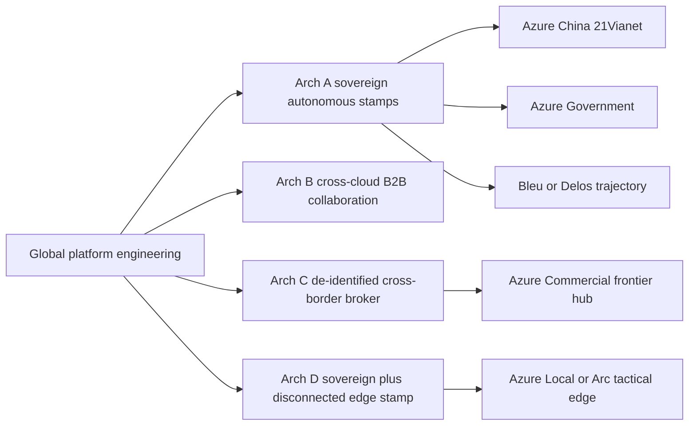
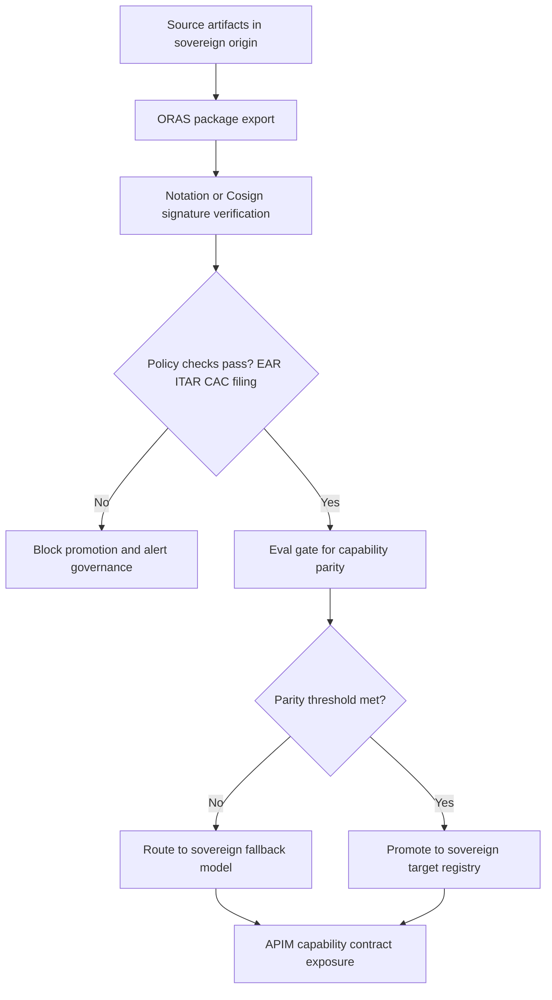
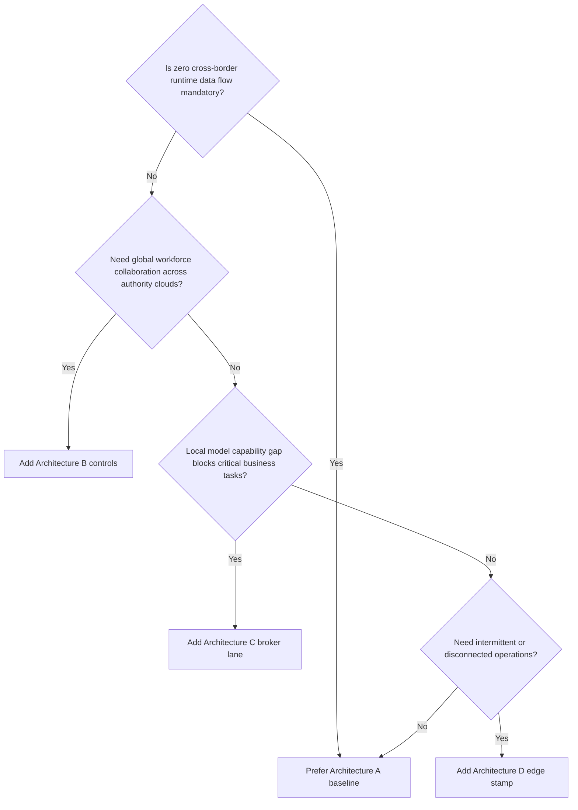

# Multi-Sovereign Cloud AI Landing-Zone Selection FAQ: Azure China 21Vianet vs Azure Government vs Bleu/Delos with Split-Horizon Control Plane
> **Applies to**: multinational automotive OEMs, global banks, aerospace/defense suppliers, and life-sciences enterprises.
> **Decision pressure**: deliver one AI agent operating model across `.com`, `.cn`, `.us`, and European sovereign environments with hard control-plane boundaries.
> **Core objective**: design a sovereign-safe architecture that keeps jurisdictional data residency intact while sustaining capability parity and operational velocity.

## 1. Executive summary
- Multi-sovereign AI platforms are constrained first by jurisdictional control-plane boundaries.
- Azure Commercial, 21Vianet, Government, and European sovereign clouds expose distinct authority and ARM domains.
- Native cross-sovereign VNet peering and Private Link are not universal assumptions.
- Model catalog skew across sovereign regions is a persistent engineering reality.
- Identity authority and policy baselines diverge by sovereign cloud and legal regime.
- Hardcoded endpoint assumptions are the most common source of deployment failure.
- Architecture A is strongest for runtime isolation with signed artifact promotion.
- Architecture B is strongest for global workforce collaboration with sovereign-pinned data planes.
- Architecture C is strongest for regulated de-identified cross-border capability borrowing.
- Architecture D is strongest for disconnected tactical edge continuity.
- Most enterprise programs blend A as baseline with selective B/C/D overlays.
- Final selection should balance legal constraints, capability lag tolerance, and TCO.

## 2. Applicability and explicit non-goals
- Scope includes sovereign landing zones across `.com`, `.cn`, `.us`, and EU sovereign cloud trajectories.
- Scope includes Entra authority-cloud divergence and Bicep `environment()` endpoint binding.
- Scope includes model-catalog skew handling between sovereign and global clouds.
- Scope includes signed promotion airlocks for code, prompts, and adapter artifacts.
- Scope is distinct from multi-Entra-tenant M&A landing-zone patterns in Commercial Azure #367.
- Scope is distinct from EU-vs-US policy segmentation entirely inside Commercial Azure `.com`.
- Scope is distinct from cross-region AOAI failover patterns within one sovereign cloud.
- Scope excludes geopolitical policy advocacy or legal interpretation services.
- Scope excludes workload-level application refactoring unrelated to sovereignty boundaries.

## 3. Scenario and constraint physics
- Sovereign clouds impose different legal controls, compliance attestations, and service availability.
- ARM endpoints differ (`management.azure.com`, `.chinacloudapi.cn`, `.usgovcloudapi.net`).
- Entra authority discovery must align with national cloud boundaries.
- Capability lag of `3–9` months across model catalogs is normal.
- Cross-border data movement requires explicit legal pathways and auditability.
- Telemetry misconfiguration can silently violate sovereignty boundaries.
- Supply-chain promotion must be immutable, signed, and policy-validated per jurisdiction.

## 4. Four architecture candidates
- **Architecture A**: autonomous sovereign stamps plus signed artifact promotion airlock.
- **Architecture B**: Entra cross-cloud B2B collaboration with sovereign-pinned data planes.
- **Architecture C**: regulated cross-border de-identification broker for capability gaps.
- **Architecture D**: sovereign cloud plus disconnected Azure Local/Arc tactical edge stamp.
- Arch-A optimizes strict sovereignty isolation and repeatable per-cloud runtime independence.
- Arch-B optimizes workforce collaboration with clear bilateral trust controls.
- Arch-C optimizes constrained use of frontier capabilities not yet sovereign-available.
- Arch-D optimizes continuity in intermittent-connectivity or disconnected facilities.

## 5. Architecture A details (Autonomous stamp + signed airlock)
- Each sovereign cloud runs a fully independent runtime and control plane.
- Promotion flow uses immutable OCI artifacts and detached signature verification.
- `ORAS` plus `Notation/Cosign` enforces provenance before import into sovereign registries.
- Non-PII prompts, eval suites, and approved adapters move through policy gates.
- `APIM` capability abstraction hides model-provider skew behind semantic contracts.
- Local sovereign alternatives can substitute for unavailable frontier SKUs.
- Airlock scanners enforce export-control and filing-policy checks before release.
- Arch-A is the baseline for highly regulated multi-sovereign programs.

## 6. Architecture B details (Cross-cloud B2B identity collaboration)
- Cross-cloud B2B enables global staff collaboration without duplicating every identity.
- Bilateral trust must be explicit across authority-cloud boundaries.
- Conditional Access and session controls should be cloud-specific and least-privilege.
- Data planes remain pinned in sovereign regions for corpora and checkpoints.
- Regional Monitor/Sentinel workspaces prevent telemetry centralization leaks.
- Split-horizon DNS enforces local authoritative endpoints and routing decisions.
- Operational model supports traveling executives with sovereignty-aware access posture.
- Arch-B is best for collaboration-heavy organizations under strict data locality.

## 7. Architecture C details (Cross-border de-identification broker)
- Raw sovereign data remains resident in local sovereign clouds.
- Broker only forwards anonymized, schema-minimized reasoning payloads.
- Legal prerequisites include approved cross-border pathways per jurisdiction.
- Circuit controls require kill-switch and field-level egress audit trails.
- WAN latency (`130–250ms`) affects interactive workflows and routing heuristics.
- Tokenization quality determines re-identification risk and utility trade-off.
- Frontier-only sub-tasks should be narrowly scoped and policy-justified.
- Arch-C is suitable when local sovereign model capability lags business needs.

## 8. Architecture D details (Sovereign plus disconnected tactical edge)
- Azure Local or Arc-enabled AKS extends sovereignty controls to offline sites.
- Signed bundles synchronize asynchronously when constrained links are available.
- Quantized SLM/vLLM packages preserve inference continuity under disconnection.
- Local policy evaluation must remain functional without cloud control-plane reachability.
- Flux GitOps can reconcile signed desired state when links recover.
- Operational playbooks need delayed-sync conflict handling and expiry controls.
- Edge security requires hardware root-of-trust and sealed secret stores.
- Arch-D is appropriate for defense plants, embassies, and constrained factories.

## 9. Twelve-dimension architecture comparison matrix
| Dimension | Architecture A | Architecture B | Architecture C | Architecture D |
|---|---|---|---|---|
| Primary objective | Sovereign runtime autonomy | Workforce collaboration with pinned data planes | Regulated capability borrowing | Disconnected sovereign continuity |
| Sovereignty strictness | Highest | High | Medium-high | Highest at edge |
| Identity complexity | Medium | High | Medium | Medium-high |
| Model parity handling | High via abstraction | Medium | Medium-high | Medium |
| Cross-border data exposure | None by default | None by default | Controlled minimal | None by default |
| Legal governance burden | High | High | Highest | High |
| Operational complexity | Medium-high | High | High | High |
| Latency profile | Regional local | Regional local | Cross-border dependent | Local/offline |
| Capability lag resilience | High | Medium | Highest | Medium |
| Telemetry leakage risk | Low with controls | Medium | Medium-high | Low |
| Cost at small scale | Medium | Medium-high | High | High |
| Cost at large scale | High but predictable | High | Medium-high | High |

## 10. Four-architecture topology overview


## 11. Signed artifact airlock and capability parity gate


## 12. SA decision tree


### Q1. How to avoid hardcoded endpoint anti-patterns with Bicep `environment().suffixes` and Entra authority discovery
- Hardcoding `.com` endpoints breaks sovereign deployments and incident runbooks.
- Bicep modules should parameterize cloud environment and derive suffixes dynamically.
- `environment().suffixes` should drive Storage, Key Vault, and ACR endpoint construction.
- ARM endpoint differences must be reflected in deployment tooling and policy scans.
- Entra authority should be discovered per national cloud, not globally assumed.
- Token issuers and audience values differ across sovereign authority clouds.
- SDK bootstrap should include explicit cloud profile and metadata endpoint controls.
- Validation tests must fail fast on accidental global endpoint fallback.
- This pattern reduces drift and improves reproducibility across sovereign stamps.

### Q2. How to handle model-catalog skew with eval-gated capability substitution math
- Frontier SKU availability can lag by `3–9` months across sovereign clouds.
- Capability contracts should target semantic outcomes, not specific model names.
- Eval gates quantify substitution fitness before route promotion.
- Example parity score: `Score = w1*quality + w2*safety + w3*latency + w4*cost`.
- Substitution accepted when `Score_alt - Score_ref >= -epsilon` for policy epsilon.
- Critical workflows can use stricter thresholds than exploratory workloads.
- Route maps should version capability tiers and fallback precedence.
- Drift dashboards must track parity debt and retirement of temporary substitutions.
- This approach keeps business continuity without violating sovereignty controls.

### Q3. How to prevent cross-border telemetry and OpenTelemetry trace leakage
- Telemetry defaults often target global endpoints and can violate data residency.
- `Application Insights` connection strings must be sovereign-local per stamp.
- Crash dumps and prompt payloads require data classification and redaction policies.
- OpenTelemetry exporters should be pinned to sovereign collectors/workspaces.
- Cross-cloud SIEM aggregation must ingest sanitized summaries, not raw prompt content.
- Debug modes should be disabled or scoped in production sovereign workloads.
- Data-loss-prevention checks should run in CI and runtime admission controls.
- Incident forensics should keep full-fidelity artifacts in sovereign boundaries.
- Leakage prevention needs policy, tooling, and runtime enforcement together.

### Q4. How to enforce supply-chain promotion airlock with ORAS and Cosign plus export-control checks
- Promotion should transfer immutable artifact digests, never mutable tags alone.
- Signatures must be validated in both source and destination promotion stages.
- Policy engines should evaluate `EAR/ITAR` and jurisdictional filing obligations.
- China-specific algorithm filing checks should gate eligible artifact classes.
- Failing artifacts must be quarantined with auditable rejection reasons.
- Promotion events require tamper-evident logs and retention policies.
- Approved artifact manifests should include software bill of materials references.
- Emergency break-glass paths must still require post-facto legal and security review.
- This airlock pattern turns governance into deterministic release controls.

### Q5. What production Bicep and sovereign capability-routing code can look like
- Bicep should abstract cloud endpoints from one module input.
- Resource IDs and DNS suffixes must resolve from the selected environment profile.
- Runtime routers should select capability providers by sovereign and parity state.
- Routing logic should block unsupported capabilities rather than silent downgrade.
- Decision output should include rationale for audit and troubleshooting.

```bicep
@allowed([
  'AzureCloud'
  'AzureChinaCloud'
  'AzureUSGovernment'
])
param cloudName string
param location string
param workspaceName string

var suffix = environment(cloudName).suffixes
var armEndpoint = environment(cloudName).resourceManager
var storageSuffix = suffix.storage
var keyVaultSuffix = suffix.keyvaultDns

resource logWs 'Microsoft.OperationalInsights/workspaces@2023-09-01' = {
  name: workspaceName
  location: location
  properties: {
    features: {
      searchVersion: 1
    }
  }
}

output sovereignContext object = {
  armEndpoint: armEndpoint
  storageSuffix: storageSuffix
  keyVaultSuffix: keyVaultSuffix
}
```

```python
from dataclasses import dataclass

@dataclass
class Capability:
    quality: float
    safety: float
    latency: float
    cost: float

def score(c: Capability, w=(0.45, 0.30, 0.15, 0.10)) -> float:
    return w[0]*c.quality + w[1]*c.safety + w[2]*c.latency + w[3]*c.cost

def choose_route(sovereign: str, required: str, ref: Capability, alt: Capability, epsilon: float = 0.03) -> str:
    if sovereign not in {"com", "cn", "us", "eu-sovereign"}:
        raise ValueError("Unsupported sovereign domain")
    if required == "frontier_reasoning" and sovereign in {"cn", "us"} and score(alt) + epsilon < score(ref):
        return "BLOCK_OR_ESCALATE_REVIEW"
    return "USE_LOCAL_CAPABILITY_TIER"
```

### Q6. What three-year TCO looks like for 2-cloud, 3-cloud, and 4-cloud plus Azure Local footprints
- Sovereignty architecture cost grows non-linearly with cloud-count and isolation rigor.
- Shared global assumptions reduce cost but increase compliance risk exposure.
- Airlock automation and capability abstraction reduce long-term operational drag.
- TCO must include legal governance, audit, and model-parity engineering effort.

| Footprint | Architecture A | Architecture B | Architecture C | Architecture D |
|---|---:|---:|---:|---:|
| 2-cloud (`.com + .cn`) | \$2.80M–\$4.70M | \$3.20M–\$5.30M | \$3.90M–\$6.20M | \$4.10M–\$6.60M |
| 3-cloud (`.com + .cn + .us`) | \$5.40M–\$8.80M | \$6.20M–\$9.90M | \$7.40M–\$11.80M | \$7.90M–\$12.50M |
| 4-cloud + Azure Local | \$9.50M–\$15.60M | \$10.70M–\$17.20M | \$12.80M–\$20.10M | \$11.90M–\$18.90M |

| Footprint | Typical sovereignty compliance risk reduction with autonomous stamps | Typical business continuity uplift with capability-substitution and edge overlays |
|---|---:|---:|
| 2-cloud (`.com + .cn`) | 48%–66% | 35%–52% |
| 3-cloud (`.com + .cn + .us`) | 54%–71% | 42%–60% |
| 4-cloud + Azure Local | 58%–76% | 50%–68% |

- Architecture choice should optimize for legal certainty first, then model sophistication.
- Periodic parity reviews are required as sovereign catalogs evolve.
- CFO and CISO metrics should be reviewed jointly in quarterly governance boards.

## 13. Day-0 rollout checklist
- Define sovereign scope and legal obligations for each cloud stamp.
- Implement parameterized Bicep cloud profiles and endpoint validation tests.
- Establish artifact airlock with signature and policy gates.
- Build capability contract catalog and parity-eval baseline suites.
- Pin telemetry exporters and incident artifacts to sovereign-local destinations.
- Define cross-cloud identity trust contracts and Conditional Access policies.
- Create escalation paths for capability gaps and legal exceptions.
- Publish incident, rollback, and circuit kill-switch playbooks.

## 14. Day-2 operations checklist
- Re-run parity evaluations after model catalog or policy changes.
- Audit telemetry destinations and crash-dump retention boundaries.
- Validate signature verification and policy checks in every promotion run.
- Rotate trust settings and review stale B2B relationships.
- Monitor cross-border broker usage and legal basis expiration.
- Reconcile sovereign endpoint metadata drift in IaC pipelines.
- Review disconnected-edge sync lag and conflict resolution outcomes.
- Recompute TCO against current cloud footprint and utilization.

## 15. Good fit versus not for
| Category | Guidance |
|---|---|
| ✅ Good fit | Enterprises operating under multiple sovereign legal regimes with strict residency controls. |
| ✅ Good fit | Organizations requiring capability parity despite sovereign model catalog skew. |
| ✅ Good fit | Programs that need auditable supply-chain promotion and cross-cloud identity governance. |
| ⛔ Not for | Teams expecting one global control plane with unrestricted cross-border data-plane calls. |
| ⛔ Not for | Programs unwilling to invest in parity testing and sovereign telemetry segregation. |
| ⛔ Not for | Low-regulation workloads where single-cloud deployment is sufficient and simpler. |

## 16. Five-step implementation guide
1. Segment workloads by sovereign strictness and capability dependency.
2. Deploy autonomous sovereign stamps with parameterized endpoint-aware IaC.
3. Implement signed artifact airlock and parity-eval capability gates.
4. Add cross-cloud identity collaboration and regulated broker lanes as needed.
5. Introduce disconnected edge overlays where continuity requirements demand it.

## 17. Operational metric pack for quarterly steering
- Track parity-eval pass rate by sovereign cloud and capability tier.
- Track promotion airlock block reasons by policy class.
- Track signature verification failures per artifact family.
- Track sovereign telemetry leakage incidents detected pre-production.
- Track cross-cloud identity trust exceptions and remediation SLA.
- Track model substitution frequency and business-impact score.
- Track legal-basis expiry risk for cross-border broker lanes.
- Track average latency overhead for broker-routed sub-tasks.
- Track disconnected-edge sync lag and drift reconciliation time.
- Track endpoint misconfiguration incidents by environment profile.
- Track sovereign-specific outage impact on agent availability.
- Track cloud-by-cloud operational labor hours per month.
- Track cost per capability tier in each sovereign stamp.
- Track policy exception approvals and closure timeliness.
- Track crash-dump data-classification violations blocked.
- Track APIM capability-contract version drift across clouds.
- Track fallback route activations during catalog skew events.
- Track audit findings related to export-control gate misses.
- Track kill-switch invocation and restoration time for broker circuits.
- Track local model quality delta versus commercial reference.
- Track change-failure rate for sovereign IaC deployments.
- Track security incident MTTR by sovereign region.
- Track data-residency attestations delivered to governance boards.
- Track quarterly TCO variance against sovereign footprint plans.
- Track edge bundle signature freshness and expiration.
- Maintain architecture decision logs for sovereign routing changes.

## 18. Provenance
- `anonymized_reported`: metrics, policy patterns, and cost ranges are synthesized from anonymized multi-sovereign enterprise programs and reproducible planning assumptions.
