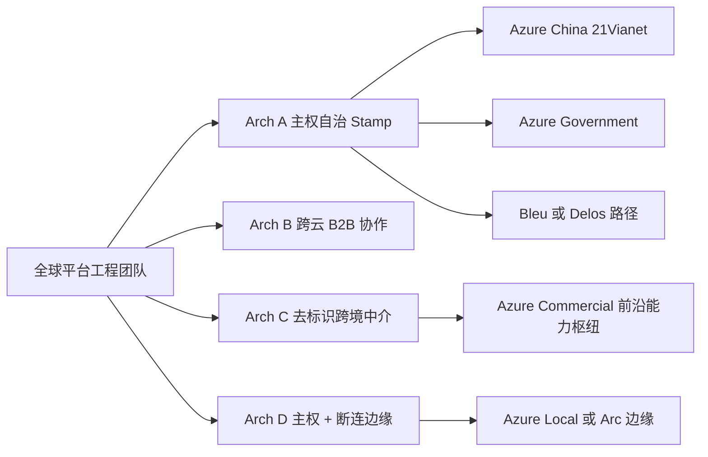
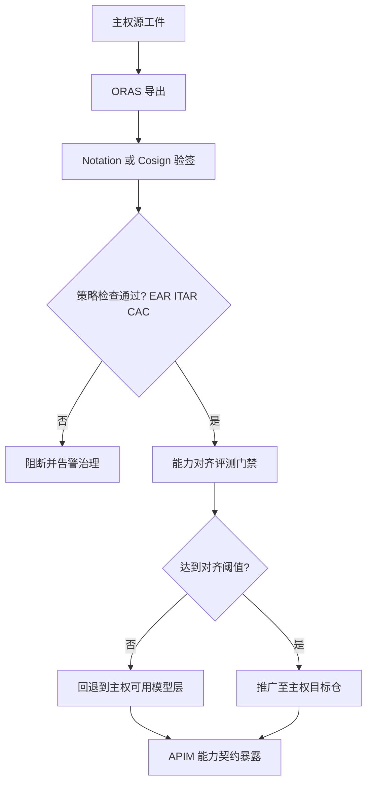
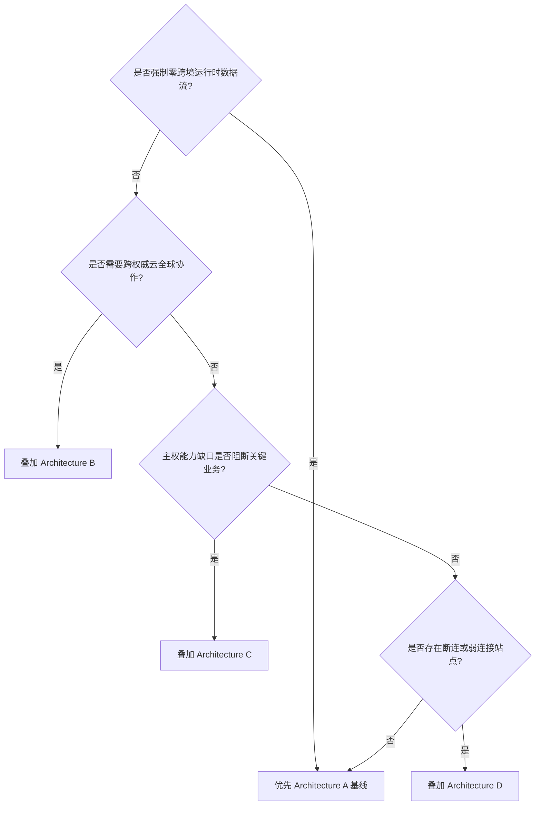

# 多主权云 AI Landing Zone 选型 FAQ：Azure China 21Vianet vs Azure Government vs Bleu/Delos 分域控制平面
> **适用场景**：跨国汽车 OEM、全球商业银行、航天国防供应链与生命科学企业。
> **决策压力**：在 `.com`、`.cn`、`.us` 与欧洲主权云路径上建立统一 AI Agent 平台，同时满足硬控制平面边界。
> **核心目标**：在司法辖区数据主权不破界前提下，实现能力可替代、运维可扩展与成本可治理。

## 1. 执行摘要
- 多主权 AI 平台首先受制于司法辖区控制平面硬边界。
- Commercial、21Vianet、Government 与欧洲主权云具备不同权威域与 ARM 终结点。
- 不能假设跨主权 VNet Peering/Private Link 天生可用。
- 模型目录在主权云之间长期存在能力与上架时差。
- 身份权威云与合规基线在不同主权区存在显著差异。
- 将 `.com` 终结点硬编码进 IaC 是最常见故障源。
- Architecture A 在严格主权隔离与可审计供应链上最稳健。
- Architecture B 在全球协作与本地主权数据面共存上最有效。
- Architecture C 在“本地主权能力缺口”补位上最有价值。
- Architecture D 在断连或弱连接场景下提供连续可用性。
- 企业通常以 A 为基线，再按场景叠加 B/C/D。
- 最终选型应由合规刚性、能力滞后容忍度与 TCO 共同决定。

## 2. 适用性与明确非目标
- 本文覆盖 `.com/.cn/.us/欧洲主权云` 多域 Landing Zone 架构。
- 本文覆盖 Entra 国家权威云差异与 Bicep `environment()` 绑定策略。
- 本文覆盖模型目录时差与能力替代门禁治理。
- 本文覆盖签名工件气闸式跨域推广路径。
- 本文不同于 Commercial Azure 内多 Entra 租户并购整合（#367）。
- 本文不同于 `.com` 内 EU-vs-US 策略分区落地主题。
- 本文不同于单一云内 AOAI 跨区域故障切换主题。
- 本文不提供法律意见或地缘政策解读。
- 本文不覆盖与主权边界无关的应用代码重构工作。

## 3. 场景与约束物理
- 主权云在法规、审计认证与服务可用性上天然异构。
- ARM 终结点不同（`management.azure.com`、`.chinacloudapi.cn`、`.usgovcloudapi.net`）。
- Entra authority discovery 必须按国家云分域解析。
- 前沿模型能力在主权区出现 `3–9` 个月时差是常态。
- 跨境数据流转需要明确法律基础与可审计证据链。
- 遥测配置错误可能在无感知下突破主权边界。
- 供应链推广需不可变、可签名、可策略验证。

## 4. 四类候选架构
- **Architecture A**：自治主权 Stamp + 签名工件气闸推广。
- **Architecture B**：跨云 B2B 身份协作 + 主权数据面锚定。
- **Architecture C**：合规跨境去标识中介能力借用通道。
- **Architecture D**：主权云 + 断连 `Azure Local/Arc` 战术边缘 Stamp。
- Arch-A 强化“运行时完全自治 + 跨域仅工件”边界。
- Arch-B 强化跨主权协作效率与访问可控性。
- Arch-C 强化在能力缺口期的受监管应急可用性。
- Arch-D 强化断网工厂/使馆/防务环境连续可用性。

## 5. Architecture A 细节（自治 Stamp + 签名气闸）
- 每个主权云独立运行完整控制面与数据面。
- 仅允许不可变工件通过气闸跨域推广。
- `ORAS` + `Notation/Cosign` 对工件来源与完整性做双向校验。
- 仅非 PII prompt、评测集、适配器等可审查资产跨域流转。
- `APIM` 能力契约抽象屏蔽模型目录差异。
- 主权区可用模型可替代缺失前沿 SKU。
- 气闸扫描器可串接出口管制与备案规则校验。
- Arch-A 是高监管行业的默认基线架构。

## 6. Architecture B 细节（跨云 B2B 身份协作）
- 跨国家云 B2B 协作可减少重复人身份体系维护成本。
- 双边信任关系需显式配置且可撤销。
- Conditional Access 应按主权云独立配置最小权限策略。
- RAG 语料、检查点、密钥与遥测保持主权本地存放。
- 区域化 Monitor/Sentinel 防止遥测默认回传总部。
- Split-horizon DNS 保证本地主权权威解析与路由。
- 可支撑跨境出差管理者与平台团队协同作业。
- Arch-B 适用于协作密集且数据驻留严格的组织。

## 7. Architecture C 细节（合规跨境去标识中介）
- 原始主权数据保持在本地主权云内不出境。
- 仅发送最小化、去标识化推理子任务请求。
- 必须具备合法跨境机制与审批审计记录。
- 电路需支持 kill-switch 与字段级出境审计。
- `130–250ms` WAN 时延会影响交互式任务体验。
- 去标识质量决定重识别风险与任务可用性的平衡。
- 仅在本地主权能力缺口场景启用该通道。
- Arch-C 适合“能力暂缺但业务必须连续”的过渡阶段。

## 8. Architecture D 细节（主权云 + 断连战术边缘）
- Azure Local/Arc 可将主权治理外延到弱网或断网站点。
- 签名模型包与 GitOps 状态可异步同步。
- 量化 SLM/vLLM 包可在离线时维持推理连续性。
- 断连状态下本地策略评估仍需可执行。
- 链路恢复后通过 Flux 对齐签名期望状态。
- 需设计延迟同步冲突检测与版本回收机制。
- 边缘机房需强化硬件信任根与密钥封装能力。
- Arch-D 适用于军工、使馆与智能工厂离线场景。

## 9. 12 维架构对比矩阵
| 维度 | Architecture A | Architecture B | Architecture C | Architecture D |
|---|---|---|---|---|
| 主要目标 | 主权运行时自治 | 跨云协作与数据面锚定 | 合规能力借用 | 断连连续可用 |
| 主权刚性 | 最高 | 高 | 中高 | 边缘最高 |
| 身份复杂度 | 中 | 高 | 中 | 中高 |
| 能力差异治理 | 高（契约抽象） | 中 | 中高 | 中 |
| 跨境数据暴露 | 默认无 | 默认无 | 可控最小 | 默认无 |
| 法务治理负担 | 高 | 高 | 最高 | 高 |
| 运维复杂度 | 中高 | 高 | 高 | 高 |
| 时延画像 | 区域本地 | 区域本地 | 跨境依赖 | 本地/离线 |
| 能力滞后韧性 | 高 | 中 | 最高 | 中 |
| 遥测泄漏风险 | 低（控好） | 中 | 中高 | 低 |
| 小规模成本 | 中 | 中高 | 高 | 高 |
| 大规模成本 | 高但可预测 | 高 | 中高 | 高 |

## 10. 四架构主权拓扑总览


## 11. 签名工件气闸与能力对齐门禁


## 12. 架构师决策树


### Q1. 如何避免硬编码终结点反模式并落地 `environment().suffixes` 与 Entra authority discovery
- 将 `.com` 终结点写死会直接导致主权部署失败与应急误操作。
- Bicep 模块应以 cloud profile 入参驱动后缀与终结点解析。
- `environment().suffixes` 应统一生成 Storage、Key Vault、ACR 域名。
- ARM 终结点差异必须体现在 IaC 与策略扫描中。
- Entra authority 发现应按国家云独立执行，不能全局默认。
- Token issuer/audience 在不同权威云不一致。
- SDK 初始化应显式传入 cloud profile 与 metadata 终结点。
- 对 accidental global fallback 应在 CI 阶段 fail fast。
- 该模式可显著降低跨主权配置漂移与回归故障。

### Q2. 模型目录时差下如何做评测门禁能力替代数学
- 主权云中前沿 SKU 相对 Commercial 滞后 `3–9` 个月较常见。
- 能力契约应描述语义目标而非绑定特定模型名。
- 替代模型上线前应通过评测门禁验证。
- 可用评分：`Score = w1*quality + w2*safety + w3*latency + w4*cost`。
- 当 `Score_alt - Score_ref >= -epsilon` 时可按策略接受替代。
- 核心生产链路应采用更严格阈值。
- 路由表应版本化能力层级与回退优先级。
- 需持续追踪替代债务并在能力到位后回收临时路由。
- 该机制可在不破主权边界下维持业务连续性。

### Q3. 如何防止跨境遥测与 OpenTelemetry Trace 泄漏
- 默认遥测目标常指向全球端点，容易隐性越界。
- `Application Insights` connection string 必须按主权 Stamp 本地化。
- crash dump 与 prompt 内容应做分级与脱敏治理。
- OpenTelemetry exporter 必须锚定主权本地 collector/workspace。
- 跨云总部 SIEM 仅接收脱敏摘要而非原始提示词。
- 生产环境应限制调试模式与原文日志输出。
- DLP 检查应覆盖 CI 与运行时准入策略。
- 完整取证数据应留存在主权边界内。
- 防泄漏需要策略、工具与运行时三层联动。

### Q4. 如何把 ORAS + Cosign 气闸与出口管制校验做成确定性门禁
- 推广必须基于不可变 digest，而非可变 tag。
- 源端与目标端都应执行签名与策略双验证。
- 策略引擎应校验 `EAR/ITAR` 与法域备案要求。
- 中国场景应加入 `CAC` 算法备案前置检查。
- 不合规工件应隔离并输出可审计拒绝原因。
- 推广事件需防篡改日志与留存策略。
- 放行清单应绑定 SBOM 与版本可追踪关系。
- 紧急 break-glass 也应保留事后法务与安全复核。
- 该气闸模型可将治理要求转化为可执行发布控制。

### Q5. 生产级 Bicep 主权模块与 Python 能力路由示例
- Bicep 应把主权云端点抽象成统一模块入参。
- 资源后缀与 ARM 地址应从环境配置动态解析。
- 路由器应按主权域与评测结果选择能力提供者。
- 对不支持能力应明确阻断，不做静默降级。
- 路由决策输出应带审计可解释理由。

```bicep
@allowed([
  'AzureCloud'
  'AzureChinaCloud'
  'AzureUSGovernment'
])
param cloudName string
param location string
param workspaceName string

var suffix = environment(cloudName).suffixes
var armEndpoint = environment(cloudName).resourceManager
var storageSuffix = suffix.storage
var keyVaultSuffix = suffix.keyvaultDns

resource logWs 'Microsoft.OperationalInsights/workspaces@2023-09-01' = {
  name: workspaceName
  location: location
  properties: {
    features: {
      searchVersion: 1
    }
  }
}

output sovereignContext object = {
  armEndpoint: armEndpoint
  storageSuffix: storageSuffix
  keyVaultSuffix: keyVaultSuffix
}
```

```python
from dataclasses import dataclass

@dataclass
class Capability:
    quality: float
    safety: float
    latency: float
    cost: float

def score(c: Capability, w=(0.45, 0.30, 0.15, 0.10)) -> float:
    return w[0]*c.quality + w[1]*c.safety + w[2]*c.latency + w[3]*c.cost

def choose_route(sovereign: str, required: str, ref: Capability, alt: Capability, epsilon: float = 0.03) -> str:
    if sovereign not in {"com", "cn", "us", "eu-sovereign"}:
        raise ValueError("Unsupported sovereign domain")
    if required == "frontier_reasoning" and sovereign in {"cn", "us"} and score(alt) + epsilon < score(ref):
        return "BLOCK_OR_ESCALATE_REVIEW"
    return "USE_LOCAL_CAPABILITY_TIER"
```

### Q6. `2-cloud`、`3-cloud` 与 `4-cloud + Azure Local` 三年 TCO 如何比较
- 随主权云数量与隔离强度上升，成本会呈非线性增长。
- 共享全球假设可降本但会显著增加合规风险暴露。
- 气闸自动化与能力抽象可压降长期运营摩擦。
- TCO 应同时纳入法务治理与能力对齐工程成本。

| Footprint | Architecture A | Architecture B | Architecture C | Architecture D |
|---|---:|---:|---:|---:|
| 2-cloud (`.com + .cn`) | \$2.80M–\$4.70M | \$3.20M–\$5.30M | \$3.90M–\$6.20M | \$4.10M–\$6.60M |
| 3-cloud (`.com + .cn + .us`) | \$5.40M–\$8.80M | \$6.20M–\$9.90M | \$7.40M–\$11.80M | \$7.90M–\$12.50M |
| 4-cloud + Azure Local | \$9.50M–\$15.60M | \$10.70M–\$17.20M | \$12.80M–\$20.10M | \$11.90M–\$18.90M |

| Footprint | 自治主权 Stamp 典型合规风险下降 | 能力替代 + 边缘叠加典型连续性提升 |
|---|---:|---:|
| 2-cloud (`.com + .cn`) | 48%–66% | 35%–52% |
| 3-cloud (`.com + .cn + .us`) | 54%–71% | 42%–60% |
| 4-cloud + Azure Local | 58%–76% | 50%–68% |

- 架构决策应优先满足法域确定性，再追求模型最优能力。
- 主权模型目录变化应触发定期能力对齐复评。
- CFO 与 CISO 应在同一季度治理板共同审阅指标。

## 13. Day-0 落地清单
- 明确每个主权 Stamp 的法域范围与合规义务。
- 建立参数化 Bicep 云配置与端点校验测试。
- 落地签名工件气闸与策略门禁流水线。
- 建立能力契约目录与对齐评测基线。
- 将遥测出口与取证工件固定在主权本地。
- 配置跨云身份信任契约与访问策略。
- 设计能力缺口升级路径与法务例外流程。
- 发布故障、回滚与电路熔断运行手册。

## 14. Day-2 运营清单
- 模型目录或策略变更后重跑能力对齐评测。
- 审计遥测目标与 crash dump 留存边界。
- 验证每次推广都完成签名与策略双校验。
- 轮换 B2B 信任关系并清理陈旧授权。
- 监控跨境中介调用与法律基础到期风险。
- 修复 IaC 中主权终结点元数据漂移。
- 复盘断连边缘同步延迟与冲突处理结果。
- 按最新负载重算多主权 TCO 与人力画像。

## 15. Good fit 与 Not for
| 分类 | 指引 |
|---|---|
| ✅ Good fit | 同时运行于多个主权法域且驻留约束严格的企业平台。 |
| ✅ Good fit | 需要在主权能力时差下保持可替代与连续服务的组织。 |
| ✅ Good fit | 需要可审计供应链推广与跨云身份治理的高监管行业。 |
| ⛔ Not for | 仍希望单一全球控制面直接跨境数据面的项目。 |
| ⛔ Not for | 不愿投入能力对齐评测与主权遥测隔离治理的团队。 |
| ⛔ Not for | 低监管、单云即可满足需求且追求最简交付的场景。 |

## 16. 五步实施路径
1. 按主权刚性与能力依赖对工作负载分层。
2. 部署带端点参数化的自治主权 Stamp 基线。
3. 落地签名气闸与能力对齐评测门禁。
4. 按需叠加跨云协作与合规跨境中介通道。
5. 对断连场景叠加 Azure Local/Arc 边缘能力。

## 17. 季度治理指标包（运营看板建议）
- 跟踪各主权域能力对齐评测通过率。
- 跟踪气闸阻断原因按策略类别分布。
- 跟踪工件签名校验失败率。
- 跟踪预生产发现的主权遥测泄漏事件。
- 跟踪跨云身份信任例外处理 SLA。
- 跟踪能力替代触发频率与业务影响评分。
- 跟踪跨境中介法律基础到期风险。
- 跟踪中介路径额外时延开销。
- 跟踪断连边缘同步滞后与回收时长。
- 跟踪环境配置误绑导致的终结点故障。
- 跟踪主权区域故障对 Agent 可用性影响。
- 跟踪各主权域月度运维工时。
- 跟踪各能力层级单次调用成本。
- 跟踪策略例外审批数量与关闭周期。
- 跟踪 crash dump 分级违规阻断数。
- 跟踪 APIM 能力契约版本漂移。
- 跟踪目录时差触发的回退路由次数。
- 跟踪出口管制门禁缺失审计发现。
- 跟踪跨境电路 kill-switch 触发与恢复时长。
- 跟踪主权本地模型相对基线质量差值。
- 跟踪主权 IaC 发布变更失败率。
- 跟踪各主权域安全事件 MTTR。
- 跟踪主权驻留审计材料交付完整率。
- 跟踪季度 TCO 与预算偏差。
- 跟踪边缘包签名有效期健康度。
- 维护主权路由决策日志与依据。

## 18. Provenance
- `anonymized_reported`：文中指标、策略模式与成本区间来自匿名化多主权企业项目观察与可复现规划假设。
