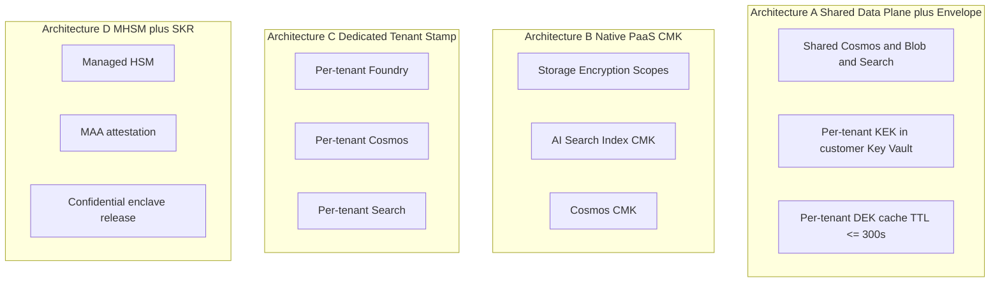
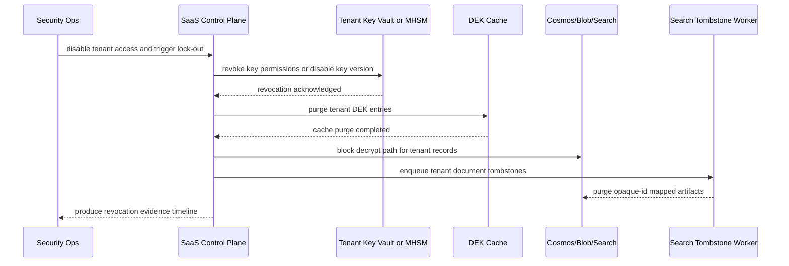
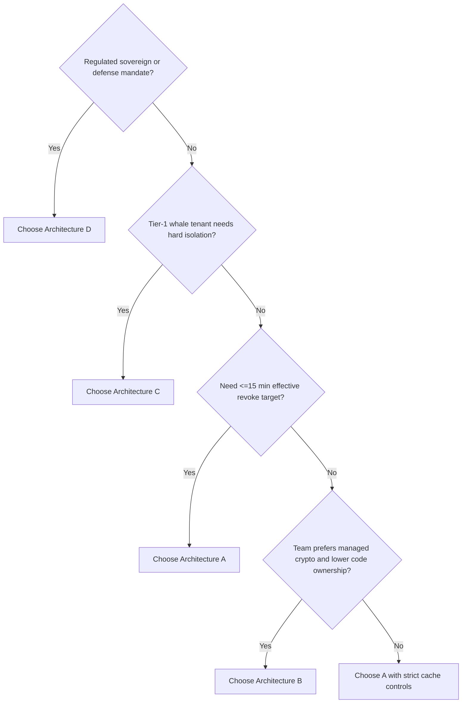

# Multi-Tenant Agent BYOK/CMK Crypto-Shredding Selection FAQ: Envelope DEK vs Native Encryption Scopes vs Dedicated Stamp vs MHSM+SKR
> **Scope**: B2B SaaS platforms and enterprise AI landing zones running stateful agents over Foundry threads, Cosmos checkpoints, AI Search vectors, and Blob artifacts.
> **Decision axis**: tenant-isolation blast radius, revocation latency, cryptographic shredding evidence, control-plane scale, and unit economics.
> **Audience**: cloud and AI solution architects owning both platform reliability and regulated customer contracts.

## 1. Executive summary
The problem is not just encryption at rest; the hard requirement is provable tenant offboarding and incident lock-out with bounded delay. Many teams implement default platform encryption first and only later face procurement demands for BYOK/CMK revocation evidence, where architecture shape matters more than key toggles.
Architecture A gives fast revocation control on shared pools, Architecture B minimizes custom crypto code but depends on service propagation windows, Architecture C provides strongest tenant blast-radius isolation with a clear cost floor, and Architecture D targets sovereign or defense-grade controls with enclave-bound key release.
No single pattern wins every segment: shared-economics SaaS commonly starts with A/B, while whale tenants and strict regulators usually push toward C/D.

## 2. Applicability and explicit non-goals
This FAQ applies when tenants require CMK ownership and revocation rights, and when legal or audit teams require measurable cryptographic-shredding timelines for stateful agent workloads persisted across multiple Azure services.
It is not a generic disk-encryption guide, does not claim ciphertext vectors preserve ANN quality, does not fully cover model-training key governance across all third-party hosts, and does not replace legal retention policy design or SOC runbooks.
Its scope is architecture-level trade-offs and production mechanics.

## 3. Problem mechanics in multi-tenant agent platforms
Stateful agent stacks write to multiple surfaces: Foundry threads for conversation artifacts, Cosmos DB for checkpoints and tool outcomes, AI Search for vectors and metadata, and Blob for source and generated files.
A tenant offboarding event must invalidate all decrypt paths, including hot caches and in-flight tasks; if one decrypt path survives, effective revocation has failed.
The architecture therefore must define bounded revocation delay with measurable evidence, and clearly document where keys are wrapped, cached, released, and physically shared versus tenant-dedicated.

## 4. Architecture A: shared data plane with envelope encryption
Architecture A keeps shared Cosmos, Search, and Blob pools while each tenant owns a KEK in cross-tenant Key Vault or Premium HSM.
Platform services generate per-tenant DEKs, wrap them with tenant KEKs, and cache them with strict TTL; recommended TTL is `<=300s` to preserve aggressive revoke posture.
Payloads are AES-256-GCM encrypted before persistence, vectors remain numeric with opaque-ID linkage, and shredding is executed by revoking KEK access plus DEK-cache expiry.
This pattern scales beyond `1,000` tenants in shared pools, with trade-offs in application crypto complexity and strict cache-discipline requirements.

## 5. Architecture B: native sub-resource PaaS CMK
Architecture B delegates crypto operations to platform engines: Storage Encryption Scopes for Blob segmentation, AI Search index-level CMK for index-at-rest encryption, and Cosmos account/database CMK for database encryption.
It reduces custom cryptography code and key-wrap plumbing and fits teams prioritizing managed control planes.
The caveat is propagation timing: key-disable effects follow service-specific cache windows, commonly `15-60 min`, and sub-resource limits (scopes/index fan-out) can constrain large-tenant designs.
Operations are simpler than A, but minute-level revoke SLOs are harder to guarantee.

## 6. Architecture C: dedicated per-tenant CMK stamp
Architecture C provisions isolated data-plane stamps per premium tenant, typically with dedicated Foundry project, Cosmos account, and AI Search service.
Tenant KEK ownership and access-domain boundaries are explicit, shared-index side channels are removed by topology, and revoke impact is confined to one tenant stamp.
This gives strong confidence for Tier-1 accounts, but increases monthly base spend and consumes ARM/subscription quotas quickly; common floor is `$900-$3,500+` per tenant per month.
In practice, C is usually a premium commercial tier, not a universal default.

## 7. Architecture D: MHSM plus Secure Key Release in confidential enclaves
Architecture D targets sovereign and top-regulated environments by anchoring keys in Managed HSM with FIPS 140-3 Level 3 controls and gating DEK release on attested enclave identity.
Azure Attestation + SKR policies enforce enclave-only unwrap for AKS Confidential Pods or NCC H100 execution paths, so plaintext DEKs are not released to non-attested nodes.
This sharply reduces operator-trust assumptions and provides strong evidence for defense or central-banking workloads, with trade-offs in cost and operational specialization.
HSM cluster floor, multi-region replication, and attestation lifecycle governance require mature platform teams.

## 8. Revocation math and shredding SLO model
A usable revocation model needs explicit terms: `T_effective_revoke = T_kv_rbac + T_dek_ttl + T_inflight_drain`.
`T_kv_rbac` is policy/token propagation to key access enforcement, `T_dek_ttl` is max cache validity for wrapped DEKs, and `T_inflight_drain` is grace time for running tasks to terminate.
Architecture A directly controls `T_dek_ttl`; B is more sensitive to service cache internals; C shrinks blast radius of any delay; D adds attestation checks to key-release paths.
The second operational formula is unwrap pressure: `R_unwrap = N_active_tenants / TTL_dek`.
Short TTL narrows exposure but raises unwrap call rates and must be budgeted against Key Vault/MHSM throughput and throttling behavior.

## 9. Topology comparison diagram


## 10. Cross-tenant revocation and crypto-shredding sequence


## 11. Selection decision tree


## 12. 12-dimension architecture comparison matrix
| Dimension | A Shared + Envelope DEK | B Native PaaS CMK | C Dedicated Stamp | D MHSM + SKR |
|---|---|---|---|---|
| Revocation precision | High with TTL control | Medium | High | Highest |
| Typical revoke window | `5-15 min` target | `15-60 min` common | `5-20 min` by design | Policy-defined strict |
| Tenant blast radius | Medium-low | Medium | Low | Lowest |
| Shared-economics efficiency | Highest | High | Low | Lowest |
| Code ownership burden | High | Low | Medium | High |
| Platform ops complexity | Medium | Low-medium | High | Highest |
| Scale to thousands tenants | High | Medium-high | Low-medium | Low |
| Evidence quality for audits | High | Medium | High | Highest |
| Vector search compatibility | High with opaque IDs | High | High | High |
| Key unwrap throughput pressure | Medium-high | Medium | Medium | High |
| Onboarding speed | Medium | High | Low | Low |
| Best-fit segment | Mid-market regulated SaaS | Standard enterprise SaaS | Premium isolated tenants | Sovereign/defense |

## 13. Why vectors cannot be naively ciphertext-encrypted
HNSW and DiskANN depend on floating-point vector geometry; cosine/L2 distances require numeric arithmetic over embedding dimensions.
AES-GCM ciphertext destroys neighborhood structure, so replacing vectors with ciphertext blobs collapses ANN quality.
The production pattern is separation of concerns: keep vectors numeric, store opaque document IDs in index payload fields, resolve those IDs to encrypted source payloads outside index math, apply tenant filters at query time, and run async tombstone purge for deleted mappings.
This preserves retrieval quality while reducing residual metadata-leakage and inversion exposure.

## 14. Cross-tenant identity wiring with UAMI and federated credentials
Cross-tenant BYOK commonly requires federated identity bridges: the provider tenant runs workload UAMI, while customer tenant hosts KEK in Key Vault or MHSM.
Customer Entra app trust is expressed through Federated Identity Credential bindings for issuer, subject, and audience, with least-privilege rights constrained to wrap/unwrap operations.
Broad key-management rights are unnecessary, and revocation remains customer-controlled with auditable logs in their own tenant.

## 15. Key unwrap throughput and SLA trade-offs
Key systems have finite RPS envelopes, and `R_unwrap = N_active_tenants / TTL_dek` provides the baseline pressure estimate.
Aggressive TTL shortening increases unwrap spikes; long TTL weakens effective revocation latency.
Capacity models must include burst factors and retry patterns, while `KeyVaultUnavailable` handling must be explicit.
Fail-closed preserves strict security guarantees but impacts availability; bounded grace-lease can preserve availability for lower-risk tiers at the cost of stricter revoke posture.
The policy choice must be tenant-tier aware, documented, and observable.

## 16. Production Bicep: cross-tenant CMK plus encryption scope
```bicep
param location string = resourceGroup().location
param storageName string
param keyVaultUri string
param keyName string
param keyVersion string
param tenantObjectId string
param uamiName string

resource uami 'Microsoft.ManagedIdentity/userAssignedIdentities@2023-01-31' = {
  name: uamiName
  location: location
}

resource stg 'Microsoft.Storage/storageAccounts@2023-05-01' = {
  name: storageName
  location: location
  sku: { name: 'Standard_RAGRS' }
  kind: 'StorageV2'
  identity: {
    type: 'UserAssigned'
    userAssignedIdentities: {
      '${uami.id}': {}
    }
  }
  properties: {
    encryption: {
      keySource: 'Microsoft.Keyvault'
      keyvaultproperties: {
        keyname: keyName
        keyversion: keyVersion
        keyvaulturi: keyVaultUri
      }
      services: {
        blob: { enabled: true }
      }
    }
  }
}

resource scopeTenantA 'Microsoft.Storage/storageAccounts/encryptionScopes@2023-05-01' = {
  parent: stg
  name: 'tenant-a-scope'
  properties: {
    source: 'Microsoft.KeyVault'
    keyUri: '${keyVaultUri}keys/${keyName}/${keyVersion}'
    requireInfrastructureEncryption: true
  }
}
```

## 17. Python AES-256-GCM envelope cache with TTL and KeyDisabled invalidation
```python
from dataclasses import dataclass
from datetime import datetime, timedelta, timezone
from cryptography.hazmat.primitives.ciphers.aead import AESGCM
import os


@dataclass
class DekEntry:
    wrapped_dek: bytes
    plaintext_dek: bytes
    expires_at: datetime


class DekCache:
    def __init__(self, ttl_seconds: int = 300):
        self.ttl = ttl_seconds
        self.entries: dict[str, DekEntry] = {}

    def get(self, tenant_id: str) -> bytes | None:
        e = self.entries.get(tenant_id)
        if not e:
            return None
        if datetime.now(timezone.utc) >= e.expires_at:
            self.entries.pop(tenant_id, None)
            return None
        return e.plaintext_dek

    def put(self, tenant_id: str, wrapped: bytes, dek: bytes) -> None:
        self.entries[tenant_id] = DekEntry(
            wrapped_dek=wrapped,
            plaintext_dek=dek,
            expires_at=datetime.now(timezone.utc) + timedelta(seconds=self.ttl),
        )

    def invalidate_tenant(self, tenant_id: str) -> None:
        self.entries.pop(tenant_id, None)

    def invalidate_all(self) -> None:
        self.entries.clear()


def encrypt_payload(plaintext: bytes, dek: bytes, aad: bytes) -> tuple[bytes, bytes]:
    nonce = os.urandom(12)
    cipher = AESGCM(dek)
    ciphertext = cipher.encrypt(nonce, plaintext, aad)
    return nonce, ciphertext


def on_event_grid_key_disabled(event: dict, cache: DekCache) -> None:
    tenant_id = event["data"]["tenantId"]
    cache.invalidate_tenant(tenant_id)
```

### Q1: How should we compute effective revocation windows instead of key-state windows?
Use full-path timing, not key-state timing alone: `T_effective_revoke = T_kv_rbac + T_dek_ttl + T_inflight_drain`.
If any term is unbounded, revoke SLO is unbounded; regulated tiers should enforce hard caps on DEK TTL and in-flight drain.
The formula should appear in customer-facing control descriptions and audit evidence.

### Q2: How do we preserve ANN retrieval utility while enforcing crypto controls?
Do not encrypt vector floats with AES-GCM because ANN math needs numeric geometry, not opaque ciphertext bytes.
Use opaque-ID indirection in index metadata, enforce tenant filter at resolution, and run async tombstone purge on offboarding.
This keeps retrieval quality and reduces residual data-linkage risk.

### Q3: How do we wire cross-tenant UAMI + FIC safely without over-privileging?
Use provider-side UAMI as workload identity and customer-side app registration with precise FIC trust entries.
Bind exact issuer/subject claims without wildcards and grant only `wrapKey`/`unwrapKey` permissions.
Keep key rotation and revoke ownership in customer tenant, and correlate dual-tenant logs on request IDs.

### Q4: How should we handle KeyVaultUnavailable events without violating contracts?
Define mode by tenant tier and risk profile: fail-closed for strict revoke guarantees, bounded grace-lease for lower-risk availability-first paths.
If grace-lease is enabled, enforce short duration and full audit logging.
Expose mode changes on incident dashboards and never silently degrade from fail-closed.

### Q5: What are the minimum engineering artifacts required before go-live?
You need IaC definitions for cross-tenant identity and CMK bindings, deterministic DEK TTL enforcement, Event Grid invalidation for key-disable events, and per-tier revocation runbooks with evidence templates.
You also need replayable offboarding timeline tests.
Without these artifacts, audits commonly fail despite encrypted-at-rest claims.

### Q6: When should we escalate from A/B to C/D patterns?
Escalate to C when tenant-specific isolation materially drives deal value or contractual terms.
Escalate to D when enclave-bound key release and sovereign controls are mandated.
Do not escalate due to a single questionnaire; use contract language, regulator class, breach impact, and spend-versus-value modeling.
Treat escalation as portfolio strategy, not one-off engineering preference.

## 24. 3-year TCO model for 25, 250, and 2,000 tenants
| Architecture | 25 tenants | 250 tenants | 2,000 tenants | 3-year total profile |
|---|---:|---:|---:|---:|
| A Shared + Envelope | `$0.78M` | `$4.6M` | `$30.9M` | Lowest blended cost |
| B Native PaaS CMK | `$0.71M` | `$4.9M` | `$34.8M` | Lower code, higher propagation dependence |
| C Dedicated Stamp | `$1.9M` | `$18.7M` | `$145.0M` | Premium-tier isolation economics |
| D MHSM + SKR | `$3.4M` | `$28.6M` | `$208.0M` | Sovereign-grade control economics |
| Hybrid A+B+C tiering | `$1.1M` | `$8.2M` | `$62.4M` | Practical enterprise mix |

## 25. Day-0 go-live checklist
- Classify tenants into standard, premium, and sovereign security tiers.
- Define revocation SLO with explicit equation terms and targets.
- Implement cross-tenant identity trust with least privilege claims.
- Set DEK cache TTL defaults and emergency override controls.
- Validate search opaque-ID pattern and tenant filter correctness.
- Run offboarding simulation with evidence export and timeline stamps.
- Establish per-tier fallback policy for KeyVaultUnavailable events.

## 26. Day-2 operating checklist
- Recompute `R_unwrap` and HSM pressure monthly from active tenant telemetry.
- Track revocation timeline percentiles and outlier root causes.
- Rotate KEK versions and test rollback-safe policy changes.
- Verify tombstone lag and stale-reference error budgets in search indexes.
- Audit cross-tenant identity trust objects for drift.
- Run quarterly breach-containment game days across all four patterns.

## 27. Recommended adoption path
Start with A for controlled revoke windows at shared economics.
Use B when platform-managed crypto operations are preferred.
Offer C as premium isolation SKU for whale tenants.
Reserve D for sovereign and high-assurance contracts.
Keep migration paths explicit between tiers.
Design commercial packaging and technical architecture together.
Define explicit upgrade criteria in contracts so architecture moves do not depend on ad-hoc escalations.
Track per-tier revoke SLO attainment monthly to validate that segmentation remains technically and commercially sound.

## 28. Provenance note
Cost and latency envelopes combine measured lab data and anonymized_reported enterprise field telemetry with synthetic stress-model interpolation for capacity planning.
