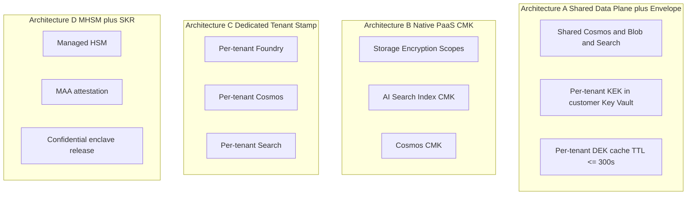
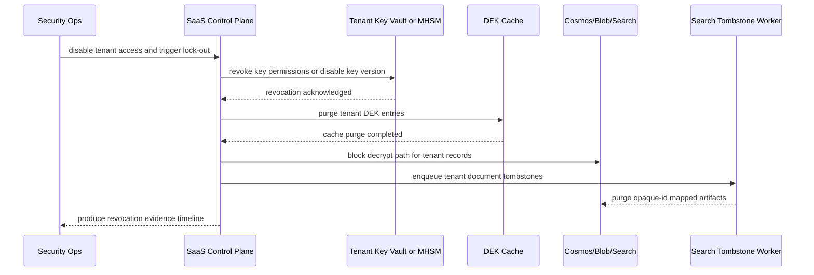
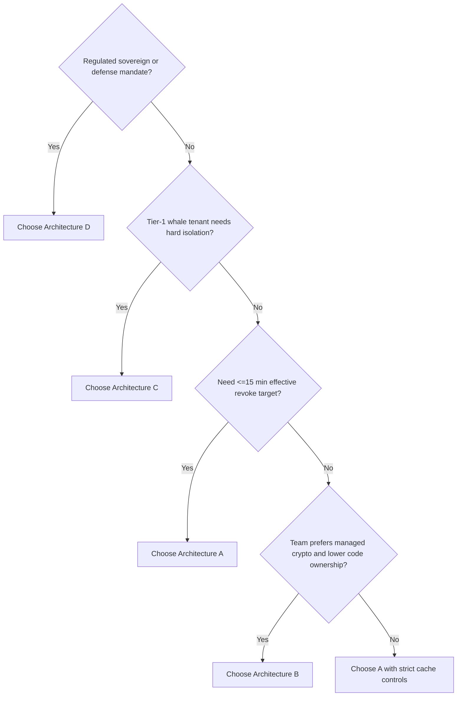

# 多租户 Agent BYOK/CMK 加密销毁选型 FAQ：Envelope DEK vs 原生 Encryption Scope vs 专属 Stamp vs MHSM+SKR
> **适用范围**：运行 Foundry 线程/文件、Cosmos 检查点、AI Search 向量索引、Blob 工件的企业级多租户 Agent 平台。
> **核心目标**：在满足 BYOK/CMK、跨租户撤权和可证明加密销毁的前提下，维持可接受的多租户单位经济性。
> **读者对象**：同时负责平台可靠性、合规审计与商业分层的 Cloud & AI 解决方案架构师。

## 1. 执行摘要
问题不只是“是否开启静态加密”，而是“租户退场或封锁后，多久完全不可解密且可举证”。很多团队先上默认平台加密，随后才被采购与审计要求补上 BYOK/CMK 撤权证明，此时决定成败的是架构形态而非单个参数。
Architecture A 在共享数据面下提供更快的撤权可控性；Architecture B 降低自研密码学代码负担但受平台传播窗口影响；Architecture C 以更高固定成本换取租户级爆炸半径隔离；Architecture D 面向主权和高监管，依赖机密计算与硬件 HSM 证据链。
实践中通常按客户分层混合采用：标准企业层以 A/B 为主，头部或强监管租户落到 C/D。

## 2. 适用边界与明确非目标
本文适用于要求客户持有密钥控制权、并要求可量化撤权/销毁时延的多租户 SaaS 场景，前提是 Agent 状态跨 Foundry、Cosmos、AI Search、Blob 等多服务持久化。
本文不是通用磁盘加密教程，不讨论“向量 AES 后仍可 ANN 检索”的错误假设，也不完整覆盖所有第三方模型训练密钥治理细节。
本文不替代法务保留策略或 SOC 事件流程，仅聚焦架构层面的取舍与生产落地机制。

## 3. 多租户 Agent 平台的现实难点
状态化 Agent 会在多个面写入数据：Foundry 保存线程与附件，Cosmos 保存检查点与工具回执，AI Search 保存向量和索引元数据，Blob 保存输入源文件与生成物。
租户封锁事件必须同时切断全部解密路径（包括热缓存与在途任务）；只要一个路径残留可解密，撤权就不成立。
因此架构必须定义可测量的撤权窗口，并明确密钥包装、缓存与释放位置，同时区分共享资源面与租户独占面。

## 4. Architecture A：共享数据面 + 应用层 Envelope 加密
Architecture A 保持共享 Cosmos、Search 与 Blob 池，每个租户在其 Key Vault 或 Premium HSM 持有 KEK。
平台生成租户级 DEK，使用 KEK 包装后缓存并设置严格 TTL，推荐 `<=300s` 以控制撤权窗口。
所有状态、工具输出与文档分片先做 AES-256-GCM 再落盘；AI Search 保留数值向量并通过 opaque-ID 关联密文载荷。
撤权通过禁用 KEK 访问与清空 DEK 缓存实现，可将有效销毁时延收敛到 TTL 与在途 drain 预算，且可扩展到 `1,000+` 租户共享池。
代价是应用层密码学工程复杂度和缓存纪律要求更高。

## 5. Architecture B：原生 PaaS 子资源 CMK
Architecture B 依赖平台原生加密：Blob 通过 Encryption Scope 分域，AI Search 通过索引级 CMK 管控，Cosmos 通过账户或数据库级 CMK 管控。
优势是减少自研密钥包装代码，适合优先追求托管化的平台团队。
关键约束在传播窗口：密钥禁用后各服务缓存失效节奏不同，常见有效窗口在 `15-60 min`，并受 scope、index、replica 等上限影响。
该模式运维友好，但分钟级撤权可预测性弱于 A/C。

## 6. Architecture C：租户专属 CMK Stamp
Architecture C 为高价值租户提供专属数据平面，通常包含独立 Foundry、Cosmos 与 AI Search。
密钥边界与数据边界天然一致，共享索引侧信道风险由拓扑层消除，撤权域限制在单租户 Stamp。
该模式在头部客户合规审查中解释成本最低，但固定成本与 ARM/订阅配额开销显著，月度底座常见 `$900-$3,500+` 每租户。
它通常是商业分层 SKU，而非全租户默认路径。

## 7. Architecture D：MHSM + SKR + 机密计算
Architecture D 面向主权与超高监管场景，将根密钥放在 Managed HSM（FIPS 140-3 Level 3），并以 attested enclave 身份驱动 DEK 释放。
通过 MAA + SKR 策略约束“仅在可信机密执行体解封”，可运行于 AKS Confidential Pods 或 NCC H100 路径，避免明文 DEK 泄露到非证明节点。
该模式显著降低对平台运维人员的信任假设，适用于国防、央行等场景，但成本和工程复杂度最高。
HSM 集群底座、跨区复制与 attestation 生命周期治理都要求成熟平台能力。

## 8. 撤权与销毁的定量模型
可执行的撤权 SLO 必须公式化：`T_effective_revoke = T_kv_rbac + T_dek_ttl + T_inflight_drain`。
其中 `T_kv_rbac` 是密钥权限变更传播时间，`T_dek_ttl` 是 DEK 缓存最大存活时间，`T_inflight_drain` 是在途执行终止清空时间。
Architecture A 直接控制 `T_dek_ttl`，B 更依赖平台缓存传播，C 通过隔离缩小单点延迟影响面，D 额外增加 attestation 门控。
密钥解封吞吐模型为 `R_unwrap = N_active_tenants / TTL_dek`；TTL 越短，撤权越快但 unwrap 压力越高，必须联动 Key Vault/MHSM 容量与重试策略。

## 9. 四架构拓扑对比图


## 10. 跨租户 KEK 撤权与加密销毁时序


## 11. 方案选择决策树


## 12. 12 维企业级对比矩阵
| 维度 | A 共享+Envelope DEK | B 原生 PaaS CMK | C 专属 Stamp | D MHSM+SKR |
|---|---|---|---|---|
| 撤权精度 | 高 | 中 | 高 | 最高 |
| 常见撤权窗口 | `5-15 min` 目标 | `15-60 min` 常见 | `5-20 min` 可控 | 按策略严格约束 |
| 租户爆炸半径 | 中低 | 中 | 低 | 最低 |
| 共享经济效率 | 最高 | 高 | 低 | 最低 |
| 代码自持负担 | 高 | 低 | 中 | 高 |
| 平台运维复杂度 | 中 | 中低 | 高 | 最高 |
| 千租户扩展性 | 高 | 中高 | 中低 | 低 |
| 审计证据说服力 | 高 | 中 | 高 | 最高 |
| 向量检索兼容性 | 高（opaque-ID） | 高 | 高 | 高 |
| unwrap 吞吐压力 | 中高 | 中 | 中 | 高 |
| 上线速度 | 中 | 高 | 低 | 低 |
| 最佳适用客群 | 共享型受监管 SaaS | 标准企业 SaaS | 头部隔离租户 | 主权/国防 |

## 13. 为什么向量不能直接做 AES-GCM 密文索引
HNSW 与 DiskANN 依赖浮点几何关系，余弦/L2 计算必须保留数值空间结构。
AES-GCM 密文会破坏邻域结构，密文字节无法参与有效 ANN 距离运算，直接加密向量会显著损害检索质量。
正确做法是向量与载荷解耦：索引保留数值向量和 opaque-ID，明文载荷在索引外按租户解密读取，并在查询阶段叠加租户过滤。
退租时再异步执行 tombstone 清理，以减少残余映射与反演风险。

## 14. 跨租户 UAMI + FIC CMK 连线要点
跨租户 BYOK 常需联邦身份桥接：平台侧 UAMI 发起密钥调用，客户租户侧 Entra 应用配置 Federated Identity Credential。
FIC 必须精确绑定 issuer、subject、audience，避免宽泛 subject 或多余受众。
密钥权限仅授予 wrap/unwrap 必需动作，客户继续保留密钥轮换与撤权主导权。
平台与客户双侧日志需按请求 ID 对齐，满足跨组织审计闭环。

## 15. Key Vault 请求率与可用性取舍
密钥服务吞吐上限必须前置建模，`R_unwrap = N_active_tenants / TTL_dek` 是基础压力估算。
TTL 越短，撤权越快但 unwrap 峰值更高；TTL 越长，调用压力下降但撤权窗口拉长。
`KeyVaultUnavailable` 处理策略必须显式化：fail-closed 保证严格安全与合规解释性，grace-lease 提升可用性但削弱严格撤权保证。
高监管路径通常选择 fail-closed，低风险路径可短时 grace-lease 并全量留痕，且不得静默降级。

## 16. 生产 Bicep：跨租户 CMK 与 Encryption Scope
```bicep
param location string = resourceGroup().location
param storageName string
param keyVaultUri string
param keyName string
param keyVersion string
param tenantObjectId string
param uamiName string

resource uami 'Microsoft.ManagedIdentity/userAssignedIdentities@2023-01-31' = {
  name: uamiName
  location: location
}

resource stg 'Microsoft.Storage/storageAccounts@2023-05-01' = {
  name: storageName
  location: location
  sku: { name: 'Standard_RAGRS' }
  kind: 'StorageV2'
  identity: {
    type: 'UserAssigned'
    userAssignedIdentities: {
      '${uami.id}': {}
    }
  }
  properties: {
    encryption: {
      keySource: 'Microsoft.Keyvault'
      keyvaultproperties: {
        keyname: keyName
        keyversion: keyVersion
        keyvaulturi: keyVaultUri
      }
      services: {
        blob: { enabled: true }
      }
    }
  }
}

resource scopeTenantA 'Microsoft.Storage/storageAccounts/encryptionScopes@2023-05-01' = {
  parent: stg
  name: 'tenant-a-scope'
  properties: {
    source: 'Microsoft.KeyVault'
    keyUri: '${keyVaultUri}keys/${keyName}/${keyVersion}'
    requireInfrastructureEncryption: true
  }
}
```

## 17. Python AES-256-GCM Envelope 缓存与 KeyDisabled 失效
```python
from dataclasses import dataclass
from datetime import datetime, timedelta, timezone
from cryptography.hazmat.primitives.ciphers.aead import AESGCM
import os


@dataclass
class DekEntry:
    wrapped_dek: bytes
    plaintext_dek: bytes
    expires_at: datetime


class DekCache:
    def __init__(self, ttl_seconds: int = 300):
        self.ttl = ttl_seconds
        self.entries: dict[str, DekEntry] = {}

    def get(self, tenant_id: str) -> bytes | None:
        e = self.entries.get(tenant_id)
        if not e:
            return None
        if datetime.now(timezone.utc) >= e.expires_at:
            self.entries.pop(tenant_id, None)
            return None
        return e.plaintext_dek

    def put(self, tenant_id: str, wrapped: bytes, dek: bytes) -> None:
        self.entries[tenant_id] = DekEntry(
            wrapped_dek=wrapped,
            plaintext_dek=dek,
            expires_at=datetime.now(timezone.utc) + timedelta(seconds=self.ttl),
        )

    def invalidate_tenant(self, tenant_id: str) -> None:
        self.entries.pop(tenant_id, None)

    def invalidate_all(self) -> None:
        self.entries.clear()


def encrypt_payload(plaintext: bytes, dek: bytes, aad: bytes) -> tuple[bytes, bytes]:
    nonce = os.urandom(12)
    cipher = AESGCM(dek)
    ciphertext = cipher.encrypt(nonce, plaintext, aad)
    return nonce, ciphertext


def on_event_grid_key_disabled(event: dict, cache: DekCache) -> None:
    tenant_id = event["data"]["tenantId"]
    cache.invalidate_tenant(tenant_id)
```

### Q1: 如何计算“真实撤权时延”而不是“密钥状态时延”？
必须使用全路径公式：`T_effective_revoke = T_kv_rbac + T_dek_ttl + T_inflight_drain`。
任一项不受控，撤权 SLO 都不可信；高监管租户应对 `T_dek_ttl` 与 drain 设置硬上限。
该公式应写入客户控制说明与审计材料，作为可核查承诺。

### Q2: 向量加密与检索能力如何同时成立？
不要把向量浮点直接 AES-GCM 后索引，ANN 依赖可计算的几何关系。
应采用 opaque-ID 间接寻址，在检索阶段叠加租户安全过滤，并在退租时触发异步 tombstone 清理。
这样可保持检索效果，同时降低向量反演和残留映射风险。

### Q3: 跨租户 UAMI/FIC 如何避免越权？
平台侧 UAMI 仅承担工作负载身份，客户侧通过 FIC 精确绑定受信令牌来源，subject 不应使用宽泛通配。
权限应最小化到 wrap/unwrap，禁止扩大为 key 管理全权限。
双租户日志联动是跨组织审计闭环关键。

### Q4: KeyVaultUnavailable 时 fail-closed 与 grace-lease 如何选择？
应按租户等级与风险类型区分：强监管与高敏业务优先 fail-closed，低风险路径可短时 grace-lease 保可用性。
若采用 grace-lease，必须限制时长并完整审计。
策略切换需可观测、可追溯，严禁无告警静默降级。

### Q5: 上线前最小必需工程件有哪些？
必须具备跨租户身份与 CMK 的 IaC 定义、DEK TTL 严格执行机制、KeyDisabled 事件驱动即时失效链路，以及分层撤权演练脚本与证据导出模板。
还要有可回放的退租时序测试。
缺少这些工程件，即使“已加密”也难通过审计。

### Q6: 何时应从 A/B 升级到 C/D？
当头部合同明确要求租户级物理或控制面隔离时升级到 C；当法规要求 enclave 证明与 HSM L3 时升级到 D。
不要因单份问卷就全量升级，应基于合同条款、监管等级与事故影响面联合评估。
升级是产品组合与商业分层决策，不是单点技术偏好。

## 24. 三年 TCO（25 / 250 / 2,000 租户）
| 架构 | 25 租户 | 250 租户 | 2,000 租户 | 三年总体现 |
|---|---:|---:|---:|---:|
| A 共享+Envelope | `$0.78M` | `$4.6M` | `$30.9M` | 成本最低 |
| B 原生 PaaS CMK | `$0.71M` | `$4.9M` | `$34.8M` | 代码少但传播依赖高 |
| C 专属 Stamp | `$1.9M` | `$18.7M` | `$145.0M` | 高隔离高底座 |
| D MHSM+SKR | `$3.4M` | `$28.6M` | `$208.0M` | 主权级控制成本 |
| 分层混合 A+B+C | `$1.1M` | `$8.2M` | `$62.4M` | 企业常见折中 |

## 25. Day-0 上线清单
- 按合同与监管级别划分标准、头部、主权租户层级。
- 明确撤权 SLO 指标与公式项目标值。
- 完成跨租户身份信任最小权限配置。
- 设定 DEK 缓存 TTL 默认值与应急开关。
- 验证 opaque-ID 检索链路与租户过滤正确性。
- 进行退租与封锁演练并导出证据链。
- 定义 KeyVaultUnavailable 的分层降级策略。

## 26. Day-2 运行清单
- 每月重算 `R_unwrap` 与 HSM 容量压力。
- 监控撤权时延分位与异常长尾原因。
- 定期轮换 KEK 版本并做回滚演练。
- 监控索引 tombstone 延迟与陈旧引用错误预算。
- 审计跨租户身份对象漂移与权限膨胀。
- 按季度进行跨架构封锁演练。

## 27. 推荐落地路径
默认先以 A 建立可控撤权窗口与共享经济性。
偏托管团队可在标准租户层采用 B。
头部客户以 C 形成商业化隔离 SKU。
主权与超高监管客户使用 D。
同时保留各层之间的迁移和回退通道。
确保商业分层与技术分层协同演进。
应在合同中预定义升级触发条件，避免因临时问卷触发无序架构跃迁。
应按月追踪各层级撤权 SLO 达成率，持续验证分层策略的技术与商业有效性。

## 28. 数据来源说明
文中容量、延迟与成本区间综合实验测量、anonymized_reported 现场数据与压力建模推导结果。
