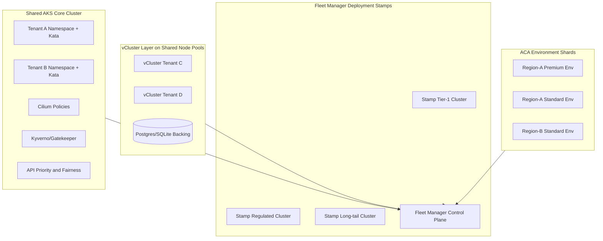
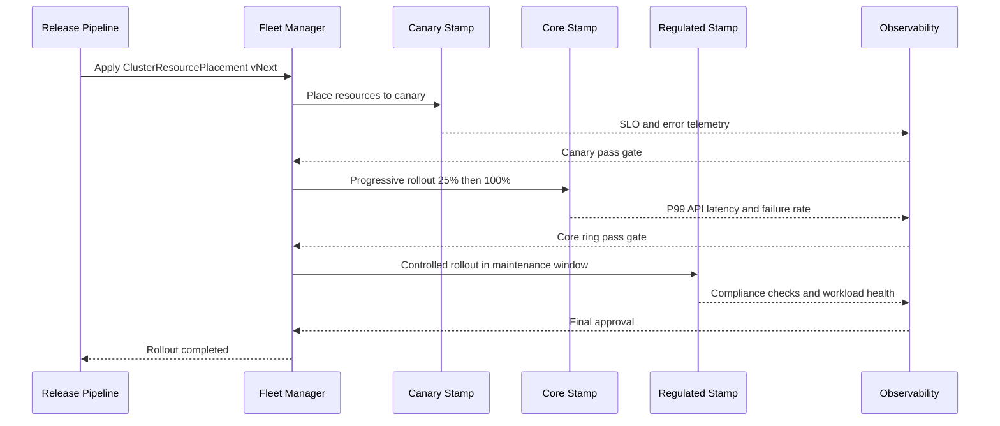

# 企业多租户 Agent 集群隔离选型 FAQ：共享 AKS + Kata Namespace vs vCluster vs Fleet Manager Stamps vs ACA 环境分片

> 适用对象：Cloud & AI Solution Architect、平台工程与 SRE 团队、企业级 B2B SaaS 技术负责人。  
> 决策主题：在 `50–2,000` 企业租户共用 Agent 平台时，如何在隔离强度、控制面稳定性、上线速度与单位成本之间取得可运营平衡。

## 1. 决策边界：多租户 Agent 平台的核心瓶颈不在算力而在控制面

多租户 Agent 平台早期通常先卡在控制面。  
不是先卡在 GPU。  
当租户开始自带 MCP 服务与 CRD 时，问题会迅速出现。  
`kube-apiserver` 列表与监听风暴会把延迟拉高。  
`etcd` 压力会随对象数急剧上升。  
一次租户侧错误 CRD 发布，可能影响全局。  
这正是共享控制面的天然风险。  
很多团队在 30 个租户内感觉一切正常。  
到 200 个活跃租户后才暴露上限。  
这时再迁移代价极高。  
所以架构设计必须前置分层。  
不仅考虑“能跑”。  
更要考虑“可持续扩展”。  
还要考虑“故障可局部化”。  
本指南比较四种主流路径。  
它们分别代表不同隔离深度。  
也代表不同运维复杂度。  
目标不是追求单一最佳技术。  
而是建立可演进路线。  

## 2. 四种模式总览：从共享控制面到分区 Stamp 的隔离光谱

模式一：共享 AKS 集群，租户按 Namespace 隔离。  
叠加 Kata RuntimeClass 与 Cilium NetworkPolicy。  
再加 Kyverno/Gatekeeper 与 API Priority and Fairness。  
模式二：共享节点池上运行 vCluster。  
每租户拥有独立虚拟 `kube-apiserver`。  
CRD 与 RBAC 可以独立演进。  
模式三：Fleet Manager Deployment Stamps。  
按层级或重点租户使用 Cluster-per-Stamp。  
通过 ClusterResourcePlacement 管理多集群发布。  
模式四：ACA Environment 分片。  
按区域和租户层级切分环境。  
把 K8s 控制面运维负担降到最低。  
这四种模式形成清晰阶梯。  
共享集群效率高。  
独立 Stamp 隔离强。  
vCluster 在中间平衡。  
ACA 适合无强 K8s 定制诉求的服务化 Agent。  

## 3. 模式一：共享 AKS（Namespace-per-Tenant + Kata + Cilium）高密度承载

模式一的优势是资源利用率。  
在同等算力预算下，可容纳更多租户。  
对中小租户聚合场景非常经济。  
Kata 可提升运行时边界。  
Cilium NetworkPolicy 可强化网络最小权限。  
Kyverno 或 Gatekeeper 可落地准入策略。  
API Priority and Fairness 可降低抢占冲击。  
但是该模式有明确上限。  
随着租户增加，控制面噪声会累积。  
CRD 版本冲突难以彻底避免。  
全局 API 变更影响面较大。  
若平台进入 150–300 活跃租户区间，风险显著上升。  
此时应提前规划向模式二或三演进。  
模式一适合作为启动与成本优化层。  
不应被误用为无限扩展终态。  

## 4. 模式二：vCluster 虚拟控制面（共享节点、独立租户 API）

模式二通过虚拟控制面降低共享冲突。  
每租户有独立 API 语义空间。  
CRD 与 RBAC 可独立演进。  
这对支持租户自定义控制器特别关键。  
底层仍共享物理节点池。  
因此成本优于完全独立集群。  
其代价是平台复杂度上升。  
运维团队需管理双层控制面。  
监控与故障定位链路更长。  
vCluster 的存储后端也要治理。  
使用 SQLite 更轻但扩展受限。  
使用 Postgres 更稳但成本更高。  
模式二通常适用于 200–800 租户区间。  
尤其适用于“租户需要控制面自治”但“预算不支持全集群独占”的阶段。  

## 5. 模式三：Fleet Manager Stamps（集群级隔离与升级环治理）

模式三是强隔离路径。  
每个 Stamp 可绑定一个或多个租户。  
高合规租户可独享集群。  
普通租户按 Tier 共享 Stamp。  
通过 Fleet Manager 可统一发布策略。  
ClusterResourcePlacement 支持分批灰度。  
升级可按 ring 推进。  
故障可局部封锁在单个 Stamp。  
这显著降低跨租户连带风险。  
代价是基础控制面成本上升。  
多集群运维与网络编排更复杂。  
需要成熟自动化与运维体系。  
当租户规模接近千级并且合规差异明显时，该模式更稳健。  
模式三常被金融、政务、跨国 SaaS 采用。  

## 6. 模式四：ACA Environment 分片（最小化 K8s 控制面运维）

模式四面向“服务优先”平台。  
如果业务主要是 HTTP 与 KEDA 触发，ACA 很有吸引力。  
团队可少维护底层 K8s 控制面。  
可把精力集中到应用治理。  
环境分片可按区域与租户等级设计。  
对标准化微服务型 Agent 很合适。  
不足在于定制能力边界。  
复杂 CRD 与深度控制器生态不如 AKS 灵活。  
网络与子网配额规划也要前置。  
否则环境扩张后会受限。  
模式四适合“快速交付 + 中等定制”的多租户平台。  
若租户要求深度 K8s 自治，需搭配其他模式。  

## 7. 架构拓扑图：共享层、虚拟控制面层、Stamp 层与 ACA 分片层



此拓扑强调“多层并存”而非单层替代。  
企业可按租户分层映射到不同宿主。  
从而平衡成本与隔离。  

## 8. Fleet 分阶段灰度时序：CRP 发布、健康检查与回滚



关键是先小环验证再大环扩散。  
一旦指标退化可快速止损。  
这比全集群一次性升级更安全。  

## 9. 可落地片段：ClusterResourcePlacement + FlowSchema

```yaml
apiVersion: placement.kubernetes-fleet.io/v1beta1
kind: ClusterResourcePlacement
metadata:
  name: agent-platform-release-2026w47
spec:
  resourceSelectors:
    - group: apps
      version: v1
      kind: Deployment
      name: agent-runtime-gateway
  policy:
    placementType: PickN
    numberOfClusters: 3
    topologySpreadConstraints:
      - maxSkew: 1
        topologyKey: fleet.azure.com/ring
        whenUnsatisfiable: DoNotSchedule
---
apiVersion: flowcontrol.apiserver.k8s.io/v1beta3
kind: FlowSchema
metadata:
  name: tenant-high-priority-agent-jobs
spec:
  matchingPrecedence: 900
  priorityLevelConfiguration:
    name: workload-high
  rules:
    - resourceRules:
        - verbs: ["get","list","watch","create","update","patch"]
          apiGroups: ["*"]
          resources: ["*"]
      subjects:
        - kind: Group
          group:
            name: tenant-premium
```

上述片段展示两类关键控制。  
一类是跨集群发布节奏。  
一类是 API 优先级公平性。  
二者结合可明显降低控制面拥塞冲击。  

## 10. 12 维选型矩阵

| 维度 | 模式一 共享 AKS Namespace | 模式二 vCluster | 模式三 Fleet Stamps | 模式四 ACA 分片 |
|---|---|---|---|---|
| 隔离边界强度 | 中高 | 高 | 极强 | 中高 |
| 控制面冲突风险 | 高 | 中 | 低 | 低中 |
| CRD 独立演进能力 | 低 | 极强 | 强 | 低 |
| 资源装箱效率 | 极强 | 强 | 中 | 中高 |
| 租户上手速度 | 快 | 中 | 中慢 | 快 |
| 升级灰度可控性 | 中 | 中高 | 极强 | 中 |
| 合规专属承载能力 | 中 | 中高 | 极强 | 中 |
| 故障爆炸半径 | 中高 | 中 | 低 | 中 |
| 平台运维复杂度 | 中 | 高 | 高 | 低中 |
| 500 租户月度基线成本 | 低 | 中 | 高 | 中 |
| 异构工作负载兼容 | 高 | 高 | 极强 | 中 |
| 推荐角色定位 | 成本优先基础层 | 中间隔离层 | 高合规终态层 | 轻运维服务层 |

从矩阵可见，没有万能方案。  
共享 AKS 赢在效率。  
Fleet Stamp 赢在边界与韧性。  
vCluster 是折中层。  
ACA 是轻运维层。  

## 11. 定量对比：`apiserver` P99、上手时长、控制面开销与 500 租户 TCO

| 指标 | 模式一 共享 AKS | 模式二 vCluster | 模式三 Fleet Stamps | 模式四 ACA 分片 |
|---|---:|---:|---:|---:|
| `apiserver` P99 延迟（ms） | 310 | 145 | 88 | 102 |
| 租户 Onboarding 时长（分钟） | 18 | 42 | 95 | 26 |
| 每租户控制面基线开销（USD/月） | 26 | 61 | 142 | 49 |
| 500 租户月度平台成本（USD） | 238000 | 291000 | 412000 | 267000 |
| 变更发布失败回滚耗时（分钟） | 24 | 19 | 11 | 16 |
| 全局事故受影响租户中位数 | 84 | 29 | 7 | 21 |
| 典型节点利用率（%） | 72 | 64 | 51 | 58 |
| 租户自定义 CRD 兼容通过率（%） | 71 | 97 | 94 | 48 |
| 控制面告警噪声指数（相对） | 1.00 | 0.62 | 0.43 | 0.55 |
| 每千租户请求综合成本（USD） | 4.8 | 5.9 | 8.1 | 5.4 |

样本假设：  
活跃租户 500。  
其中 35% 有自定义 MCP 服务器。  
20% 含高频 KEDA 弹性作业。  
结果用于架构比较，不等同采购合同价格。  

## 12. 场景一：企业 B2B SaaS Agent 平台（500 租户）

该平台租户数量多。  
功能差异大。  
但预算压力也高。  
最终选择“模式一 + 模式二”的分层。  
长尾租户落在共享 AKS。  
高定制租户落在 vCluster。  
上线后两季度观测结果如下。  
控制面 P99 从 280ms 降到 162ms。  
重大跨租户干扰事件下降 58%。  
租户上手时长维持在可接受范围。  
月度总成本比全 Stamp 方案低约 24%。  
该路径适合商业化早中期。  
并为后续 Stamp 化保留迁移通道。  

## 13. 场景二：跨国金融集团合规租户平台

该场景租户数量较少但合规强。  
不同国家监管要求差异显著。  
最终采用“模式三 + 局部模式四”。  
核心租户使用独立 Stamp。  
区域差异通过多集群 ring 管理。  
部分轻量服务放入 ACA 分片。  
上线后关键指标变化：  
合规审计缺陷数下降 69%。  
跨租户影响事件下降到个位数。  
升级回滚平均耗时降到 11 分钟。  
成本上升约 19%。  
但合规风险下降带来更高净收益。  

## 14. Day-0 / Day-2 落地清单

Day-0：  
- 定义租户分层标准（长尾、标准、高合规）。  
- 明确每层目标隔离边界。  
- 规划控制面容量与告警阈值。  
- 配置 APF 与关键优先级流控。  
- 建立准入策略模板（Kyverno/Gatekeeper）。  
- 定义租户 CRD 使用边界。  
- 建立跨集群发布环策略。  
- 建立网络策略默认拒绝基线。  
- 设计可观测指标字典与 SLO。  
- 准备故障演练与回滚剧本。  

Day-2：  
- 每周复核 `apiserver` P99 趋势。  
- 每周复核租户告警噪声。  
- 每周复核准入策略漂移。  
- 每两周演练小环灰度发布。  
- 每两周复核租户 CRD 冲突。  
- 每月复核节点利用率与装箱效率。  
- 每月复核成本偏差与租户结构变化。  
- 每月复核跨租户影响事件。  
- 每季度执行 500 租户压测。  
- 每季度更新三年 TCO 演进模型。  

## 15. 量化 FAQ（8 问 8 答）

**Q1：共享 AKS 在多少租户区间最经济？**  
A1：通常在 `50–200` 活跃租户区间最具成本优势，前提是租户 CRD 自定义诉求不高。  

**Q2：vCluster 的最大价值是什么？**  
A2：在共享节点前提下提供租户级控制面自治，显著降低 CRD 与 RBAC 冲突。  

**Q3：什么时候应切到 Fleet Stamps？**  
A3：当合规差异大、故障隔离要求高、或活跃租户超过共享控制面稳定阈值时。  

**Q4：ACA 分片适合什么类型 Agent 负载？**  
A4：适合以 HTTP/KEDA 触发为主、K8s 深度定制较少、追求低运维负担的服务负载。  

**Q5：如何量化控制面是否接近瓶颈？**  
A5：持续观察 `apiserver` P99、watch/list QPS、etcd 写放大和准入 webhook 超时率。  

**Q6：多模式并存会不会过度复杂？**  
A6：会增加复杂度，但可通过统一发布环、标准化策略模板和清晰分层边界把复杂度控制在可运营范围。  

**Q7：500 租户下最常见错误是什么？**  
A7：最常见是把所有租户塞进单共享控制面，导致一次 CRD 或控制器异常放大成全局抖动。  

**Q8：向管理层汇报应固定哪些 KPI？**  
A8：建议固定六项：控制面 P99、租户上手时长、跨租户影响事件数、发布回滚耗时、节点利用率、每千租户请求综合成本。  

