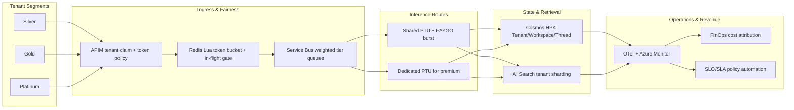
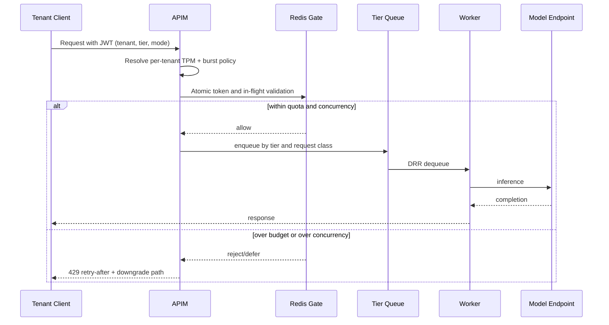

# Multi-Tenant B2B Agent SaaS Noisy-Neighbor Isolation FAQ: APIM+Redis Fair Queuing vs Dedicated PTU by Tier vs Cosmos Hierarchical Partition Governance

> Audience: Cloud & AI Solution Architects, SaaS platform leads, FinOps managers, SRE teams, customer-success engineering, and enterprise delivery teams.  
> Objective: preserve low-latency interactive experience, predictable gross margin, and contractual SLA isolation while serving 2,000+ SMB/mid-market tenants plus 40+ Fortune-class enterprise tenants.  
> Core tension: batch-heavy tenants maximize throughput while interactive tenants need stable TTFT; the platform needs margin discipline while compliance demands isolation evidence.  
> Practical takeaway: this is not a single-choice decision, but a three-layer composition of traffic fairness, resource tiering, and data-plane partition policy.  

## 1. Why noisy-neighbor impact is materially worse for agent SaaS than classic web SaaS

Classic SaaS contention usually shows up as CPU spikes, DB lock queues, and connection-pool starvation.  
Agent SaaS adds additional shared constraints: `TPM`, model-side concurrency, context-size inflation, and multi-tool fan-out per request.  

A single enterprise tenant launching a 500-document workflow can simultaneously stress:

- model token throughput budgets,  
- worker queue depth,  
- retrieval and state-store IOPS/RU,  
- approval callbacks and orchestration retries.  

With a naive shared pool, the platform commonly observes:

- one tenant saturates regional PTU budget,  
- interactive chat users across many other tenants receive `HTTP 429`,  
- TTFT jumps from low single-digit seconds to double digits,  
- SLA penalty exposure and churn risk rise together.  

This is why multi-tenant fairness is a business-critical architecture concern, not just a performance tuning exercise.

## 2. Scope boundary vs #17 and #13: this guide is about fairness under mixed-tenant concurrency

Guide #17 is primarily about metering and monetization attribution.  
Guide #13 is primarily about single-enterprise PTU/PAYGO economics.  

This guide targets a different failure mode:
multi-tenant contention where bursty batch traffic and latency-sensitive interactive traffic coexist on one platform.  

Primary decision criteria therefore include:

- cross-tenant blast radius under burst conditions,  
- P95 TTFT protection for interactive sessions during bulk storms,  
- gross-margin stability under mixed tenant behavior,  
- onboarding/upgrade lead time for contractual SLA tiers.  

## 3. Tenant load profile model: 2,000+ SMB/mid-market plus 40 enterprise tenants

Representative portfolio:

- Silver: 1,600 tenants, mostly interactive, price-sensitive.  
- Gold: 400 tenants, mixed traffic with recurring workflow bursts.  
- Platinum: 40 tenants, heavy bulk operations and stricter SLO contracts.  

Behavioral patterns:

- Silver has low average concurrency but unpredictable burst starts.  
- Gold exhibits schedule-aligned waves with moderate fan-out.  
- Platinum generates coordinated bulk runs and longer context windows.  

Risk is driven by tail behavior, not mean utilization.  
A system may report healthy monthly averages while repeatedly violating sub-hour SLO windows.  

## 4. Option A: pooled multi-tenant plane with APIM tenant limits and Redis atomic concurrency gates

Option A establishes fairness controls within shared infrastructure.

Core components:

- APIM tenant-aware limits with JWT claim extraction.  
- Redis Lua token-bucket and in-flight counters for atomic gating.  
- Service Bus tiered queues.  
- Weighted Fair Queuing / Deficit Round Robin worker scheduling.  

Control strategy:

- separate interactive and bulk channels,  
- enforce per-tenant TPM caps with burst windows,  
- defer over-budget requests to lower-priority paths,  
- meter batch budgets explicitly to avoid hidden debt.  

Strengths:

- fast adoption path,  
- strong utilization efficiency,  
- immediate reduction in tail latency contention.  

Limitations:

- very large tenants can still pressure shared inference substrate,  
- contractual “hard isolation” evidence is weaker than dedicated deployments.  

## 5. Option B: hybrid silo-and-pool tiering with dedicated PTU for premium tenants

Option B maps commercial tiers to infrastructure tiers.

Typical pattern:

- Silver/Gold remain on shared pool,  
- Platinum moves to dedicated PTU or isolated Foundry projects,  
- premium tenants may receive dedicated search indexes and observability channels.  

Benefits:

- premium bulk jobs no longer starve shared interactive pool,  
- stronger contractual isolation posture,  
- cleaner cost-to-revenue mapping per segment.  

Trade-offs:

- higher fixed-cost footprint,  
- lower average utilization if demand is uneven,  
- lifecycle automation required for tier upgrades and migrations.  

## 6. Option C: data-plane isolation with Cosmos hierarchical partitioning and index sharding

Option C addresses state and retrieval hot-spot contention.

Recommended partition key hierarchy:

- `TenantId`,  
- `WorkspaceId`,  
- `ThreadId`.  

Governance objectives:

- per-tenant RU budgets and upper bounds,  
- hot-partition detection and split/remap procedures,  
- tenant-aware index sharding in AI Search.  

Option C alone does not solve inference token contention,  
but it significantly reduces persistence and retrieval amplification during burst events.

## 7. Twelve-dimension comparison matrix

| Dimension | Option A: Pooled Fairness | Option B: Dedicated + Pooled Hybrid | Option C: Data-Plane Isolation |
|---|---|---|---|
| Cross-tenant blast radius | Medium to Low | Lowest | Medium |
| Interactive TTFT protection | High | Very High | Medium |
| Bulk throughput ceiling | High | Very High | Medium to High |
| Hard isolation evidence | Medium | Very High | High (data plane) |
| Margin stability | High | Medium to High | Medium |
| Implementation complexity | Medium | High | Medium |
| Initial cost | Medium | High | Medium |
| Utilization efficiency | High | Medium | High |
| Upgrade migration overhead | Medium | Medium to High | Medium |
| Observability clarity | High | High | High |
| Contract/SOC2 alignment | High | Very High | Very High |
| Recommended role | Baseline | Premium reinforcement | Mandatory complementary layer |

Baseline recommendation:
adopt Option A + Option C as default platform standard,  
then apply Option B selectively for premium or regulated contracts.

## 8. Reference architecture: fairness controls, queue tiers, partition governance



## 9. Runtime sequence during batch storms: preserving interactive pathways



## 10. Production policy snippet: APIM claim extraction + token limit + Redis gate

```xml
<policies>
  <inbound>
    <base />
    <set-variable name="tenantId" value="@((string)context.Principal?.Claims.GetValueOrDefault("tid","unknown"))" />
    <set-variable name="tier" value="@((string)context.Principal?.Claims.GetValueOrDefault("plan","silver"))" />
    <choose>
      <when condition="@((string)context.Variables["tier"] == "platinum")">
        <set-variable name="tpmLimit" value="240000" />
      </when>
      <when condition="@((string)context.Variables["tier"] == "gold")">
        <set-variable name="tpmLimit" value="90000" />
      </when>
      <otherwise>
        <set-variable name="tpmLimit" value="30000" />
      </otherwise>
    </choose>
    <azure-openai-token-limit counter-key="@((string)context.Variables["tenantId"])" tokens-per-minute="@((int)context.Variables["tpmLimit"])" estimate-prompt-tokens="true" />
    <send-request mode="new" response-variable-name="redisGate" timeout="5" ignore-error="false">
      <set-url>https://redis-gate.internal/check</set-url>
      <set-method>POST</set-method>
      <set-body>@("{\"tenant\":\"" + (string)context.Variables["tenantId"] + "\",\"tier\":\"" + (string)context.Variables["tier"] + "\"}")</set-body>
    </send-request>
    <choose>
      <when condition="@(((IResponse)context.Variables["redisGate"]).StatusCode != 200)">
        <return-response>
          <set-status code="429" reason="tenant_concurrency_limited" />
          <set-header name="retry-after" exists-action="override">
            <value>15</value>
          </set-header>
        </return-response>
      </when>
    </choose>
  </inbound>
  <backend>
    <base />
  </backend>
  <outbound>
    <base />
  </outbound>
</policies>
```

Redis Lua atomic gate sample:

```lua
-- KEYS[1]=tenant_inflight_key, ARGV[1]=limit, ARGV[2]=ttl_seconds
local current = redis.call("GET", KEYS[1])
if not current then
  redis.call("SET", KEYS[1], 1, "EX", ARGV[2])
  return 1
end
if tonumber(current) >= tonumber(ARGV[1]) then
  return 0
end
redis.call("INCR", KEYS[1])
redis.call("EXPIRE", KEYS[1], ARGV[2])
return 1
```

## 11. Production data-governance snippet: Cosmos three-level hierarchical partition key

```bicep
resource sessionState 'Microsoft.DocumentDB/databaseAccounts/sqlDatabases/containers@2024-05-15' = {
  name: '${cosmosAccount.name}/agentdb/sessionstate'
  properties: {
    resource: {
      id: 'sessionstate'
      partitionKey: {
        kind: 'MultiHash'
        paths: [
          '/tenantId'
          '/workspaceId'
          '/threadId'
        ]
        version: 2
      }
      indexingPolicy: {
        indexingMode: 'consistent'
      }
    }
    options: {
      throughput: 20000
      autoscaleSettings: {
        maxThroughput: 60000
      }
    }
  }
}
```

Operational extensions:

- dedicate container or database for selected premium tenants,  
- enforce RU quotas and alerts by tenant dimension,  
- shard AI Search indexes for tenants with sustained hot partitions.  

## 12. SaaS gross-margin and 3-year TCO model

Assumptions:

- Enterprise users: 480k MAU  
- Daily requests: 36 million  
- Bulk ratio: 14%  
- Platinum revenue contribution: 43%  
- SLA penalties activate when monthly TTFT SLO misses exceed 0.5% of interactive traffic  

### 12.1 Option A monthly cost (USD)

- APIM Premium v2 multi-region: $19.6k  
- Redis Enterprise HA: $7.4k  
- Service Bus Premium tiered queues: $5.1k  
- Observability + operations overhead: $9.3k  
- **Total: $41.4k/month**  

### 12.2 Option B monthly cost (USD)

- Shared PTU + PAYGO baseline: $33.2k  
- Dedicated premium PTU pools: $28.8k  
- Dedicated index/telemetry channels: $6.7k  
- Platform + success engineering overhead: $10.6k  
- **Total: $79.3k/month**  

### 12.3 Option C monthly cost (USD)

- Cosmos HPK autoscale profile: $18.9k  
- AI Search tenant sharding: $11.2k  
- Quota governance and audit ops: $6.4k  
- **Total: $36.5k/month**  

### 12.4 Margin and risk-adjusted economics

If SLA credits, churn risk, and support escalations are monetized:

- A + C baseline: approximately $2.08M over three years  
- A + B + C premium mix: approximately $2.74M over three years  
- C-only (no fairness control): approximately $3.31M over three years  

Conclusion:
shared fairness and data partition governance are foundational;
dedicated premium isolation should be selectively applied where contracts justify it.

## 13. Scenario A: legal/procurement agent SaaS scaling from 150 to 3,500 tenants

Initial state:

- one shared inference lane,  
- no tenant-aware queueing,  
- monthly bulk-review peaks caused repeated outage windows.  

Intervention:

- APIM tenant TPM policies,  
- Redis in-flight gate,  
- weighted Service Bus queues,  
- async-by-default path for bulk requests.  

Measured outcomes over 10 weeks:

- interactive TTFT P95: 8.7s down to 2.4s  
- bulk completion latency: +11% only  
- tenant-facing 429 support tickets: down 82%  
- platform gross margin: +6.3 percentage points  

## 14. Scenario B: global customer-support ISV with Silver/Gold/Platinum contractual tiers

Initial challenge:

- premium campaigns overloaded shared capacity,  
- standard-tier customers experienced visible degradation,  
- contracts required clearer throughput isolation guarantees.  

Intervention:

- keep Silver/Gold on shared fair-queue pool,  
- move Platinum to dedicated PTU and dedicated index channels,  
- apply Cosmos HPK baseline across all tiers,  
- expose tier-level SLO dashboards to customer success and sales engineering.  

Quarterly outcomes:

- premium TTFT variance reduced by 68% during peaks  
- standard-tier latency remained stable during premium spikes  
- tier-upgrade provisioning lead time reduced from 21 to 9 days  
- high-tier renewal conversion increased by 19%  

## 15. Quantitative FAQ and five-step implementation guide

### Q1: When must we move from pure pooling to hybrid dedicated+pooled capacity?

Move when any one condition is consistently true:

- a single tenant peak exceeds 22% of shared regional TPM,  
- premium segment contributes more than 35% of ARR,  
- contracts include explicit independent-capacity clauses.  

### Q2: How should DRR/WFQ weights be set initially?

A practical starting point:

- Silver = 1  
- Gold = 3  
- Platinum = 8  

Then cap per-round dequeue units so one tenant cannot monopolize workers over long windows.

### Q3: What is an acceptable 429 target by traffic class?

Suggested policy:

- interactive: < 0.2%  
- bulk: < 2.0%  
- premium interactive: < 0.05%  

Crossing thresholds should trigger automatic scale, policy rebalance, or burst-route activation.

### Q4: How does Cosmos HPK reduce 20GB physical-partition saturation risk?

Three-level keys distribute heat across tenant, workspace, and thread dimensions,  
reducing concentration on single logical ranges.  
Add TTL + archival policy for stale thread state to keep hot containers lean.

### Q5: Which margin costs are commonly underestimated?

Most teams underestimate:

- SLA credits paid after latency incidents,  
- customer-success and support labor for mitigation,  
- renewal discounts required after repeated degradation.  

Ignoring these costs makes simple shared pooling appear cheaper than it truly is.

### Q6: How can we preserve shipping velocity while increasing isolation?

Use two lanes:

- fast lane for shared-tier launches using standard templates,  
- controlled lane for premium/regulated tenants with dedicated capacity and stricter governance.

This keeps product cadence while preserving contractual guarantees.

### Q7: Which KPI dashboard should executives review weekly?

Recommended minimum:

- interactive TTFT P95 by tier,  
- 429 rate by tenant and traffic class,  
- queue wait distribution by tier,  
- RU hot-partition alerts by tenant,  
- gross margin trend with incident-adjusted COGS.

### Q8: What is the migration order for a live platform?

Order matters:

1. Introduce tenant identity claims and policy dimensions.  
2. Enable APIM token limits and Redis gates (A).  
3. Implement Cosmos HPK and index partition governance (C).  
4. Carve dedicated premium capacity where contract economics justify (B).  
5. Continuously retune weights, quotas, and tier boundaries from telemetry.

---

### Five-step execution playbook

1. **Profile tenant behavior** by concurrency, burst profile, and contract tier.  
2. **Deploy Option A baseline** for fairness and immediate contention relief.  
3. **Deploy Option C baseline** for durable state and retrieval partition governance.  
4. **Apply Option B selectively** for premium and regulated commitments.  
5. **Operate as a closed loop** with weekly KPI, margin, and SLA tuning.  

### Good fit vs not for

**Good fit**:

- multi-tenant platforms with tiered contracts,  
- mixed interactive and bulk workloads,  
- strong SLA and margin accountability.  

**Not for (full-stack investment)**:

- very small internal-only deployments with no commercial tiering,  
- homogeneous traffic with minimal burst behavior.  

Even in early-stage products, tenant identity and quota dimensions should be designed up front to avoid expensive re-architecture later.
