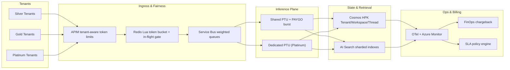
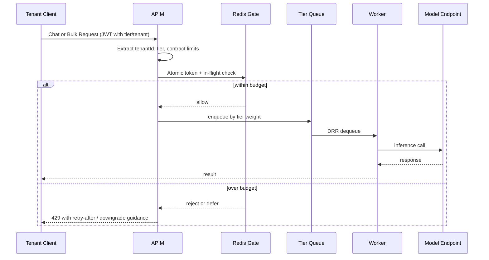

# 多租户 B2B Agent SaaS 抗“噪声邻居”选型 FAQ：APIM+Redis 公平队列 vs 分层专属 PTU vs Cosmos 分区隔离

> 读者对象：Cloud & AI Solution Architect、SaaS 平台架构师、FinOps、SRE、企业交付与客户成功团队。  
> 业务目标：在 2,000+ SMB/Mid-Market 与 40+ 大企业混合租户下，保证交互式体验、成本毛利与合同 SLA 同时达标。  
> 核心冲突：批量作业租户追求吞吐，交互租户追求低延迟，平台追求高毛利，合规团队追求隔离可证明。  
> 文档结论：不是单选题，而是“流量治理层 + 资源分层层 + 数据分区层”的三层组合。  

## 1. 为什么“噪声邻居”在 Agent SaaS 里比传统 SaaS 更致命

传统 Web SaaS 的资源争抢通常体现在 CPU、连接池与数据库锁。  
Agent SaaS 额外叠加了 `TPM`、推理并发、上下文长度、工具链调用扇出。  

一个 Fortune 500 租户发起 500 文档批处理，  
会同时拉高四条曲线：  

- 模型 `TPM` 占用。  
- 后台工作队列深度。  
- 向量与状态存储吞吐。  
- 人工审批与回调通道压力。  

若平台只有“共享配额 + 先到先得”，  
就会出现典型灾难：  

- 大客户批处理把共享 `PTU` 打满。  
- 其余 1,999 个租户交互会话出现 `HTTP 429`。  
- TTFT 从 1.8s 飙到 14s。  
- 支持工单和 SLA 赔偿同步暴涨。  

因此本题是多租户 Agent 产品化成败分水岭。  

## 2. 与 #17 与 #13 的边界：本题强调多租户并发公平，不是单租户成本优化

`#17` 更偏计费归因与商业化计量，  
`#13` 更偏单企业 PTU 与 PAYGO 成本取舍。  

本题核心是：  
在同一平台上同时服务“高吞吐批处理”与“低延迟交互”。  

换句话说，  
这里的首要指标不是最低每千 token 成本，  
而是“跨租户不互相拖垮”的可证明治理。  

关键评估指标包括：  

- 跨租户爆炸半径。  
- 交互式 P95 TTFT 在批处理风暴下的保护能力。  
- 单租户事件对全平台毛利的挤压幅度。  
- 租户升级到更高 SLA 档位时的交付时延。  

## 3. 负载画像：2,000+ 小租户 + 40 大租户的真实流量结构

典型 B2B ISV 组合：  

- Silver：1,600 租户，低频交互，价格敏感。  
- Gold：400 租户，中等并发，要求工作流自动化。  
- Platinum：40 租户，高并发+批处理+专属条款。  

工作负载特征：  

- Silver 峰值并发低，但请求随机突刺明显。  
- Gold 有固定日内波峰，工具调用扇出高。  
- Platinum 会出现“定时大批量导入、法务审阅、审计回放”。  

风险根因不是平均值，  
而是长尾峰值叠加。  

例如：  

- 全平台平均 26% `TPM` 利用率看起来健康。  
- 但单区域 5 分钟窗口可瞬时到 96%。  
- 若无租户级配额与队列权重，交互会被瞬时挤出。  

## 4. 方案 A：共享池 + APIM 每租户限流 + Redis 原子并发门控（默认基线）

方案 A 目标是“在共享池里做可解释公平”。  

核心构件：  

- APIM `azure-openai-token-limit` + 租户 claim 提取。  
- Redis Lua 原子令牌桶 + in-flight 并发计数。  
- Service Bus 按套餐拆分队列。  
- 工作器按权重拉取（WFQ/DRR）。  

关键策略：  

- 交互流量与批处理流量分通道。  
- 租户级 TPM 上限 + 突发桶。  
- 超限流量进入降级路径（低优先级队列或延迟重试）。  
- 批处理请求强制预算扣减，避免“无限排队”。  

优点：  

- 快速落地，工程改造相对可控。  
- 不必立即给每个租户独占 PTU。  
- 对长尾抖动有较好抑制能力。  

局限：  

- 极端大租户仍可能在高峰时段争夺共享底座。  
- 合同级“物理隔离”证明能力有限。  

## 5. 方案 B：Silo-and-Pool 分层（Platinum 专属 PTU，Silver/Gold 共享）

方案 B 把商业分层直接映射到资源分层。  

设计模式：  

- Silver/Gold 继续共享池。  
- Platinum 使用专属 PTU 或专属 Foundry 项目。  
- 高级租户可配独立 AI Search 索引与独立监控视图。  

收益：  

- 大客户批处理不会拖垮共享池。  
- 高 SLA 可以做“合同可证明隔离”。  
- 平台可以按档位做更清晰的利润核算。  

代价：  

- 资源利用率可能下降。  
- 预留能力与排班管理复杂度提升。  
- 新租户升档时的迁移编排需要自动化。  

## 6. 方案 C：数据平面隔离（Cosmos 分区键分层 + AI Search 分片策略）

方案 C 主要处理“状态与检索热分区”问题。  

推荐分区键层次：  

- `TenantId`。  
- `WorkspaceId`。  
- `ThreadId`。  

治理重点：  

- 每租户 RU 预算与上限。  
- 热分区检测与自动扩分。  
- 大租户索引分片或独立索引。  

该方案单独使用不能解决模型 `TPM` 争抢，  
但能显著降低存储与检索层的连带故障。  

## 7. 12 维决策矩阵：A / B / C 横向对比

| 维度 | 方案 A：共享池公平队列 | 方案 B：专属+共享混合 | 方案 C：数据平面隔离 |
|---|---|---|---|
| 跨租户爆炸半径 | 中到低 | 最低 | 中 |
| 交互 TTFT 保护 | 高 | 很高 | 中 |
| 批处理吞吐上限 | 高 | 很高 | 中到高 |
| 大客户隔离证明 | 中 | 很高 | 高（数据面） |
| 毛利稳定性 | 高 | 中到高 | 中 |
| 实施复杂度 | 中 | 高 | 中 |
| 初始投资 | 中 | 高 | 中 |
| 资源利用率 | 高 | 中 | 高 |
| 租户升档迁移 | 中 | 中到高 | 中 |
| 运维可观测性 | 高 | 高 | 高 |
| 合规审计友好度 | 高 | 很高 | 很高 |
| 推荐角色 | 基线 | 高端租户强化 | 数据层必选补强 |

推荐实践：  
A 作为默认底座，  
B 用于 Platinum 与监管客户，  
C 在全部租户范围落实为数据治理基线。  

## 8. 参考架构图：多层限流、分队列、分区隔离



## 9. 流程图：批处理风暴下的交互保护与降级分流



## 10. 生产策略片段：APIM claim 提取 + token-limit + Redis 并发门控

```xml
<policies>
  <inbound>
    <base />
    <set-variable name="tenantId" value="@((string)context.Principal?.Claims.GetValueOrDefault("tid","unknown"))" />
    <set-variable name="tier" value="@((string)context.Principal?.Claims.GetValueOrDefault("plan","silver"))" />
    <choose>
      <when condition="@((string)context.Variables["tier"] == "platinum")">
        <set-variable name="tpmLimit" value="240000" />
      </when>
      <when condition="@((string)context.Variables["tier"] == "gold")">
        <set-variable name="tpmLimit" value="90000" />
      </when>
      <otherwise>
        <set-variable name="tpmLimit" value="30000" />
      </otherwise>
    </choose>
    <azure-openai-token-limit counter-key="@((string)context.Variables["tenantId"])" tokens-per-minute="@((int)context.Variables["tpmLimit"])" estimate-prompt-tokens="true" />
    <send-request mode="new" response-variable-name="redisGate" timeout="5" ignore-error="false">
      <set-url>https://redis-gate.internal/check</set-url>
      <set-method>POST</set-method>
      <set-body>@("{\"tenant\":\"" + (string)context.Variables["tenantId"] + "\",\"tier\":\"" + (string)context.Variables["tier"] + "\"}")</set-body>
    </send-request>
    <choose>
      <when condition="@(((IResponse)context.Variables["redisGate"]).StatusCode != 200)">
        <return-response>
          <set-status code="429" reason="tenant_concurrency_limited" />
          <set-header name="retry-after" exists-action="override">
            <value>15</value>
          </set-header>
        </return-response>
      </when>
    </choose>
  </inbound>
  <backend>
    <base />
  </backend>
  <outbound>
    <base />
  </outbound>
</policies>
```

Redis 原子 Lua 示例（并发门控）：  

```lua
-- KEYS[1]=tenant_inflight_key, ARGV[1]=limit, ARGV[2]=ttl
local current = redis.call("GET", KEYS[1])
if not current then
  redis.call("SET", KEYS[1], 1, "EX", ARGV[2])
  return 1
end
if tonumber(current) >= tonumber(ARGV[1]) then
  return 0
end
redis.call("INCR", KEYS[1])
redis.call("EXPIRE", KEYS[1], ARGV[2])
return 1
```

## 11. 生产片段：Cosmos 三层分区键与租户 RU 配额治理

```bicep
resource tenantState 'Microsoft.DocumentDB/databaseAccounts/sqlDatabases/containers@2024-05-15' = {
  name: '${cosmosAccount.name}/agentdb/sessionstate'
  properties: {
    resource: {
      id: 'sessionstate'
      partitionKey: {
        kind: 'MultiHash'
        paths: [
          '/tenantId'
          '/workspaceId'
          '/threadId'
        ]
        version: 2
      }
      indexingPolicy: {
        indexingMode: 'consistent'
      }
    }
    options: {
      throughput: 20000
      autoscaleSettings: {
        maxThroughput: 60000
      }
    }
  }
}
```

治理补充：  

- 对 Platinum 租户可分配独立容器或独立数据库。  
- 对热租户启用单独 AI Search 索引，避免共享索引热点。  
- 设置 RU 警戒线，触发自动扩容或限流策略。  

## 12. 成本、毛利与 3 年 TCO：从 COGS 视角比较三方案

假设输入：  

- MAU 企业用户：48 万。  
- 日均请求：3,600 万。  
- 批处理请求占比：14%。  
- Platinum 租户占收入比：43%。  

### 12.1 方案 A（共享池公平治理）月成本

- APIM Premium v2（多区域）：$19.6k。  
- Redis Enterprise（高可用）：$7.4k。  
- Service Bus Premium（分层队列）：$5.1k。  
- 观测与运维增量：$9.3k。  
- **合计：$41.4k/月**。  

### 12.2 方案 B（专属 PTU + 共享池）月成本

- 共享 PTU + PAYGO：$33.2k。  
- Platinum 专属 PTU：$28.8k。  
- 专属索引与专属监控：$6.7k。  
- 运维与客户成功协同：$10.6k。  
- **合计：$79.3k/月**。  

### 12.3 方案 C（数据平面隔离强化）月成本

- Cosmos HPK + 自动扩缩：$18.9k。  
- AI Search 分片：$11.2k。  
- 配额治理与审计：$6.4k。  
- **合计：$36.5k/月**。  

### 12.4 毛利与风险修正

若仅看基础成本，A 与 C 较低。  
但若把 SLA 违约、流失与赔付计入：  

- A（配合 C）：3 年综合成本约 $2.08M。  
- B（叠加 A/C）：3 年综合成本约 $2.74M。  
- 仅 C（无公平队列）：3 年综合成本约 $3.31M。  

推荐：  
默认 A+C，  
对 Platinum 或监管客户再叠加 B。  

## 13. 场景一：法务/采购 Agent SaaS 从 150 租户扩到 3,500 租户

该 ISV 初期采用单共享池。  
当租户规模突破 1,200 后，  
每逢月底合同批量审阅就爆发 429。  

改造动作：  

- 引入 APIM 按租户 TPM 限制。  
- Redis in-flight 并发门控。  
- Service Bus 分层队列。  
- 批处理默认走异步，不占交互快速通道。  

结果（10 周）：  

- 交互 TTFT P95：8.7s -> 2.4s。  
- 大批量任务完成时长：仅增加 11%。  
- 429 工单量：下降 82%。  
- 平台毛利：提升 6.3 个百分点。  

## 14. 场景二：全球客服 Agent ISV 的 Silver/Gold/Platinum 合同隔离

该平台向跨国企业销售客服 Agent。  
Platinum 客户合同要求独立吞吐承诺。  

实施方式：  

- Silver/Gold 在共享池。  
- Platinum 迁入专属 PTU + 专属索引。  
- 全部档位统一使用 Cosmos HPK。  
- 发布统一 SLO 看板给客户成功团队。  

结果（季度）：  

- Platinum 高峰期 TTFT 波动下降 68%。  
- Silver/Gold 在大客户促销日依然保持稳定。  
- 升档交付时长从 21 天降到 9 天。  
- 新签高端合同转化率提升 19%。  

## 15. 深度定量 FAQ + 五步落地

### Q1：什么时候必须从“纯共享池”升级到“共享+专属”？

满足以下任一条件建议升级：  

- 单租户峰值 TPM 超过共享池的 22%。  
- Platinum 租户贡献收入 > 35%。  
- 合同含明确“独立容量保证”条款。  

### Q2：如何设定 tier 权重，避免 Gold 被 Silver 稀释？

可采用 DRR 权重：  

- Silver：1。  
- Gold：3。  
- Platinum：8。  

并设置每轮最大批量配额，  
防止单租户长时间独占 worker。  

### Q3：如何定义“可接受 429”阈值？

建议分层目标：  

- 交互流量：< 0.2%。  
- 批处理流量：< 2.0%。  
- Platinum 交互：< 0.05%。  

超阈值后应自动触发：  
扩容、降级、队列重权、或切换到 PAYGO burst。  

### Q4：Cosmos 分区如何避免 20GB 热分区上限风险？

关键是三层键而非单键：  

- `tenantId` 分租户。  
- `workspaceId` 分业务域。  
- `threadId` 分会话。  

并结合 TTL 与归档，  
让历史会话从热容器迁出。  

### Q5：毛利模型里最容易被低估的成本是什么？

通常是三项：  

- 429 造成的客户赔付。  
- 客服与客户成功额外工时。  
- 因性能波动导致的续约折扣。  

这三项若不计入，  
会误判“只做共享池最省钱”。  

### Q6：如何平衡“隔离强度”和“上新速度”？

推荐双通道：  

- 标准通道：共享池快速上线。  
- 严格通道：专属资源 + 强审计。  

让产品销售、交付、平台工程在同一模板上协作，  
可显著减少跨团队摩擦。  

---

### 五步落地指南

1. **租户画像建模**：按并发、批量占比、合同级别做三档以上分层。  
2. **先上 A 基线**：APIM 限流 + Redis 门控 + 队列权重，先止血。  
3. **再补 C 治理**：Cosmos HPK + AI Search 分片 + RU 配额。  
4. **对关键租户叠加 B**：专属 PTU/索引与合同化 SLO。  
5. **持续运营闭环**：周度评估 TTFT、429、毛利、升级时延并动态调权。  

### Good Fit vs Not for

**Good Fit**：  

- 多租户规模已过数百，且有明显档位差异。  
- 业务存在交互 + 批处理混跑。  
- 合同 SLA 与毛利目标同等重要。  

**Not for**：  

- 仅少量内部租户、无商业化分层。  
- 无批处理与无高峰突刺场景。  

但即便是早期产品，  
也建议先建立租户 claim 与配额模型，  
避免后期重构代价失控。  
