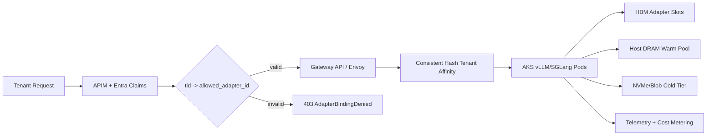
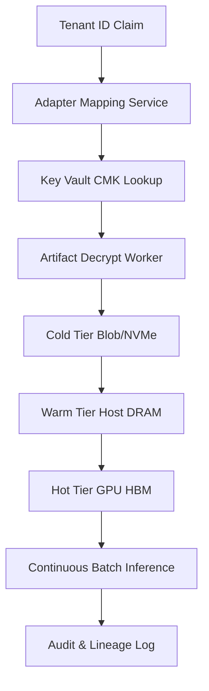

# Multi-Tenant Dynamic Multi-LoRA Serving Selection FAQ (AKS vLLM/SGLang vs Foundry Fine-Tuned Deployments vs Zipf Tiered Pinning)

> Audience: Cloud & AI Solution Architects, platform engineering leaders, and B2B SaaS/ISV model-serving teams.
> Decision focus: How to support `50` to `5,000+` tenant-specific LoRA adapters without `O(M)` GPU sprawl or cross-tenant adapter leakage.

## 1. Executive summary

Multi-tenant customization is no longer optional for enterprise AI products, but naive deployment patterns fail quickly:

- one full checkpoint per tenant explodes GPU cost,
- uncontrolled adapter identifiers create cross-tenant confusion risk,
- long-tail low-frequency tenants waste hot GPU memory if kept permanently warm.

This guide compares four architecture routes:

- **Route A**: AKS ND H100/H200 + dynamic Multi-LoRA engine (`vLLM` / `SGLang`, Punica/S-LoRA style segmented kernels, three-tier paging).
- **Route B**: Managed fine-tuned deployments on Microsoft Foundry/Azure OpenAI.
- **Route C**: Zipf-aware hot/warm/long-tail hybrid routing with selective adapter pinning.
- **Route D**: Anti-pattern baseline with dedicated checkpoints per tenant or raw client-controlled adapter selection.

Recommended direction:

1. Use **Route A + Route C** for large-scale SaaS with heterogeneous tenant demand curves.
2. Use **Route B** first when platform team size is small and speed-to-market dominates.
3. Treat **Route D** as prohibited in architecture review because of cost and security failure modes.

## 2. Problem frame and constraints

### 2.1 Business constraints

- Tenants require differentiated behavior and style adaptation.
- Request distribution usually follows Zipf law (few whales dominate, long tail is sparse).
- Tenants expect strict model/IP isolation and predictable latency.

### 2.2 Technical constraints

- HBM is limited while adapter ranks vary (`r=8..64`).
- KV cache competes with adapter residency.
- Cold hydration path (NVMe/blob) affects TTFT and jitter.

### 2.3 Governance constraints

- Every request must be provably bound to an allowed adapter.
- Every adapter load/unload path must be auditable.
- Every capacity decision should map to tenant-level cost attribution.

## 3. Route definitions

### Route A: AKS dynamic Multi-LoRA with three-tier adapter paging

- Keep one frozen base model in HBM.
- Dynamically activate multiple tenant adapters inside continuous batching windows.
- Use tiered adapter memory:
  - Tier-1: GPU HBM hot slots (`max_loras`),
  - Tier-2: pinned host DRAM warm pool (`max_cpu_loras`),
  - Tier-3: NVMe/blob cold encrypted artifact storage.
- Use gateway-level consistent hash tenant affinity to maximize HBM hit ratio (`H_hbm > 94%` target).

### Route B: Managed fine-tuned model deployments (Foundry/Azure OpenAI)

- Offload serving operations and low-level kernel maintenance.
- Use managed deployment controls, RBAC, and safety features.
- Trade operational simplicity against deployment ceilings and pricing floors.

### Route C: Zipf-aware hot/warm/long-tail tiering

- Pin high-QPS whale tenants to guaranteed warm HBM slots or dedicated PTU lanes.
- Serve mid-tier tenants via DRAM-to-HBM dynamic paging.
- Route ultra-sparse tail tenants to base model + prompt caching / retrieval exemplars.

### Route D: Anti-pattern baseline

- Merge each tenant LoRA into standalone large checkpoint with dedicated GPU replicas.
- Or allow raw client `model` / `lora_name` values to reach serving runtime without APIM claim enforcement.

## 4. Twelve-dimension comparison matrix

| Dimension | Route A Dynamic Multi-LoRA | Route B Managed FT Deployments | Route C Zipf Tiered Pinning | Route D Anti-Pattern |
|---|---|---|---|---|
| GPU utilization | Very high | Medium | High | Very low |
| Operational complexity | High | Low | Medium-high | Superficially low |
| Tenant isolation confidence | High | High | High | Low |
| TTFT stability | Medium-high | High | Very high (hot tier) | Low |
| Cold-start control | High | Medium | High | Poor |
| Cost elasticity | High | Medium | Very high | Poor |
| Scale ceiling | Very high | Medium-high | High | Low |
| Change velocity | High | Medium | Medium-high | Uncontrolled |
| Auditability | High | High | High | Low |
| Vendor lock profile | Low-medium | Medium-high | Medium | N/A |
| Regulated fit | Excellent | Good-Excellent | Excellent | Poor |
| 3-year TCO predictability | High | Medium | High | Very poor |

## 5. Architecture diagram A: multi-tenant adapter serving plane



## 6. Architecture diagram B: CMK-backed adapter hydration flow



## 7. Q1: HBM budget equation for concurrent adapter residency

Capacity bound:

\[
M_{base} + M_{kv} + K_{gpu}\cdot M_{lora}(r) \le M_{hbm}
\]

Where:

- `M_base`: base model HBM footprint,
- `M_kv`: active KV cache footprint,
- `M_lora(r)`: adapter footprint as a function of rank,
- `K_gpu`: number of concurrently resident adapters.

Implication:

- increasing rank or KV pressure directly reduces adapter concurrency headroom.
- `max_loras` must be tuned jointly with context-window and batch policy.

## 8. Q2: DRAM-to-HBM vs NVMe/blob hydration latency trade-off

Typical latency ranges:

- DRAM -> HBM swap over PCIe Gen5: `~8-25ms`.
- NVMe -> DRAM -> HBM hydration: `~40-120ms`.
- Blob -> host -> HBM hydration (encrypted): `~120-400ms`.

Design consequence:

- keep whale tenants in HBM where possible,
- keep mid-tier tenants in warm DRAM,
- reserve blob hydration for sparse long-tail requests.

## 9. Q3: Heterogeneous rank batching penalty (`r=8..64`)

Issue:

- larger rank adapters consume more compute/memory bandwidth per token.
- mixed rank batches introduce throughput instability.

Mitigation:

- bucket scheduling by rank bands,
- isolate heavy-rank tenants when contention spikes,
- cap high-rank parallelism under peak load.

## 10. Q4: Why Zipf-aware hot/warm/long-tail tiering works

Zipf reality:

- top decile tenants contribute most of the traffic.
- tail tenants are infrequent and expensive to keep hot.

Tiering outcome:

- hot tier protects whale experience and throughput,
- warm tier balances cost and responsiveness,
- tail path avoids idle adapter residency waste.

## 11. Q5: Managed vs self-hosted breakeven (`N_breakeven`)

Compare:

- `C_managed`: managed token + deployment floor cost.
- `C_self`: GPU + platform operations + reliability engineering.

At low tenant/request scale:

- managed path often wins on staffing and execution risk.

At higher sustained scale:

- self-hosted dynamic Multi-LoRA usually wins on unit economics if utilization is managed well.

## 12. Q6: Tenant-binding enforcement to prevent adapter confusion

Required guard chain:

1. `tid` claim required and validated.
2. APIM maps `tid -> allowed_adapter_id`.
3. runtime accepts only internally resolved adapter IDs.
4. all binding decisions are logged for audit.

Never allow:

- raw client adapter names to bypass policy mapping,
- implicit fallback to default adapter on policy miss.

## 13. Production snippets

### Snippet A: AKS vLLM Multi-LoRA deployment

```yaml
apiVersion: apps/v1
kind: Deployment
metadata:
  name: vllm-multilora
spec:
  replicas: 6
  template:
    spec:
      nodeSelector:
        agentpool: ndh100
      containers:
      - name: vllm
        image: myacr.azurecr.io/vllm:0.6.4
        args:
          - "--model=/models/base-fp8"
          - "--enable-lora"
          - "--max-loras=96"
          - "--max-cpu-loras=640"
          - "--gpu-memory-utilization=0.92"
          - "--swap-space=48"
```

### Snippet B: APIM tenant-to-adapter gate

```xml
<policies>
  <inbound>
    <base />
    <set-variable name="tid" value="@(context.Principal?.Claims.GetValueOrDefault(\"tid\",\"\"))" />
    <set-variable name="requestedAdapter" value="@(context.Request.Headers.GetValueOrDefault(\"x-adapter-id\",\"\"))" />
    <set-variable name="mappingKey" value="@((string)context.Variables[\"tid\"] + \":\" + (string)context.Variables[\"requestedAdapter\"])" />
    <choose>
      <when condition="@(!context.Cache.LookupValue((string)context.Variables[\"mappingKey\"]).Equals(\"1\"))">
        <return-response>
          <set-status code="403" reason="AdapterBindingDenied" />
        </return-response>
      </when>
    </choose>
  </inbound>
</policies>
```

### Snippet C: Zipf-aware routing policy

```python
def route_tenant(rank_percentile: float, daily_requests: int) -> str:
    if rank_percentile <= 0.10:
        return "HOT_HBM_PINNED"
    if daily_requests >= 200:
        return "WARM_DRAM_PAGED"
    return "TAIL_BASE_ICL"
```

## 14. Enterprise scenarios

### Scenario 1: legal/contract CLM SaaS with 800 law-firm adapters

- challenge: highly specialized drafting style per tenant.
- architecture: Route A dynamic adapters plus Route C tiering.
- result: improved GPU efficiency while preserving tenant-specific behavior quality.

### Scenario 2: global retail/ERP ISV with 2,500 merchant adapters

- challenge: large multi-region demand variance and strict data isolation.
- architecture: start with Route B for speed, then transition core lanes to Route A+C.
- result: lower unit cost at scale with policy-enforced adapter isolation.

### Scenario 3: industrial support SaaS with sparse long-tail usage

- challenge: many adapters with infrequent demand.
- architecture: tail tenants moved to base+ICL path, with selective hot pinning for top tenants.
- result: substantial idle-memory reduction without unacceptable tail latency impact.

## 15. Three-tier 3-year TCO and rollout checklist

### 15.1 TCO model (USD, 3-year horizon)

| Adapter scale | Route A Self-Hosted Multi-LoRA | Route B Managed FT | Route C Tiering Increment | Combined A+C |
|---|---:|---:|---:|---:|
| 50 | 1,480,000 | 1,360,000 | 260,000 | 1,620,000 |
| 500 | 6,900,000 | 8,200,000 | 1,350,000 | 7,620,000 |
| 3,000 | 28,400,000 | 46,700,000 | 5,600,000 | 31,200,000 |

Interpretation:

- managed path is often simpler for smaller initial scale,
- dynamic self-hosted path dominates economics at larger sustained scale,
- tiering is required to keep long-tail economics healthy.

### 15.2 Day-0 / Day-1 / Day-2 checklist

**Day-0:**

- define authoritative tenant-to-adapter mapping source,
- size HBM/DRAM/cold tiers with safety margins,
- define tier thresholds and fallback policy contracts.

**Day-1:**

- deploy minimal Route A cluster and baseline observability,
- validate top-50 tenant hot-tier behavior and throughput,
- activate tail base+ICL path for sparse tenants.

**Day-2:**

- add automated capacity tuning and cost dashboards,
- establish adapter lifecycle workflows (activate/cool/archive),
- enforce dual-approval for high-risk adapter rollout changes.

### 15.3 Good fit vs Not for

**Good fit:**

- high-tenant-count SaaS with strong customization and uneven traffic distribution,
- organizations needing strict adapter isolation and auditability.

**Not for:**

- low-tenant-count products with minimal adaptation need,
- teams unable to sustain platform-level GPU serving operations.

### 15.4 Final recommendation

- strategic target: **Route A + Route C** for long-term scale economics and control,
- tactical bootstrap: **Route B** for faster launch and lower operational burden,
- governance hard stop: ban Route D raw adapter passthrough and GPU-isolated per-tenant sprawl.

Additional recommendation: quarterly reassess `H_hbm`, `N_breakeven`, rank mix, and tier thresholds to keep latency and cost objectives jointly optimized over time.

### 15.5 Operating and governance KPIs (monthly architecture board baseline)

Treat the following as dual-track SLOs (platform + finance), with alert policies bound to each metric:

- `H_hbm`: HBM hot-tier hit ratio, target `>= 94%`.
- `P95_swap_ms`: DRAM-to-HBM adapter swap latency, target `<= 25 ms`.
- `P95_cold_hydration_ms`: NVMe/blob cold hydration latency, target `<= 1200 ms`.
- `CrossTenantBlockRate`: cross-tenant authorization block effectiveness, target near `100%` for invalid attempts.
- `FalseBlockRate`: false-positive block ratio, target `< 0.2%`.
- `AdapterOrphanRate`: hot-tier occupancy by inactive adapters, target `< 5%`.
- `CostPer1KRequests`: blended cost per 1,000 requests, used to validate tier policy effectiveness.

Recommended control actions:

1. If `H_hbm` stays below threshold for 7 consecutive days, trigger hot-tier rebalance and tier-threshold recomputation.
2. If `P95_cold_hydration_ms` breaches budget, expand NVMe cache and tune prefetch policy before buying more GPU.
3. If `FalseBlockRate` rises, audit APIM claim mapping integrity against tenant authorization source of truth.
4. If `CostPer1KRequests` drifts from budget, tune Route C thresholds first, then reassess Route B/PTU mix.

### 15.6 Risk register and mitigation playbook (architecture committee format)

Risk R1: adapter naming collisions causing mis-binding

- Symptom: tenant requests hit wrong adapter and produce domain-inconsistent outputs.
- Root cause: mutable human-readable names used without immutable IDs and artifact digests.
- Mitigation: enforce `tid -> immutable adapter_id -> artifact digest` chain.
- Monitoring: track mis-binding incidents and cross-tenant rejection telemetry.

Risk R2: long-tail cold-hydration jitter causing SLA breaches

- Symptom: tail-tenant TTFT spikes during traffic bursts.
- Root cause: constrained cold-tier read concurrency and static prefetch strategy.
- Mitigation: maintain quasi-hot shortlist and staggered prewarming windows.
- Monitoring: `P95_cold_hydration_ms`, `tail_tenant_timeout_rate`.

Risk R3: heterogeneous-rank batching instability

- Symptom: mixed `r=8` and `r=64` batches show significant throughput variance.
- Root cause: scheduler does not apply rank-aware bucketization.
- Mitigation: enable rank-bucket queues and cap high-rank concurrent density.
- Monitoring: `tokens_per_second_by_rank_bucket`, `queue_wait_ms`.

Risk R4: cost optimization hurting premium tenant experience

- Symptom: premium tenants are demoted to colder tiers and trigger complaints.
- Root cause: frequency-only tiering logic without contractual priority weight.
- Mitigation: inject `business_tier` weight and reserve guaranteed hot slots.
- Monitoring: `SLA_breach_by_contract_tier`, `premium_tenant_ttft_p95`.

Risk R5: release process without rollback rehearsals

- Symptom: adapter rollout regressions with slow recovery.
- Root cause: no automated rollback validation and no dual-version safety window.
- Mitigation: enforce “release includes rollback proof” and keep last-stable snapshot live.
- Monitoring: `rollback_ready_seconds`, `post_release_error_delta`.

Implementation notes:

- Run at least one quarterly game-day for adapter lifecycle and tier-policy failure drills.
- Require platform, SRE, FinOps, and legal/compliance sign-off for cross-tenant boundary evidence.
- Encode these KPIs and risks into the standard architecture review template, not ad hoc documents.

### 15.7 Capacity and budget review template (quarterly reusable artifact)

To avoid repeating the same “buy more GPU vs tune policy” debate every quarter, standardize a shared review template:

- Inputs: `Q_peak` (peak concurrency), `L_target` (P95 latency objective), `H_hbm` (hot-tier hit ratio), `R_mix` (rank distribution), `C_gpu` (unit GPU cost), and `C_token` (managed token cost).
- Derived metrics: `GPU_hours_month`, `Hydration_events_day`, `Tail_ICL_ratio`, and `Premium_SLA_breach`.
- Decision outputs: `ScaleOut_GPU`, `Tune_Tiering`, `Shift_to_Managed`, and `Freeze_NewAdapters`.

Operational decision examples:

1. If `H_hbm < 0.92` and `Hydration_events_day` grows more than `30%` month-over-month, rebalance tiering before purchasing additional GPU.
2. If `Premium_SLA_breach > 0.5%`, reserve hot-tier budget for premium tenants first, then optimize tail cost.
3. If `CostPer1KRequests` remains more than `15%` above budget for two consecutive months, run a joint recalculation of Route B managed mix and Route A self-hosted capacity.
4. If `Tail_ICL_ratio` is low and long-tail satisfaction still does not improve, revisit prompt-template and retrieval quality rather than forcing more adapter residency.

The objective is sustained controllability across growth phases, not a one-time optimum: capacity, experience, compliance, and cost must move together.
