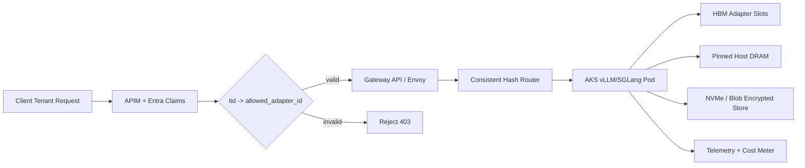
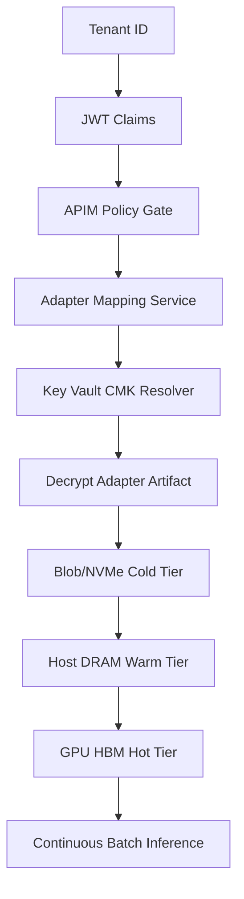

# 多租户 Dynamic Multi-LoRA 服务选型 FAQ（AKS vLLM/SGLang vs Foundry 托管微调 vs Zipf 分层固定）

> 适用对象：Cloud & AI Solution Architect、平台工程负责人、SaaS/ISV 多租户模型服务团队。
> 决策问题：在 `50` 到 `5,000+` 租户 LoRA 适配器共存时，如何避免 `O(M)` GPU 膨胀与跨租户权重混淆。

## 1. 执行摘要

多租户微调服务的核心矛盾不是“能不能跑”，而是“能否长期可控地跑”：

- 每租户独立 checkpoint 会迅速耗尽 GPU 预算。
- 动态加载若缺少租户绑定校验，会出现错配与泄漏风险。
- 稀疏长尾租户若长期保温，会造成极低利用率。

本指南对比四条路线：

- Route A：AKS ND H100/H200 + vLLM/SGLang 动态 Multi-LoRA 三层分页。
- Route B：Foundry/Azure OpenAI 托管微调部署。
- Route C：Zipf 热温冷三层分流（鲸鱼租户固定、长尾 ICL 替代）。
- Route D：每租户独立大模型副本或无租户绑定校验反模式。

推荐策略：

1. 大规模 SaaS 首选 `Route A + Route C`。
2. 小中规模与低运维团队可先 `Route B`。
3. 严禁 Route D 的无约束模型/LoRA 名称透传。

## 2. 问题边界

业务约束：

- 租户定制强，每家有独立术语与任务风格。
- 访问分布满足 Zipf，少数头部租户占多数流量。
- 法务与商业要求“租户权重不可越界访问”。

技术约束：

- HBM 空间有限，LoRA rank 存在 `r=8..64` 异构。
- KV cache 与 adapter 并存，内存竞争剧烈。
- 适配器冷加载会影响 TTFT 与吞吐稳定性。

治理约束：

- 必须可审计：某请求为何绑定某适配器。
- 必须可回滚：坏适配器应快速隔离。
- 必须可计费：租户级成本归集清晰。

## 3. 路线定义

### Route A：AKS Dynamic Multi-LoRA（三层分页）

- 共享冻结基座模型驻留 HBM。
- 多租户 LoRA 在同一连续批次动态激活。
- 三层适配器内存：GPU HBM -> Host DRAM -> NVMe/Blob。
- 通过一致性 hash 保持租户亲和，提高 HBM 命中率。

### Route B：Foundry 托管微调部署

- 平台托管部署与安全治理，减少底层维护负担。
- 适合运维能力有限、规模中等的团队。
- 需关注部署配额、保底费用与 token 成本拐点。

### Route C：Zipf 热温冷分层

- 头部租户（鲸鱼）固定 warm HBM 或专属 PTU。
- 中层租户走 DRAM->HBM 动态分页。
- 长尾超低频租户走 base + prompt cache + ICL。

### Route D：反模式

- 每租户独立完整 checkpoint + 专属 GPU。
- 或客户端透传 `model/lora_name` 直达引擎。
- 前者成本爆炸，后者存在跨租户混淆与 IP 泄漏。

## 4. 12 维比较矩阵

| 维度 | Route A 动态 Multi-LoRA | Route B 托管微调 | Route C Zipf 分层 | Route D 反模式 |
|---|---|---|---|---|
| GPU 利用率 | 很高 | 中 | 高 | 低 |
| 运维复杂度 | 高 | 低 | 中高 | 低（短期） |
| 多租户隔离 | 高 | 高 | 高 | 低 |
| TTFT 稳定性 | 中高 | 高 | 很高（热层） | 低 |
| 冷加载控制 | 高 | 中 | 高 | 差 |
| 成本弹性 | 高 | 中 | 很高 | 差 |
| 扩展上限 | 很高 | 中高 | 高 | 低 |
| 变更速度 | 高 | 中 | 中高 | 表面高 |
| 审计可解释性 | 高 | 高 | 高 | 低 |
| 供应商锁定 | 低到中 | 中高 | 中 | 不适用 |
| 监管行业适配 | 优 | 良到优 | 优 | 差 |
| 3 年 TCO 可控性 | 高 | 中 | 高 | 很差 |

## 5. 架构图一：多租户 Multi-LoRA 服务平面



## 6. 架构图二：三层适配器水合与密钥流



## 7. Q1：HBM 预算如何估算可承载 LoRA 并发？

约束：

\[
M_{base} + M_{kv} + K_{gpu}\cdot M_{lora}(r) \le M_{hbm}
\]

其中：

- `M_base`：基座模型 HBM 占用。
- `M_kv`：当前批次 KV cache。
- `M_lora(r)`：单适配器 rank 相关占用。
- `K_gpu`：同批次驻留适配器数。

结论：

- 在固定 `M_hbm` 下，rank 越大，可容纳 `K_gpu` 越低。
- 需要根据请求分布动态调节 `max_loras`。

## 8. Q2：DRAM->HBM 与 NVMe/Blob 冷加载时延如何量化？

简化模型：

- DRAM swap：`8–25ms`（PCIe Gen5 条件下）。
- NVMe hydrate：`40–120ms`。
- Blob hydrate：`120–400ms`（含网络与解密）。

工程策略：

- 热层尽量命中头部租户。
- 温层承接中频租户。
- 冷层仅对低频租户按需拉起。

## 9. Q3：异构 rank (`r=8..64`) 对吞吐影响如何控制？

问题：

- 大 rank 适配器会拖慢 batch 内核路径。
- 混合 rank 过多导致吞吐波动。

建议：

- 同批次按 rank 桶分组。
- 对 `r>=48` 的租户单独队列或独立池。
- 通过 admission 控制避免“超重请求”淹没整体。

## 10. Q4：Zipf 分布下为何要热温冷分层？

若请求满足 Zipf：

- 少数租户贡献绝大部分请求。
- 全量保温会浪费大量热内存。

分层收益：

- 热层保障鲸鱼租户 `ΔTTFT≈0`。
- 温层保证中频租户体验可控。
- 冷层降低长尾闲置成本。

## 11. Q5：托管部署与自托管何时成本反转？

定义：

- `C_managed`：托管单 token + 部署保底成本。
- `C_self`：GPU、运维、平台摊销成本。

当请求规模越大，`C_self` 的固定成本被摊薄。
在低规模阶段，`C_managed` 往往更省人力与风险成本。
应通过 `N_breakeven` 计算切换点。

## 12. Q6：如何防止跨租户适配器混淆？

强制校验链：

1. JWT 中 `tid` 必须存在。
2. APIM 将 `tid` 映射到 allowlist adapter_id。
3. 引擎只接收内部 adapter_id，不接收客户端裸字段。
4. 所有映射与加载动作写入审计日志。

任何一步失败都应拒绝请求，而非回退到默认适配器。

## 13. 生产配置与代码示例

### 示例 A：AKS vLLM Multi-LoRA 部署片段

```yaml
apiVersion: apps/v1
kind: Deployment
metadata:
  name: vllm-multilora
spec:
  replicas: 6
  template:
    spec:
      nodeSelector:
        agentpool: ndh100
      containers:
      - name: vllm
        image: myacr.azurecr.io/vllm:0.6.4
        args:
          - "--model=/models/base-fp8"
          - "--enable-lora"
          - "--max-loras=96"
          - "--max-cpu-loras=640"
          - "--gpu-memory-utilization=0.92"
          - "--swap-space=48"
```

### 示例 B：APIM 租户到适配器绑定策略

```xml
<policies>
  <inbound>
    <base />
    <set-variable name="tid" value="@(context.Principal?.Claims.GetValueOrDefault(\"tid\",\"\"))" />
    <set-variable name="reqAdapter" value="@(context.Request.Headers.GetValueOrDefault(\"x-adapter-id\",\"\"))" />
    <set-variable name="allowed" value="@((string)context.Variables[\"tid\"] + \":\" + (string)context.Variables[\"reqAdapter\"])" />
    <choose>
      <when condition="@(!context.Cache.LookupValue((string)context.Variables[\"allowed\"]).Equals(\"1\"))">
        <return-response>
          <set-status code="403" reason="AdapterBindingDenied" />
        </return-response>
      </when>
    </choose>
  </inbound>
</policies>
```

### 示例 C：Zipf 热温冷路由伪代码

```python
def route_tenant(qps_rank: int, daily_req: int) -> str:
    if qps_rank <= 0.1:
        return "HOT_HBM_PINNED"
    if daily_req >= 200:
        return "WARM_DRAM_PAGED"
    return "TAIL_BASE_ICL"
```

## 14. 企业场景（2+）

### 场景 1：法律/合同 CLM SaaS（800 租户）

- 每租户合同条款偏好差异显著。
- 使用 Route A 动态加载 + Route C 热温冷分层。
- 头部律所租户固定热层，长尾租户转 ICL。
- 结果：GPU 利用率提升，成本与时延均可控。

### 场景 2：全球零售 ERP/客服 ISV（2,500 租户）

- 多区域接入，峰值请求波动大。
- 托管 Route B 早期快速上线，后期迁移 Route A+C。
- 通过 APIM 强制租户绑定阻断跨租户混淆。
- 结果：大规模运行下仍保持可审计隔离。

### 场景 3：工业 SaaS 设备支持助手（长尾明显）

- 长尾租户请求稀疏，适配器常年冷启动。
- 采用 Route C 将尾部切换为 base+ICL。
- 保留关键租户专属热槽。
- 在成本与体验间取得平衡。

## 15. 三档三年 TCO 与落地清单

### 15.1 三档 TCO（USD，三年）

| 规模（租户适配器数） | Route A 自托管 Multi-LoRA | Route B 托管微调部署 | Route C 分层策略增量 | 组合方案 A+C |
|---|---:|---:|---:|---:|
| 50 | 1,480,000 | 1,360,000 | 260,000 | 1,620,000 |
| 500 | 6,900,000 | 8,200,000 | 1,350,000 | 7,620,000 |
| 3,000 | 28,400,000 | 46,700,000 | 5,600,000 | 31,200,000 |

说明：

- 小规模时托管模式初期成本更平滑。
- 中大规模后，自托管动态 Multi-LoRA 具备明显优势。
- 分层策略是控制尾部成本的关键。

### 15.2 Day-0 / Day-1 / Day-2

Day-0：

- 建立 `tid -> adapter_id` 映射权威源。
- 规划 HBM/DRAM/NVMe 三级容量。
- 设定租户分层阈值与回退策略。

Day-1：

- 上线 Route A 最小集群与基础观测。
- 选取前 50 租户验证热层命中与吞吐。
- 对尾部租户启用 base+ICL 替代。

Day-2：

- 引入自动容量调节与成本看板。
- 建立适配器生命周期（激活/冷却/下线）。
- 对高风险租户升级流程启用双人审批。

### 15.3 Good fit vs Not for

Good fit：

- 多租户量大、请求分布极不均匀的 B2B SaaS。
- 需要强隔离与可审计 LoRA 管理的组织。

Not for：

- 租户少且定制轻、对时延不敏感的简单场景。
- 无法投入平台工程维护的团队。

### 15.4 最终建议

- 中长期建议 `Route A + Route C`。
- 早期可用 `Route B` 快速起步并确定业务曲线。
- 明确禁止 Route D 的模型/适配器透传与 GPU 独占膨胀。

补充建议：按季度评估 `H_hbm` 命中率、`N_breakeven` 变化与租户分层阈值，持续优化成本与体验。

### 15.5 运营与治理 KPI（建议纳入月度架构评审）

建议把以下指标设为“平台 SLO + 财务 SLO”双轨看板，并绑定自动告警：

- `H_hbm`：HBM 热层命中率，建议目标 `>= 94%`。
- `P95_swap_ms`：DRAM->HBM 适配器置换时延，建议控制在 `<= 25 ms`。
- `P95_cold_hydration_ms`：NVMe/Blob 冷加载恢复时延，建议控制在 `<= 1200 ms`。
- `CrossTenantBlockRate`：租户越界调用拦截率，理想值接近 `100%`（越界请求被阻断）。
- `FalseBlockRate`：误拦截率，建议保持 `< 0.2%`，避免正常业务受损。
- `AdapterOrphanRate`：无流量但长期占用热层的适配器比例，建议 `< 5%`。
- `CostPer1KRequests`：每千次请求综合成本，用于跟踪分层策略是否持续有效。

治理动作建议：

1. 当 `H_hbm` 连续 7 天低于阈值，触发热层重排与租户分层重算。
2. 当 `P95_cold_hydration_ms` 超标，优先扩展 NVMe 缓存与热点预取策略。
3. 当 `FalseBlockRate` 上升，回溯 APIM Claim 映射规则与租户授权目录一致性。
4. 当 `CostPer1KRequests` 偏离预算，先调优 Route C 阈值，再评估 Route B/PTU 配比。

### 15.6 典型风险台账与缓解手册（架构委员会版本）

风险 R1：租户适配器命名碰撞导致误绑定

- 表现：请求命中错误适配器，生成结果风格与领域错位。
- 根因：仅凭可读名称映射，未使用不可变 `adapter_id` 与签名校验。
- 缓解：强制 `tid -> immutable adapter_id -> artifact digest` 三段绑定。
- 监控：统计“同租户跨版本误命中率”与“跨租户拒绝事件”。

风险 R2：长尾适配器冷加载抖动引发 SLA 违约

- 表现：业务低峰正常，高峰尾部租户 TTFT 突增。
- 根因：冷层读取并发受限，预取策略过于静态。
- 缓解：按历史窗口建立“准热点”白名单，实施分批预热。
- 监控：`P95_cold_hydration_ms`、`tail_tenant_timeout_rate`。

风险 R3：异构 rank 批处理导致吞吐波动

- 表现：单批次中 `r=8` 与 `r=64` 混跑时吞吐下降明显。
- 根因：批次内核执行路径不均衡，调度器未做 rank-aware 分桶。
- 缓解：启用 rank 分组队列与批次上限，限制高 rank 并行密度。
- 监控：`tokens_per_second_by_rank_bucket` 与 `queue_wait_ms`。

风险 R4：成本优化误伤关键租户体验

- 表现：为降本将关键租户降级到冷层，触发业务投诉。
- 根因：仅依据频次分层，未纳入业务优先级和合同等级。
- 缓解：分层模型引入 `business_tier` 权重；关键租户保底热槽。
- 监控：`SLA_breach_by_contract_tier`、`premium_tenant_ttft_p95`。

风险 R5：发布流程缺少回退演练

- 表现：新适配器上线后质量回退，且切回耗时过长。
- 根因：未建立自动化回滚与双版本并行窗口。
- 缓解：执行“发布即回退验证”机制，保留上一稳定快照。
- 监控：`rollback_ready_seconds`、`post_release_error_delta`。

实施建议：

- 每季度至少一次“分层策略 + 适配器治理”联合演练。
- 平台、SRE、FinOps、法务共同审阅跨租户边界控制证据。
- 将上述风险与 KPI 固化为架构评审模板，避免仅做一次性治理。

### 15.7 容量与预算复盘模板（建议季度复用）

为了避免团队在不同季度重复争论“是扩 GPU 还是调策略”，建议将以下复盘模板固化：

- 输入参数：`Q_peak`（峰值并发请求）、`L_target`（目标 P95 时延）、`H_hbm`（热层命中率）、`R_mix`（rank 分布）、`C_gpu`（单位 GPU 成本）、`C_token`（托管 token 成本）。
- 中间指标：`GPU_hours_month`、`Hydration_events_day`、`Tail_ICL_ratio`、`Premium_SLA_breach`。
- 输出决策：`ScaleOut_GPU`、`Tune_Tiering`、`Shift_to_Managed`、`Freeze_NewAdapters`。

可执行判定示例：

1. 若 `H_hbm < 0.92` 且 `Hydration_events_day` 同比上升超过 `30%`，优先执行分层重排而非直接扩 GPU。
2. 若 `Premium_SLA_breach > 0.5%`，先保障关键租户热层配额，再做长尾降本。
3. 若 `CostPer1KRequests` 连续两个月高于预算 `15%`，触发“Route B 托管配比”与“Route A 自托管容量”联合重算。
4. 若 `Tail_ICL_ratio` 过低但长尾租户满意度无改善，说明 ICL 迁移策略不足，应回看提示模板与知识检索质量。

最终目标不是单次最优，而是通过“容量、体验、合规、成本”四维联动，让多租户 LoRA 平台在增长阶段持续可控。
