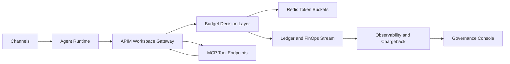
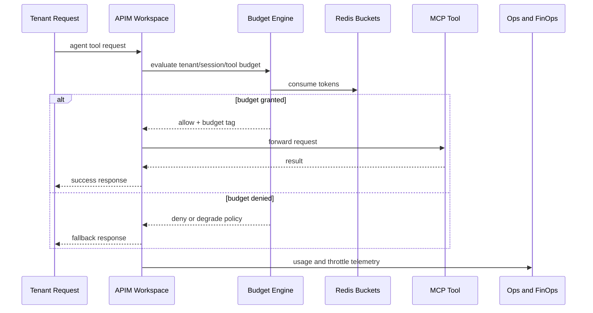

# Enterprise multi-tenant MCP quota isolation selection FAQ: APIM Workspace quota domains vs Redis token buckets vs dedicated gateway pools

> **Audience**: Enterprise Cloud & AI Solution Architects, platform governance leads, AI gateway owners, FinOps teams, and audit/compliance stakeholders.  
> **Core question**: When many business domains share one agent platform and remote MCP tool catalog, how do we enforce fair quota isolation, predictable cost, and stable SLA under burst load.

## 1. Problem framing: quota governance is usually the first scale failure

Early-stage agent platforms
focus on features and availability.

At scale,
quota contention becomes the first severe incident source.

Common trigger paths:

- One tenant replays large jobs and starves others.
- Tool fan-out storms hit downstream SaaS limits.
- Uneven cache behavior slows healthy tenants.
- Budget drift appears only at monthly close.

Without tenant-aware controls,
the platform enters shared-pool tragedy.

## 2. Scope: why MCP quota control differs from basic API throttling

MCP traffic is not simple request-per-user flow.

It differs from classic API patterns:

- Agent behavior can amplify tool calls adaptively.
- One turn may create concurrent tool fan-out.
- One tool result can trigger additional tool loops.

Entry QPS limits alone are insufficient.
You need multi-layer budget governance.

Baseline metrics should include:

- Per-tenant calls per minute.
- Cost per 1,000 sessions.
- Throttle trigger rate and false-throttle rate.
- Critical-tenant success rate and P95 latency.

## 3. Pattern A: APIM Workspace quota domains

Pattern A uses APIM Workspace
as a tenant policy isolation boundary.

Typical design:

- Separate products and subscriptions by tenant.
- Per-tenant burst and sustained limits.
- Outbound policy writes tenant cost labels.
- Workspace-level usage and audit views.

Strengths:

- Centralized governance and traceability.
- Strong alignment with existing API controls.
- Fast adoption with limited runtime refactor.

Limitations:

- Limited granularity at tool-session level.
- Session-aware elasticity needs extra components.
- Hot tenants can still stress shared backends.

## 4. Pattern B: Redis token buckets and runtime budget ledger

Pattern B enforces runtime fine-grained quotas.

Core mechanics:

- Tenant bucket for global fairness.
- Session bucket for burst control.
- Tool bucket for expensive operations.
- Budget ledger for consume and refill events.

Strengths:

- High granularity and dynamic control.
- Supports priority and quota borrowing logic.
- Portable across gateway implementations.

Limitations:

- Requires strong consistency discipline.
- Higher implementation complexity than gateway-only.
- Rule growth can increase ops burden.

## 5. Pattern C: dedicated gateway pools with hard tenant isolation

Pattern C provisions dedicated gateway pools
for high-value or high-risk tenants.

Common setup:

- Strategic tenants on isolated gateway groups.
- Standard tenants remain in shared pools.
- Regulated tenants use dedicated key paths.
- Cost attribution is pool-based and explicit.

Strengths:

- Strongest noise isolation.
- Clear SLA and compliance boundaries.
- Natural fault-domain containment.

Limitations:

- Higher baseline cost.
- Lower utilization if sizing is conservative.
- Requires stronger capacity planning capability.

## 6. Pattern D: hybrid layered control plane (recommended)

Mature enterprises usually adopt hybrid layering.

Recommended split:

- APIM for tenant boundary and audit consistency.
- Redis for session-tool runtime budgets.
- Dedicated pools for premium and regulated tenants.

This balances policy consistency,
runtime elasticity, and business priority.
It also gives finance teams cleaner quarterly forecasting baselines.

## 7. Reference architecture: multi-tenant quota control plane

Architecture implications:

- Decision layer and gateway policy must reconcile deterministically.
- Budget decisions must be replayable for audit.
- Cost attribution tags must stay end-to-end.

## 8. Request flow: quota decision, degrade path, and recovery

Flow governance essentials:

- Denials need machine-readable reason codes.
- Degrade policy must distinguish soft vs hard denial.
- Recovery cannot depend on ad hoc manual override.

## 9. 12-dimension enterprise comparison matrix

| Dimension | A APIM Workspace | B Redis Buckets | C Dedicated Pools | D Hybrid Layer |
|---|---|---|---|---|
| Tenant isolation strength | High | Medium | Very high | Very high |
| Session-level precision | Medium | Very high | Medium | High |
| Tool-level budget control | Medium | High | Medium | High |
| Governance traceability | Very high | High | High | Very high |
| Time to adopt | High | Medium | Medium | Medium |
| Runtime elasticity | Medium | High | Medium | High |
| Noise-tenant suppression | Medium | High | Very high | Very high |
| Cost predictability | High | Medium | High | High |
| Cost utilization | High | High | Medium | High |
| Operations complexity | Medium | High | Medium | High |
| Cross-team collaboration fit | High | Medium | Medium | High |
| Recommended maturity stage | Early to growth | Growth to complex | Premium-tier focus | Enterprise scale |

## 10. Quantitative break-even: SLA and TCO baseline

| Metric | A APIM | B Redis | C Dedicated | D Hybrid |
|---|---:|---:|---:|---:|
| False-throttle rate | 2.7% | 1.9% | 1.6% | 1.2% |
| Critical-tenant success rate | 96.8% | 97.6% | 98.4% | 99.1% |
| Tool wait P95 | 1180ms | 1010ms | 940ms | 860ms |
| Cost per 1k sessions | $31 | $29 | $37 | $33 |
| Over-budget incident rate | 4.8% | 3.2% | 2.7% | 1.9% |
| Finance reconciliation drift | 3.1% | 2.4% | 2.0% | 1.4% |

Assumptions:

- 380k monthly active sessions.
- 4.2x peak load multiplier.
- 18% premium or regulated tenants.
- Average 7.4 tool calls per session.

Interpretation:

- A is best for fast standardization.
- B wins in fine-grained dynamic control.
- C suits strict premium-tier guarantees.
- D is strongest under mixed enterprise goals.

## 11. Decision tree: selecting by tenant and operating model

Question 1:
Do you have contract-grade isolated SLA tenants?

- Yes: start with C or D.
- No: continue to Question 2.

Question 2:
Do you need session-level budget and refill logic?

- Yes: start with B or D.
- No: continue to Question 3.

Question 3:
Is centralized policy audit the top priority?

- Yes: start with A.
- No: continue to Question 4.

Question 4:
Do noise tenants and budget drift occur regularly?

- Yes: converge to D.
- No: phase with A or B.

## 12. Anti-patterns and corrective governance

Anti-pattern 1:
One static threshold for all tenants.

Correction:
Apply tiered quota by tenant class and time window.

Anti-pattern 2:
Govern by QPS only, ignoring unit economics.

Mitigation:
Join token, retry, and downstream billing into one budget model.

Anti-pattern 3:
Throttle responses lack standardized reason codes.

Action:
Publish a machine-readable denial reason catalog.

Anti-pattern 4:
Manual whitelist changes become daily operations.

Fix:
Automate quota borrow/return with policy approvals.

## 13. Platform governance model and change gates

Recommended operating model:

- Platform team owns quota model and runtime engine.
- Business domains own tenant class and priority policy.
- FinOps owns budget lines and anomaly thresholds.
- Audit owns retention and evidence requirements.

Change gates:

- Quota policy updates require staged rollout.
- High-risk tenant updates require dual approval.
- Every policy release must be replayable and reversible.

## 14. Five-step rollout guide (Good fit vs Not for)

Step 1:
Define a unified tenant tier model and tagging taxonomy.

Step 2:
Use APIM Workspace as the baseline boundary layer.

Step 3:
Introduce Redis runtime budget control at session-tool granularity.

Step 4:
Move premium and regulated tenants into dedicated pools.

Step 5:
Review false-throttle, SLA, and cost drift weekly.

Good fit:

- Shared multi-domain enterprise agent platforms.
- Clear tenant SLA tiers and billing ownership.
- Strong requirements for auditable cost attribution.

Not for:

- Single-tenant internal automation only.
- Small low-risk trials with limited tool usage.
- Teams without basic cost accounting discipline.

## 15. Practical FAQ (8 questions)

**Q1: Is APIM-only enough for enterprise scale?**  
A1: It is sufficient for early scale, but runtime fine-grained control usually requires additional budget engines.

**Q2: Does Redis bucket control create a new single point risk?**  
A2: It can if poorly designed; use HA topology and explicit degrade behavior.

**Q3: Are dedicated pools too expensive by default?**  
A3: Not for premium tenants with strict SLA penalties, where isolation often lowers total loss.

**Q4: How do we reduce false throttling on critical workflows?**  
A4: Use priority-aware reserve quotas and separate soft and hard denial paths.

**Q5: How often should quotas be recalibrated?**  
A5: Weekly baseline calibration is typical, with event-driven temporary policies when needed.

**Q6: Why does finance reconciliation often drift?**  
A6: Missing tenant labels and retry-cost attribution are common root causes.

**Q7: How can tenants migrate into dedicated pools without downtime?**  
A7: Use pre-warmed capacity and policy templates with staged traffic movement.

**Q8: Is hybrid layering over-engineering?**  
A8: Complexity increases, but enterprise stability and cost predictability usually improve significantly.

