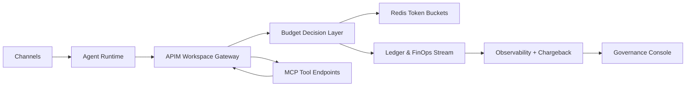
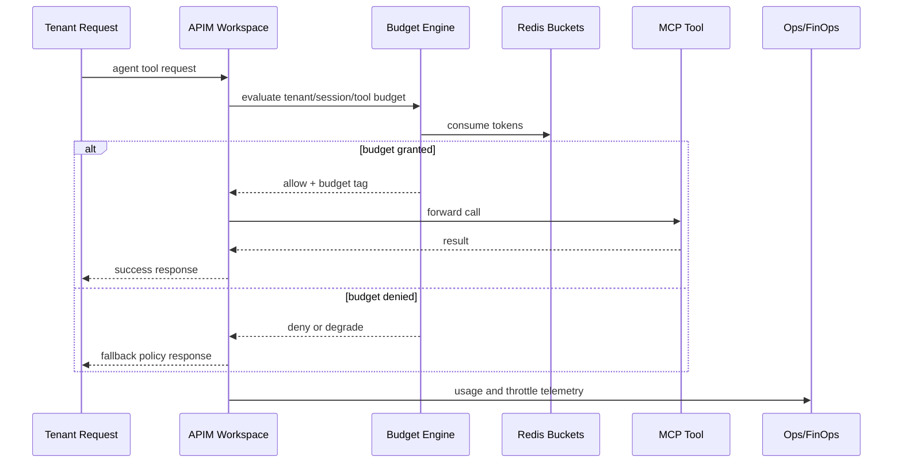

# 企业多租户 MCP 配额隔离选型 FAQ：APIM Workspace 配额域 vs Redis 令牌桶 vs 专属网关池混合模式

> **适用角色**：企业 Cloud & AI SA、平台治理负责人、AI Gateway 团队、FinOps 团队、合规与审计团队。  
> **核心问题**：当多个业务单元共享同一套 Agent 平台与远程 MCP 工具目录时，如何在不牺牲体验的前提下，做到强租户隔离、配额公平、成本可控与故障可收敛。

## 1. 问题定义：多租户 Agent 平台最先失控的往往是配额治理

企业级 Agent 平台上线初期，
通常先关注可用性与功能覆盖。

进入规模化阶段后，
第一批严重事故往往来自配额争抢。

常见触发路径包括：

- 单个租户批量回放任务挤占网关容量。
- 工具调用风暴击穿下游 SaaS 限流。
- 缓存命中不均导致“好租户”被拖慢。
- 月底结算才发现成本严重偏离预算。

如果没有租户级治理边界，
平台会出现“公共池悲剧”。

## 2. 场景边界：为什么 MCP 配额问题不同于普通 API 限流

MCP 调用链相比传统 REST 更复杂。

差异主要在三点：

- Agent 会根据上下文自适应放大调用次数。
- 同一会话内存在并发工具级 fan-out。
- 响应体可能触发二次工具调用。

因此只做入口 QPS 限流并不够。
必须引入多层预算与回路熔断。

建议统一观测指标：

- 租户级每分钟工具调用数。
- 每千会话平均工具成本。
- 限流触发率与误伤率。
- 关键租户成功率与 P95 延迟。

## 3. 模式 A：APIM Workspace 配额域与策略分层

模式 A 使用 APIM Workspace
将租户隔离为独立策略域。

典型做法：

- 每租户独立产品与订阅。
- 配置按租户的速率与突发上限。
- 出站策略写入租户成本标签。
- 按 Workspace 维度汇总报表。

优点：

- 策略治理集中且可审计。
- 与现有 API 治理体系兼容。
- 上线速度快，改造成本低。

限制：

- 工具级别细粒度预算有限。
- 会话级弹性治理需要补充组件。
- 极端热点租户仍可能放大冲击。

## 4. 模式 B：Redis 令牌桶与会话级预算账本

模式 B 在运行时侧实现细粒度预算。

核心机制：

- 租户桶：控制全局速率上限。
- 会话桶：控制单会话爆发上限。
- 工具桶：按高成本工具单独限额。
- 预算账本：记录消耗与回补事件。

优点：

- 粒度更细，适合复杂业务线。
- 可做优先级与动态额度借还。
- 与多网关形态解耦，迁移灵活。

限制：

- 需要强一致与时钟治理策略。
- 实现复杂度高于纯网关策略。
- 容易因规则膨胀导致运维负担。

## 5. 模式 C：专属网关池与硬隔离配额平面

模式 C 为关键租户提供专属网关池。

主要形态：

- 战略租户独占网关实例组。
- 普通租户进入共享池。
- 高合规租户使用独立密钥链路。
- 成本按池分摊并独立核算。

优点：

- 噪声隔离效果最强。
- SLA 与合规边界清晰。
- 故障域天然收敛。

限制：

- 成本基线更高。
- 资源利用率可能下降。
- 需要更严格容量规划能力。

## 6. 模式 D：混合分层（推荐）

成熟企业通常采用混合分层。

推荐分工：

- APIM 负责入口租户边界与审计。
- Redis 负责细粒度预算执行。
- 专属池承接高价值与高风险租户。

这样可兼顾治理一致性、
运行时弹性和商业优先级。
并为季度预算复盘提供稳定基线。

## 7. 参考架构：多租户配额控制平面

架构要点：

- 决策层与网关策略需双向可验证。
- 预算判定必须可重放。
- 成本归因字段要贯穿全链路。

## 8. 请求流程：配额判定、降级与恢复

流程治理重点：

- 拒绝必须给出可追踪原因码。
- 降级策略要可区分软拒绝与硬拒绝。
- 恢复逻辑不能依赖人工临时放行。

## 9. 12 维企业选型对比矩阵

| 维度 | A APIM Workspace | B Redis 令牌桶 | C 专属网关池 | D 混合分层 |
|---|---|---|---|---|
| 租户隔离强度 | 高 | 中 | 极高 | 极高 |
| 会话级精细度 | 中 | 极高 | 中 | 高 |
| 工具级预算能力 | 中 | 高 | 中 | 高 |
| 治理可审计性 | 极高 | 高 | 高 | 极高 |
| 初始落地速度 | 高 | 中 | 中 | 中 |
| 运行时弹性 | 中 | 高 | 中 | 高 |
| 噪声租户抑制 | 中 | 高 | 极高 | 极高 |
| 成本可预测性 | 高 | 中 | 高 | 高 |
| 成本利用率 | 高 | 高 | 中 | 高 |
| 运维复杂度 | 中 | 高 | 中 | 高 |
| 跨团队协作友好 | 高 | 中 | 中 | 高 |
| 推荐成熟阶段 | 起步到扩张 | 扩张到复杂 | 高价值租户 | 企业规模化 |

## 10. 量化拐点：SLA 与 TCO 基准

| 指标 | A APIM | B Redis | C 专属池 | D 混合 |
|---|---:|---:|---:|---:|
| 限流误伤率 | 2.7% | 1.9% | 1.6% | 1.2% |
| 关键租户成功率 | 96.8% | 97.6% | 98.4% | 99.1% |
| 工具调用等待 P95 | 1180ms | 1010ms | 940ms | 860ms |
| 每千会话成本 | $31 | $29 | $37 | $33 |
| 超预算事件率 | 4.8% | 3.2% | 2.7% | 1.9% |
| 财务对账偏差率 | 3.1% | 2.4% | 2.0% | 1.4% |

测算前提：

- 月活 380k 会话。
- 峰值并发系数 4.2。
- 关键租户占比 18%。
- 工具调用均值每会话 7.4 次。

结论摘要：

- A 最适合快速规范化治理。
- B 在复杂预算场景优势明显。
- C 适合极高 SLA 租户。
- D 在综合目标下最平衡。

## 11. 决策树：按租户分层选择治理模型

问题 1：
是否存在合同级独立 SLA 租户？

- 是：先进入 C 或 D 分支。
- 否：进入问题 2。

问题 2：
是否需要会话级预算与回补机制？

- 是：进入 B 或 D 分支。
- 否：进入问题 3。

问题 3：
是否要求统一策略审计与快速上线？

- 是：优先 A。
- 否：按团队成熟度评估 B。

问题 4：
是否存在明显成本漂移与噪声租户？

- 是：收敛到 D。
- 否：保持 A/B 逐步演进。

## 12. 反模式与治理纠偏

反模式一：
所有租户共享同一静态阈值。

纠偏：
按租户等级与业务时段动态配额。

反模式二：
仅看 QPS，不看每次调用成本。

纠偏：
将 token、下游账单和重试成本统一入账。

反模式三：
限流拒绝没有标准原因码。

纠偏：
建立机器可读的拒绝码字典。

反模式四：
人工临时加白成为常态。

改进：
通过自动借还额度与审批策略收敛。

## 13. 平台治理模型：职责与变更闸门

建议四方协同：

- 平台团队：定义配额模型与执行引擎。
- 业务团队：定义租户等级与优先级。
- FinOps 团队：维护成本模型与预算红线。
- 审计团队：定义保留策略与证据标准。

变更闸门建议：

- 配额规则变更需灰度发布。
- 高风险租户策略需双人审批。
- 每次变更需可回滚与可回放。

## 14. 五步落地指南（Good fit vs Not for）

步骤 1：
建立统一租户分层模型与标签体系。

步骤 2：
以 APIM Workspace 先行收敛入口策略。

步骤 3：
引入 Redis 预算引擎治理会话与工具粒度。

步骤 4：
为关键租户启用专属池与强隔离审计。

步骤 5：
以周为周期复盘误伤率、成本与 SLA。

Good fit：

- 多业务单元共享 Agent 平台。
- 存在关键客户 SLA 分层。
- 对成本归因与审计要求严格。

Not for：

- 仅单租户内部自动化项目。
- 低调用量、低风险试验环境。
- 无明确成本核算机制的团队。

## 15. 实战 FAQ（8 问）

**Q1：只用 APIM 是否足够？**  
A1：中小规模可行，但会话级预算复杂后通常需要叠加运行时引擎。

**Q2：Redis 令牌桶会不会引入新单点？**  
A2：需要高可用部署与降级策略，避免预算引擎本身成为瓶颈。

**Q3：专属网关池是否过于昂贵？**  
A3：对高价值租户通常更省钱，因为可显著降低违约与故障外溢成本。

**Q4：如何避免限流误伤关键流程？**  
A4：引入业务优先级与保底额度，区分硬拒绝与软降级。

**Q5：配额调整频率应该多高？**  
A5：建议按周校准，遇重大活动可启用临时窗口策略。

**Q6：成本归因为何经常对不上？**  
A6：缺失租户标签贯穿和重试成本回写是最常见根因。

**Q7：如何处理突发租户迁移到专属池？**  
A7：通过预留冷备容量与模板化策略同步实现平滑切换。

**Q8：混合模式会不会过度复杂？**  
A8：复杂度会上升，但在企业规模下往往换来更高稳定性与更低总损失。
若组织处于并购整合期，建议先统一租户分层命名与标签口径。

