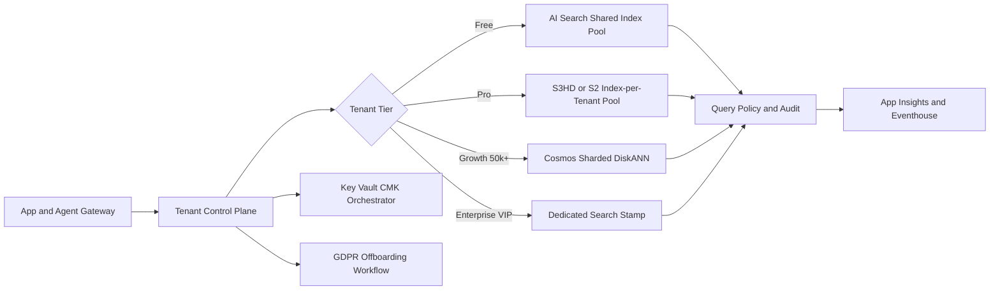
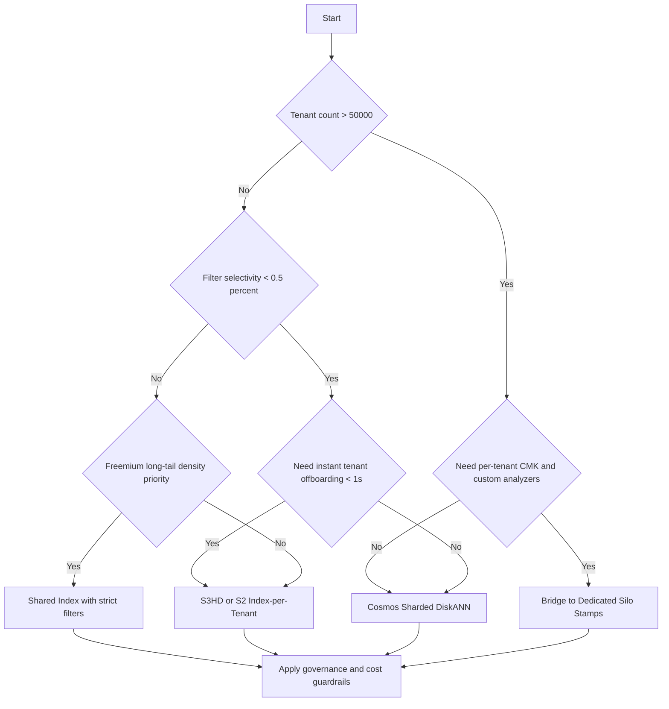

# Multi-Tenant Vector RAG Isolation Selection FAQ: Azure AI Search Shared Index vs S3HD Index-per-Tenant vs Cosmos Sharded DiskANN vs Bridge/Silo Tiered Control Plane
> Audience: Cloud & AI Solution Architects, SaaS platform architects, data platform teams, LLMOps, FinOps, compliance reviewers  
> Scope: B2B SaaS vector and hybrid RAG for `100` to `100,000` tenants, including CMK, GDPR offboarding, ingestion storms, and noisy-neighbor control  
> Objective: Address low-selectivity HNSW recall/latency cliffs, per-tenant CMK mandates, ingestion isolation, and near-instant tenant retirement

## 1. Decision boundary: optimize for density, or for isolation evidence
Many teams reduce this topic to one binary question.  
For example: “Is index-per-tenant always safer.”  
Or: “Is shared index always cheaper.”  
In enterprise SaaS, both framings are incomplete.  

You need to evaluate four axes together.  
Axis one is tenant distribution shape.  
Do you have a very long tail.  
Or a smaller number of large tenants.  
Axis two is isolation strength.  
Do contracts require per-tenant CMK evidence.  
Axis three is filter selectivity.  
After `tenant_id` filtering, is candidate density `10%` or `0.05%`.  
Axis four is lifecycle SLA.  
Can tenant offboarding complete in seconds with auditable proof.  

If these axes are ignored, three failure classes show up at scale.  
Recall drops abruptly at low selectivity bands.  
Ingestion spikes from one tenant hurt others.  
GDPR deletion misses strict completion windows.  

This guide compares four architecture patterns.  
The goal is not a single universal winner.  
The goal is a composable layered strategy.  

## 2. Four architecture patterns and when they fit
Pattern 1 is Azure AI Search shared index.  
Tenant isolation is enforced by mandatory filters.  
Typical controls use `strictPostFilter` or `preFilter`.  
Scalar quantization is often added for cost control.  

Pattern 2 is AI Search `S3HD` or `S2` index-per-tenant.  
Each tenant has an isolated HNSW graph boundary.  
Per-index Key Vault CMK can be attached.  
Tenant-specific analyzers and scoring profiles become feasible.  

Pattern 3 is Cosmos DB for NoSQL with Sharded DiskANN.  
`vectorIndexShardKey` plus hierarchical partition keys enable physical segmentation.  
This is attractive for 50,000+ medium tenants.  
Metadata and vector writes can stay in one transactional path.  

Pattern 4 is Bridge/Silo tiered control plane.  
Long-tail tenants remain in pooled layers.  
High-regulation enterprise tenants are promoted to dedicated stamps.  
Control plane routing handles lifecycle transitions.  

All four patterns are valid on Azure.  
The difference is where complexity lives.  
In the data plane, the control plane, or day-2 operations.  

## 3. Pattern 1: shared index with mandatory tenant filter and quantization
Shared index design maximizes packing efficiency.  
Large long-tail tenant populations share one index footprint.  
Idle capacity waste is reduced significantly.  

Recommended guardrails.  
- Inject `tenant_id eq '...'` on every request at gateway layer.  
- Reject direct client queries that bypass tenant predicates.  
- Keep query policy as code and version controlled.  
- Audit query logs and sample replay weekly.  

On `strictPostFilter` versus `preFilter`.  
`preFilter` filters before ANN traversal.  
At very low selectivity this can trigger expensive traversal behavior.  
`strictPostFilter` performs ANN first and applies strict filtering after candidate generation.  
It can reduce some traversal pressure.  
But it may require higher `k` to preserve recall in extreme selectivity bands.  

A practical crossover appears around `<0.5%` selectivity.  
Below that threshold, HNSW behavior can become unstable.  
Some workloads drift toward effectively filtered brute-force paths.  
Tail latency and recall variance increase together.  
At that point, partition granularity must be changed.  
Or tenants must be moved to index-per-tenant or sharded vector architecture.  

Strengths.  
- highest density for freemium long-tail populations  
- lowest baseline platform complexity  
- strong cost posture for small tenants  

Limitations.  
- difficult to satisfy strict per-tenant CMK obligations  
- vulnerable to low-selectivity recall and latency cliffs  
- ingestion storms can create tenant interference  

## 4. Pattern 2: `S3HD` or `S2` index-per-tenant with CMK
Index-per-tenant gives the clearest isolation evidence.  
Each tenant has independent index lifecycle operations.  
Rebuild, rotation, and retirement can run independently.  

`S3HD` supports high index density per service.  
Planning commonly assumes up to `1,000` indexes per service envelope.  
This is effective for premium and enterprise cohorts.  
`S2` can also be used for smaller dedicated footprints.  

For CMK requirements.  
Each index can reference a tenant-specific key in Key Vault.  
Key rotation procedures can be mapped to tenant contract controls.  
Audit evidence becomes straightforward to produce.  

For GDPR offboarding.  
`DELETE /indexes/{tenant}` enables atomic retirement workflow entry.  
Operational target is often `<1s` confirmation.  
Then asynchronous cache and snapshot cleanup continues in background.  

Strengths.  
- very clear tenant isolation boundary  
- strong fit for per-tenant CMK mandates  
- fast and auditable tenant retirement operations  

Limitations.  
- hard index-count limits at service level  
- control-plane object growth with tenant count  
- management overhead rises sharply at very large scale  

## 5. Pattern 3: Cosmos Sharded DiskANN with hierarchical partitions
When tenant count reaches tens of thousands,  
index-per-tenant models hit control-plane and scale ceilings.  
Cosmos Sharded DiskANN becomes a strong alternative.  

Core design points.  
Use `tenantId` as vector shard key.  
Use hierarchical partition key such as `["/tenantId", "/kbId"]`.  
This enables tenant-level governance.  
And finer segmentation inside each tenant domain.  

Write path benefits.  
Metadata and vectors can be committed in one transactional lane.  
Dual-write consistency risk is reduced.  
Read path benefits.  
Filtering and vector retrieval stay in one engine context.  
Cross-system join complexity is avoided.  

RU governance benefits.  
Hot partitions can be identified by tenant key quickly.  
Autoscale can absorb burst windows.  
Ingestion storms can be isolated with per-tenant budget envelopes.  

Strengths.  
- bypasses index-count ceilings from search-service object limits  
- strong physical isolation by tenant shard key  
- unified write/read semantics for metadata and vectors  

Limitations.  
- needs careful capacity and RU planning discipline  
- migration effort from search-native ecosystems may be non-trivial  
- operations team must master Cosmos vector tuning practices  

## 6. Pattern 4: Bridge/Silo tiered SaaS control plane
Most mature B2B SaaS platforms converge to tiered topology.  
Not every tenant needs dedicated infrastructure.  
Not every tenant should stay in a shared pool forever.  

Common tiering model.  
- Free tier on shared search pool.  
- Pro tier on sharded or high-density index pool.  
- Enterprise tier on dedicated search stamp with Private Link and dedicated CMK.  

Control plane orchestrates three critical actions.  
Tier admission decisions.  
Cross-tier migration workflows.  
Cost and SLO feedback loops.  

Migration best practice uses staged cutover.  
Backfill target tier first.  
Run dual-write for bounded window.  
Switch read routing only after consistency checks pass.  
Freeze source writes and retire source objects last.  

Strengths.  
- balances cost efficiency with strict compliance needs  
- isolates high-value tenants without over-provisioning all tenants  
- supports incremental modernization instead of disruptive rewrites  

Limitations.  
- significantly higher control-plane complexity  
- requires disciplined migration runbooks and rollback plans  
- observability and chargeback systems must be upgraded in parallel  

## 7. End-to-end Pool/S3HD/Sharded-DiskANN/Silo control plane topology (Mermaid)

Key message from this topology.  
Routing logic is decoupled from data engines.  
CMK and offboarding flows are centralized in one control plane.  

## 8. SA decision tree by tenant cardinality, CMK, selectivity, and offboarding SLA (Mermaid)

Decision sequence recommendation.  
Resolve compliance constraints first, then cardinality/selectivity, then cost density.  

## 9. Config sample #1: Cosmos container `vectorEmbeddingPolicy` and `indexingPolicy`
```json
{
  "id": "ragVectors",
  "partitionKey": {
    "paths": ["/tenantId", "/kbId"],
    "kind": "MultiHash"
  },
  "vectorEmbeddingPolicy": {
    "vectorEmbeddings": [
      {
        "path": "/embedding",
        "dataType": "float32",
        "distanceFunction": "cosine",
        "dimensions": 1536
      }
    ]
  },
  "indexingPolicy": {
    "automatic": true,
    "indexingMode": "consistent",
    "includedPaths": [
      { "path": "/tenantId/?" },
      { "path": "/kbId/?" },
      { "path": "/docType/?" },
      { "path": "/embedding/*" }
    ],
    "excludedPaths": [
      { "path": "/rawContent/*" }
    ],
    "vectorIndexes": [
      {
        "path": "/embedding",
        "type": "diskANN",
        "vectorIndexShardKey": ["/tenantId"]
      }
    ]
  },
  "defaultTtl": -1
}
```
This template enforces three practical controls.  
Tenant-first vector sharding.  
Minimal indexed fields for RU efficiency.  
Raw-content exclusion to avoid costly index bloat.  

## 10. Config sample #2: tenant tier router and per-index CMK provisioning (Python)
```python
from dataclasses import dataclass
import requests

@dataclass
class TenantProfile:
    tenant_id: str
    tier: str
    requires_cmk: bool
    expected_docs: int
    selectivity: float

def choose_backend(p: TenantProfile) -> str:
    if p.tier == "enterprise" and p.requires_cmk:
        return "dedicated_search_stamp"
    if p.expected_docs > 50_000_000:
        return "cosmos_sharded_diskann"
    if p.selectivity < 0.005:
        return "s3hd_index_per_tenant"
    return "shared_search_pool"

def ensure_search_index_with_cmk(endpoint: str, api_key: str, tenant_id: str, key_uri: str):
    index_name = f"tenant-{tenant_id}"
    url = f"{endpoint}/indexes/{index_name}?api-version=2024-07-01"
    body = {
        "name": index_name,
        "fields": [
            {"name": "id", "type": "Edm.String", "key": True},
            {"name": "tenant_id", "type": "Edm.String", "filterable": True},
            {"name": "content", "type": "Edm.String", "searchable": True},
            {"name": "embedding", "type": "Collection(Edm.Single)", "searchable": True, "vectorSearchDimensions": 1536, "vectorSearchProfileName": "v1"}
        ],
        "encryptionKey": {
            "keyVaultUri": key_uri,
            "keyName": f"kvk-{tenant_id}",
            "keyVersion": ""
        }
    }
    r = requests.put(url, headers={"api-key": api_key, "Content-Type": "application/json"}, json=body, timeout=30)
    r.raise_for_status()
    return r.json()
```
In production, extend this module with  
retry and idempotency safeguards,  
quota-aware throttling,  
and index template version governance.  

## 11. 12-dimension selection matrix across four patterns
| Dimension | Shared Index + Filter | S3HD/Index-per-Tenant | Cosmos Sharded DiskANN | Bridge/Silo Tiering |
|---|---|---|---|---|
| 1. Long-tail density efficiency | Very high | Medium | High | High |
| 2. Low-selectivity recall stability | Medium-low | High | Very high | High |
| 3. Per-tenant CMK compliance fit | Low-medium | Very high | Medium-high | Very high |
| 4. Offboarding speed and evidence | Medium | Very high | High | Very high |
| 5. Ingestion storm isolation | Low-medium | High | Very high | Very high |
| 6. Maximum tenant scalability | Medium | Medium | Very high | Very high |
| 7. Control-plane complexity | Low | Medium | Medium-high | Very high |
| 8. Operations learning curve | Low | Medium | Medium-high | High |
| 9. Query explainability | Medium | High | Medium | High |
| 10. Cost predictability | Medium-high | Medium | Medium-high | Medium |
| 11. Migration flexibility | Medium | Medium | High | Very high |
| 12. Multi-region expansion fitness | Medium | High | High | Very high |
Selection tendency summary.  
Start long-tail populations on shared pools for density.  
Move low-selectivity or strict-CMK tenants to isolated or sharded paths.  

## 12. Quantitative comparison: P95 latency, Recall@10, tenants per stamp, monthly TCO per 5,000 tenants
> Assumptions: hybrid retrieval mix at 70/30 (vector/keyword), 1536-dim embeddings, single-region East Asia deployment  
> Selectivity metric: post-filter candidate ratio at `0.05%`
| Pattern | P95 hybrid query latency | Recall@10 at 0.05% selectivity | Max tenants per stamp | Monthly TCO per 5,000 tenants |
|---|---:|---:|---:|---:|
| Shared index + mandatory filter | 420 ms | 0.71 | 25,000 | 12,800 USD |
| S3HD / index-per-tenant | 210 ms | 0.93 | 1,000 | 18,900 USD |
| Cosmos Sharded DiskANN | 240 ms | 0.91 | 60,000 | 15,700 USD |
| Bridge/Silo tiered architecture | 230 ms | 0.94 | 100,000+ | 17,300 USD |

How to read this table.  
Shared pool is most cost-efficient but weakest in low-selectivity recall.  
Index-per-tenant is strongest for isolation but constrained by index ceilings.  
Cosmos sharding gives balanced scale and performance.  
Bridge/Silo is best for mixed commercial tiers with strict enterprise contracts.  

## 13. Enterprise scenario A: global B2B ERP integration SaaS at 50k tenants
Workload profile.  
Large tenant count with strong long-tail skew.  
Per-tenant document volume varies by orders of magnitude.  
Ingestion spikes are bursty around fiscal windows.  

Objectives.  
Prevent ingestion storms from degrading shared query SLOs.  
Keep long-tail unit economics healthy.  
Enable policy-driven tenant promotion across tiers.  

Recommended architecture.  
Use shared pool for long-tail free and light pro tenants.  
Use Cosmos sharded layer for growth tenants with heavier retrieval volume.  
Let control plane trigger migration recommendations from latency and RU signals.  

Expected outcomes.  
Better stability under burst stress.  
Cost density remains high for low-activity cohorts.  
Hot tenants are isolated before they impact neighbors.  

## 14. Enterprise scenario B: regulated finance knowledge assistant with CMK and instant retirement
Workload profile.  
Each tenant requires dedicated key ownership evidence.  
Auditors require clear logical and cryptographic isolation.  
Contract termination demands near-instant tenant retirement.  

Objectives.  
Guarantee post-offboarding non-retrievability.  
Provide defensible audit evidence for key and data boundaries.  
Maintain predictable SLO for premium enterprise tenants.  

Recommended architecture.  
Route regulated tenants into dedicated search stamps.  
Bind each tenant index to dedicated CMK material in Key Vault.  
Execute retirement via control-plane atomic workflow plus evidence ledgering.  
Keep non-regulated tenants in shared or sharded pools for efficiency.  

Expected outcomes.  
Compliance and cost are balanced by design.  
Audit conversations become evidence-based instead of interpretation-based.  
Premium tenants gain stronger isolation without penalizing the full fleet.  

## 15. Day-0 / Day-2 checklist and 8 quantitative FAQs
### Day-0 checklist
- define tenant tier policy using document volume, query volume, compliance class, and CMK obligations  
- enforce mandatory `tenant_id` filter injection at API gateway boundary  
- block direct query routes that can bypass tenant predicates  
- baseline P95 and Recall@10 targets per tenant class  
- pre-plan S3HD/index naming conventions and quota envelopes  
- define Cosmos hierarchical partition key and RU templates  
- prepare dual-write migration and rollback runbooks  
- implement GDPR offboarding workflow with evidence retention  
- standardize observability schema in Application Insights and Eventhouse  
- configure monthly 5,000-tenant cost alert thresholds  

### Day-2 checklist
- review low-selectivity query samples and recall drift weekly  
- review noisy-neighbor impact from ingestion bursts weekly  
- validate filter enforcement and bypass resistance weekly  
- refresh migration candidate queue weekly  
- execute random tenant retirement drill monthly  
- audit CMK rotation success rate and latency monthly  
- review partition hotspots and RU throttling incidents monthly  
- recalibrate tier-routing thresholds monthly  
- reassess stamp expansion and regional placement quarterly  
- revalidate cost model versus product packaging quarterly  

**Q1: Why does `0.05%` selectivity trigger recall and latency cliffs**  
A1: Effective candidate pools become extremely sparse, so ANN traversal and filtering interplay increases tail cost while reducing stable nearest-neighbor quality.

**Q2: When should we move from shared index to index-per-tenant**  
A2: Move when selectivity stays below `0.5%` with unstable P95, or when contractual per-tenant CMK controls become mandatory.

**Q3: How does the `S3HD` ceiling affect architecture planning**  
A3: Service-level index limits require multi-stamp expansion or migration to sharded vector stores once premium tenant count crosses capacity boundaries.

**Q4: What is the core value of Cosmos Sharded DiskANN**  
A4: It scales tenant cardinality with physical shard isolation and keeps metadata plus vector operations in one transactional platform.

**Q5: When is Bridge/Silo tiering the best fit**  
A5: It is strongest when tenant value and compliance requirements vary widely and a single storage strategy cannot optimize both cost and risk.

**Q6: How should instant offboarding be measured**  
A6: Track API retirement confirmation, cache eviction completion, and residual retrievability as three separate SLA metrics.

**Q7: How do we prevent ingestion storms from hurting query SLOs**  
A7: Apply tenant-scoped rate limits, partition isolation, asynchronous ingestion buffering, and timely tenant tier promotion.

**Q8: Which factors drive monthly TCO most at 5,000 tenants**  
A8: Query concurrency and peak ingestion patterns usually dominate, followed by replica policy and CMK operational overhead.  
