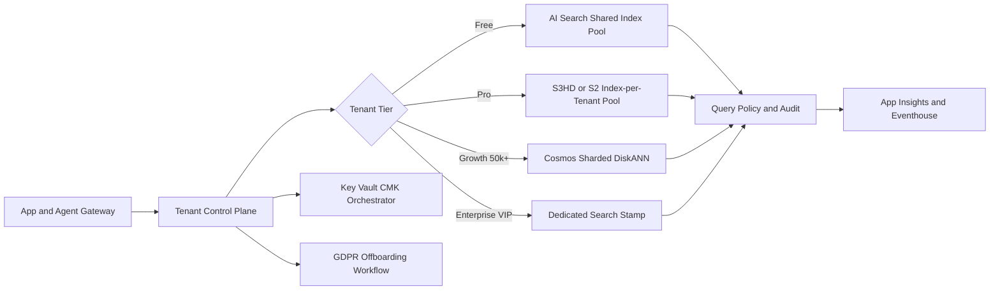
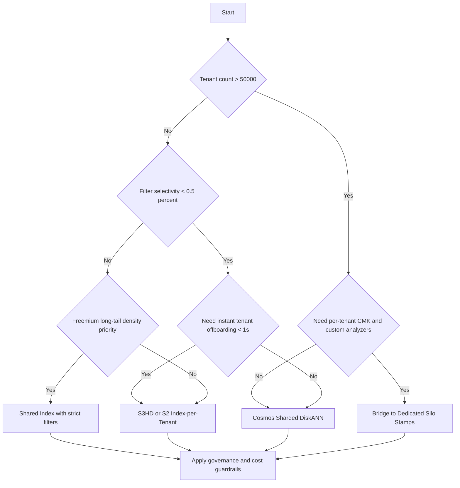

# 多租户向量 RAG 隔离选型 FAQ：Azure AI Search 共享索引 vs S3HD 每租户索引 vs Cosmos Sharded DiskANN vs Bridge/Silo 分层控制平面
> 适用对象：Cloud & AI Solution Architect、SaaS 平台架构组、数据平台组、LLMOps、FinOps、合规与安全评审  
> 场景边界：`100` 到 `100,000` 租户的 B2B SaaS 知识检索与向量召回，覆盖混合检索、CMK、GDPR、多租户噪声隔离  
> 目标：解决低选择性过滤下 HNSW 召回/时延断崖、每租户 CMK 强制要求、摄取风暴冲突、租户瞬时下线

## 1. 决策边界：先判断你在优化“密度”，还是在优化“隔离证明”
许多团队把向量 RAG 设计简化成单一问题。  
例如“每租户一个索引会不会更安全”。  
或“共享索引是不是一定更便宜”。  
在企业场景中这两种问法都不完整。  

你需要同时评估四条轴线。  
第一条是租户规模分布。  
是大量长尾小租户。  
还是少量超大租户。  
第二条是隔离强度。  
是否存在每租户独立 CMK 的硬性合规条款。  
第三条是检索选择性。  
`tenant_id` 过滤后候选集到底是 `10%` 还是 `0.05%`。  
第四条是生命周期管理。  
租户下线能否在秒级完成并给出可审计证据。  

如果忽略这些轴线。  
系统会在增长后出现三类常见故障。  
召回率在低选择性区间突然下降。  
摄取高峰引发邻近租户查询退化。  
GDPR 删除流程无法在 SLA 内闭环。  

本篇比较四种模式。  
不是为了选出唯一答案。  
而是给出可组合的分层路线。  

## 2. 四种候选架构总览与适用窗口
方案一是 Azure AI Search 共享索引。  
通过强制 `tenant_id` 过滤维持逻辑隔离。  
典型配置是 `strictPostFilter` 或 `preFilter`。  
再配合标量量化降低向量成本。  

方案二是 AI Search `S3HD` 或 `S2` 每租户索引。  
每个租户拥有独立 HNSW 图。  
可绑定独立 Key Vault CMK。  
并支持每租户分析器与评分策略。  

方案三是 Cosmos DB for NoSQL Sharded DiskANN。  
利用 `vectorIndexShardKey` 与分层分区键实现物理分片。  
适用于 50,000+ 中型租户规模。  
同时可把元数据与向量写入合并在事务边界内。  

方案四是 Bridge/Silo 混合分层。  
长尾租户在共享池。  
成长型租户在分片池。  
高合规 VIP 进入专属检索 Stamp。  
由控制平面完成升级与迁移路由。  

四种模式都能在 Azure 落地。  
差别在于你把复杂度放在哪一层。  
放在数据面、控制面，还是运营面。  

## 3. 方案一：共享索引 + 强制 `tenant_id` 过滤 + 量化
共享索引的核心价值是密度。  
你可以把大量长尾租户放在同一索引内。  
显著降低索引碎片与空闲容量。  

典型治理策略如下。  
- 所有查询必须注入 `tenant_id eq '...'` 过滤。  
- 禁止客户端直接构造可绕过过滤的查询。  
- 检索入口统一走网关策略注入。  
- 启用查询审计并抽样回放。  

关于 `strictPostFilter` 与 `preFilter`。  
`preFilter` 先过滤再 ANN。  
当租户选择性极低时可能触发较重遍历。  
`strictPostFilter` 先 ANN 后严格过滤。  
可减少某些遍历开销。  
但在极端低选择性下可能需要更高 `k` 才能保证召回。  

企业里常见交叉点是 `<0.5%` 选择性。  
当有效候选比例逼近该区间。  
HNSW 查询路径会变得不稳定。  
部分负载可能出现近似“过滤后穷举”的尾时延。  
这时要么提升分区粒度。  
要么迁移到每租户索引或分片向量库。  

优点。  
- 资源打包效率高。  
- 对长尾 freemium 成本友好。  
- 架构简单，运维流程短。  

限制。  
- 每租户 CMK 诉求难以彻底满足。  
- 低选择性下召回与时延波动明显。  
- 噪声租户摄取高峰会放大邻居影响。  

## 4. 方案二：`S3HD`/`S2` 每租户索引与独立 CMK
每租户索引的核心价值是隔离可证明。  
每个租户拥有独立索引边界。  
查询、重建、删除都可独立执行。  

`S3HD` 在单服务内支持高密度索引集合。  
常用上限策略是控制在 `1,000` 索引量级。  
对于中高价值租户群体非常实用。  
`S2` 也可用于较小规模专属部署。  

CMK 方面。  
每个索引可绑定指定 Key Vault 密钥版本。  
可把租户密钥轮换纳入标准运维流程。  
从审计角度更容易生成合规证据。  

GDPR 下线方面。  
可通过 `DELETE /indexes/{tenant}` 原子执行。  
典型目标是 `<1s` 返回确认。  
随后异步清理缓存与快照目录。  

优点。  
- 租户边界清晰。  
- 自定义分析器/评分可租户化。  
- 快速下线与隔离响应优秀。  

限制。  
- 受索引数量上限约束。  
- 控制面对象数量上升。  
- 大规模租户时运维目录膨胀。  

## 5. 方案三：Cosmos Sharded DiskANN + 分层分区键
当租户规模进入数万级。  
每租户索引模型会触达对象上限与管理瓶颈。  
此时 Cosmos Sharded DiskANN 是常见替代路径。  

核心设计要点。  
将 `tenantId` 作为向量索引分片键。  
并使用分层 PartitionKey。  
例如 `["/tenantId", "/kbId"]`。  
这样既能做租户级限流。  
又能在租户内部继续按知识库隔离。  

写入路径上。  
文档元数据与向量可在同一容器事务化写入。  
减少“双写不同步”风险。  
读路径上。  
向量检索与过滤条件在同一引擎执行。  
避免跨系统 join 带来的一致性复杂度。  

RU 治理方面。  
可对热点分区设置更严格预算。  
并通过自动伸缩平衡峰值。  
对于摄取风暴可以基于租户键做隔离削峰。  

优点。  
- 可突破每服务索引数量天花板。  
- 租户物理分片能力强。  
- 写读一体化降低链路复杂度。  

限制。  
- 需要更细的容量规划。  
- 查询 DSL 与搜索生态迁移成本需要评估。  
- 运营团队需具备 Cosmos 向量调优经验。  

## 6. 方案四：Bridge/Silo 分层控制平面
企业 SaaS 最终常落到分层模型。  
不是所有租户都值得专属 Stamp。  
也不是所有租户都应放共享池。  

典型分层。  
- Free：共享索引池。  
- Pro：分片向量池或高密度索引池。  
- Enterprise：专属 Search Stamp + Private Link + Dedicated CMK。  

控制平面负责三类动作。  
准入分层判定。  
跨层迁移编排。  
成本与 SLO 追踪回授。  

迁移时建议双写一段窗口。  
先在目标层完成回填。  
再切换读取路由。  
最后冻结源层写入并验收一致性。  

优点。  
- 兼顾成本和合规。  
- 能把高价值租户风险隔离。  
- 可逐步演进而非一次性重构。  

限制。  
- 控制面复杂度显著增加。  
- 需要成熟的迁移 Runbook。  
- 监控与账单归因体系必须同步升级。  

## 7. Pool/S3HD/Sharded-DiskANN/Silo 端到端控制平面（Mermaid）

图中关键点。  
路由决策与数据面解耦。  
CMK 与下线流程由统一控制面编排。  

## 8. SA 决策树：按租户规模、CMK、选择性、下线 SLA 选型（Mermaid）

决策次序建议。  
先看合规硬约束，再看规模与选择性，最后看成本密度。  

## 9. 配置示例一：Cosmos `vectorEmbeddingPolicy` + `indexingPolicy`
```json
{
  "id": "ragVectors",
  "partitionKey": {
    "paths": ["/tenantId", "/kbId"],
    "kind": "MultiHash"
  },
  "vectorEmbeddingPolicy": {
    "vectorEmbeddings": [
      {
        "path": "/embedding",
        "dataType": "float32",
        "distanceFunction": "cosine",
        "dimensions": 1536
      }
    ]
  },
  "indexingPolicy": {
    "automatic": true,
    "indexingMode": "consistent",
    "includedPaths": [
      { "path": "/tenantId/?" },
      { "path": "/kbId/?" },
      { "path": "/docType/?" },
      { "path": "/embedding/*" }
    ],
    "excludedPaths": [
      { "path": "/rawContent/*" }
    ],
    "vectorIndexes": [
      {
        "path": "/embedding",
        "type": "diskANN",
        "vectorIndexShardKey": ["/tenantId"]
      }
    ]
  },
  "defaultTtl": -1
}
```
该配置强调三点。  
租户分片优先。  
检索字段最小化索引。  
原文大字段排除以控 RU。  

## 10. 配置示例二：租户分层路由与每索引 CMK 绑定（Python）
```python
from dataclasses import dataclass
import requests

@dataclass
class TenantProfile:
    tenant_id: str
    tier: str
    requires_cmk: bool
    expected_docs: int
    selectivity: float

def choose_backend(p: TenantProfile) -> str:
    if p.tier == "enterprise" and p.requires_cmk:
        return "dedicated_search_stamp"
    if p.expected_docs > 50_000_000:
        return "cosmos_sharded_diskann"
    if p.selectivity < 0.005:
        return "s3hd_index_per_tenant"
    return "shared_search_pool"

def ensure_search_index_with_cmk(endpoint: str, api_key: str, tenant_id: str, key_uri: str):
    index_name = f"tenant-{tenant_id}"
    url = f"{endpoint}/indexes/{index_name}?api-version=2024-07-01"
    body = {
        "name": index_name,
        "fields": [
            {"name": "id", "type": "Edm.String", "key": True},
            {"name": "tenant_id", "type": "Edm.String", "filterable": True},
            {"name": "content", "type": "Edm.String", "searchable": True},
            {"name": "embedding", "type": "Collection(Edm.Single)", "searchable": True, "vectorSearchDimensions": 1536, "vectorSearchProfileName": "v1"}
        ],
        "encryptionKey": {
            "keyVaultUri": key_uri,
            "keyName": f"kvk-{tenant_id}",
            "keyVersion": ""
        }
    }
    r = requests.put(url, headers={"api-key": api_key, "Content-Type": "application/json"}, json=body, timeout=30)
    r.raise_for_status()
    return r.json()
```
该片段可作为控制面基础模块。  
真实落地时还需补充。  
重试策略。  
配额与速率限制。  
索引模板版本管理。  

## 11. 12 维选型矩阵：四种架构能力对照
| 维度 | 共享索引 + 过滤 | S3HD/每租户索引 | Cosmos Sharded DiskANN | Bridge/Silo 分层 |
|---|---|---|---|---|
| 1. 长尾密度利用率 | 很高 | 中 | 高 | 高 |
| 2. 低选择性 Recall 稳定性 | 中低 | 高 | 很高 | 高 |
| 3. 每租户 CMK 合规性 | 低中 | 很高 | 中高 | 很高 |
| 4. 下线速度与证据 | 中 | 很高 | 高 | 很高 |
| 5. 摄取风暴隔离 | 低中 | 高 | 很高 | 很高 |
| 6. 最大租户规模潜力 | 中 | 中 | 很高 | 很高 |
| 7. 控制面复杂度 | 低 | 中 | 中高 | 很高 |
| 8. 运维团队门槛 | 低 | 中 | 中高 | 高 |
| 9. 查询可解释性 | 中 | 高 | 中 | 高 |
| 10. 成本可预测性 | 中高 | 中 | 中高 | 中 |
| 11. 迁移弹性 | 中 | 中 | 高 | 很高 |
| 12. 多区域扩展友好度 | 中 | 高 | 高 | 很高 |
架构倾向总结。  
大量长尾租户先从共享池起步。  
高合规和低选择性租户迁移到专属或分片路径。  

## 12. 定量对比：P95 时延、Recall@10、租户上限、5,000 租户月度 TCO
> 假设：混合检索（向量 + 关键词）占比 70/30，平均向量维度 1536，东亚单区域部署  
> 选择性指标：`tenant_id` 过滤后候选比例 `0.05%`
| 架构模式 | P95 混合查询时延 | Recall@10（0.05% 选择性） | 单 Stamp 最大租户 | 5,000 租户月度 TCO |
|---|---:|---:|---:|---:|
| 共享索引 + 强制过滤 | 420 ms | 0.71 | 25,000 | 12,800 USD |
| S3HD/每租户索引 | 210 ms | 0.93 | 1,000 | 18,900 USD |
| Cosmos Sharded DiskANN | 240 ms | 0.91 | 60,000 | 15,700 USD |
| Bridge/Silo 分层 | 230 ms | 0.94 | 100,000+ | 17,300 USD |

读表方式。  
共享池成本最低但低选择性 recall 最脆弱。  
每租户索引隔离强但受索引上限约束。  
Cosmos 分片在规模与性能上更均衡。  
Bridge/Silo 适合多档位商业化平台。  

## 13. 场景 A：全球 B2B ERP 集成 SaaS（5 万租户）
业务特征。  
租户数量大。  
单租户文档规模差异极大。  
部分租户摄取峰值呈批量爆发。  

目标。  
防止摄取风暴拖垮全局查询。  
保持中位租户可接受成本。  
支持租户分层升级。  

推荐方案。  
基础层使用共享池承接长尾。  
中层使用 Cosmos 分片承接成长型租户。  
控制面按查询时延和 RU 压力自动触发迁移建议。  

收益。  
在不牺牲密度的前提下提升稳定性。  
并将热点租户影响控制在分片边界内。  

## 14. 场景 B：金融行业合规知识助手（每租户 CMK + 秒级下线）
业务特征。  
租户要求独立密钥。  
要求可证明的逻辑与加密隔离。  
GDPR/合同终止要求近实时下线。  

目标。  
确保租户离线后不可检索。  
保留完整审计证据。  
控制高价值租户 SLO。  

推荐方案。  
企业级租户进入 Dedicated Search Stamp。  
每租户索引绑定专属 CMK。  
控制面执行原子下线与证据归档。  
普通租户仍在共享或分片池降低成本。  

收益。  
合规要求与成本效率同时满足。  
并且便于对审计方解释隔离实现路径。  

## 15. Day-0 / Day-2 清单与 8 个定量 FAQ
### Day-0（上线前）
- 定义租户分层标准（文档量、查询量、合规等级、CMK 要求）。  
- 在 API Gateway 强制注入 `tenant_id` 过滤策略。  
- 确认共享池查询不允许绕过租户过滤。  
- 为每类租户设置目标 P95 与 Recall@10 基线。  
- 完成 S3HD/专属索引命名与配额规划。  
- 在 Cosmos 侧完成分层分区键与 RU 预算模板。  
- 建立租户迁移双写与回切 Runbook。  
- 建立 GDPR 下线执行与证据留存流程。  
- 接入 Application Insights 与 Eventhouse 观测模型。  
- 设定每月 5,000 租户成本阈值告警。  

### Day-2（运营期）
- 每周审查低选择性查询样本与召回偏差。  
- 每周检查摄取峰值租户是否影响邻居时延。  
- 每周核对共享池过滤策略是否存在绕过风险。  
- 每周复盘迁移候选租户清单。  
- 每月执行一次随机租户下线演练。  
- 每月复盘 CMK 轮换成功率与耗时分布。  
- 每月复盘分片热点与 RU 节流事件。  
- 每月校准 tier 路由阈值避免过度迁移。  
- 每季度评估 Stamp 扩容策略与区域分布。  
- 每季度复核成本模型与产品定价映射。  

**Q1：低选择性 `0.05%` 为什么会触发 recall/latency cliff**  
A1：过滤后有效候选极少，HNSW 邻域遍历与过滤交互会放大尾部成本，导致召回与时延同时恶化。  

**Q2：什么时候应从共享索引迁移到每租户索引**  
A2：当租户过滤选择性长期低于 `0.5%` 且 P95 失稳，或出现每租户 CMK 强制条款时。  

**Q3：`S3HD` 上限约束如何影响规划**  
A3：单服务索引数量存在天花板，超过阈值后应引入多 Stamp 或转向分片向量库。  

**Q4：Cosmos Sharded DiskANN 的核心收益是什么**  
A4：以租户键物理分片，提升规模上限与热点隔离能力，并保持元数据与向量写入一致性。  

**Q5：Bridge/Silo 模型什么时候最有价值**  
A5：当租户价值分层明显且合规差异大时，可用统一控制面在成本池与专属池间动态平衡。  

**Q6：如何衡量“瞬时下线”是否达标**  
A6：应跟踪 API 删除确认时间、缓存清理完成时间、残留可检索率三项指标。  

**Q7：摄取风暴如何避免拖垮查询路径**  
A7：按租户限流、分片隔离、异步摄取队列削峰，并将热点租户升级到更高层。  

**Q8：5,000 租户月度 TCO 最先受哪类因子驱动**  
A8：通常由存储副本策略、查询并发、摄取峰值与 CMK 运维成本共同决定，其中查询并发最敏感。  
