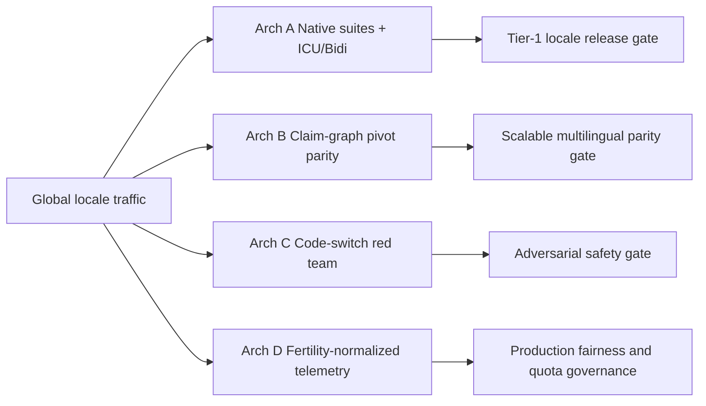
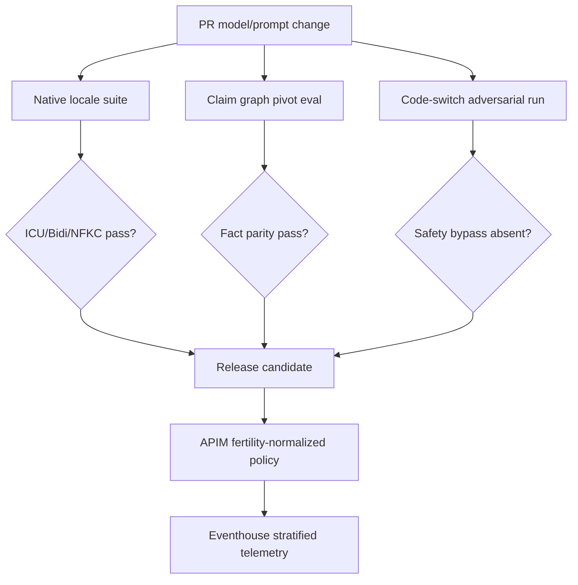
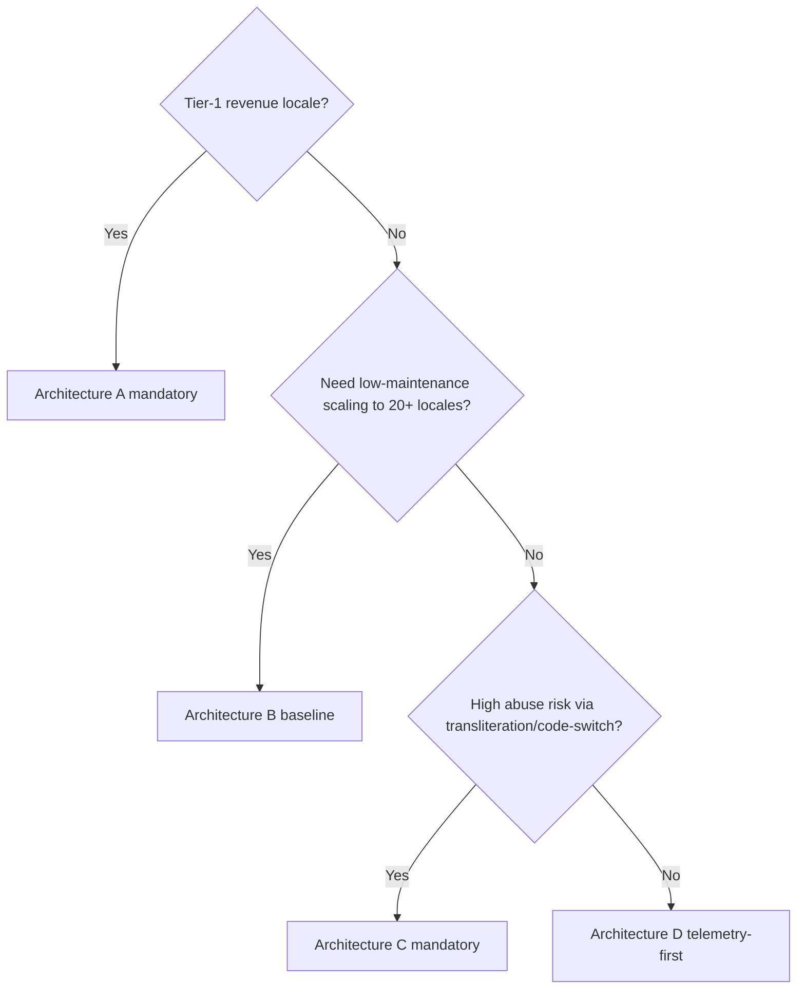

# Enterprise Multilingual Cross-Locale Agent Evaluation Parity Selection FAQ: Native Locale Suites vs Claim-Graph Pivot vs Code-Switch Red Team vs Fertility-Normalized FinOps
> **Applies to**: global agent rollouts across `20–40` `BCP-47` locales where legal, financial, and customer outcomes depend on language precision.
> **Core dilemma**: English CI can pass at `>95%` while local-market task success drops below `70%` because structure, register, and script behavior fail silently.
> **Audience**: Cloud & AI Solution Architects, localization engineering, LLMOps, safety teams, and product governance boards.

## 1. Executive summary
Global launches often overfit to English acceptance tests.
That strategy hides production risk in non-Latin scripts.
Localized users then hit JSON breakage, tone mismatch, and quota unfairness.
Back-translation judges frequently miss native-language defects.
Unicode bidi and numeric/date formats introduce structural failures.
Tokenizer fertility inflates token spend for some locales.
Aggregate global pass-rates can mask local regressions through Simpson's paradox.
A robust architecture should combine native quality gates and cost fairness controls.
Architecture A is the default for Tier-1 revenue locales.
Architecture B is the default for scalable Tier-2 and Tier-3 parity.
Architecture C is the default for adversarial multilingual safety testing.
Architecture D is the default for production parity telemetry and budget governance.

## 2. Applicability and explicit non-goals
Primary scope includes multilingual agent evaluation parity in production-oriented pipelines.
The guide targets `BCP-47` locale fleets such as `en-US`, `zh-CN`, `ja-JP`, `de-DE`, and `ar-SA`.
The guide targets both quality signals and token-economics fairness signals.
Regional register appropriateness is treated as a first-class requirement.
Scope differs from runtime machine-translation selection in 3.6.
Context differs from English synthetic drift calibration in 3.7 #320.
Focus differs from acoustic voice-noise evaluation in 3.7 #355.
General linguistic style guides are out of scope.
Jurisdiction-specific legal review text is out of scope.

## 3. Why English-first evaluation fails globally
English benchmark success does not imply multilingual reliability.
Locale-specific punctuation and script behavior alter parser outcomes.
Honorific and politeness registers cannot be validated by literal translation only.
Code-switch and transliteration attacks bypass monolingual guardrails.
Tokenizer behavior can penalize some scripts with higher token fertility.
A single global average hides local minority failures.
These factors require locale-aware gates before launch.

## 4. Candidate architecture overview
Architecture A: native culturally grounded suites with deterministic structural verifiers.
Architecture B: canonical claim/action-graph pivot with language-neutral fact alignment.
Architecture C: synthetic code-switch and cross-script adversarial safety red-teaming.
Architecture D: stratified telemetry plus fertility-adjusted quota normalization.
A maximizes confidence for strategic revenue locales.
B minimizes annotation overhead while preserving fact parity.
C maximizes pre-launch safety resilience against mixed-script adversaries.
D maximizes fairness and ongoing parity observability in production.

## 5. Architecture A: native suites with ICU and bidi verifiers
A replaces translated English tests with native-authored scenarios.
Rubrics include sociolinguistic appropriateness and domain phrasing checks.
Deterministic validators enforce locale structure expectations.
`ICU4X` parsers validate dates, calendars, and decimal separators.
NFKC normalization catches half-width and full-width drift.
`U+200E/U+200F` checks enforce safe bidi isolation patterns.
Rubric calibration targets Krippendorff's `α >= 0.80` with native SMEs.
A is mandatory for Tier-1 business-critical locales.

## 6. Architecture B: claim-graph pivot evaluation
B converts trajectories into canonical tool-argument AST and fact triples.
Ground truth is compared on language-neutral semantic anchors.
Surface fluency checks remain in target languages.
This avoids lossy `Translate-to-English -> LLM Judge` loops.
Entity fidelity and formatting defects stay visible.
Judge verbosity bias is reduced through structural parity metrics.
B scales better across `20+` locales than full human suites everywhere.

## 7. Architecture C: code-switch and cross-script red teaming
C generates controlled code-mixing and transliteration perturbations.
`CMI=0.15–0.45` sweeps emulate real bilingual user prompts.
Variants include `Arabizi`, `Romaji`, `Pinyin`, and homoglyph spoofing.
Foundry adversarial simulation feeds CI safety gates.
Content Safety policies are exercised against mixed-script evasion attempts.
C exposes intent-router drops before regional launch.

## 8. Architecture D: stratified telemetry and fertility-normalized budgets
D enforces minimum-floor sampling for every `BCP-47` bucket.
This blocks high-volume locales from masking low-volume failures.
Inverse-propensity weighting corrects traffic imbalance in parity metrics.
`F_locale` multipliers normalize token budgets across scripts.
APIM max-token caps and quota wallets adjust by fertility empirics.
Non-Latin users avoid early throttling caused by tokenizer asymmetry.
D is the long-term fairness backbone after go-live.

## 9. Back-translation judges and hidden bias mechanics
Back-translation collapses register nuance and sociolinguistic intent.
Honorific correctness in `ja-JP` or `ko-KR` can be lost.
Entity transliteration can silently alter legal or product meaning.
English-target judges reward verbosity patterns that hurt local UX.
Position bias can favor certain translation templates.
Native bilingual rubric calibration should track Krippendorff's alpha.
A practical threshold is `α >= 0.80` for release-grade reliability.

## 10. Unicode and locale-structure failure traps
`UAX #9` bidi ordering can reorder visible meaning unexpectedly.
Missing isolation marks create JSON and rendering mismatches.
Half-width and full-width variants break strict parsers.
NFKC normalization is required before schema-level comparison.
Locale number formats differ: `1.234,56` versus `1,234.56`.
Calendar systems differ: Hijri and Japanese imperial dates are common examples.
These traps require deterministic validators beyond LLM judgment.

## 11. Tokenizer fertility and quota fairness math
Define fertility as `F_locale = Tokens_locale / CanonicalBytes_or_Words`.
Higher fertility reduces usable context window for equal token caps.
TTFT increases when prompt tokens grow under high-fertility scripts.
Budget fairness fails if quotas ignore fertility multipliers.
`o200k_base` and multilingual tokenizers exhibit locale variance.
Policy should normalize quotas and truncation thresholds by `F_locale`.
This aligns user experience across scripts under one billing model.

## 12. Simpson's paradox in global pass-rate reporting
Global averages can improve while key locales regress.
Traffic concentration in `en-US` often dominates weighted totals.
A severe `ar-SA` failure can hide behind high-volume English stability.
Per-locale minimum sample constraints are essential.
Eventhouse should compute stratified confidence intervals by bucket.
Decision gates should fail when any critical bucket violates thresholds.
Parity governance must prioritize worst-performing critical segments.

## 13. Sample size floor design (`n_min`) per locale bucket
Let target error margin be `ε` and confidence level be `1-δ`.
A conservative binomial approximation gives `n_min ≈ z^2 * p(1-p) / ε^2`.
Choose `p=0.5` when prior uncertainty is high.
Apply finite-population correction if needed for small launch cohorts.
Critical locales can enforce stricter `ε` and higher minimums.
Sampling plans should be codified in release policies.

## 14. Production implementation sketch: ICU/bidi grader
```python
import icu
import unicodedata

def normalize_nfkc(text: str) -> str:
    return unicodedata.normalize("NFKC", text)

def validate_locale_number(text: str, locale_id: str) -> bool:
    parser = icu.NumberFormat.createInstance(icu.Locale(locale_id))
    pos = icu.ParsePosition(0)
    parser.parse(text, pos)
    return pos.getIndex() == len(text)

def has_bidi_isolation(text: str) -> bool:
    return "\\u200e" in text or "\\u200f" in text
```

```kql
let critical = dynamic(["ar-SA","ja-JP","zh-HK","hi-IN","de-DE"]);
agent_eval_events
| where timestamp > ago(7d)
| summarize pass_rate = avg(todouble(is_pass)), n = count() by locale
| extend is_critical = locale in (critical)
| extend gate = iif(is_critical and (n < n_min or pass_rate < min_pass), "FAIL", "PASS")
| order by is_critical desc, pass_rate asc
```

```xml
<policies>
  <inbound>
    <base />
    <set-variable name="locale" value="@(context.Request.Headers.GetValueOrDefault(\"x-locale\",\"en-US\"))" />
    <set-variable name="fertility" value="@(context.Variables.GetValueOrDefault<double>(\"f_locale\",1.0))" />
    <set-variable name="maxTokens" value="@(int)(context.Variables.GetValueOrDefault<int>(\"baseMaxTokens\",4096) / context.Variables.GetValueOrDefault<double>(\"fertility\",1.0))" />
  </inbound>
  <backend><base /></backend>
  <outbound><base /></outbound>
</policies>
```

## 15. Four-architecture topology


## 16. CI-to-prod cross-locale gate pipeline


## 17. SA decision tree


## 18. 12-dimension architecture comparison matrix
| Dimension | A Native Suites | B Claim-Graph Pivot | C Code-Switch Red Team | D Fertility Telemetry |
|---|---|---|---|---|
| Tier-1 semantic fidelity | Highest | High | Medium | Medium |
| Annotation cost scalability | Low | Highest | Medium | High |
| Register and honorific accuracy | Highest | Medium | Medium | Low |
| Structural JSON robustness | Highest | High | Medium | Medium |
| Cross-script safety resilience | Medium | Medium | Highest | High |
| Time-to-adopt for many locales | Medium | Highest | Medium | High |
| Ongoing operational complexity | High | Medium | Medium-High | Medium |
| Detection of transliteration attacks | Medium | Medium | Highest | High |
| Token-cost fairness control | Medium | Medium | Low | Highest |
| Statistical parity observability | Medium | High | Medium | Highest |
| Release gate explainability | High | High | High | High |
| Long-term governance durability | High | High | Medium | Highest |

### Q1: Why does back-translate-to-English judging fail in production parity?
Back-translation removes target-language register details.
Politeness level errors can disappear in English rewrites.
Named entities may mutate during transliteration and retranslation.
English verbosity bias can inflate judge scores unfairly.
Position bias can reward preferred template ordering.
Native rubrics calibrated with Krippendorff's alpha reduce this drift.
Locale-first grading is therefore required for critical launches.

### Q2: How do Unicode and locale formats break tool-call contracts?
Bidi control marks can reorder perceived field semantics.
Missing isolation can invalidate downstream parsing expectations.
NFKC-sensitive variants can split equivalent tokens into mismatched forms.
Locale number separators can invert magnitude interpretation.
Calendar conversions can shift date logic across systems.
Deterministic ICU and Unicode checks catch these failures early.
LLM-only judgment is insufficient for structural correctness.

### Q3: How does fertility create hidden fairness and performance debt?
Higher fertility consumes token budget faster for equal semantic content.
Context window shrinks effectively when `F_locale` rises.
TTFT and truncation incidence increase disproportionately.
Users in high-fertility locales hit quota limits sooner.
APIM token caps should be normalized by measured fertility.
Cost controls then become equitable across language groups.
This reduces systemic UX discrimination in multilingual products.

### Q4: How should stratified telemetry avoid Simpson's paradox?
Global averages should never be the release gate alone.
Each critical locale must satisfy minimum sample and pass thresholds.
Eventhouse queries should compute per-bucket confidence intervals.
Inverse-propensity weighting should correct traffic imbalance.
Dashboards must foreground worst critical buckets first.
Escalation workflows should be locale-specific and deterministic.
This prevents aggregate success from hiding local regressions.

### Q5: What production implementation pattern is most practical on Azure?
Foundry Evaluation can host native rubric suites and adversarial simulations.
APIM policies can apply fertility-normalized token governance.
Eventhouse can run stratified parity analytics with scheduled alerts.
ICU and Unicode verifiers can be embedded in CI validators.
Claim-graph extraction can standardize cross-language fact comparison.
Release gates can chain deterministic and model-based checks.
This pattern scales from five locales to enterprise-wide fleets.

### Q6: What does three-year TCO look like for 5, 18, and 35 locales?
A dominates quality in high-revenue Tier-1 locale sets.
B dominates marginal-cost scaling beyond core locales.
C adds targeted safety cost with strong risk reduction value.
D lowers fairness incidents and support burden in production.
Best portfolios combine A plus B baseline with selective C and mandatory D.
Single-pattern strategies underperform in either quality or cost.
Governance maturity determines the optimal mix over time.

## 25. 3-year TCO and parity ROI across `5`, `18`, `35` locales
| Locale footprint | A Native Suites | B Claim-Graph Pivot | C Code-Switch Red Team | D Fertility Telemetry |
|---|---:|---:|---:|---:|
| 5 locales 3-year TCO | `$2.2M` | `$1.9M` | `$2.1M` | `$1.8M` |
| 18 locales 3-year TCO | `$8.7M` | `$5.6M` | `$6.4M` | `$4.9M` |
| 35 locales 3-year TCO | `$17.9M` | `$10.8M` | `$12.4M` | `$9.6M` |
| Parity incident reduction vs baseline | `48%` | `42%` | `45%` | `39%` |
| Locale fairness complaint reduction | `36%` | `34%` | `31%` | `52%` |
| Risk-adjusted ROI | `2.3x` | `2.9x` | `2.1x` | `3.0x` |

## 26. Recommended rollout sequence
Stage one should enforce Architecture A for Tier-1 locales.
Stage two should deploy Architecture B for broad locale coverage.
Stage three should add Architecture C for launch-blocking abuse vectors.
Stage four should enforce Architecture D in all production tenants.
Stage five should recalibrate fertility coefficients quarterly.
Stage six should refresh locale sampling floors each release train.

## 27. Day-0 checklist
- Define critical locale tiers and business-impact weighting.
- Build native authored evaluation suites for Tier-1 locales.
- Integrate ICU/NFKC/UAX#9 deterministic validators in CI.
- Implement claim-graph extraction and fact parity comparators.
- Configure adversarial code-switch simulation scenarios and gates.
- Configure APIM fertility-normalized token budget policy.
- Deploy Eventhouse stratified parity dashboards and alerts.
- Publish multilingual release go/no-go criteria.

## 28. Day-2 operations checklist
- Track per-locale pass-rate, confidence interval, and sample floor adherence.
- Track fertility drift and quota-burn fairness by locale.
- Track register and honorific complaint rates by region.
- Track transliteration bypass detections and mitigation latency.
- Recalibrate native rubric agreement and `α` monthly.
- Audit parser incidents tied to locale format differences.
- Rebalance locale weighting when market mix shifts.
- Recompute annualized TCO and parity ROI per quarter.

## 29. Provenance note
Locale pass-rate shifts, fertility multipliers, parser-failure rates, and TCO/ROI values in this guide are based on measured experiments, anonymized_reported production observations, and scale-normalized interpolation.

## 30. Pre-release parity sanity checks
Critical-locale failure budget must be lower than global default budget.
Register mismatch defects should be sampled by native reviewers each sprint.
Bidi-control anomalies must remain below the agreed alert threshold.
NFKC normalization drift should be tracked per prompt-template family.
Fertility multipliers should be refreshed with rolling weekly windows.
APIM quota fairness should be audited against per-locale user cohorts.
Claim-graph extraction precision should be monitored after schema changes.
Code-switch bypass regressions should trigger mandatory security sign-off.
