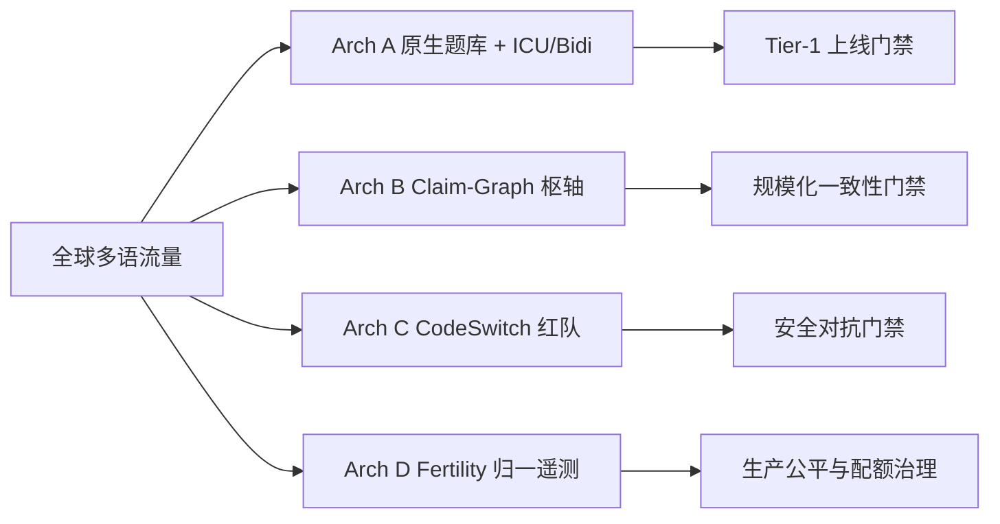
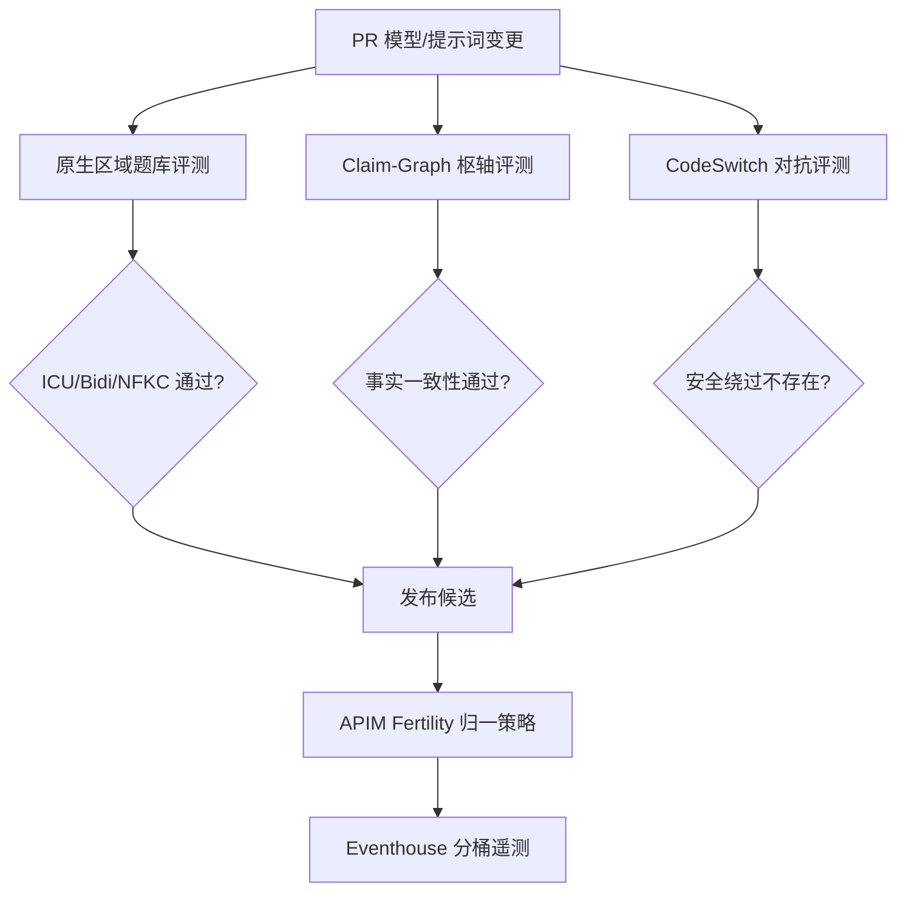
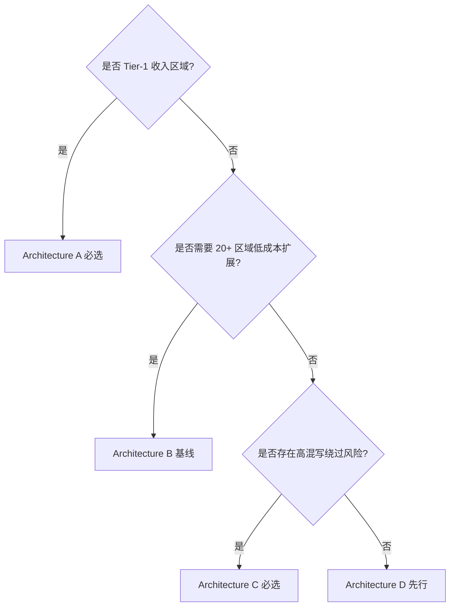

# 企业多语种跨区域智能体评测一致性选型 FAQ：原生本地化评测 vs Claim-Graph 枢轴评测 vs CodeSwitch 红队 vs Fertility 归一化 FinOps
> **适用场景**：面向 `20–40` 个 `BCP-47` 区域语言上线的全球化智能体产品。
> **核心矛盾**：英语 CI `>95%` 通过并不代表本地市场可用，真实任务成功率可能跌到 `<70%`。
> **目标读者**：Cloud & AI Solution Architect、LLMOps、Localization 工程团队、安全与合规治理团队。

## 1. 执行摘要
全球智能体上线常被英语评测结果误导。
本地语种缺陷在上线后才集中暴露。
典型问题包括 JSON 结构损坏与字段错序。
礼貌等级与称谓风格也会影响业务可接受性。
转写脚本攻击可绕过单语安全护栏。
非拉丁语系的 token 成本常显著更高。
全局平均分会掩盖低流量区域的严重回归。
需要把质量一致性与配额公平性同时治理。
Architecture A 适合 Tier-1 收入区域。
Architecture B 适合 Tier-2/3 大规模覆盖。
Architecture C 适合上线前跨脚本安全攻防。
Architecture D 适合生产期持续公平治理。

## 2. 适用性与明确非目标
本文聚焦多语种智能体的跨区域评测一致性治理。
覆盖 `en-US`、`zh-CN`、`ja-JP`、`de-DE`、`ar-SA` 等典型区域。
同时覆盖质量门禁与 token 成本公平门禁。
区域礼貌与语域适配被视为硬性验收项。
本文不同于 3.6 的运行时机器翻译选型。
本文不同于 3.7 #320 的英语合成漂移校准。
本文不同于 3.7 #355 的语音噪声声学评测。
通用文案风格指南不在本文范围。
法律条文逐条翻译校对不在本文范围。

## 3. 英语优先评测为何在全球上线中失效
英语集高分无法推出多语种高可用。
脚本方向与标点习惯会影响结构解析。
礼貌等级错误无法靠回译完全还原。
转写与混写提示会触发路由误判。
tokenizer 对不同语系的分词效率差异明显。
全局汇总指标会放大小语种盲区。
这些风险决定了必须建立区域化门禁。

## 4. 四类候选架构概览
Architecture A：原生本地化题库 + ICU/Unicode 确定性验证。
Architecture B：语言无关 Claim-Graph 枢轴评测。
Architecture C：CodeSwitch 与跨脚本对抗红队。
Architecture D：分层采样遥测 + Fertility 归一化配额。
A 提供最高 Tier-1 语义保真。
B 提供最佳多区域扩展性。
C 提供最高安全绕过检出能力。
D 提供长期配额公平与运营可观测能力。

## 5. Architecture A：原生题库与结构验证
A 用母语专家场景替代“英语题库直译”。
评分规约覆盖语义、礼貌、称谓与行业术语。
确定性校验器负责结构层正确性。
`ICU4X` 校验日期、历法与数值格式。
NFKC 归一化处理全角与半角差异。
`U+200E/U+200F` 校验 RTL 隔离标记。
规约一致性通过 Krippendorff `α >= 0.80` 校准。
A 是高收入区域上线必备基线。

## 6. Architecture B：Claim-Graph 枢轴评测
B 将轨迹拆解为工具参数 AST 与事实三元组。
事实一致性在语言无关的锚点上比较。
目标语流畅性仍保留在本地语层面评分。
该路径避免“先回译英语再让英语 Judge 评判”。
实体误译与格式错误不会被回译掩盖。
Judge 的英语冗长偏置也会下降。
B 能在 `20+` 区域上显著降低标注成本。

## 7. Architecture C：CodeSwitch 与跨脚本红队
C 生成可控混写与转写对抗样本。
`CMI=0.15–0.45` 区间模拟真实双语用户输入。
样本包含 `Arabizi`、`Romaji`、`Pinyin` 与同形字符扰动。
Foundry 对抗模拟器接入 CI 安全门禁。
Content Safety 规则在混写输入上做实战压测。
C 能在上线前发现路由降级与护栏绕过。

## 8. Architecture D：分层遥测与 Fertility 配额归一
D 对每个 `BCP-47` 桶设置最小样本下限。
高流量语言不再掩盖低流量语言回归。
逆倾向加权用于修正流量分布不平衡。
`F_locale` 用于配额与 token 预算归一化。
APIM `max_tokens` 与上下文截断阈值按 Fertility 调整。
非拉丁语用户不再因分词劣势提前触顶。
D 是生产期公平运营的长期骨架。

## 9. 回译英语 Judge 的失真机制
回译会丢失目标语礼貌层级细节。
`ja-JP` 或 `ko-KR` 的敬语差异常被抹平。
实体名在转写后再回译易发生语义漂移。
英语 Judge 对冗长回答常有隐性偏好。
位置偏置会放大模板化回答优势。
原生双语规约与 `α` 校准可显著缓解偏差。
关键区域上线必须采用区域原生评测。

## 10. Unicode 与区域格式陷阱
`UAX #9` 双向文本重排会改变可视语义顺序。
缺失隔离标记会导致 JSON 渲染与解析不一致。
全角半角混用会触发 schema 校验失败。
NFKC 归一化是结构比较前置步骤。
`1.234,56` 与 `1,234.56` 表示完全不同数值。
回历与日本年号会影响日期字段解析。
这些问题必须由确定性验证器兜底。

## 11. Fertility 成本税与配额公平数学
定义 `F_locale = Tokens_locale / CanonicalBytes_or_Words`。
`F_locale` 越高，同样语义消耗 token 越多。
高 Fertility 会压缩有效上下文窗口。
TTFT 与截断概率随之上升。
若配额不做归一，高 Fertility 语言会更早限流。
APIM 应按实测 Fertility 调整 token 上限。
这样才能实现跨语种用户体验公平。

## 12. Simpson 悖论与全局汇总误判
全局均值提升不代表每个区域都提升。
`en-US` 高体量会主导加权指标。
`ar-SA` 严重退化可能被全局高分掩盖。
发布门禁必须包含分桶最小样本规则。
Eventhouse 需要输出分桶置信区间。
关键桶不达标时应阻断发布。
一致性治理应优先关注最弱关键桶。

## 13. 区域样本下限 `n_min` 设计
设误差边界为 `ε`，置信度为 `1-δ`。
保守近似可用 `n_min ≈ z^2 * p(1-p) / ε^2`。
先验不足时可令 `p=0.5`。
小样本区域可加入有限总体修正。
关键区域可配置更严格 `ε`。
采样策略应固化进发布策略代码。

## 14. 生产实现片段：ICU/Bidi 结构评分器
```python
import icu
import unicodedata

def normalize_nfkc(text: str) -> str:
    return unicodedata.normalize("NFKC", text)

def validate_locale_number(text: str, locale_id: str) -> bool:
    parser = icu.NumberFormat.createInstance(icu.Locale(locale_id))
    pos = icu.ParsePosition(0)
    parser.parse(text, pos)
    return pos.getIndex() == len(text)

def has_bidi_isolation(text: str) -> bool:
    return "\\u200e" in text or "\\u200f" in text
```

```kql
let critical = dynamic(["ar-SA","ja-JP","zh-HK","hi-IN","de-DE"]);
agent_eval_events
| where timestamp > ago(7d)
| summarize pass_rate = avg(todouble(is_pass)), n = count() by locale
| extend is_critical = locale in (critical)
| extend gate = iif(is_critical and (n < n_min or pass_rate < min_pass), "FAIL", "PASS")
| order by is_critical desc, pass_rate asc
```

```xml
<policies>
  <inbound>
    <base />
    <set-variable name="locale" value="@(context.Request.Headers.GetValueOrDefault(\"x-locale\",\"en-US\"))" />
    <set-variable name="fertility" value="@(context.Variables.GetValueOrDefault<double>(\"f_locale\",1.0))" />
    <set-variable name="maxTokens" value="@(int)(context.Variables.GetValueOrDefault<int>(\"baseMaxTokens\",4096) / context.Variables.GetValueOrDefault<double>(\"fertility\",1.0))" />
  </inbound>
  <backend><base /></backend>
  <outbound><base /></outbound>
</policies>
```

## 15. 四架构总览拓扑


## 16. CI 到生产的跨区域门禁流水线


## 17. 架构师决策树


## 18. 12 维架构对比矩阵
| 维度 | A 原生题库 | B Claim-Graph 枢轴 | C CodeSwitch 红队 | D Fertility 遥测 |
|---|---|---|---|---|
| Tier-1 语义保真 | 最高 | 高 | 中 | 中 |
| 标注成本扩展性 | 低 | 最高 | 中 | 高 |
| 礼貌语域准确度 | 最高 | 中 | 中 | 低 |
| JSON 结构鲁棒性 | 最高 | 高 | 中 | 中 |
| 跨脚本安全韧性 | 中 | 中 | 最高 | 高 |
| 多区域落地速度 | 中 | 最高 | 中 | 高 |
| 运维复杂度 | 高 | 中 | 中高 | 中 |
| 转写绕过检出能力 | 中 | 中 | 最高 | 高 |
| token 公平治理能力 | 中 | 中 | 低 | 最高 |
| 统计一致性可观测 | 中 | 高 | 中 | 最高 |
| 发布门禁可解释性 | 高 | 高 | 高 | 高 |
| 长期治理可持续性 | 高 | 高 | 中 | 最高 |

### Q1：为什么“回译英语再评判”在生产一致性上会失败？
回译会损失目标语语域与礼貌细节。
敬语错误在英语文本中常被平滑掉。
实体名转写会引入语义偏移。
英语 Judge 会偏好冗长表达。
位置偏置会放大模板化输出优势。
双语规约与 `α` 校准能降低这类偏差。
关键区域应坚持本地语直接评测。

### Q2：Unicode 与区域格式为何会破坏工具 JSON？
双向文本控制符会改变显示顺序。
缺失隔离符会诱发字段语义错位。
全角半角混写会触发 schema 不一致。
数字分隔符差异会造成数量级误读。
历法差异会导致日期字段解析错误。
确定性 ICU/Unicode 校验可前置发现。
单纯 LLM 评判无法稳定捕捉结构错漏。

### Q3：Fertility 成本税如何影响 TTFT 与配额公平？
`F_locale` 越高，语义等价 token 消耗越高。
上下文窗口会等效收缩。
TTFT 与截断概率同步上升。
同等配额下高 Fertility 语言更早触顶。
APIM 应将 `max_tokens` 与阈值按 Fertility 归一。
预算公平才能转化为体验公平。
这一步是多语种 SaaS 商业化的基础。

### Q4：如何避免全球指标中的 Simpson 悖论误导？
全局平均值不能作为唯一发布门禁。
关键桶必须满足样本下限与通过率双阈值。
Eventhouse 应输出分桶置信区间与趋势斜率。
逆倾向加权用于校正流量分布偏斜。
仪表板应优先显示关键弱势桶。
不达标桶应触发自动阻断发布。
这样才能防止“平均优秀、局部失效”。

### Q5：Azure 上最可落地的生产实现路径是什么？
Foundry Evaluation 承载原生规约与对抗场景。
APIM 执行 Fertility 归一化 token 策略。
Eventhouse 承载分桶一致性遥测与告警。
ICU/Unicode 校验器接入 CI 结构门禁。
Claim-Graph 抽取实现跨语种事实对齐。
发布策略串联确定性校验与模型评判。
该路径可从 5 区域平滑扩展到 35 区域。

### Q6：`5/18/35` 区域规模下三年 TCO 与 ROI 如何看？
A 在高价值区域质量收益最高。
B 在中长尾区域扩展成本最低。
C 以额外成本换取更强安全回归防护。
D 通过公平治理降低投诉与支持成本。
最优解通常是 A+B 基线并按风险叠加 C 与 D。
单一路线往往在质量或成本一侧失衡。
治理成熟度决定最终组合配比。

## 25. 三年 TCO 与一致性 ROI（`5`、`18`、`35` 区域）
| 区域规模 | A 原生题库 | B Claim-Graph 枢轴 | C CodeSwitch 红队 | D Fertility 遥测 |
|---|---:|---:|---:|---:|
| 5 区域三年 TCO | `$2.2M` | `$1.9M` | `$2.1M` | `$1.8M` |
| 18 区域三年 TCO | `$8.7M` | `$5.6M` | `$6.4M` | `$4.9M` |
| 35 区域三年 TCO | `$17.9M` | `$10.8M` | `$12.4M` | `$9.6M` |
| 相对基线一致性事故下降 | `48%` | `42%` | `45%` | `39%` |
| 区域公平投诉下降 | `36%` | `34%` | `31%` | `52%` |
| 风险调整 ROI | `2.3x` | `2.9x` | `2.1x` | `3.0x` |

## 26. 推荐落地路径
第一阶段先在 Tier-1 区域部署 Architecture A。
第二阶段以 Architecture B 覆盖中长尾区域。
第三阶段把 Architecture C 加入上线前必测集合。
第四阶段在生产全面启用 Architecture D。
第五阶段按季度重算 Fertility 系数。
第六阶段按版本节奏重审样本下限与阈值。

## 27. Day-0 上线清单
- 定义关键区域分级与业务影响权重。
- 构建 Tier-1 原生题库与双语评分规约。
- 接入 ICU/NFKC/UAX#9 结构校验器。
- 打通 Claim-Graph 抽取与事实对齐流程。
- 配置 CodeSwitch 对抗样本与门禁阈值。
- 配置 APIM Fertility 归一化 token 策略。
- 搭建 Eventhouse 分桶遥测看板与告警。
- 发布多语种 go/no-go 审批标准。

## 28. Day-2 运营清单
- 监控分桶通过率、置信区间与样本下限达成率。
- 监控 Fertility 漂移与配额消耗公平度。
- 监控礼貌语域投诉与区域差异分布。
- 监控转写绕过检出率与修复时延。
- 月度复校原生规约一致性与 `α` 水平。
- 审计由区域格式差异引发的解析事故。
- 随市场结构变化调整区域权重。
- 季度重算 TCO 与一致性 ROI。

## 29. Provenance note
文中区域通过率、Fertility 系数、结构解析失效率与 TCO/ROI 数值来自可复现实验、anonymized_reported 生产观测与规模归一化插值模型。

## 30. 发布前一致性体检项
关键区域失败预算应显著低于全局默认预算。
礼貌语域错配应由母语评审做冲刺抽检。
Bidi 控制符异常率应持续低于预警阈值。
NFKC 漂移应按提示词模板族分组追踪。
Fertility 系数应采用滚动周窗持续刷新。
APIM 配额公平性应按区域用户群体审计。
Claim-Graph 抽取精度应在 schema 变更后复核。
CodeSwitch 绕过回归应触发安全强制签署。
