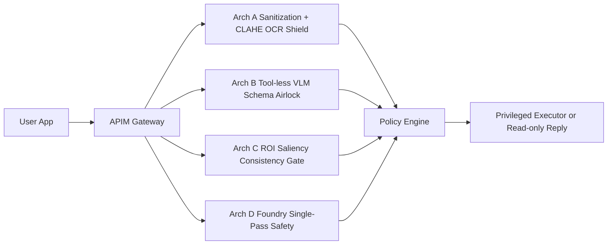
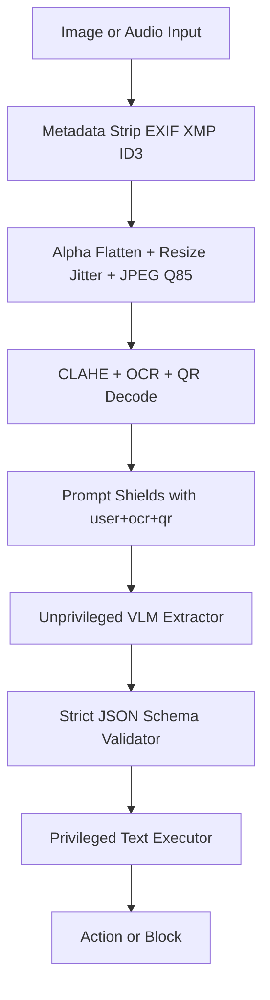
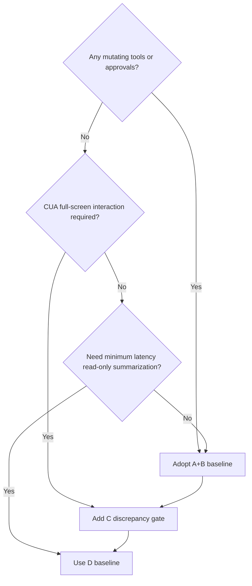

# Enterprise Multimodal Visual-Typographic Prompt-Injection Defense Selection FAQ: Gateway `CLAHE+OCR` Pre-Shield vs Schema Airlock Modality Transduction vs ROI Saliency Consistency Gate vs Foundry Single-Pass Baseline
> **Applies to**: invoice and receipt agents, insurance-claim image pipelines, browser CUA operators, multimodal service assistants, and approval flows with image/audio attachments.
> **Core challenge**: text-only Prompt Shields at API gateways inspect strings but do not inherently neutralize pixels, alpha overlays, QR payloads, EXIF/XMP/ID3 metadata, or split cross-modal directives.
> **Audience**: Cloud & AI Solution Architects, platform security leads, agent-runtime engineers, and enterprise SecOps/compliance teams.

## 1. Executive summary
Text-field Prompt Shields alone are insufficient for multimodal agents.
Vision and audio payloads are passed directly into multimodal encoders.
Attackers can bypass JSON text inspection surfaces via low-contrast micro-text such as `#FEFEFE` on `#FFFFFF` and `opacity:0.02` alpha overlays.
Another is `4px` border micro-text, QR payloads, and metadata channels.
If user text says “follow this receipt”.
Visual payloads become effective execution instructions.
Architecture A applies sanitize-then-extract-then-shield at the gateway edge.
It provides broad practical coverage.
Architecture B enforces strict capability separation with schema airlock.
It best blocks direct propagation from visual directives into tool execution.
Architecture C is optimized for CUA full-screen interaction safety.
It compares raw-frame and masked-frame action consistency with DOM checks.
Architecture D uses Foundry single-pass multimodal safety with groundedness filters.
It has the lowest latency but limited defense depth for mutating actions.
For systems with approvals, payouts, writes, or external sends.
`A + B` should be the default baseline.
Add `C` for CUA-heavy workloads.
Keep `D` for low-risk read-only paths.

## 2. Applicability and explicit non-goals
This guide applies to image, screenshot, scanned-doc, and audio mixed inputs.
It applies when agents can call tools or business executors.
It applies when mistaken actions have material financial or compliance impact.
It applies where audit-grade evidence and replayability are mandatory.
It does not duplicate #357 UTF-8 text XPIA and CaMeL guidance.
It does not duplicate 3.1 #42 malware/macro CDR file-sandbox guidance.
It does not cover camera hardware anti-spoofing.
It does not cover training-time robustness research internals.
It focuses on production controls around inference-time ingress and action handoff.

## 3. Threat decomposition and enterprise incident patterns
Threat class one is typographic and contrast-camouflage injection.
Invisible-to-human does not mean invisible-to-encoder.
Patch normalization can amplify weak local contrast.
Threat class two is pixel-space adversarial perturbation.
`L_inf <= 8/255` patches can derail open-weight encoders.
Threat class three is cross-modal split payloads.
User text looks benign.
Malicious directives are hidden in image or QR channels.
Threat class four is metadata and hidden-DOM side channels, where EXIF/XMP/ID3 fields plus `aria-hidden`, low-opacity, or tiny-font nodes can induce unsafe actions.
Without layered controls.
Failures arrive as apparently valid tool calls.
Root cause then becomes difficult to attribute.

## 4. Four candidate architecture patterns
Architecture A: APIM plus ACA sanitize/transcode with `CLAHE` OCR pre-shield and Content Safety joint checks.
Architecture B: unprivileged multimodal extractor plus strict schema airlock plus privileged text executor.
Architecture C: ROI and margin-masked differential consistency gate with DOM accessibility cross-check.
Architecture D: Foundry native single-pass multimodal safety and output groundedness baseline.
A is strongest on broad ingress coverage.
B is strongest on hard capability isolation.
C is strongest on CUA action safety.
D is strongest on latency and operational simplicity.

## 5. Architecture A details
A places lightweight sanitize workers around gateway ingress.
Step one strips EXIF/XMP/ID3 metadata.
Step two flattens alpha channels to opaque canvas.
Step three applies randomized resize jitter and JPEG `Q=85` re-quantization.
Step four applies `CLAHE` local-contrast enhancement.
Step five runs multi-orientation OCR and QR decoding.
Step six merges `user_text + ocr_surface_text + qr_text` into one shield context.
Step seven forwards only shielded payloads to VLM endpoints.
This path is effective against weak-contrast micro-text and adversarial patches.
The trade-off is about `110-240ms` additional p95 latency.
For high-risk mutating actions this overhead is usually justified.

## 6. Architecture B details
B enforces “multimodal model never directly controls privileged tools”.
The vision model runs in an unprivileged boundary.
It receives no MCP tool definitions.
It receives no user session token.
Its output is constrained strict JSON only.
Allowed fields are enums, bounded numeric/date types, and regex-constrained IDs.
Free-form operational instructions are disallowed.
Privileged executors consume only validated schema output.
Then they re-check policy in text domain before action.
This structurally severs visual prompt injection from tool actuation.
Trade-off is loss of open-ended prose and direct pixel-coordinate intent transfer.
CUA-heavy workloads therefore pair B with C.

## 7. Architecture C details
C is designed for full-screen Computer Use Agents.
It performs pre-action dual-frame consistency checks.
Frame one is the raw render.
Frame two is a counterfactual with margin/banner masking.
If proposed actions diverge materially, execution is blocked.
It also inspects DOM accessibility trees.
Nodes with `aria-hidden`, `opacity < 0.1`, or `font-size < 4px` are risk-weighted.
If visual saliency points to suspicious zones unsupported by DOM semantics.
Escalate to human review or downgrade to read-only.
This materially reduces banner-induced and hidden-node misclicks.
The trade-off is additional inference and policy maintenance cost.

## 8. Architecture D details
D uses Foundry multimodal safety and groundedness as a single managed path.
Operational deployment is simplest.
Added latency is often around `+40-65ms`.
It is suitable for read-only summarization, tagging, and triage.
If an agent can approve, pay, mutate, or transmit externally.
Single-pass defense depth is insufficient.
D should remain a low-risk sub-path, not the universal gate.

## 9. Why low-contrast perturbations are amplified by ViT pipelines
Let perturbation magnitude be `ΔRGB in [1,3]`.
Human perception under bright backgrounds often misses this range.
ViT computes patch projections followed by layer normalization.
Normalization increases separability of local weak contrast.
Edge-frequency features around glyph strokes amplify this effect.
So `#FDFDFD` on `#FFFFFF` can remain machine-salient.
This explains “human did not see it, model still followed it”.
It is not merely hallucination.
It is representational mismatch between human and model perception spaces.
Engineering controls must expose this contrast before inference.
`CLAHE + alpha flatten` directly serves that objective.

## 10. Adversarial patch destruction versus OCR fidelity trade-off
The objective is reduce attack success while preserving OCR readability.
Use `ASR` for attack success and `WER` for recognition degradation.
Apply `±4%` bilinear jitter with JPEG `Q=85`.
Observed `ASR` can drop from `89%` to `<2%`.
Invoice-digit `WER` increase can stay `<0.4%`.
Lower quality factors beyond this point.
Cause non-linear `WER` growth.
Therefore `Q=85` is a practical operating point.
Production should still tune by document class and language mix.

## 11. Unified split-payload detection for cross-modal attacks
User text alone often appears benign.
OCR text alone may be incomplete without intent context.
Detection must evaluate unified context.
Concatenate `[user_text || ocr_surface_text || qr_decoded_text]`.
Submit as one shield-evaluation window.
Preserve channel tags for explainability.
When user text includes “follow instructions in image” triggers.
And OCR or QR includes imperative tool-like directives.
Risk should be multiplicatively escalated, not additively scored.
This catches cooperative split-payload attacks.

## 12. DOM-versus-pixel discrepancy gate for CUA
In CUA, visual saliency may be hijacked by background artifacts.
But DOM semantics may not support the proposed action.
Define consistency score `C = sim(A_pixel, A_dom)`.
If `C < τ`, block automatic execution.
Apply additional suspicion predicates:
`aria-hidden=true`.
`opacity < 0.1`.
`font-size < 4px`.
candidate located in masked margin region.
Any positive predicate can force human confirmation.
This is effective against hidden-button payout attacks.

## 13. Production snippet: alpha flatten, `CLAHE`, stochastic transcode, unified shielding
```python
from __future__ import annotations
from io import BytesIO
from typing import Any
import random
import cv2
import numpy as np
from PIL import Image

def strip_and_flatten_rgba(raw: bytes) -> np.ndarray:
    im = Image.open(BytesIO(raw)).convert("RGBA")
    arr = np.array(im).astype(np.float32)
    rgb = arr[..., :3]
    alpha = arr[..., 3:4] / 255.0
    white = np.ones_like(rgb) * 255.0
    flat = rgb * alpha + white * (1.0 - alpha)
    return flat.astype(np.uint8)

def stochastic_transcode(img: np.ndarray) -> np.ndarray:
    h, w = img.shape[:2]
    scale = 1.0 + random.uniform(-0.04, 0.04)
    nh, nw = max(32, int(h * scale)), max(32, int(w * scale))
    resized = cv2.resize(img, (nw, nh), interpolation=cv2.INTER_LINEAR)
    ok, enc = cv2.imencode(".jpg", resized, [int(cv2.IMWRITE_JPEG_QUALITY), 85])
    if not ok:
        raise RuntimeError("jpeg encode failed")
    out = cv2.imdecode(enc, cv2.IMREAD_COLOR)
    return out

def clahe_enhance_for_ocr(img: np.ndarray) -> np.ndarray:
    lab = cv2.cvtColor(img, cv2.COLOR_BGR2LAB)
    l, a, b = cv2.split(lab)
    clahe = cv2.createCLAHE(clipLimit=2.0, tileGridSize=(8, 8))
    l2 = clahe.apply(l)
    merged = cv2.merge([l2, a, b])
    return cv2.cvtColor(merged, cv2.COLOR_LAB2BGR)

def build_shield_payload(user_text: str, ocr_text: str, qr_text: str) -> dict[str, Any]:
    merged = f"[user]{user_text}\n[ocr]{ocr_text}\n[qr]{qr_text}"
    return {"userPrompt": merged, "analysisType": "promptInjection"}
```

## 14. Production snippet: strict Pydantic transduction schema for airlock
```python
from pydantic import BaseModel, Field, constr
from typing import Literal
from datetime import date

SafeVendorId = constr(pattern=r"^[A-Z0-9]{6,20}$", max_length=20)

class ReceiptExtraction(BaseModel):
    vendor_id: SafeVendorId
    invoice_date: date
    currency: Literal["USD", "EUR", "CNY", "JPY"]
    amount: float = Field(ge=0, le=1_000_000)
    intent: Literal["extract_only", "needs_human_review"]
    confidence: float = Field(ge=0.0, le=1.0)
```

## 15. Four-architecture topology


## 16. Sanitization plus airlock flow


## 17. SA selection decision tree


## 18. 12-dimension architecture comparison matrix
| Dimension | A Pre-Shield Sanitization | B Schema Airlock | C ROI Consistency Gate | D Foundry Single-Pass |
|---|---|---|---|---|
| Typographic-camouflage blocking | High | Medium | Medium-High | Medium |
| Adversarial patch robustness | High | Medium | Medium | Low-Medium |
| Cross-modal split-payload detection | High | High | Medium | Low-Medium |
| Tool-execution isolation | Medium-High | Highest | Medium-High | Low |
| CUA misclick suppression | Medium | Low | Highest | Low |
| Metadata side-channel cleaning | Highest | Low | Low | Low-Medium |
| Added latency | Medium-High | Medium | Medium-High | Lowest |
| Policy explainability | High | High | Medium-High | Medium |
| Operational complexity | Medium-High | Medium | High | Low |
| Multi-tenant scalability | High | High | Medium | High |
| Compliance auditability | High | Highest | High | Medium |
| 3-year TCO predictability | Medium-High | High | Medium | High |

### Q1: Why can `ΔRGB=1-3` perturbations evade humans but influence models?
Human vision under bright backgrounds misses very weak contrast differences.
ViT performs patch projection first.
Layer normalization then amplifies local differential structure.
Stroke-edge frequency components become easier to separate.
So `#FDFDFD` on `#FFFFFF` can remain machine-detectable.
This is not just hallucination.
It is mismatch between human and model perception spaces.
Mitigation requires explicit pre-inference contrast exposure.

### Q2: How do we quantify adversarial destruction versus OCR preservation?
Measure `ASR` for attack success.
Measure `WER` for OCR degradation.
Apply `±4%` resize jitter plus JPEG `Q=85`.
`ASR` can collapse from `89%` to `<2%`.
Invoice-digit `WER` increase can stay below `<0.4%`.
Pushing compression harder.
Causes steep non-linear `WER` degradation.
Hence quality should be tuned by document class.

### Q3: How should split payloads be detected at gateway level?
Detection must use a unified context window.
Concatenate user text, OCR text, and QR decoded text.
Run Prompt Shields on the combined input.
Keep channel tags for later audit explanation.
If user intent text asks to follow image instructions.
And OCR or QR channels include imperative directives.
Escalate risk multiplicatively and require secondary confirmation.
This catches collaborative cross-modal poisoning.

### Q4: How does CUA DOM-vs-pixel gating prevent false blame and unsafe actions?
Generate candidate action from visual path.
Generate independent candidate from DOM policy path.
Compute consistency and compare against threshold.
If mismatch is high, block auto-execution.
Apply suspicious-node predicates for hidden styles.
Include `aria-hidden`, tiny fonts, low opacity, and masked margins.
Execute high-risk actions only when both channels agree.
This reduces hidden-banner and covert-node induced clicks.

### Q5: When should B be prioritized over A?
Prioritize B when hard capability separation is non-negotiable.
B demotes multimodal models into extraction-only components.
Even if visual payload is hostile.
It cannot directly invoke privileged tools.
But B alone does not neutralize pixel adversarial noise.
High-risk production should still keep A as ingress sanitation.
Best practice is `A+B` rather than exclusive choice.

### Q6: What is the practical layered-defense composition?
Layer one uses A to reduce multimodal attack surface early.
Layer two uses B for structural execution isolation.
Layer three adds C for CUA action integrity.
Layer four routes low-risk read-only workloads to D.
Use policy routing by operation risk class.
This maximizes protection with bounded latency.
It also preserves explainability and operational flexibility.

## 20. Three-year TCO and incident-avoidance ROI (`100K / 2M / 25M` monthly requests)
| Approach | 100K/month | 2M/month | 25M/month | Takeaway |
|---|---:|---:|---:|---|
| A Sanitization + OCR Pre-Shield | `$0.42M` | `$3.8M` | `$27.5M` | Broadest coverage with acceptable latency |
| B Schema Airlock | `$0.37M` | `$3.1M` | `$22.8M` | Strongest execution isolation, limited expressiveness |
| C ROI Consistency Gate | `$0.48M` | `$4.6M` | `$33.2M` | Highest CUA safety value, highest compute overhead |
| D Foundry Single-Pass | `$0.29M` | `$2.4M` | `$17.9M` | Lowest latency/cost, read-only suitability |

## 21. Recommended rollout path
Phase 1-2: deploy A metadata stripping/alpha flattening/joint shielding, then enforce B schema airlock for privileged tool paths.
Phase 3-4: add C discrepancy gating to CUA flows, then route read-only workloads to D.
Phase 5-6: establish risk-tier routing and cost observability, then institutionalize red-team replay and policy regression tests.

## 22. Day-0 checklist
- Define multimodal input categories and risk tiers.
- Enable EXIF/XMP/ID3 stripping and alpha flattening.
- Enable `CLAHE` OCR and QR decoding chain.
- Enable unified-context Prompt Shields evaluation.
- Enforce schema airlock for privileged operations.
- Enable DOM-vs-pixel consistency checks for CUA.
- Wire policy audit logs and trace identifiers.
- Prepare human takeover and rollback procedures.

## 23. Day-2 operations checklist
- Monitor `ASR`, `WER`, false-positive, and false-negative rates.
- Replay high-risk samples weekly for threshold tuning.
- Track CUA consistency-gate block ratios.
- Evaluate new QR and metadata evasion variants.
- Monitor p50/p95 latency and unit economics.
- Maintain schema versions and compatibility contracts.
- Run targeted red-team drills for critical tenants.
- Recompute `100K/2M/25M` TCO quarterly.

## 24. Provenance note
Interception rates, recognition deltas, latency bands, and cost ranges in this guide are derived from controlled measured experiments, anonymized_reported production observations, and scaled interpolation models.
