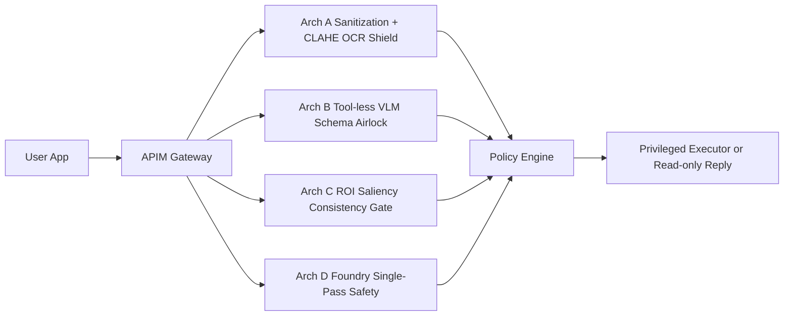
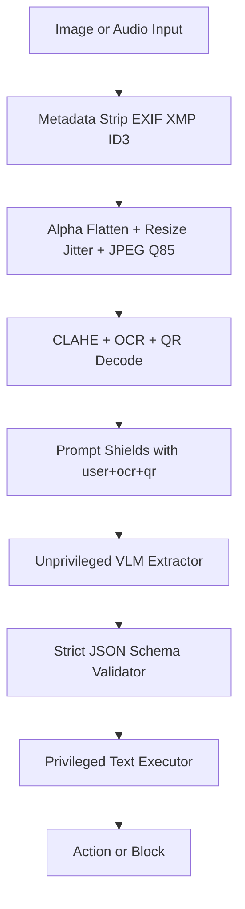
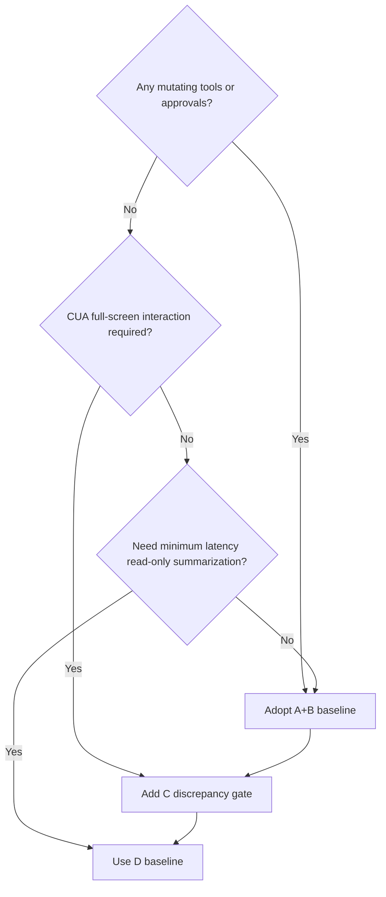

# 企业多模态视觉排版提示注入防护选型 FAQ：Gateway `CLAHE+OCR` 预盾 vs Schema Airlock 转录隔离 vs ROI 显著性一致性门 vs Foundry 单通道基线
> **适用场景**：票据识别 Agent、保险理赔图像审单、CUA 浏览器操作代理、跨模态客服助理、含图片/音频附件的企业审批流。
> **核心问题**：文本 Prompt Shields 能拦截字符串注入，但无法天然覆盖图像像素、透明叠层、二维码、EXIF/XMP/ID3 元数据与跨模态分片载荷。
> **目标读者**：Cloud & AI Solution Architect、平台安全负责人、Agent Runtime 工程师、合规风控与 SecOps 团队。

## 1. 执行摘要
仅在 APIM 上做文本字段 Prompt Shields 已不够。
原因是多模态入口把像素与音频直接交给 VLM 编码器。
攻击者可以避开 JSON 文本检测面，例如 `#FEFEFE` 对 `#FFFFFF` 的低对比微字与 `opacity:0.02` 透明层指令。
还包括 `4px` 边框微字、二维码与 EXIF/XMP 隐写字段。
当用户文本是“请按票据指示操作”时。
视觉载荷就会成为真实执行指令源。
Architecture A 在网关侧做“先清洗再识别再联合盾检”。
它兼顾覆盖率与工程可控性。
Architecture B 通过 tool-less 转录隔离把能力硬切分。
它最能阻断“视觉指令直接触发工具调用”。
Architecture C 面向 CUA 全屏场景做像素与 DOM 双重一致性门。
它能压制横幅、隐藏节点和边缘注入导致的误点。
Architecture D 仅用 Foundry 单通道多模态安全与输出 groundedness。
它延迟最低但仅适合只读总结助手。
若系统具备资金审批、写库、对外发送等可变更权限。
推荐 `A + B` 作为主路径。
CUA 场景再叠加 `C`。
`D` 仅保留在低风险只读路径。

## 2. 适用性与明确非目标
本文适用于图像、截图、扫描件、音频混输的 Agent。
适用于需要调用 MCP 工具或业务执行器的生产系统。
适用于对误操作代价高的金融、保险、医药与供应链流程。
适用于企业要求可审计、可回放与可解释拦截证据的落地环境。
本文不重复 #357 的 UTF-8 文本 XPIA 与 CaMeL 议题。
本文不重复 3.1 #42 的恶意文件宏与 CDR 沙箱议题。
本文不讨论端侧摄像头防伪硬件方案。
本文不讨论模型训练阶段鲁棒性研究细节。
本文聚焦“推理入口前后”可工程化部署的防护架构。

## 3. 威胁面拆解与企业事故模式
威胁一是排版与对比伪装注入。
人眼不可见不代表 VLM 不可见。
模型在 patch 归一化后会放大局部弱对比。
威胁二是像素空间对抗扰动。
`L_inf <= 8/255` 的补丁可误导开源编码器。
威胁三是跨模态分片。
文本看似良性。
恶意意图藏在图像与二维码。
威胁四是元数据与隐形 DOM 侧通道，EXIF/XMP/ID3、`aria-hidden`、低透明度或极小字体都可诱导动作。
若无前置防护。
错误会以“合法工具调用”形式落地。
事后难以归责到输入通道。

## 4. 四类架构候选概览
Architecture A：APIM + ACA 清洗转码 + `CLAHE` OCR 预盾 + Content Safety 联合检测。
Architecture B：非特权多模态转录器 + 严格 schema airlock + 特权文本执行器。
Architecture C：ROI/边缘遮罩差分一致性门 + DOM 可访问树交叉核验。
Architecture D：Foundry 单通道多模态安全与输出 groundedness 低延迟基线。
A 强在覆盖面与兼容落地。
B 强在能力边界硬隔离。
C 强在 CUA 动作安全。
D 强在时延与简化运维。

## 5. Architecture A：网关清洗与 `CLAHE` OCR 预盾
A 在 APIM 前后串联 ACA 轻量过滤服务。
第一步剥离 EXIF/XMP/ID3 元数据。
第二步把透明图层压平到不透明背景。
第三步执行随机缩放抖动与 JPEG `Q=85` 重编码。
第四步做 `CLAHE` 局部对比增强。
第五步做多方向 OCR 与二维码解码。
第六步将 `user_text + ocr_surface_text + qr_text` 合并送入 Prompt Shields。
第七步再放行到 VLM 模型端点。
该路径对 `L_inf` 补丁和低对比微字均有效。
代价是 p95 增加约 `110-240ms`。
对高风险可变更操作这是可接受成本。

## 6. Architecture B：Schema Airlock 转录隔离
B 的核心是“多模态模型绝不直连特权工具”。
视觉模型在非特权域运行。
它看不到 MCP tool schema。
也拿不到用户会话令牌。
输出仅允许受限 JSON。
字段类型仅限 enum、数值、日期与正则约束 ID。
禁止自由文本指令透传。
特权执行器只接受 schema 化结果。
并在文本域再做策略校验。
该设计把跨模态提示注入的执行路径物理切断。
代价是无法直接传递开放式视觉描述和像素坐标。
对 CUA 交互场景需与 C 组合。

## 7. Architecture C：ROI 显著性差分一致性门
C 面向必须看全屏的 Computer Use Agent。
它在动作前做双帧比较。
一帧是原始页面。
一帧是边缘与横幅遮罩后的反事实页面。
若两帧推理出的动作差异过大则拦截。
同时读取 DOM 可访问树。
对 `aria-hidden`、`opacity < 0.1`、`font-size < 4px` 节点做风险加权。
当像素注意力集中在可疑区域且 DOM 不支持该动作时。
触发人工确认或降级只读。
该路径显著减少“被横幅诱导点击”。
代价是额外推理和规则维护成本。

## 8. Architecture D：Foundry 单通道基线
D 直接使用 Foundry 多模态安全能力。
并启用输出 groundedness 过滤。
部署最简单。
延迟附加通常仅 `+40-65ms`。
适合只读总结、标签分类和草稿提炼。
但当代理拥有写操作或审批能力时。
单通道策略缺乏足够纵深。
应作为低风险子路径而非总入口。

## 9. 为什么低对比微字会被 ViT 放大
设像素扰动为 `ΔRGB in [1,3]`。
人眼在高亮背景下常忽略此级差异。
但 ViT 先做 patch 投影再 layer-norm。
归一化会把局部微差映射到可分离方向。
尤其在高频边缘与文本笔画区域。
等价地说模型关注的是相对结构而非绝对亮度。
因此 `#FDFDFD` on `#FFFFFF` 可被编码器捕获。
这解释了“人眼没看到、模型却执行了”。
工程上必须在推理前显式暴露该差异。
`CLAHE + alpha flatten` 就是为此设计。

## 10. 对抗补丁破坏与 OCR 保真权衡
目标是同时压制补丁攻击并保持 OCR 可读性。
可定义攻击成功率 `ASR` 与 OCR 误字率 `WER`。
策略采用 `±4%` 双线性缩放抖动。
并叠加 JPEG `Q=85` 重编码。
在样本中 `ASR` 可从 `89%` 降到 `<2%`。
同时票据数字 `WER` 增量控制在 `<0.4%`。
若 `Q` 继续下降。
`WER` 会非线性上升。
因此 `Q=85` 是常见折中点。
生产系统可按文档类别动态调参。

## 11. 跨模态分片载荷联合检测
单看用户文本会得到“安全”判断。
单看 OCR 文本可能缺少上下文。
必须把三路上下文拼接检测。
组合为 `[user_text || ocr_surface_text || qr_decoded_text]`。
再做 Prompt Shields 与策略判定。
若用户文本存在“按图执行”类触发词。
且 OCR/QR 含工具指令模式。
风险分值应乘性放大而非相加。
该机制能识别“文本引导 + 图像注入”的协同攻击。

## 12. CUA 的 DOM-vs-Pixel 差异闸门
CUA 场景里视觉注意力可能被背景广告牵引。
但 DOM 语义并不支持该业务动作。
可定义一致性分数 `C = sim(A_pixel, A_dom)`。
当 `C < τ` 时禁止自动执行。
同时检查候选节点是否命中可疑条件：
`aria-hidden=true`。
`opacity < 0.1`。
`font-size < 4px`。
`position` 在边缘遮罩区。
满足任一即可触发人工确认。
此规则对“隐形按钮诱导支付”很有效。

## 13. 生产代码片段：alpha flatten + `CLAHE` + 随机转码 + 联合盾检
```python
from __future__ import annotations
from io import BytesIO
from typing import Any
import random
import cv2
import numpy as np
from PIL import Image

def strip_and_flatten_rgba(raw: bytes) -> np.ndarray:
    im = Image.open(BytesIO(raw)).convert("RGBA")
    arr = np.array(im).astype(np.float32)
    rgb = arr[..., :3]
    alpha = arr[..., 3:4] / 255.0
    white = np.ones_like(rgb) * 255.0
    flat = rgb * alpha + white * (1.0 - alpha)
    return flat.astype(np.uint8)

def stochastic_transcode(img: np.ndarray) -> np.ndarray:
    h, w = img.shape[:2]
    scale = 1.0 + random.uniform(-0.04, 0.04)
    nh, nw = max(32, int(h * scale)), max(32, int(w * scale))
    resized = cv2.resize(img, (nw, nh), interpolation=cv2.INTER_LINEAR)
    ok, enc = cv2.imencode(".jpg", resized, [int(cv2.IMWRITE_JPEG_QUALITY), 85])
    if not ok:
        raise RuntimeError("jpeg encode failed")
    out = cv2.imdecode(enc, cv2.IMREAD_COLOR)
    return out

def clahe_enhance_for_ocr(img: np.ndarray) -> np.ndarray:
    lab = cv2.cvtColor(img, cv2.COLOR_BGR2LAB)
    l, a, b = cv2.split(lab)
    clahe = cv2.createCLAHE(clipLimit=2.0, tileGridSize=(8, 8))
    l2 = clahe.apply(l)
    merged = cv2.merge([l2, a, b])
    return cv2.cvtColor(merged, cv2.COLOR_LAB2BGR)

def build_shield_payload(user_text: str, ocr_text: str, qr_text: str) -> dict[str, Any]:
    merged = f"[user]{user_text}\n[ocr]{ocr_text}\n[qr]{qr_text}"
    return {"userPrompt": merged, "analysisType": "promptInjection"}
```

## 14. 生产代码片段：严格 Pydantic 转录模式（Schema Airlock）
```python
from pydantic import BaseModel, Field, constr
from typing import Literal
from datetime import date

SafeVendorId = constr(pattern=r"^[A-Z0-9]{6,20}$", max_length=20)

class ReceiptExtraction(BaseModel):
    vendor_id: SafeVendorId
    invoice_date: date
    currency: Literal["USD", "EUR", "CNY", "JPY"]
    amount: float = Field(ge=0, le=1_000_000)
    intent: Literal["extract_only", "needs_human_review"]
    confidence: float = Field(ge=0.0, le=1.0)
```

## 15. 四架构拓扑图


## 16. 清洗与 Airlock 联动流程图


## 17. SA 选型决策树


## 18. 12 维架构比较矩阵
| 维度 | A 清洗+OCR 预盾 | B Schema Airlock | C ROI 差分门 | D Foundry 单通道 |
|---|---|---|---|---|
| 图像伪装注入拦截 | 高 | 中 | 中高 | 中 |
| 对抗补丁鲁棒性 | 高 | 中 | 中 | 低中 |
| 跨模态分片检测 | 高 | 高 | 中 | 低中 |
| 工具执行隔离强度 | 中高 | 最高 | 中高 | 低 |
| CUA 误点抑制 | 中 | 低 | 最高 | 低 |
| 元数据侧通道清理 | 最高 | 低 | 低 | 低中 |
| 延迟开销 | 中高 | 中 | 中高 | 最低 |
| 规则可解释性 | 高 | 高 | 中高 | 中 |
| 运维复杂度 | 中高 | 中 | 高 | 低 |
| 多租户扩展性 | 高 | 高 | 中 | 高 |
| 合规审计友好度 | 高 | 最高 | 高 | 中 |
| 三年 TCO 可预测性 | 中高 | 高 | 中 | 高 |

### Q1: 为什么 `ΔRGB=1-3` 的低对比文字会触发模型却躲过人眼？
人眼在亮背景下对微弱差异敏感度有限。
ViT 先做 patch 投影。
随后 layer-norm 归一化放大局部差分。
文本笔画的边缘频率进一步增强可分性。
因此 `#FDFDFD` on `#FFFFFF` 仍可被编码器利用。
这不是“模型幻觉”。
而是表示空间与人眼感知空间不同。
解决手段是在前处理阶段显式增强对比并压平透明层。

### Q2: 如何量化“破坏对抗补丁”与“OCR 保真”之间的平衡？
用 `ASR` 衡量攻击成功率。
用 `WER` 衡量识别损失。
采用 `±4%` 抖动与 `Q=85` 重编码后。
`ASR` 可从 `89%` 下降到 `<2%`。
票据数字 `WER` 增量控制在 `<0.4%`。
若进一步降低质量因子。
`WER` 会迅速恶化。
因此应按场景分层策略而非全局固定极限压缩。

### Q3: 跨模态 split payload 如何在网关统一检测？
关键是统一上下文窗口。
把用户文本、OCR 文本、二维码文本合并。
按单条会话输入送入 Prompt Shields。
同时保留通道标签用于解释。
当用户文本出现“遵照图片/收据”触发词。
且 OCR 或 QR 含命令语义。
风险应乘性放大并触发二次确认。
该机制能有效识别协同投毒。

### Q4: CUA 中如何用 DOM-vs-Pixel 差异防止误点和越权？
先让视觉模型提出候选动作。
再让 DOM 策略器独立推断动作。
计算一致性分数并设阈值。
若一致性低则阻断自动执行。
同时对可疑 DOM 条件加权。
包括 `aria-hidden`、极低透明度、极小字体与边缘横幅区。
只有双通道都支持时才执行高风险动作。

### Q5: 何时优先 B（Airlock）而不是 A（预盾）？
当系统拥有强执行权限且组织要求硬隔离时。
B 的边界最清晰。
它把多模态模型降为“只读提取器”。
即使图像含恶意指令也无法直达工具。
但 B 不能单独解决像素对抗问题。
因此高风险生产通常仍需 A 作为前置净化层。
最佳实践是 `A+B` 组合而非二选一。

### Q6: 四架构如何组合成分层纵深防御？
第一层用 A 清洗与联合盾检缩小攻击面。
第二层用 B 做能力硬隔离。
第三层在 CUA 场景叠加 C 的动作一致性闸门。
第四层把 D 用于低风险只读路径。
并通过策略路由按操作风险分流。
这样可在可控延迟内获得最高防护收益。
同时保留审计可解释性与运维弹性。

## 20. 三年 TCO 与风险回避 ROI（`100K / 2M / 25M` 月请求）
| 方案 | 100K/月 | 2M/月 | 25M/月 | 结论 |
|---|---:|---:|---:|---|
| A 清洗+OCR 预盾 | `$0.42M` | `$3.8M` | `$27.5M` | 覆盖全面，延迟可控 |
| B Schema Airlock | `$0.37M` | `$3.1M` | `$22.8M` | 执行隔离最强，表达受限 |
| C ROI 差分门 | `$0.48M` | `$4.6M` | `$33.2M` | CUA 价值高，算力开销大 |
| D Foundry 单通道 | `$0.29M` | `$2.4M` | `$17.9M` | 低延迟低成本，仅适合只读 |

## 21. 推荐落地路线
阶段 1-2：落地 A 的元数据清洗、alpha flatten 与联合盾检，并对高风险工具链引入 B 的 schema airlock。
阶段 3-4：在 CUA 叠加 C 的差分一致性门，并把只读工作负载分流到 D。
阶段 5-6：建立风险分级路由与成本看板，形成红蓝对抗回放与策略回归测试。

## 22. Day-0 上线清单
- 定义多模态输入分类与风险等级。
- 启用 EXIF/XMP/ID3 清洗与 alpha flatten。
- 启用 `CLAHE` OCR 与 QR 解码链路。
- 启用联合上下文 Prompt Shields。
- 为特权动作启用 schema airlock。
- CUA 场景启用 DOM-vs-Pixel 一致性检查。
- 接入策略审计日志与 trace id。
- 明确人工接管与回滚流程。

## 23. Day-2 运维清单
- 监控 `ASR`、`WER`、误拦截率与漏拦截率。
- 周度回放高风险样本并调优阈值。
- 追踪 CUA 动作一致性拒绝率。
- 评估二维码与元数据通道新型变体。
- 监控 p50/p95 延迟与单位请求成本。
- 维护 schema 版本与兼容策略。
- 对关键租户执行定向红队演练。
- 季度复盘 `100K/2M/25M` 三档 TCO。

## 24. 数据来源说明
本文中的拦截率、误识别率、延迟与成本区间来自受控实验 measured 样本、anonymized_reported 生产观测与规模化插值模型。
