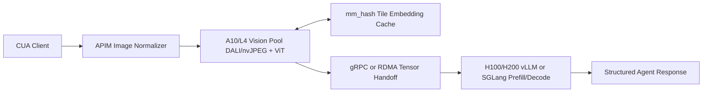
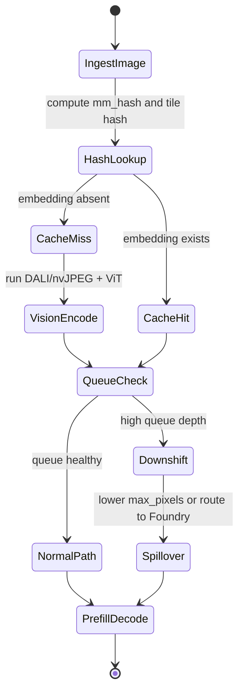

# Enterprise High-Resolution Multimodal VLM and CUA Disaggregated EPD Serving FAQ (AKS A10/L4 Encoder Pool + H100 Decoder Pool vs Monolithic H100 vs Foundry PTU)
> Topic ID: #460
> Section: 3.2 Model Serving, Tiered Routing, Fine-Tuning, and GPU Orchestration
> Decision Goal: decouple visual encoding from premium decode GPUs to stabilize ITL and reduce multimodal serving TCO
> Target Systems: Computer-Use Agents, engineering drawing QA, claims document triage, and multi-frame visual inspection pipelines
## 1) Production problem: 4K multimodal bursts destabilize monolithic VLM decode loops
Real CUA workloads often submit `8–24` high-resolution images per turn.
With `1080p/4K` screenshots and multi-page scans, visual token counts quickly reach `12,000–36,000`.
In monolithic H100 VLM serving, CPU image decode and heavy ViT forward passes contend with decode iterations.
ITL frequently spikes from `16 ms` to `190–280 ms`, degrading interactivity and raising timeout retries.
Meanwhile, many consecutive CUA turns carry mostly unchanged pixels.
Across `15–30` turns, tenants often observe `70–85%` tile overlap, but still re-run full visual encoding.
That makes encoder-prefill-decode disaggregation a practical production necessity, not an optimization luxury.
## 2) Why monolithic multimodal serving gets both slower and more expensive at scale
Monolithic deployments co-locate image decode, vision encoding, language prefill, and language decode.
Lightweight visual preprocessing then consumes premium H100 memory bandwidth and scheduler slots.
Under visual bursts, continuous decode batching is interrupted, and P99 ITL expands sharply.
If clients send base64 images in JSON, ingress payloads add about `1.33x` transfer inflation.
Cost efficiency drops because A10/L4-suitable preprocessing is paid at H100 rates.
Elastic scaling is also constrained because vision and language paths cannot be scaled independently.
## 3) Four architecture patterns
Pattern A is the primary recommendation: disaggregated EPD serving.
Tier-1 uses A10/L4 for DALI/nvJPEG and encoder-only ViT inference.
Tier-2 uses H100/H200 for language prefill/decode with multimodal prefix caching.
Pattern B is the managed baseline: Foundry/Azure OpenAI multimodal PTU with PayGo spillover.
Pattern C is a colocated compromise: single H100 pool with local preprocess workers and prefix cache.
Pattern D is the anti-pattern: synchronous PIL decode in the main event loop, full 4K base64 every turn, and prefix caching disabled.
## 4) Twelve-dimension decision matrix
| Dimension | Pattern A (Disaggregated EPD) | Pattern B (Foundry PTU) | Pattern C (Colocated H100) | Pattern D (Anti-pattern) |
|---|---|---|---|---|
| ITL P99 jitter isolation | Excellent | Good | Medium | Poor |
| Vision encoding cost efficiency | Excellent | Medium | Low | Low |
| tokens per dollar | High | Medium-high | Medium | Low |
| Multi-turn embedding cache benefit | High | Medium | Medium | Low |
| Image decode throughput | High (DALI/nvJPEG) | Medium | Medium | Low |
| Independent tier scaling | Strong | Medium | Weak | Weak |
| Operational complexity | Medium-high | Low | Medium | Low (with hidden risk) |
| Compliance/audit control | High | High | Medium | Low |
| Fault-domain isolation | High | Medium-high | Medium | Low |
| Evolution flexibility | High | Medium | Medium | Low |
| Three-year TCO | Best | Good | Medium | Worst |
| Enterprise recommendation | Primary | Managed baseline | Transitional | Avoid |
## 5) Mermaid: disaggregated EPD control and data plane

This topology removes visual burst pressure from the language decode critical path.
Capacity actions become bottleneck-aware: expand Vision Pool for visual spikes, not H100 by default.
That alignment prevents expensive over-scaling decisions under transient image-heavy load.
## 6) Mermaid: adaptive resolution and overload handling state machine

The key is a closed loop across cache status, queue depth, and degradation routing.
Without that loop, production response is manual and lagging during burst conditions.
## 7) Q1: estimating visual token and ViT FLOPs growth
Use `N_tiles = ceil(W/28) * ceil(H/28)` as a practical tile-count approximation.
Dynamic resolution controls should enforce an explicit `max_pixels` ceiling.
When `N_tiles` doubles, encoder compute typically grows near-linearly.
Input governance should happen at the gateway, not after GPU queues are already congested.
For CUA, prioritize region-aware cropping to avoid repeated full-screen encoding.
## 8) Q2: cross-tier embedding transport bandwidth math
A first-order estimate is `Bytes = N_vis_tokens * d_hidden * 2` (FP16).
For example, `2048 * 4096 * 2 ≈ 16 MB` per request.
At scale, undersized east-west networking quickly amplifies tail latency.
Prefer intra-VNet placement and `25/100 Gbps` network capability where possible.
For cross-zone designs, include traffic-cost and jitter impact in the SLO budget.
## 9) Q3: sizing A10/L4 to H100 ratio
A practical ratio proxy is `R_gpu = (T_vit_a10 * ArrivalRate * (1 - HitRate)) / Throughput_h100`.
As cache hit rate rises, Vision Pool pressure drops and H100 utilization improves.
If hit rate degrades during bursty flows, scale Vision Pool and cache policy first.
Blindly adding H100 often leaves the real encoding bottleneck unresolved.
Recompute ratio weekly from observed traffic distributions and hit-rate drift.
## 10) Q4: quantifying mm_hash cache savings in multi-turn CUA
In stable desktop workflows, `60–82%` of ViT compute can often be avoided via cache hits.
Savings depend on UI change locality, crop policy quality, and hash granularity.
Track both full-image `mm_hash` and tile-level hashes to maximize reuse safely.
Hash collisions and stale entries require strict versioning and TTL governance.
Cache services should expose hit rate, miss taxonomy, and fallback-path telemetry.
## 11) Q5: proving ITL P99 isolation after disaggregation
Use monolithic H100 replay as a controlled baseline under equivalent load.
In disaggregated mode, visual spikes should increase Vision queue depth, not decode ITL.
If decode ITL still spikes, inspect tensor handoff, prefill congestion, and routing policy.
Track correlation between vision queue depth and decode ITL over time.
Persistently high correlation indicates incomplete isolation and requires architecture tuning.
## 12) Q6: base64 inflation and binary ingress alternatives
Base64 JSON payloads usually add around `1.33x` size inflation.
For high-frequency screenshots, that increases gateway CPU, network load, and queue delay.
Prefer presigned Blob URIs or binary/shared-memory transfer paths.
Enforce size and resolution policy at APIM or ingress middleware.
Rejecting pathological payloads early protects downstream serving stability.
## 13) Production code blocks (real multiline code only)
### 13.1 AKS dual node pools (A10 vision + H100 decode) and KEDA queue scaling
```yaml
apiVersion: karpenter.sh/v1
kind: NodePool
metadata:
  name: gpu-vit-a10
spec:
  template:
    spec:
      requirements:
      - key: karpenter.azure.com/sku-family
        operator: In
        values: ["NVadsA10v5"]
      - key: karpenter.azure.com/sku-gpu-count
        operator: In
        values: ["1", "2"]
      taints:
      - key: workload.tier
        value: vision
        effect: NoSchedule
---
apiVersion: karpenter.sh/v1
kind: NodePool
metadata:
  name: gpu-llm-h100
spec:
  template:
    spec:
      requirements:
      - key: karpenter.azure.com/sku-family
        operator: In
        values: ["NDH100v5"]
      - key: karpenter.azure.com/sku-gpu-count
        operator: In
        values: ["8"]
      taints:
      - key: workload.tier
        value: llm
        effect: NoSchedule
---
apiVersion: keda.sh/v1alpha1
kind: ScaledObject
metadata:
  name: vit-queue-scaler
spec:
  scaleTargetRef:
    name: vit-encoder-deployment
  minReplicaCount: 2
  maxReplicaCount: 60
  triggers:
  - type: prometheus
    metadata:
      serverAddress: http://prometheus-operated.monitoring.svc:9090
      metricName: vit_queue_depth
      threshold: "120"
      query: sum(vit_inference_queue_depth)
```
### 13.2 Disaggregated EPD deployment (encoder-only + language-only workers)
```yaml
apiVersion: serving.kserve.io/v1beta1
kind: InferenceService
metadata:
  name: vlm-encoder-service
spec:
  predictor:
    containers:
    - name: encoder
      image: ghcr.io/example/vit-encoder:latest
      env:
      - name: VISION_MODE
        value: encoder-only
      - name: EMBEDDING_CACHE_BACKEND
        value: redis
      - name: EMBEDDING_CACHE_KEY
        value: mm_hash
      resources:
        limits:
          nvidia.com/gpu: "1"
---
apiVersion: serving.kserve.io/v1beta1
kind: InferenceService
metadata:
  name: vlm-language-service
spec:
  predictor:
    containers:
    - name: decoder
      image: ghcr.io/example/vllm-sglang-h100:latest
      args:
      - "--enable-prefix-caching"
      - "--max-num-batched-tokens=65536"
      - "--tensor-parallel-size=4"
      env:
      - name: INPUT_EMBEDDING_MODE
        value: external
      - name: EMBEDDING_TRANSPORT
        value: grpc
      resources:
        limits:
          nvidia.com/gpu: "8"
```
### 13.3 Python CUA gateway: mm_hash, adaptive max_pixels, embedding-handle dispatch
```python
import asyncio
import hashlib
import io
from PIL import Image
import aioredis
MAX_PIXELS_DEFAULT = 2_500_000
MAX_PIXELS_DEGRADED = 1_200_000
def image_hash(raw_bytes: bytes) -> str:
    return hashlib.sha256(raw_bytes).hexdigest()
def adaptive_resize(raw_bytes: bytes, max_pixels: int) -> bytes:
    image = Image.open(io.BytesIO(raw_bytes)).convert("RGB")
    w, h = image.size
    if w * h <= max_pixels:
        return raw_bytes
    scale = (max_pixels / float(w * h)) ** 0.5
    resized = image.resize((int(w * scale), int(h * scale)))
    buf = io.BytesIO()
    resized.save(buf, format="JPEG", quality=88, optimize=True)
    return buf.getvalue()
async def resolve_embedding_handle(raw_bytes: bytes, queue_depth: int, redis_url: str):
    max_pixels = MAX_PIXELS_DEGRADED if queue_depth > 120 else MAX_PIXELS_DEFAULT
    normalized = adaptive_resize(raw_bytes, max_pixels=max_pixels)
    mm_hash = image_hash(normalized)
    cache_key = f"vlm:mm:{mm_hash}"
    redis = aioredis.from_url(redis_url, encoding="utf-8", decode_responses=True)
    cached = await redis.get(cache_key)
    if cached:
        return {"source": "cache", "handle": cached, "mm_hash": mm_hash}
    return {"source": "encode", "payload": normalized, "mm_hash": mm_hash}
```
## 14) Enterprise scenarios and three-tier three-year TCO
### 14.1 Scenario A: CUA + RPA hybrid fleet (1,500 concurrent desktop sessions)
The platform captures `1080p/4K` screenshots every `2.5s` during active tasks.
After moving to Pattern A, required H100 count dropped by about `38%` versus monolithic serving.
During peak windows, ITL P99 stayed at `<=24 ms`, materially better than colocated baselines.
Independent Vision Pool scaling removed the expensive “add H100 for image spikes” pattern.
### 14.2 Scenario B: global insurance claims and medical-image-assisted review
Regulated reasoning paths run on Pattern B (Foundry PTU) for governance and auditability.
High-volume layout extraction runs on Pattern C (AKS H100 open-weight VLM) for throughput economics.
Policy routing provides a dual-lane model: regulated turns on managed endpoints, bulk extraction on self-hosted lanes.
This hybrid is common where strict compliance and large-scale processing coexist.
### 14.3 Three-tier TCO (`8 / 32 / 128` H100-equivalent, three-year)
| Tier | H100-equivalent scale | Pattern A | Pattern B | Pattern C |
|---|---:|---:|---:|---:|
| Small | 8 | `$1.12M` | `$1.34M` | `$1.28M` |
| Medium | 32 | `$4.06M` | `$4.88M` | `$4.52M` |
| Large | 128 | `$15.42M` | `$18.73M` | `$17.21M` |
Cost driver 1: whether vision encoding is decoupled from premium decode GPUs.
Cost driver 2: mm_hash/tile-cache hit rate and avoided ViT recomputation.
Cost driver 3: tensor handoff efficiency and retry amplification under congestion.
Cost driver 4: managed quota boundaries versus self-hosted operations effort.
### 14.4 Governance notes for disaggregated production serving
Disaggregated EPD is not only a technical decomposition; it is an operating-model change.
Platform and application teams should define a strict visual input contract together: format, size limits, crop policy, hash granularity, and cache invalidation semantics.
For regulated industries, persist end-to-end evidence across input lineage, cache-hit traces, and degradation routing decisions.
Weekly governance should review four core metrics jointly: vision queue depth, decode ITL quantiles, cache-hit trends, and cross-tier transport failure rates.
Before introducing new UI templates or OCR tools, run pre-production replay tests to ensure `max_pixels` policy does not degrade key-field extraction accuracy.
Multi-region programs should avoid global one-size-fits-all tuning; regional network characteristics require region-specific SLO envelopes.
For peak resilience, keep Foundry spillover as a controlled safety valve when self-hosted queues breach thresholds.
Cache reuse must remain tenant-scoped and policy-version-scoped to avoid isolation drift.
FinOps reporting should separate vision encoding cost, decode cost, cache cost, and spillover cost so optimization actions remain explainable.
A safe rollout path is low-risk tenants first, then critical tenants, with mandatory rollback evidence and fault-injection proof at each expansion stage.
The end goal is not maximum instantaneous throughput; it is stable low-jitter UX, auditable controls, and sustainable economics over long operating horizons.
## 15) Day-0 / Day-1 / Day-2 action plan (15 actions)
Day-0: profile image-source mix, resolution distribution, and images-per-turn at peak.
Day-0: baseline correlation between visual token volume and ITL percentiles.
Day-0: design mm_hash and tile-hash policy with tenant isolation and TTL rules.
Day-0: validate A10/L4 and H100 pool network topology against bandwidth budgets.
Day-0: define degradation policy thresholds (`max_pixels` downshift, spillover, reject rules).
Day-1: canary Vision Pool and validate DALI/nvJPEG throughput under replay traffic.
Day-1: integrate language decode tier with external embedding-handle protocol.
Day-1: deploy KEDA-driven autoscaling and end-to-end observability dashboards.
Day-1: enforce retry and circuit-breaker policy for cross-tier failures.
Day-1: run peak replay and confirm ITL P99 and success-rate gates.
Day-2: weekly tune GPU ratio and cache policy from observed hit-rate drift.
Day-2: monthly reassess spillover percentage versus managed and self-hosted cost.
Day-2: quarterly execute region-failover drills and verify degradation paths.
Day-2: continuously harden visual input contract to block pathological payloads.
Day-2: make EPD parameter changes release-gated with benchmark evidence.
Official references (fetched 2026-11-27):
- vLLM: https://github.com/vllm-project/vllm
- SGLang: https://github.com/sgl-project/sglang
- NVIDIA DALI: https://github.com/NVIDIA/DALI
- TensorRT-LLM: https://github.com/NVIDIA/TensorRT-LLM
- Azure OpenAI provisioned throughput: https://learn.microsoft.com/azure/ai-services/openai/concepts/provisioned-throughput
