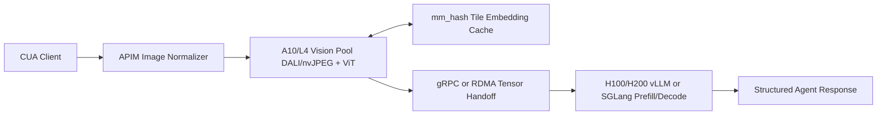
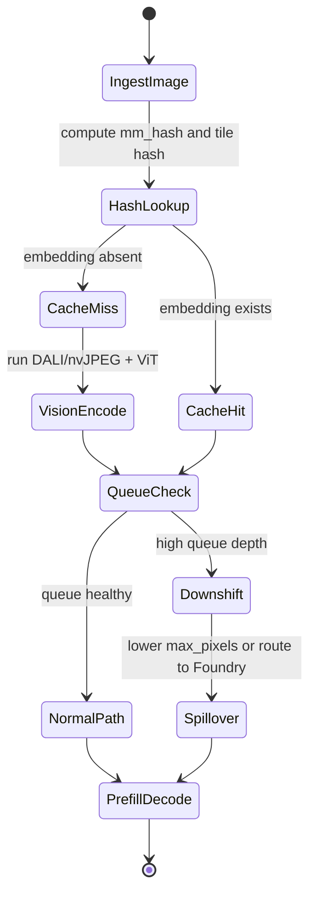

# 企业高分辨率多模态 VLM 与 CUA 的解耦式 EPD 推理选型 FAQ（AKS A10/L4 编码池 + H100 解码池 vs 单体 H100 vs Foundry PTU）
> 主题编号：#460
> 章节归属：3.2 模型托管、分级路由与 GPU 编排
> 目标问题：在 4K 截图与多页文档场景下，如何把视觉编码负载从贵价解码 GPU 解耦，稳定 ITL 并降低 TCO
> 适用对象：Computer-Use Agent、工程图审阅 Agent、质检视觉 Agent、文档审阅与理赔核验平台
## 1) 生产问题：4K 多图输入把单体 VLM 解码链路拖入抖动区
企业 CUA 和视觉审计 Agent 在真实生产中常出现 `8–24` 张高分辨率图片/回合。
当每轮输入包含 `1080p/4K` 桌面截图、扫描页与局部裁剪时，视觉 token 会迅速增长到 `12,000–36,000`。
如果采用单体 H100 VLM 进程，CPU 侧 `Pillow` 解码和重型 ViT 前向会与解码迭代争用算力与显存带宽。
典型后果是 ITL 从 `16 ms` 抖升到 `190–280 ms`，进而触发交互卡顿和超时重试。
更糟的是，多轮 CUA 会重复上传大面积未变化屏幕，导致同一视觉编码被重复计算。
在 `15–30` 连续回合里，很多租户可观察到 `70–85%` 的像素块并未变化，却仍重复消耗 H100 周期。
因此“编码-预填充-解码”拆层成为高并发多模态推理的核心工程手段。
## 2) 为什么单体多模态推理在高并发 CUA 下会变贵又变慢
单体路径把图像解码、视觉编码、LLM 预填充与解码捆绑在同一类顶级 GPU 上。
这会导致轻量视觉前处理挤占本应留给语言解码的高速显存与调度窗口。
当视觉突发请求到来时，持续批处理的解码迭代被打断，P99 ITL 立即放大。
如果再叠加 base64 图片直传，网关和应用层会出现 `1.33x` 的额外膨胀传输。
在成本侧，企业会为大量“可在 A10/L4 完成的视觉算子”支付 H100 价格。
在稳定性侧，单池架构难以独立扩容视觉与语言子系统，弹性效率偏低。
## 3) 四种架构路径：从解耦 EPD 到反模式
Pattern A 是主推荐：视觉编码池与语言解码池分离。
在 Tier-1 使用 A10/L4 跑 DALI/nvJPEG 与 ViT Encoder-Only，产出压缩投影向量。
在 Tier-2 使用 H100/H200 仅承接语言预填充与解码，并启用多模态前缀缓存。
Pattern B 是托管基线：Foundry/Azure OpenAI Multimodal PTU + PayGo 溢出。
Pattern C 是同池折中：单体 H100 VLM 加本地多进程预处理与缓存。
Pattern D 是反模式：主事件循环内同步 PIL 解码 + 每轮上传原始 4K base64 + 关闭前缀缓存。
## 4) 十二维决策矩阵（高分辨率多模态场景）
| 评估维度 | Pattern A（解耦 EPD） | Pattern B（Foundry PTU） | Pattern C（同池 H100） | Pattern D（反模式） |
|---|---|---|---|---|
| ITL P99 抖动控制 | 优（低耦合） | 良（托管稳定） | 中（高峰易抖） | 差 |
| 视觉编码成本效率 | 优（A10/L4 承载） | 中 | 低 | 低 |
| tokens/$ | 高 | 中高 | 中 | 低 |
| ViT 缓存命中收益 | 高（独立缓存层） | 中（受托管能力约束） | 中 | 低 |
| 图像解码吞吐 | 高（DALI/nvJPEG） | 中 | 中 | 低 |
| 视觉与语言独立扩容 | 强 | 中 | 弱 | 弱 |
| 运维复杂度 | 中高 | 低 | 中 | 低（但风险高） |
| 监管与审计可控性 | 高 | 高 | 中 | 低 |
| 失败域隔离 | 高 | 中高 | 中 | 低 |
| 迁移与演进弹性 | 高 | 中 | 中 | 低 |
| 三年 TCO | 最优 | 良好 | 中等 | 最差 |
| 企业推荐级别 | 主路径 | 托管基线 | 过渡路径 | 禁用 |
## 5) Mermaid：解耦 EPD 数据与控制平面

该拓扑把视觉突发从语言解码关键路径中剥离。
当视觉请求增多时，系统优先扩容 Vision Pool，而不是盲目增加 H100 数量。
这使容量扩展动作与真实瓶颈更一致，降低错误扩容导致的预算浪费。
## 6) Mermaid：分辨率自适应与过载降级状态机

状态机关键在于把“缓存命中”“视觉队列深度”“路由降级”串成可观测闭环。
若无闭环，系统只能在告警后人工介入，无法稳定支撑全天候负载波动。
## 7) Q1：视觉 token 与 ViT FLOPs 如何估算
可用 `N_tiles = ceil(W/28) * ceil(H/28)` 估算 tile 数量。
动态分辨率策略可通过 `max_pixels` 上限约束极端输入。
当 `N_tiles` 翻倍时，ViT 前向成本通常近似线性增加。
因此输入治理应前置到网关层，不应等到 GPU 侧再被动削峰。
对 CUA 场景，建议按窗口变化区域裁剪，避免整屏重复编码。
## 8) Q2：视觉嵌入跨层传输带宽怎么计算
传输负载可近似 `Bytes = N_vis_tokens * d_hidden * 2`（FP16）。
例如 `2048 * 4096 * 2 ≈ 16 MB`，单次请求即可能达到较大带宽开销。
在高并发场景，若链路不足（如低速网卡或跨区抖动），延迟会快速堆叠。
建议在同 VNet 近邻部署并优先使用 `25/100 Gbps` 网络能力。
若跨可用区部署，应同步评估 east-west 流量成本和尾延迟放大。
## 9) Q3：A10/L4 与 H100 的配比如何定量
可用 `R_gpu = (T_vit_a10 * ArrivalRate * (1 - HitRate)) / Throughput_h100` 做一阶估算。
当缓存命中率提升时，Vision Pool 承压下降，H100 可聚焦解码吞吐。
若命中率低且视觉输入突发强，应优先扩充 Vision Pool 或提升缓存策略。
若盲目只扩 H100，会出现“贵卡空转 + 编码瓶颈未解”的反直觉现象。
建议每周复盘配比并结合真实到达分布做动态修正。
## 10) Q4：多轮 CUA 的 mm_hash 缓存节省如何评估
对连续桌面任务，常见 `60–82%` 的 ViT 计算可被缓存命中抵消。
节省比例与界面稳定性、截图裁剪策略、哈希粒度设计强相关。
推荐同时维护整图 `mm_hash` 与分块 tile-hash，兼顾全局与局部复用。
哈希冲突或误判会引入语义偏差，需配套版本化和 TTL 策略。
缓存层应提供命中率、失效率与回退路径可观测指标。
## 11) Q5：解耦后如何证明 ITL P99 隔离有效
对照组可使用单体 H100 同负载回放，观察 ITL P99 分布变化。
解耦架构下，视觉突发应主要影响 Vision Pool 队列，不应显著拉高解码 ITL。
若解码 ITL 仍抖动，通常表示跨层传输、预填充拥塞或路由策略存在问题。
建议记录“视觉队列深度-解码 ITL”相关系数，作为隔离有效性的长期指标。
当相关系数持续偏高时，应触发容量与策略联合调优。
## 12) Q6：base64 入口膨胀与二进制路径收益
base64 JSON 传输在体积上通常约 `1.33x` 膨胀。
对高频截图业务，该膨胀会放大网关 CPU、网络带宽与排队时延。
推荐使用预签名 Blob URI 或共享内存/二进制传输协议。
同时在 APIM 或网关层做大小上限、分辨率策略与格式白名单。
这样可以把不合理输入挡在业务层之前，减少后端震荡。
## 13) 生产代码片段（仅多行真实代码）
### 13.1 AKS 双节点池（A10 视觉池 + H100 解码池）与 KEDA 队列扩缩
```yaml
apiVersion: karpenter.sh/v1
kind: NodePool
metadata:
  name: gpu-vit-a10
spec:
  template:
    spec:
      requirements:
      - key: karpenter.azure.com/sku-family
        operator: In
        values: ["NVadsA10v5"]
      - key: karpenter.azure.com/sku-gpu-count
        operator: In
        values: ["1", "2"]
      taints:
      - key: workload.tier
        value: vision
        effect: NoSchedule
---
apiVersion: karpenter.sh/v1
kind: NodePool
metadata:
  name: gpu-llm-h100
spec:
  template:
    spec:
      requirements:
      - key: karpenter.azure.com/sku-family
        operator: In
        values: ["NDH100v5"]
      - key: karpenter.azure.com/sku-gpu-count
        operator: In
        values: ["8"]
      taints:
      - key: workload.tier
        value: llm
        effect: NoSchedule
---
apiVersion: keda.sh/v1alpha1
kind: ScaledObject
metadata:
  name: vit-queue-scaler
spec:
  scaleTargetRef:
    name: vit-encoder-deployment
  minReplicaCount: 2
  maxReplicaCount: 60
  triggers:
  - type: prometheus
    metadata:
      serverAddress: http://prometheus-operated.monitoring.svc:9090
      metricName: vit_queue_depth
      threshold: "120"
      query: sum(vit_inference_queue_depth)
```
### 13.2 解耦 EPD 部署（encoder-only + language-only）
```yaml
apiVersion: serving.kserve.io/v1beta1
kind: InferenceService
metadata:
  name: vlm-encoder-service
spec:
  predictor:
    containers:
    - name: encoder
      image: ghcr.io/example/vit-encoder:latest
      env:
      - name: VISION_MODE
        value: encoder-only
      - name: EMBEDDING_CACHE_BACKEND
        value: redis
      - name: EMBEDDING_CACHE_KEY
        value: mm_hash
      resources:
        limits:
          nvidia.com/gpu: "1"
---
apiVersion: serving.kserve.io/v1beta1
kind: InferenceService
metadata:
  name: vlm-language-service
spec:
  predictor:
    containers:
    - name: decoder
      image: ghcr.io/example/vllm-sglang-h100:latest
      args:
      - "--enable-prefix-caching"
      - "--max-num-batched-tokens=65536"
      - "--tensor-parallel-size=4"
      env:
      - name: INPUT_EMBEDDING_MODE
        value: external
      - name: EMBEDDING_TRANSPORT
        value: grpc
      resources:
        limits:
          nvidia.com/gpu: "8"
```
### 13.3 Python：CUA 网关 mm_hash + 自适应 max_pixels + 缓存句柄分发
```python
import asyncio
import hashlib
import io
from PIL import Image
import aioredis
MAX_PIXELS_DEFAULT = 2_500_000
MAX_PIXELS_DEGRADED = 1_200_000
def image_hash(raw_bytes: bytes) -> str:
    return hashlib.sha256(raw_bytes).hexdigest()
def adaptive_resize(raw_bytes: bytes, max_pixels: int) -> bytes:
    image = Image.open(io.BytesIO(raw_bytes)).convert("RGB")
    w, h = image.size
    if w * h <= max_pixels:
        return raw_bytes
    scale = (max_pixels / float(w * h)) ** 0.5
    resized = image.resize((int(w * scale), int(h * scale)))
    buf = io.BytesIO()
    resized.save(buf, format="JPEG", quality=88, optimize=True)
    return buf.getvalue()
async def resolve_embedding_handle(raw_bytes: bytes, queue_depth: int, redis_url: str):
    max_pixels = MAX_PIXELS_DEGRADED if queue_depth > 120 else MAX_PIXELS_DEFAULT
    normalized = adaptive_resize(raw_bytes, max_pixels=max_pixels)
    mm_hash = image_hash(normalized)
    cache_key = f"vlm:mm:{mm_hash}"
    redis = aioredis.from_url(redis_url, encoding="utf-8", decode_responses=True)
    cached = await redis.get(cache_key)
    if cached:
        return {"source": "cache", "handle": cached, "mm_hash": mm_hash}
    return {"source": "encode", "payload": normalized, "mm_hash": mm_hash}
```
## 14) 企业场景与三档三年 TCO
### 14.1 场景 A：企业 CUA 与 RPA 混合舰队（1,500 并发桌面会话）
平台以 `2.5s` 频率采集 `1080p/4K` 截图并执行多轮操作。
迁移到 Pattern A 后，H100 数量相较单体方案下降约 `38%`。
在高峰时段，ITL P99 稳定在 `<=24 ms`，显著优于同池方案。
视觉负载可独立扩容，减少“为了编码突发而被迫扩 H100”的浪费。
### 14.2 场景 B：全球保险理赔与医疗影像复核
合规推理链路使用 Pattern B（Foundry PTU）承载监管敏感问答。
高吞吐文档版面抽取使用 Pattern C（AKS H100 开源权重）降低成本。
通过策略路由实现“合规高价值请求走托管、海量抽取走自建”的双轨治理。
该组合适合既有强监管要求又有大规模批量处理诉求的组织。
### 14.3 三档三年 TCO（8 / 32 / 128 H100 当量）
| 规模层级 | H100 当量规模 | Pattern A | Pattern B | Pattern C |
|---|---:|---:|---:|---:|
| 小规模 | 8 | `$1.12M` | `$1.34M` | `$1.28M` |
| 中规模 | 32 | `$4.06M` | `$4.88M` | `$4.52M` |
| 大规模 | 128 | `$15.42M` | `$18.73M` | `$17.21M` |
成本驱动一：视觉编码是否从高价解码 GPU 解耦。
成本驱动二：mm_hash 与 tile-cache 命中率带来的 ViT 复算减少比例。
成本驱动三：跨层传输链路效率与重试放大成本。
成本驱动四：托管服务配额边界与自建运维人力成本。
### 14.4 生产治理补充：解耦架构的组织协同要求
解耦 EPD 不是“多加一层服务”这么简单，而是把性能工程、成本治理、模型质量和平台运维统一到同一套控制平面。
平台团队应与应用团队共同定义视觉输入合同，包括图片格式、分辨率上限、裁剪策略、哈希粒度与缓存失效规则，避免上游任意输入拖垮下游。
对监管行业，应建立“视觉输入留痕 + 哈希命中证据 + 降级路由轨迹”的审计链，确保每次自动降级都能被事后解释与复盘。
建议每周复盘四类指标：视觉队列深度分布、解码 ITL 分位数、缓存命中率曲线、跨层传输失败率，并把异常区间映射到容量计划。
当业务引入新界面模板或新 OCR 工具时，要先在预生产执行回放基准，验证 `max_pixels` 策略不会损害关键字段识别准确率。
若组织跨区域部署，应拆分区域级 SLO，禁止使用单一区域经验对全球统一调参，避免在网络路径差异下触发隐性退化。
对高峰保障场景，建议设置“Foundry 托管溢出安全阀”，当自建集群队列超过阈值时自动切流，优先保住用户时延与成功率。
缓存策略需区分租户边界，避免跨租户复用导致数据隔离风险；哈希命中只能在同租户、同策略版本、同数据分类级别下生效。
在 FinOps 侧，除了总 GPU 成本，还应分账展示“视觉编码成本、解码成本、缓存成本、回退溢出成本”，让优化动作可量化、可追责。
演进策略建议按“低风险租户先行、关键租户后迁、全局统一度量”推进，每次扩面必须附带回滚方案与故障注入结果证据。
最终目标不是追求单一吞吐峰值，而是实现长期稳定的“低抖动交互 + 可解释成本 + 可审计治理 + 可持续演进”平衡。
补充治理要点一：建议把视觉输入治理纳入企业数据分级制度，明确哪些截图可长期留存、哪些截图只能短暂缓存、哪些截图必须实时脱敏后才允许进入编码池，并将违规输入在网关层直接拒绝。
补充治理要点二：建议把“缓存命中收益、降级触发次数、跨层传输失败率、托管溢出比例”作为同一张经营看板的强制字段，避免团队只看吞吐或只看成本而忽视系统稳定性和用户体验的共同约束。
补充治理要点三：建议建立季度级架构回归演练，覆盖哈希碰撞回退、缓存失效风暴、区域链路退化、模型版本切换与审计抽检，确保解耦 EPD 在复杂变更周期内仍保持可预测行为和可追溯证据。
## 15) Day-0 / Day-1 / Day-2（15 项执行动作）
Day-0：梳理多模态输入来源，统计图片尺寸、帧率、平均每轮图片数与峰值并发。
Day-0：建立视觉 token 与 ITL 的关联基线，识别当前单体架构瓶颈位置。
Day-0：设计 mm_hash 与 tile-hash 规则，定义缓存隔离域、TTL 与失效条件。
Day-0：规划 A10/L4 视觉池与 H100 解码池网络拓扑，确认带宽与时延预算。
Day-0：制定降级策略（max_pixels 下调、托管溢出、输入拒绝）与触发阈值。
Day-1：灰度上线 Vision Pool，验证 DALI/nvJPEG 吞吐与编码稳定性。
Day-1：灰度接入语言解码池，验证外部 embedding 句柄协议与前缀缓存行为。
Day-1：接入 KEDA 与监控看板，追踪视觉队列、ITL 分位数与缓存命中率。
Day-1：启用跨层失败重试与熔断策略，避免单点堵塞扩散到全链路。
Day-1：执行高峰回放压测，确认 `ITL P99` 与成功率达到上线阈值。
Day-2：每周复盘 GPU 配比与缓存策略，持续优化 tokens/$ 与时延。
Day-2：每月复核托管溢出比例，平衡自建成本和托管稳定性。
Day-2：每季度演练区域故障与流量迁移，验证降级与回退链路可靠性。
Day-2：持续审查输入合同，防止上游异常图片流入生产关键路径。
Day-2：将 EPD 参数变更纳入发布门禁，强制关联基准回放与审计记录。
官方参考（抓取 2026-11-27）：
- vLLM: https://github.com/vllm-project/vllm
- SGLang: https://github.com/sgl-project/sglang
- NVIDIA DALI: https://github.com/NVIDIA/DALI
- TensorRT-LLM: https://github.com/NVIDIA/TensorRT-LLM
- Azure OpenAI provisioned throughput: https://learn.microsoft.com/azure/ai-services/openai/concepts/provisioned-throughput
