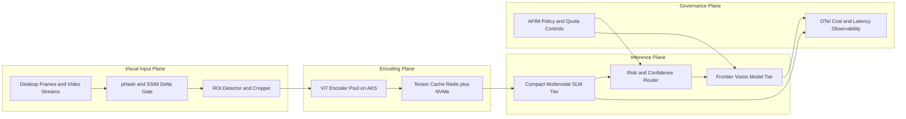
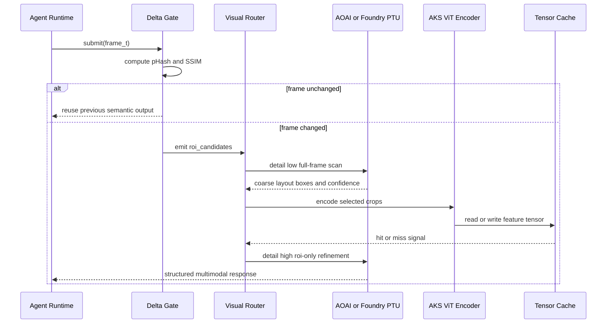

# Enterprise Multimodal VLM Serving FAQ: AOAI/Foundry PTU Adaptive Tiling vs AKS Disaggregated ViT Pools vs Keyframe Delta Gating vs Compact SLM Cascades
> 🌐 **Language Switch**: [中文](multimodal-vlm-visual-token-serving-aoai-ptu-tiling-vs-aks-disagg-vit-vs-keyframe-slm-selection-faq.md) | **English (current)**  
> Audience: Principal Cloud & AI Solution Architects, multimodal platform engineers, FinOps leaders, SRE teams, and security governance boards.  
> Scope: Online multimodal serving for GUI screenshots and high-FPS video streams, not offline OCR ingestion pipelines and not text-only prefill/decode optimization.  
> Objective: Govern visual token explosion while preserving latency SLO, throughput headroom, and predictable cost envelopes.  

## 1. Executive outcome: visual tokens, not model IQ, are the first production bottleneck
Most multimodal pilots look excellent in controlled demos.  
Many fail financially in production traffic.  
The root cause is often not model quality.  
The root cause is uncontrolled frame-to-token conversion.  
A single frame may cost around `85` visual tokens in low detail.  
The same frame may exceed `1,105` tokens in high detail.  
If every step sends raw `4K` frames at high detail, PTU burn rate becomes non-linear.  
Queue latency then spikes during business peaks.  
This architecture problem is therefore not “which VLM is smarter.”  
It is “how to compress visual evidence before expensive reasoning.”  
This guide frames four complementary architecture paths.  
Path A applies AOAI/Foundry adaptive low-to-high detail tiling.  
Path B disaggregates ViT encoding from LLM prefill/decode serving.  
Path C gates unchanged frames with pHash/SSIM and ROI crops.  
Path D uses compact multimodal SLM triage before frontier escalation.  
Combined correctly, these controls can reduce visual TPM by `72%–95%`.  
They also stabilize user-perceived latency under enterprise SLO constraints.  
Scalable multimodal serving starts with token governance discipline.  

## 2. Workload boundaries and traffic profile: define frame economics before model selection
Enterprise visual workloads are not random photo prompts.  
They are mostly repetitive GUI loops and semi-static video streams.  
That means temporal redundancy is structurally high.  
In desktop operations, many consecutive frames differ only by cursor movement.  
In factory CCTV, long intervals contain no meaningful scene change.  
Sending all frames to heavyweight VLM inference is therefore wasteful.  
Architects should profile three dimensions before platform choice.  
First, frame-change density per stream.  
Second, business risk class per scene type.  
Third, urgency class per workflow stage.  
Low-change and low-risk traffic should be compressed aggressively.  
High-change or high-risk traffic should escalate to richer detail paths.  
Capacity planning must move from request-level to frame-level budgeting.  
Mandatory metrics include visual TPM, GPU seconds, and cache hit ratio.  
Without those metrics, autoscaling and cost controls are blind.  

## 3. Four-path architecture position: separate control planes for cost and quality
Path A governs detail strategy and managed PTU consumption.  
Path B governs compute decoupling between vision encoding and language reasoning.  
Path C governs pre-inference frame suppression and ROI selection.  
Path D governs model tiering and escalation percentages.  
Path A is strongest for rapid enterprise rollout with managed services.  
Path B is strongest for high sustained throughput and queue isolation.  
Path C is strongest for immediate reduction of useless GPU-bound frames.  
Path D is strongest for balancing responsiveness and model quality.  
No single path solves full-chain production economics.  
The recommended posture is composable adoption.  
Usually start with C and D to shrink demand.  
Then optimize A and B for deterministic capacity envelopes.  
This sequence tends to reduce rollout risk and accelerates ROI.  

## 4. Twelve-dimension architecture comparison matrix
| Dimension | A: AOAI/Foundry Adaptive Tiling | B: AKS Disaggregated ViT + LLM | C: pHash/SSIM + ROI Delta Gating | D: Compact SLM Cascade |
|---|---|---|---|---|
| Time to production | High | Medium | Medium-high | Medium-high |
| Visual token reduction potential | High | Medium-high | Very high | High |
| First-token latency stability | High | Medium | High | High |
| Peak throughput ceiling | Medium | Very high | High | High |
| Resource utilization efficiency | Medium-high | High | Very high | High |
| Architecture complexity | Low-medium | High | Medium | Medium |
| Explainability for operations | High | Medium-high | High | High |
| Cache leverage potential | Medium | Very high | Medium | High |
| Multi-tenant isolation strength | High | High | Medium-high | High |
| Cost predictability | High | Medium-high | High | High |
| Ops skill requirement | Medium | High | Medium | Medium |
| Three-year TCO convergence | High | Very high | High | High |
The matrix should be weighted by business criticality.  
Financial services generally prioritize predictability and explainability.  
Industrial inspection may prioritize throughput ceiling and resilience.  
Cross-business portfolios can keep one matrix template and vary weights.  
That reduces architecture review friction across regions and teams.  

## 5. Path A deep dive: AOAI/Foundry PTU adaptive two-pass visual strategy
Path A applies coarse-to-fine visual reasoning.  
Phase one runs `detail: low` for global layout scan.  
Phase two runs `detail: high` only on selected crops.  
This pattern avoids full-frame high-detail inflation on every step.  
For many GUI tasks, coarse layout is enough for navigation decisions.  
Only validation-critical regions need high-detail re-check.  
In field programs this often cuts visual token spend by `72%–86%`.  
Path A also supports prompt-cached few-shot visual prefixes.  
That improves efficiency for recurring templates and known UI families.  
Prefix caching must still obey strict invalidation discipline.  
Template changes, rendering updates, and aspect ratio shifts must invalidate keys.  
Otherwise “cache hit” can still return semantically stale priors.  
Path A is ideal for enterprises optimizing delivery speed and governance clarity.  
Its main limitation appears in ultra-high sustained frame volumes.  
When PTU saturation rises, Path B disaggregation becomes more attractive.  

## 6. Path B deep dive: disaggregated ViT encoder pools and LLM backbone pools on AKS
Path B addresses queue head-of-line blocking at scale.  
Vision encoding and language decoding are provisioned independently.  
ViT pools can run on `NVadsA10_v5` or `L40S` classes.  
LLM pools can run on `ND H100/H200 v5` classes with vLLM or SGLang.  
A tensor feature bus connects both planes asynchronously.  
This decoupling keeps text ITL from stalling behind image preprocessing bursts.  
Repeated frames can skip re-encoding via tensor cache lookups.  
Recommended cache identity combines `sha256 + perceptual_hash + layout_version`.  
A practical layout is Redis metadata with NVMe tensor shards.  
High cache hit rate is common for GUI chrome and fixed templates.  
Path B offers the highest throughput ceiling among all four routes.  
It also introduces the highest platform complexity.  
Strong telemetry and ownership boundaries are mandatory.  
Without that discipline, capacity gains can be offset by operational friction.  

## 7. Path C deep dive: pre-inference delta gating with pHash/SSIM and ROI detectors
Path C is the fastest route to cost containment.  
It suppresses visually redundant frames before GPU inference queues.  
A common pattern combines pHash distance and SSIM thresholds.  
If both indicate near-identity, frame inference can be skipped safely.  
When partial changes exist, only ROIs are cropped and sent downstream.  
Detectors such as Florence-2 or RT-DETR can propose candidate regions.  
In `1–5 fps` streams, unchanged-frame drop rates often reach `88%–95%`.  
The main risk is missing tiny but meaningful events.  
Examples include corner toasts, subtle icon states, and cursor-bound hints.  
Mitigation requires periodic full-frame low-detail audits.  
Critical zones should be pinned in a never-skip whitelist.  
Path C usually provides the best near-term cost-to-effort return.  
It is frequently the first production control to deploy.  

## 8. Path D deep dive: compact multimodal SLM triage then frontier escalation
Path D prevents blanket use of expensive frontier vision models.  
Compact multimodal models perform fast triage and structured extraction.  
Candidates include `Phi-4-multimodal-instruct` and `Qwen2.5-VL-7B-FP8`.  
Only ambiguous or high-risk cases escalate to frontier tiers.  
Well-tuned programs often keep escalation below `<12%`.  
That range tends to preserve quality while restoring cost balance.  
Triage models on mid-tier GPUs can achieve `<300ms` TTFT class response.  
This materially improves perceived responsiveness in operator workflows.  
Escalation thresholds must include confidence and business risk jointly.  
Regulated workflows should favor conservative escalation rules.  
Low-risk assistive flows can run more aggressively on compact tiers.  
Path D needs continuous eval loops to prevent threshold drift.  
Without governance, yesterday’s thresholds become tomorrow’s incident.  

## 9. Reference architecture topology for multimodal token governance

This topology enforces filter-first serving economics.  
Cache is intentionally positioned between encoding and reasoning planes.  
That maximizes reuse of expensive visual features.  
Governance controls are first-class components, not afterthoughts.  
They should be present from day zero of rollout.  

## 10. Sequence flow: adaptive detail low scan to high-detail ROI escalation

The critical control is strict two-stage binding.  
High-detail calls must be constrained to selected crops.  
Otherwise the pipeline degrades into full-frame expensive repetition.  
Cache hit and miss events should be trace-correlated for FinOps review.  

## 11. Quantitative Q&A for architecture review and production governance
**Q1: Why do `1920x1080` and `3840x2160` frames diverge so strongly in token cost?**  
A1: Higher resolution increases tile or patch count; in many stacks `4K` can consume multiple times the tokens of `1080p` at high detail.  
**Q2: How does low-detail global scan plus high-detail ROI refinement cut PTU burn?**  
A2: A low-detail pass can stay near `85` tokens, then only `10%–20%` ROI area is refined at high detail, often reducing total spend by `72%–86%`.  
**Q3: When does ViT become the bottleneck before LLM decode?**  
A3: At sustained multi-image or `>1 fps` visual loops, encoder queues saturate first while decode capacity remains underutilized.  
**Q4: What is the pHash false-negative risk on tiny UI state changes?**  
A4: Toasts, cursor hints, and corner badges can be missed; combine ROI whitelist rules with periodic full-frame audits to bound risk.  
**Q5: Why can multimodal prefix caches produce wrong answers despite cache hits?**  
A5: If timestamp, style skin, or layout version changes without key refresh, cached visual priors become semantically stale and misleading.  
**Q6: How should dynamic-resolution `min_pixels/max_pixels` be set for Qwen2.5-VL tiers?**  
A6: Tie upper bounds to risk classes and queue depth budgets; larger bounds improve fidelity but can abruptly raise token and latency cost.  
**Q7: Why keep frontier escalation below roughly `<12%` when feasible?**  
A7: Beyond that point, frontier cost often dominates and erodes tiering benefits faster than quality gains justify.  
**Q8: How do you estimate visual TPM for 500-seat desktop automation fleets?**  
A8: Multiply per-seat fps, average token per analyzed frame, and active seat concurrency, then apply escalation and peak safety multipliers.  
Quantitative answers must be recalibrated with observed production telemetry.  
Static planning assumptions should never remain unchallenged after launch.  

## 12. Production code sample: SSIM plus ROI adaptive two-pass router
```python
from dataclasses import dataclass
from typing import List, Tuple
import cv2
import numpy as np


@dataclass
class FrameMeta:
    frame_id: str
    ssim: float
    phash_distance: int
    rois: List[Tuple[int, int, int, int]]


def calc_ssim(gray_a: np.ndarray, gray_b: np.ndarray) -> float:
    c1, c2 = 6.5025, 58.5225
    mu_a = cv2.GaussianBlur(gray_a, (11, 11), 1.5)
    mu_b = cv2.GaussianBlur(gray_b, (11, 11), 1.5)
    sigma_a = cv2.GaussianBlur(gray_a * gray_a, (11, 11), 1.5) - mu_a * mu_a
    sigma_b = cv2.GaussianBlur(gray_b * gray_b, (11, 11), 1.5) - mu_b * mu_b
    sigma_ab = cv2.GaussianBlur(gray_a * gray_b, (11, 11), 1.5) - mu_a * mu_b
    ssim_map = ((2 * mu_a * mu_b + c1) * (2 * sigma_ab + c2)) / (
        (mu_a * mu_a + mu_b * mu_b + c1) * (sigma_a + sigma_b + c2)
    )
    return float(ssim_map.mean())


def should_skip(meta: FrameMeta, ssim_th: float = 0.985, phash_th: int = 6) -> bool:
    return meta.ssim >= ssim_th and meta.phash_distance <= phash_th and len(meta.rois) == 0


def build_requests(image_url: str, rois: List[Tuple[int, int, int, int]]) -> list:
    requests = []
    requests.append({"detail": "low", "image": image_url, "purpose": "global_layout"})
    for (x, y, w, h) in rois:
        requests.append(
            {
                "detail": "high",
                "image": image_url,
                "crop": {"x": x, "y": y, "w": w, "h": h},
                "purpose": "roi_refine",
            }
        )
    return requests
```
This sample expresses the control logic, not full production hardening.  
Real deployments should add timeout budgets, retry classes, and circuit guards.  
ROI provenance and policy versions should be emitted for every decision path.  
That evidence is essential for post-incident root cause analysis.  

## 13. Production deployment sample: AKS vLLM multimodal limits and encoder cache controls
```yaml
apiVersion: apps/v1
kind: Deployment
metadata:
  name: vlm-serving
  namespace: multimodal
spec:
  replicas: 4
  selector:
    matchLabels:
      app: vlm-serving
  template:
    metadata:
      labels:
        app: vlm-serving
    spec:
      containers:
        - name: vllm
          image: vllm/vllm-openai:latest
          args:
            - "--model=Qwen/Qwen2.5-VL-7B-Instruct"
            - "--gpu-memory-utilization=0.9"
            - "--max-model-len=16384"
            - "--limit-mm-per-prompt=image=4,video=0"
            - "--max-num-seqs=128"
            - "--enable-prefix-caching"
            - "--mm-processor-cache-gb=24"
            - "--served-model-name=vlm-tier"
          env:
            - name: VLLM_USE_FLASH_ATTN
              value: "1"
            - name: REDIS_URL
              valueFrom:
                secretKeyRef:
                  name: tensor-cache-secret
                  key: redis-url
          resources:
            limits:
              nvidia.com/gpu: "1"
            requests:
              cpu: "8"
              memory: "48Gi"
---
apiVersion: keda.sh/v1alpha1
kind: ScaledObject
metadata:
  name: vlm-serving-keda
  namespace: multimodal
spec:
  scaleTargetRef:
    name: vlm-serving
  minReplicaCount: 2
  maxReplicaCount: 30
  triggers:
    - type: prometheus
      metadata:
        serverAddress: http://prometheus.monitoring.svc.cluster.local:9090
        metricName: vlm_queue_wait_p95_ms
        threshold: "120"
        query: histogram_quantile(0.95, sum(rate(vlm_queue_wait_ms_bucket[2m])) by (le))
```
`--limit-mm-per-prompt` should be treated as a hard budget guardrail.  
Queue-wait SLO is a better autoscaling trigger than raw request count alone.  
Monitor cache hit ratio and eviction pressure as first-class capacity signals.  
Otherwise hidden encoder bottlenecks can masquerade as model latency issues.  

## 14. Enterprise scenarios and FinOps table for visual TPM and GPU TCO
### Scenario A: 500-seat computer-use claims and ERP operations fleet
This program runs `0.5 fps` desktop loops at `1080p`.  
Peak traffic aligns with month-end and daytime operations windows.  
A full high-detail baseline exhausted PTU budget early in peak periods.  
Path C dropped unchanged frames before inference queues.  
Path D kept most requests on compact multimodal tiers.  
Path A then improved crop-only refinement economics.  
The result was lower queue volatility and stable operator experience.  
### Scenario B: semiconductor and battery gigafactory with 240 AOI plus CCTV streams
This workload has non-uniform change density across lines and shifts.  
Change bursts occur during line swaps and maintenance events.  
Long steady intervals contain highly repetitive visual signals.  
Path B disaggregation isolated ViT bursts from language serving lanes.  
Path C removed redundant frames aggressively in steady intervals.  
High-risk lines retained stricter escalation and audit thresholds.  
Low-risk lines used compact SLM tiers for continuous monitoring.  
### FinOps visual TPM and GPU TCO comparison
| Metric | Baseline: full-frame high detail | Combined: C + D + A + B | Delta |
|---|---:|---:|---:|
| Visual tokens per minute | 1,280,000 | 265,000 | -79% |
| Frontier escalation rate | 100% | 9.5% | -90.5pp |
| Average TTFT | 1,180ms | 410ms | -65% |
| End-to-end P95 latency | 2,900ms | 1,020ms | -65% |
| Daily GPU hours | 1,920 | 830 | -57% |
| Monthly inference spend | $428k | $172k | -60% |
| Missed anomaly rate | 0.9% | 1.1% | +0.2pp |
| Business acceptability | Variable | Stable | Improved |
The slight miss-rate increase requires explicit compensating controls.  
Cost wins are only acceptable when risk bounds remain auditable.  
Architecture choices must be evaluated on both economics and compliance outcomes.  

## 15. Day-0 and Day-2 twelve-item execution checklist
- Build frame-level budget models for both `1080p` and `4K` classes.  
- Enforce low-detail global scan as default entry policy.  
- Define mandatory high-detail ROI refinement for high-risk workflows.  
- Tune pHash and SSIM thresholds per business domain, not globally.  
- Implement ROI whitelists and periodic full-frame audit sampling.  
- Include layout and template versions in multimodal cache keys.  
- Observe visual TPM, queue wait, cache hit, and escalation ratio continuously.  
- Put escalation thresholds under canary rollout and rollback governance.  
- Capacity-test ViT pools and LLM pools independently under failure injection.  
- Run weekly false-negative review loops and threshold recalibration.  
- Re-forecast PTU and GPU procurement monthly from measured telemetry.  
- Execute quarterly multi-tenant stress and quota incident drills.  
This checklist separates launch readiness from sustained operational maturity.  
Consistent execution quality determines whether multimodal ROI is durable.  
Map each checklist item to owning teams and verifiable evidence artifacts.  
