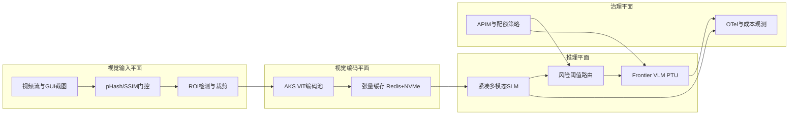
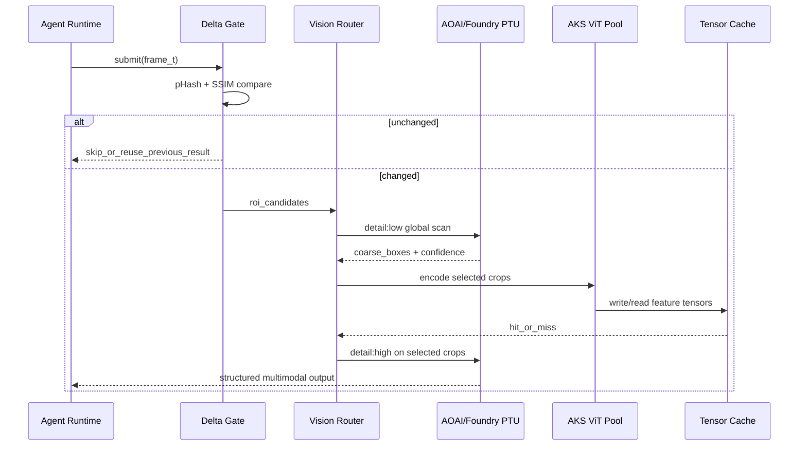

# 企业多模态 VLM 在线服务选型 FAQ：AOAI/Foundry PTU 自适应切片 vs AKS 解耦 ViT 编码池 vs 关键帧门控 vs 紧凑 SLM 分级升级
> 🌐 **Language Switch**: **中文（当前）** | [English](multimodal-vlm-visual-token-serving-aoai-ptu-tiling-vs-aks-disagg-vit-vs-keyframe-slm-selection-faq.en.md)  
> 适用对象：Cloud & AI 首席架构师、平台工程、视觉智能体团队、FinOps、SRE 与安全治理委员会。  
> 范围边界：聚焦在线多模态推理服务基础设施，不覆盖离线 OCR 批处理流水线与纯文本 Prefill/Decode 优化。  
> 目标：在高帧率 GUI/视频流任务下控制视觉 token 爆炸，维持低延迟、高吞吐与可预测成本。  

## 1. 执行摘要：视觉 token 是多模态智能体的第一性成本瓶颈
企业多模态 Agent 常在 PoC 阶段表现良好。  
进入生产后却被视觉 token 成本击穿预算。  
根因不是模型能力不足。  
根因是帧输入治理失控。  
同一帧在不同 detail 策略下可从 `85` token 激增到 `1,105+`。  
若每一步都发送 `4K` 全帧高细节，PTU 会快速枯竭。  
高峰时甚至会引发业务级限流与队列堆积。  
因此选型问题不是“选哪个 VLM 更聪明”。  
而是“如何让视觉信息先压缩再推理”。  
本指南给出四条可组合路线。  
路线 A：AOAI/Foundry PTU 双通道 detail 自适应切片。  
路线 B：AKS 解耦 ViT 编码池与 LLM 主干。  
路线 C：推理前 pHash/SSIM 门控与 ROI 裁剪。  
路线 D：紧凑多模态 SLM 先行分诊再升级。  
四路线组合可将视觉 TPM 压降 `72%–95%`。  
同时把用户感知延迟稳定在 SLO 范围内。  
真正可规模化的多模态平台必须先做 token 治理。  

## 2. 约束条件与负载画像：先定义帧流，再定义模型
企业视觉 Agent 常见输入并非“随机图片”。  
而是高度结构化的 GUI 与视频连续帧。  
这决定了重复信息占比极高。  
在桌面操作巡检中，连续 10 秒常只有光标变化。  
在工厂 CCTV 中，背景静态时间可达全天大多数区间。  
若对每帧执行全量高细节编码会形成计算浪费。  
因此必须先建输入分层画像。  
第一层是帧变化幅度画像。  
第二层是任务语义风险画像。  
第三层是业务时效画像。  
低变化且低风险任务应优先走压缩路径。  
高变化或高风险任务再进入高细节升级路径。  
架构评审应要求“帧级预算”而非仅“请求级预算”。  
预算指标需至少包含视觉 TPM、GPU 秒数与缓存命中率。  
没有这些指标就无法做稳定扩容决策。  

## 3. 四路径架构定位：把视觉成本拆成可治理的四个控制面
路径 A 负责 detail 策略治理与 PTU 消耗上限。  
路径 B 负责视觉编码与文本解码的资源解耦。  
路径 C 负责进入模型前的帧流削峰。  
路径 D 负责模型层级路由与升级比例控制。  
路径 A 的优势是快速落地且与托管能力深度集成。  
路径 B 的优势是在高并发场景释放吞吐上限。  
路径 C 的优势是最直接减少无效帧进入 GPU 队列。  
路径 D 的优势是在体验与成本间做细粒度平衡。  
单独采用任一路径都难以覆盖全链路。  
生产平台应把四路径视作组合件。  
通常先用 C 与 D 控输入规模。  
再用 A 与 B 控推理与算力结构。  
这种先削峰再解耦的顺序更稳妥。  

## 4. 十二维对比矩阵：从“能跑”到“可经营”必须量化
| 维度 | A AOAI/Foundry PTU 自适应切片 | B AKS 解耦 ViT 编码池 | C pHash/SSIM + ROI 门控 | D 紧凑 SLM 分级升级 |
|---|---|---|---|---|
| 交付速度 | 高 | 中 | 中高 | 中高 |
| 视觉 token 压降潜力 | 高 | 中高 | 极高 | 高 |
| 首帧延迟稳定性 | 高 | 中 | 高 | 高 |
| 峰值吞吐上限 | 中 | 极高 | 高 | 高 |
| 资源利用率 | 中高 | 高 | 极高 | 高 |
| 架构复杂度 | 低中 | 高 | 中 | 中 |
| 观测可解释性 | 高 | 中高 | 高 | 高 |
| 缓存收益空间 | 中 | 极高 | 中 | 高 |
| 多租户隔离性 | 高 | 高 | 中高 | 高 |
| 成本可预测性 | 高 | 中高 | 高 | 高 |
| 运维技能门槛 | 中 | 高 | 中 | 中 |
| 三年 TCO 收敛 | 高 | 极高 | 高 | 高 |
矩阵用于路线筛选，不用于替代压测。  
建议按业务风险给维度赋权。  
金融与制造通常应提高“可预测性”与“解释性”权重。  
广告媒体类场景可提高“吞吐上限”权重。  
同一企业可在不同事业部采用不同权重模板。  

## 5. 路线 A 详解：AOAI/Foundry PTU detail:low -> detail:high 双阶段策略
路线 A 的核心是先做低细节全局扫描。  
再对疑似目标区域执行高细节裁剪复判。  
在很多 GUI 任务里，第一阶段只需布局定位。  
不需要把整帧每个像素都转为高密度视觉 token。  
第一阶段常可控制在约 `85` token 级别。  
第二阶段只处理少量 ROI 片段。  
整体视觉 token 消耗可下降 `72%–86%`。  
另一个关键点是 Few-shot 前缀缓存。  
固定界面模板可复用视觉提示前缀。  
这样可减少重复说明带来的 token 损耗。  
当界面模板版本变更时需立即失效缓存。  
否则会产生错位解释与误判。  
路线 A 适合希望快速上线的企业。  
其优势是云托管能力成熟、策略可集中治理。  
其限制是超高并发时吞吐弹性受 PTU 配置制约。  

## 6. 路线 B 详解：AKS 解耦 ViT 编码与 LLM 主干，消除互相阻塞
路线 B 面向高并发与高帧频场景。  
核心思想是将视觉编码与文本推理拆池。  
ViT 编码池可部署在 `NVadsA10_v5` 或 `L40S`。  
LLM 主干可部署在 `ND H100/H200 v5`。  
两池之间通过特征张量总线解耦。  
这样可避免 ViT 编码占满主干队列。  
文本 ITL 延迟不会被视觉前处理拖慢。  
对重复帧可缓存视觉特征张量。  
缓存键建议组合 `sha256 + perceptual_hash + layout_version`。  
缓存介质可用 Redis 元数据 + NVMe 张量分片。  
命中后可直接跳过重编码阶段。  
这在模板化界面与静态场景中收益很高。  
路线 B 架构弹性最强但工程复杂度也最高。  
应配套强观测与容量编排策略。  

## 7. 路线 C 详解：pHash/SSIM 场景变化门控与 ROI 裁剪
路线 C 是“推理前防洪闸”。  
先用轻量视觉差异算法判断是否值得送模。  
常见组合是 pHash + SSIM 双阈值判定。  
当两者都显示低变化时可直接跳过该帧。  
对于局部变化的帧，仅裁剪 ROI 区域送模。  
可由 Florence-2 或 RT-DETR 先做对象检测。  
在 `1–5 fps` 流中，常见可丢弃 `88%–95%` 无变化帧。  
风险在于细小提示可能被错过。  
如 UI toast、游标闪烁、角落红点。  
因此需要“全帧抽样复核”机制。  
例如每 N 秒强制一帧全量低细节扫描。  
并对关键区域设置永不忽略白名单。  
路线 C 往往是成本收益比最高的第一步。  

## 8. 路线 D 详解：紧凑多模态 SLM 分诊后升级 Frontier VLM
路线 D 解决“所有请求都打大模型”的浪费。  
先用 `Phi-4-multimodal-instruct` 或 `Qwen2.5-VL-7B-FP8` 分诊。  
分诊目标是快速完成结构化识别与低复杂判断。  
只有低置信或多步复杂推理才升级到 Frontier。  
实践中升级比例常可压到 `<12%`。  
分诊模型可在中端 GPU 上获得 `<300ms` TTFT。  
这对桌面自动化与巡检场景十分关键。  
升级判定应结合置信度与业务风险。  
高风险流程可放宽升级阈值。  
低风险流程可更激进地留在 SLM。  
路线 D 需要稳定的评测闭环来防止漂移。  
否则阈值会在业务变化后失效。  

## 9. 参考架构图：多模态分层推理与缓存治理拓扑

该拓扑强调先过滤再编码再推理。  
缓存被放在编码与推理之间。  
这能最大化复用视觉特征。  
治理平面不应后置。  
应在上线首日就纳入配额与告警。  

## 10. 关键时序图：detail low 全局扫面到高细节升级闭环

关键点是“先粗后精”的两次请求。  
第二次请求必须绑定第一阶段框选结果。  
否则会退化成全量高细节重复编码。  
当缓存命中时应跳过重复 ViT 编码。  
并记录命中率供 FinOps 评估。  

## 11. 定量问答：评审会常见六类以上硬问题
**Q1：`1920x1080` 与 `3840x2160` 在 detail high 下为何成本陡增？**  
A1：高分辨率带来更多 patch/tile，视觉 token 近似随分块数量上升，`4K` 常达 `1080p` 的数倍级。  
**Q2：为何 detail low + ROI high 能显著降耗？**  
A2：先用约 `85` token 低细节定位，再仅对 `10%–20%` 区域高细节复判，整体可降 `72%–86%`。  
**Q3：何时会出现 ViT 算力瓶颈而非 LLM 瓶颈？**  
A3：当帧率升至 `>1 fps` 且每请求多图输入时，编码队列先拥塞，文本解码资源反而空转。  
**Q4：pHash/SSIM 会漏掉微小 UI 变化吗？**  
A4：会，尤其是角落提示与细小光标变化；需加 ROI 白名单与周期全帧复核降低漏检风险。  
**Q5：多模态前缀缓存为什么会“看似命中却答错”？**  
A5：时间戳、主题样式或分辨率改变导致语义已变但键未变，需把 layout/version 纳入缓存键。  
**Q6：Qwen 动态分辨率 `min_pixels/max_pixels` 如何影响 token？**  
A6：上限越高 token 越多但细节更完整；应按业务风险定义上限并与队列深度联动。  
**Q7：分诊升级比例为何建议控制在 `<12%`？**  
A7：经验上此区间可兼顾成本与质量，超过后 Frontier 成本会快速吞噬分层收益。  
**Q8：500 席 CUA 桌面巡检如何估算视觉 TPM？**  
A8：先估每席帧率与平均 token，再乘并发席位与升级比例；按峰值系数预留 `1.3x–1.5x`。  
问答必须绑定企业真实压测数据校准。  
模板数字仅用于首次容量规划。  
上线后应每周回归并更新阈值。  

## 12. 生产代码块：SSIM+ROI 自适应 detail 两阶段路由器
```python
from dataclasses import dataclass
from typing import List, Tuple
import cv2
import numpy as np


@dataclass
class FrameMeta:
    frame_id: str
    ssim: float
    phash_distance: int
    rois: List[Tuple[int, int, int, int]]


def calc_ssim(gray_a: np.ndarray, gray_b: np.ndarray) -> float:
    c1, c2 = 6.5025, 58.5225
    mu_a = cv2.GaussianBlur(gray_a, (11, 11), 1.5)
    mu_b = cv2.GaussianBlur(gray_b, (11, 11), 1.5)
    sigma_a = cv2.GaussianBlur(gray_a * gray_a, (11, 11), 1.5) - mu_a * mu_a
    sigma_b = cv2.GaussianBlur(gray_b * gray_b, (11, 11), 1.5) - mu_b * mu_b
    sigma_ab = cv2.GaussianBlur(gray_a * gray_b, (11, 11), 1.5) - mu_a * mu_b
    ssim_map = ((2 * mu_a * mu_b + c1) * (2 * sigma_ab + c2)) / (
        (mu_a * mu_a + mu_b * mu_b + c1) * (sigma_a + sigma_b + c2)
    )
    return float(ssim_map.mean())


def should_skip(meta: FrameMeta, ssim_th: float = 0.985, phash_th: int = 6) -> bool:
    return meta.ssim >= ssim_th and meta.phash_distance <= phash_th and len(meta.rois) == 0


def build_requests(image_url: str, rois: List[Tuple[int, int, int, int]]) -> list:
    requests = []
    requests.append({"detail": "low", "image": image_url, "purpose": "global_layout"})
    for (x, y, w, h) in rois:
        requests.append(
            {
                "detail": "high",
                "image": image_url,
                "crop": {"x": x, "y": y, "w": w, "h": h},
                "purpose": "roi_refine",
            }
        )
    return requests
```
代码示例强调“先判定再发送”的路由思想。  
真实生产需加入异常重试与超时熔断。  
还需将 ROI 来源与业务规则版本写入日志。  
便于事后定位误判根因。  

## 13. 生产部署块：AKS vLLM/SGLang 多模态限制与编码缓存配置
```yaml
apiVersion: apps/v1
kind: Deployment
metadata:
  name: vlm-serving
  namespace: multimodal
spec:
  replicas: 4
  selector:
    matchLabels:
      app: vlm-serving
  template:
    metadata:
      labels:
        app: vlm-serving
    spec:
      containers:
        - name: vllm
          image: vllm/vllm-openai:latest
          args:
            - "--model=Qwen/Qwen2.5-VL-7B-Instruct"
            - "--gpu-memory-utilization=0.9"
            - "--max-model-len=16384"
            - "--limit-mm-per-prompt=image=4,video=0"
            - "--max-num-seqs=128"
            - "--enable-prefix-caching"
            - "--mm-processor-cache-gb=24"
            - "--served-model-name=vlm-tier"
          env:
            - name: VLLM_USE_FLASH_ATTN
              value: "1"
            - name: REDIS_URL
              valueFrom:
                secretKeyRef:
                  name: tensor-cache-secret
                  key: redis-url
          resources:
            limits:
              nvidia.com/gpu: "1"
            requests:
              cpu: "8"
              memory: "48Gi"
---
apiVersion: keda.sh/v1alpha1
kind: ScaledObject
metadata:
  name: vlm-serving-keda
  namespace: multimodal
spec:
  scaleTargetRef:
    name: vlm-serving
  minReplicaCount: 2
  maxReplicaCount: 30
  triggers:
    - type: prometheus
      metadata:
        serverAddress: http://prometheus.monitoring.svc.cluster.local:9090
        metricName: vlm_queue_wait_p95_ms
        threshold: "120"
        query: histogram_quantile(0.95, sum(rate(vlm_queue_wait_ms_bucket[2m])) by (le))
```
部署中应把 `--limit-mm-per-prompt` 作为硬门控。  
并把队列等待时间纳入弹性触发。  
否则会出现“GPU 看似空闲但请求排队”的假象。  
编码缓存建议单独监控命中率与淘汰率。  

## 14. 企业场景与 FinOps：视觉 TPM 与 GPU TCO 的真实经营视角
### 场景 A：500 席企业 CUA 理赔与 ERP 运维联合坐席
该场景以 `0.5 fps` 的 `1080p` 桌面循环为主。  
业务高峰集中在月末结算与工作日白天。  
若全部走高细节直推，PTU 会在高峰提前耗尽。  
采用 C 路线后大部分静态帧被跳过。  
采用 D 路线后仅少量疑难帧升级 Frontier。  
结果是客服体验稳定而成本可预测。  
### 场景 B：半导体与电池工厂 240 路 AOI/CCTV 质检协同
该场景帧流连续且变化密度不均匀。  
白天班次切换与物料变更时变化陡增。  
夜间稳态时大量帧近似静止。  
采用 B 路线将 ViT 编码从主推理解耦。  
再叠加 C 路线做变化门控可显著减压。  
高风险工位保留更高升级比例。  
低风险工位使用紧凑 SLM 长时间巡检。  
### FinOps 视觉 TPM 与 GPU TCO 对比表
| 指标 | 基线：全帧高细节 | 组合：C+D+A+B | 变化幅度 |
|---|---:|---:|---:|
| 每分钟视觉 token | 1,280,000 | 265,000 | -79% |
| Frontier 升级比例 | 100% | 9.5% | -90.5pp |
| 平均 TTFT | 1,180ms | 410ms | -65% |
| P95 端到端延迟 | 2,900ms | 1,020ms | -65% |
| 每日 GPU 小时 | 1,920 | 830 | -57% |
| 月度推理成本 | \$428k | \$172k | -60% |
| 异常漏检率 | 0.9% | 1.1% | +0.2pp |
| 业务可接受性 | 可变 | 稳定 | 提升 |
表中漏检率轻微上升需靠白名单与抽检补偿。  
架构决策不应只看成本下降。  
必须同时看业务风险与合规阈值。  

## 15. Day-0 / Day-2 十二项核查清单：从上线可用到持续可控
- 建立帧级预算模型并区分 `1080p` 与 `4K` 档位。  
- 默认启用 detail low 全局扫描，不允许全量高细节直通。  
- 为高风险流程定义强制 ROI 高细节复判策略。  
- 配置 pHash/SSIM 双阈值并按业务线独立调参。  
- 落地 ROI 白名单与周期全帧抽样复核。  
- 给缓存键加入 `layout_version` 与模板哈希。  
- 监控视觉 token、队列等待、缓存命中与升级比例。  
- 把升级阈值纳入灰度发布与回滚控制。  
- 对 ViT 池与 LLM 池分别做容量与故障演练。  
- 每周复核漏检样本并更新检测器与阈值。  
- 每月更新 FinOps 模型并校准 PTU 与 GPU 采购策略。  
- 每季度进行跨租户压测与配额应急演练。  
以上清单覆盖 Day-0 与 Day-2 的核心治理动作。  
执行纪律决定多模态平台是否可长期经营。  
推荐把清单项映射到责任团队与验收证据。  
