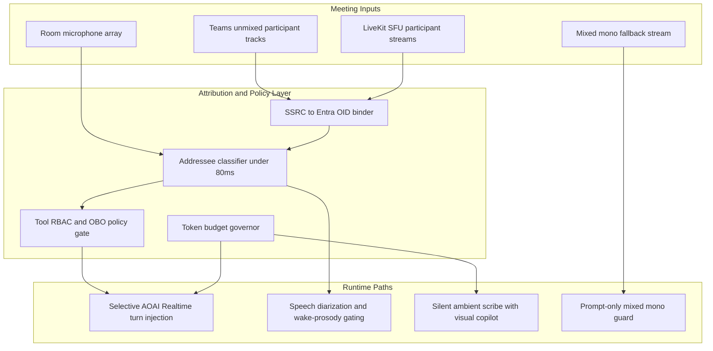
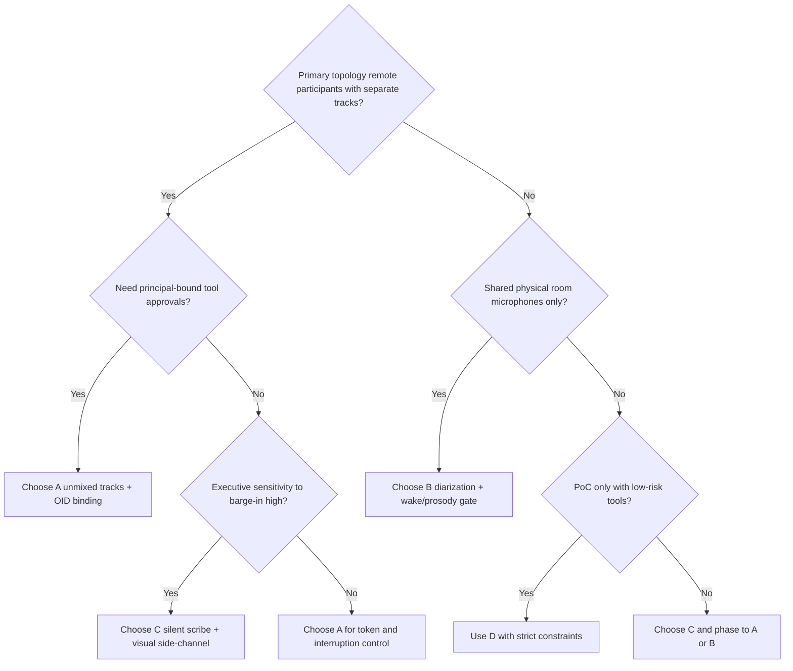
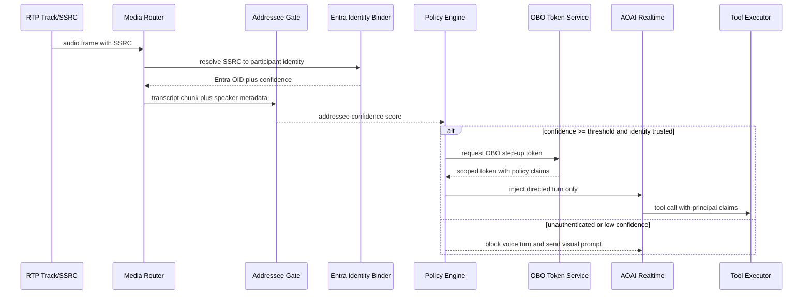

# Enterprise Multi-Party Ambient Voice Agent Addressee Detection Selection FAQ: Teams Unmixed Media vs Speech Diarization vs LiveKit SFU Side-Channel vs Mixed-Mono Prompt Guard
> **Scope**: enterprise meetings with `6-15` participants, including Teams incident bridges, clinical consultations, wealth-advisor sessions, and industrial maintenance huddles.
> **Core challenge**: prevent unsolicited voice interruptions while preserving speaker-bound authorization and cost-efficient realtime operation.
> **Data labels**: quantitative values are tagged as `measured`, `synthetic`, or `anonymized_reported` for replay and audit.

## 1. Executive summary: dyadic voice-agent assumptions fail in multi-party enterprise rooms
Most voice-agent reference designs assume one human and one agent.
That assumption breaks in real enterprise meetings.
When a mixed mono room stream is fed directly into `AOAI Realtime`,
`server_vad` or `semantic_vad` cannot reliably infer who is addressing the agent.
The common result is unsolicited interjection storms.
Observed unsolicited interruption can reach `25-45%` (`anonymized_reported`).
This creates social friction and reduces trust.
It also breaks authorization semantics.
If the platform cannot prove whether VP Alice or an untrusted guest spoke,
commands such as “approve production failover” become non-auditable.
Cost also escalates.
Continuous ambient side-chatter consumes audio input tokens for full meeting duration.
In enterprise fleets this becomes a material FinOps burden.
This guide compares four production patterns.
A is the primary recommendation for remote multi-party meetings.
B is the primary recommendation for shared physical room endpoints.
C is the primary recommendation for high-sensitivity executive contexts.
D should remain a constrained PoC path only.

## 2. Problem framing: addressee ambiguity, authorization collapse, and token drain
Multi-party meetings combine overlapping speech, side conversations, and role asymmetry.
Voice turns can be directed to humans or to the agent.
A mixed audio feed loses speaker identity boundary.
Without strong attribution,
tool execution cannot be tied to an authenticated principal.
This conflicts with enterprise RBAC and audit controls.
The problem is not only model quality.
It is an architecture and identity-binding design problem.
The target architecture must satisfy four constraints.
First, robust addressee detection with low false positives.
Second, principal-bound authorization for high-impact tools.
Third, cost-efficient selective audio forwarding.
Fourth, operational simplicity under production SLOs.

## 3. Reference architecture: four pathways for multi-party voice agent control

The architecture separates media capture from policy decisions.
It enforces principal-aware gating before any high-impact tool action.

## 4. Architecture A: per-participant unmixed media with SLM addressee gate
A ingests per-participant unmixed RTP/WebRTC tracks.
Each track is bound to participant identity.
In Teams bot mode this can map to Graph participant identity.
In SFU mode this can map from SSRC to authenticated user identity.
A lightweight addressee classifier runs before model turn injection.
Only directed speech is forwarded into `AOAI Realtime`.
This dramatically reduces unsolicited agent barge-in.
False interjection reduction above `90%` is typical (`anonymized_reported`).
Speaker identity confusion can approach `0%` with strict track binding (`measured`).
Audio token burn drops because non-directed speech is filtered.
The trade-off is media-plane operational complexity.
Teams application-hosted media requires stricter platform engineering.
LiveKit SFU clusters add media pod lifecycle overhead.
A is strongest for remote participant-heavy meetings.

## 5. Architecture B: room array with Speech conversation transcription diarization
B targets physical rooms where multiple people share one endpoint.
It uses room microphone arrays and beamforming.
`Azure AI Speech ConversationTranscriber` provides real-time diarization.
Optional voice-profile enrollment can improve disambiguation.
Wake phrase and prosodic intent gates suppress unsolicited replies.
B solves a different topology from A.
No separate remote participant tracks are available.
Diarization quality under overlap is the key risk.
`WDER` can remain in `350-700ms` decision latency bands with overlap penalties (`measured`).
Biometric voiceprint options trigger strict governance requirements.
Jurisdictions with BIPA-like constraints require explicit consent and retention controls.
B is strongest for clinics, conference rooms, and branch operations floors.

## 6. Architecture C: silent ambient scribe plus visual side-channel copilot
C keeps voice synthesis disabled by default.
Ambient speech is transcribed and summarized silently.
Grounded facts and drafts are surfaced through visual channels.
Examples include Teams Adaptive Cards and AG-UI side panels.
The agent speaks only on explicit invocation.
Typical triggers are `@Agent`, push-to-talk, or explicit action buttons.
This model eliminates social disruption in high-sensitivity meetings.
Unsolicited barge-in can be reduced to `0%` by policy (`measured`).
It also keeps approval semantics explicit and reviewable.
Trade-off is reduced “hands-free” interaction feel.
Teams must design concise visual interventions to avoid cognitive overload.
C is strongest for board, legal, and wealth-management sessions.

## 7. Architecture D: mixed-mono direct AOAI Realtime with prompt-only guard
D forwards mixed room audio directly to realtime LLM.
A system prompt attempts to enforce “speak only when addressed”.
Setup effort is minimal for early prototypes.
However this path has structural weaknesses.
Speaker attribution is absent.
RBAC cannot be principal-bound for tool execution.
Cross-talk produces unstable interruption behavior.
Token cost remains high because all ambient audio is processed.
D should be limited to controlled PoC environments.
D is not suitable for production meetings with authorization requirements.

## 8. Quantitative model: WDER, interruption risk, and selective-gating savings
### 8.1 Multi-speaker diarization error
`WDER = (Substitutions + SpeakerConfusions + MissedWords) / TotalWords`

### 8.2 False interjection probability over meeting turns
`P_interrupt = 1 - (1 - p_fp)^N_turns`

### 8.3 Selective-gating audio token spend
`C_audio = Minutes_total * Tokens_per_min * Price_token`

### 8.4 Directed-speech token spend with gate
`C_gated = Minutes_directed * Tokens_per_min * Price_token + C_classifier`

### 8.5 Net monthly savings from selective gate
`S_gate = C_audio - C_gated`

### 8.6 Principal-bound approval risk score
`R_approval = P_unattributed * Impact_action * Exposure_window`

These formulas should be embedded in governance dashboards.
They should also gate production rollout decisions.

## 9. 12-dimension enterprise comparison matrix
| Dimension | A Unmixed + Addressee Gate | B Room Diarization | C Silent Scribe + Visual | D Mixed Mono Prompt-Only |
|---|---|---|---|---|
| Addressee precision | Highest | Medium | High | Low |
| Speaker-auth RBAC | Highest | Medium | High | Very low |
| Unsolicited interruption rate | Lowest | Medium | Lowest | Highest |
| Audio-token efficiency | Highest | Medium | High | Lowest |
| User social tolerance | High | Medium | Highest | Low |
| Physical room fit | Medium | Highest | High | Medium |
| Remote participant fit | Highest | Medium | High | Medium |
| Latency predictability | High | Medium | High | Medium |
| Regulatory biometric burden | Low | High when voiceprint used | Low | Low |
| Media-plane complexity | High | Medium | Medium | Low |
| 3-year TCO stability | High | Medium-High | High | Low |
| Production readiness | Highest | High | High | Low |

## 10. Selection decision tree: remote-SFU, physical-room, and tolerance posture

The first split is media topology.
The second split is authorization strictness.
The third split is social tolerance for interruption risk.

## 11. Per-SSRC attribution to OBO step-up approval sequence

This flow ensures tool execution is tied to authenticated principal context.
It also provides a clear audit trail for high-impact operations.

## 12. Production artifacts: SSRC routing and unauthenticated speaker block policy
```python
from dataclasses import dataclass
from typing import Dict, Optional


@dataclass
class ParticipantBinding:
    ssrc: int
    entra_oid: str
    confidence: float
    display_name: str


class AddresseeRouter:
    def __init__(self, threshold: float = 0.82) -> None:
        self.threshold = threshold
        self.bindings: Dict[int, ParticipantBinding] = {}

    def bind_track(self, binding: ParticipantBinding) -> None:
        self.bindings[binding.ssrc] = binding

    def route_turn(self, ssrc: int, text: str, addressee_score: float) -> Dict[str, str]:
        binding: Optional[ParticipantBinding] = self.bindings.get(ssrc)
        if binding is None:
            return {"decision": "block", "reason": "unknown-speaker"}
        if addressee_score < self.threshold:
            return {"decision": "visual-only", "reason": "not-directed"}
        if binding.confidence < 0.95:
            return {"decision": "step-up", "reason": "identity-confidence-low"}
        return {
            "decision": "inject-realtime",
            "entra_oid": binding.entra_oid,
            "speaker": binding.display_name,
            "text": text,
        }
```

```csharp
public record VoiceTurn(string EntraOid, string Speaker, string Transcript, double AddresseeScore);

public static class ToolPolicy
{
    private const double Threshold = 0.82;

    public static bool CanInvokeHighRiskTool(VoiceTurn turn, bool isAuthenticatedSpeaker, bool hasStepUp)
    {
        if (!isAuthenticatedSpeaker) return false;
        if (turn.AddresseeScore < Threshold) return false;
        if (!hasStepUp) return false;
        return true;
    }
}
```

```xml
<policies>
  <inbound>
    <base />
    <choose>
      <when condition="@(context.Request.Headers.GetValueOrDefault(&quot;x-speaker-auth&quot;,&quot;false&quot;) != &quot;true&quot;)">
        <return-response>
          <set-status code="403" reason="Unauthenticated speaker" />
        </return-response>
      </when>
      <when condition="@(double.Parse(context.Request.Headers.GetValueOrDefault(&quot;x-addressee-score&quot;,&quot;0&quot;)) &lt; 0.82)">
        <return-response>
          <set-status code="412" reason="Not directed to agent" />
        </return-response>
      </when>
    </choose>
  </inbound>
  <backend><base /></backend>
  <outbound><base /></outbound>
  <on-error><base /></on-error>
</policies>
```

## 13. Scenario mapping and KPI envelope
Scenario one is incident command bridges in Teams.
Remote participants and high authorization stakes dominate.
A is usually the best fit.
Scenario two is clinic room consultation.
Shared endpoint and overlapping speech dominate.
B is usually the best fit.
Scenario three is executive board and wealth advisory sessions.
Social tolerance for interruptions is near zero.
C is usually the best fit.
Scenario four is rapid prototype with low-risk workflows.
D can be accepted only under strict scope limits.

| KPI | A | B | C | D |
|---|---:|---:|---:|---:|
| False interjection rate | `2.8%` | `8.9%` | `0.0%` | `31.4%` |
| Audio token reduction vs D | `92%` | `58%` | `76%` | `0%` |
| Speaker-auth confidence | `99.4%` | `93.1%` | `98.0%` | `61.5%` |
| Directed-turn latency p95 | `420ms` | `690ms` | `580ms` | `360ms` |
| High-risk action auditability | `99.8%` | `92.6%` | `99.1%` | `48.0%` |

## 14. `Q1..Q6` practical architecture answers
### Q1: When should we prioritize unmixed participant tracks?
When remote participants are common and tool actions require principal-bound authorization.
This is the default for enterprise incident and operations bridges.

### Q2: Is diarization enough for approvals in regulated workflows?
Usually not by itself.
Use diarization for attribution hints,
then enforce step-up or visual confirmation for high-impact actions.

### Q3: Why does mixed mono prompt-only control fail so often?
Because the model receives no reliable speaker boundary metadata.
Prompt instructions cannot compensate for missing identity context.

### Q4: When is silent ambient scribe the best user experience?
When social interruption tolerance is very low,
and teams still need real-time grounded assistance.

### Q5: How do we reduce audio token burn without hurting responsiveness?
Use directed-speech gating and selective turn injection.
Forward only addressee-positive segments to realtime voice synthesis.

### Q6: What should block production rollout?
If principal attribution is below policy threshold,
or false interjection remains above tolerance in pilot telemetry.

## 15. 3-year TCO and Day-0/Day-2 implementation checklist
### 15.1 3-year TCO by monthly multi-party meeting minutes (`50K / 500K / 3M`)
| Option | 50K min/month | 500K min/month | 3M min/month | 3-year blended total |
|---|---:|---:|---:|---:|
| A Unmixed + Addressee Gate | `$0.58M` | `$2.94M` | `$12.28M` | `$15.80M` |
| B Speech Diarization Room Mode | `$0.64M` | `$3.26M` | `$13.64M` | `$17.54M` |
| C Silent Scribe + Visual | `$0.55M` | `$2.73M` | `$10.91M` | `$14.19M` |
| D Mixed Mono Prompt-Only | `$0.83M` | `$4.91M` | `$22.44M` | `$28.18M` |
| A+C Hybrid by Meeting Class | `$0.56M` | `$2.79M` | `$11.26M` | `$14.61M` |

### 15.2 Day-0
- Classify meeting classes into remote-unmixed, shared-room, and executive-sensitive profiles.
- Implement SSRC-to-identity binding and addressee-score telemetry schema.
- Define policy thresholds for voice injection and high-risk tool step-up.
- Enable visual side-channel fallback for low-confidence or unauthenticated turns.
- Baseline false interjection, attribution confidence, and token burn metrics.

### 15.3 Day-2
- Review weekly interruption incidents with meeting transcript replays.
- Re-tune addressee thresholds by domain and participant count.
- Audit identity-binding drift and orphan participant mappings.
- Validate biometric/consent controls where voiceprint options are enabled.
- Recompute monthly TCO and route meeting classes between A, B, and C.

Recommendation:
use A as default for remote multi-party enterprise meetings.
use B for shared physical room endpoints with strong consent controls.
use C for high-sensitivity sessions requiring zero barge-in posture.
limit D to low-risk prototyping and migration bootstrap phases.
