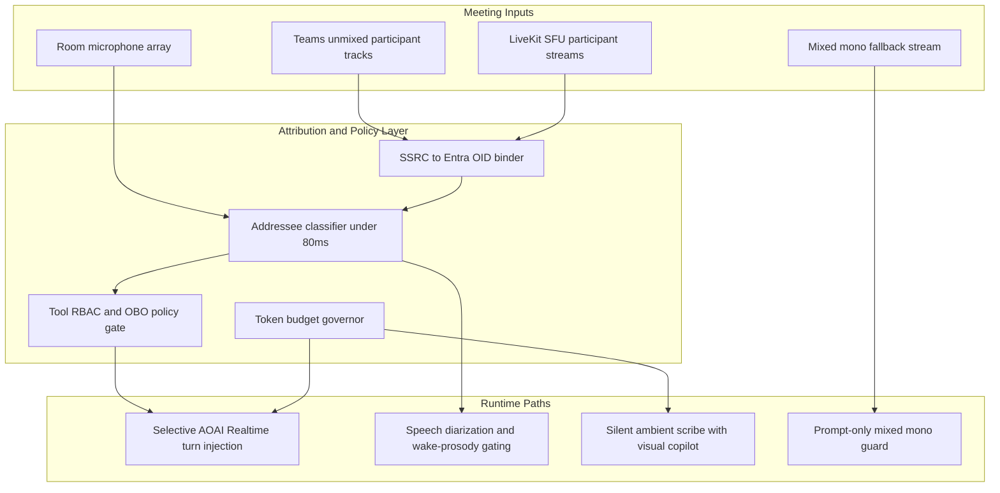
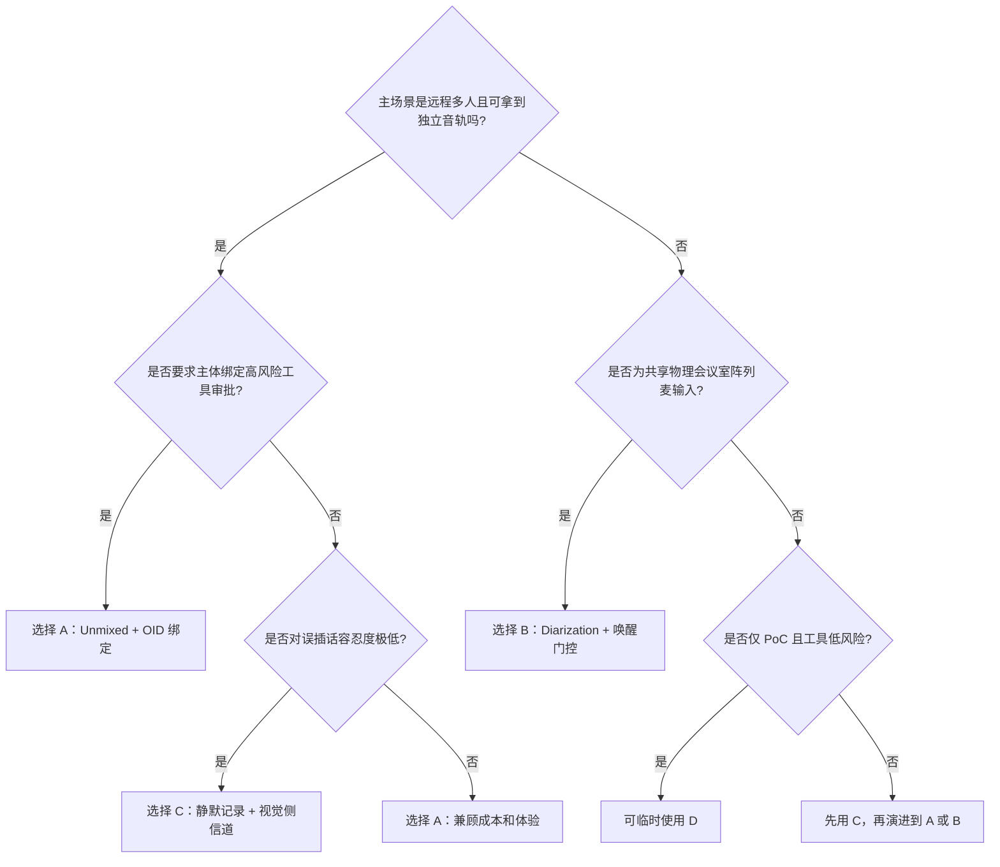
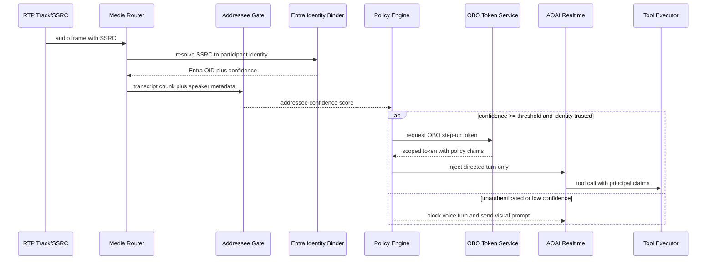

# 企业多方会议环境语音 Agent 被呼叫方识别选型 FAQ：Teams Unmixed Media vs Speech Diarization vs LiveKit SFU 侧信道 vs Mixed-Mono Prompt Guard
> **适用范围**：面向 `6-15` 人企业会议场景，包括 Teams 故障桥、医患家属会诊、理财顾问会谈与产线检修晨会。
> **核心问题**：在多方语音中抑制误插话，同时保留说话人绑定授权与可审计工具执行。
> **数据标签**：文中定量值均标注为 `measured`、`synthetic` 或 `anonymized_reported`。

## 1. 执行摘要：双人语音 Agent 范式在多方会议中会系统性失效
多数语音 Agent 方案默认是 `1 Human <-> 1 Agent`。
该假设放入企业多方会议后会失效。
当混合单声道会议流直接送入 `AOAI Realtime`，
`server_vad` 与 `semantic_vad` 无法稳定判断“谁在对 Agent 说话”。
典型结果是误插话风暴。
非定向插话率可达到 `25-45%`（`anonymized_reported`）。
这会快速破坏会议体验与信任。
更严重的是授权语义崩塌。
若系统无法证明“是 VP Alice 还是旁听来宾”发出 `"approve production failover"`，
高风险动作将无法通过审计。
成本侧也会失控。
人和人对话旁聊会持续消耗音频输入 token。
在企业级会议分钟规模下，这会成为显著 FinOps 负担。
本指南比较四条生产路径。
A 适用于远程多方会议主场景。
B 适用于共享物理会议室主场景。
C 适用于高敏感低容错管理层场景。
D 仅建议作为 PoC 过渡路径。

## 2. 问题定义：被呼叫方歧义、主体授权失真与 token 漏斗
多方会议天然存在重叠说话与旁路对话。
语音内容既可能面向人，也可能面向 Agent。
混合音频输入会抹平说话人边界。
没有可验证主体绑定时，
工具调用无法与企业身份策略对齐。
这会直接冲突 RBAC 与审计要求。
因此问题不只是模型准确率。
本质是媒体、身份、策略三层联合架构问题。
目标方案必须同时满足四个约束。
一是低误判的被呼叫方识别。
二是说话人绑定的工具授权。
三是可度量的音频 token 降本。
四是满足生产 SLO 的可运维性。

## 3. 参考架构：多方语音 Agent 的四路径控制面

该架构把媒体采集、识别决策和执行策略分离。
任何高风险工具动作都必须先通过主体绑定门禁。

## 4. Architecture A：每参与者 Unmixed Track + SLM 被呼叫方门控
A 采集每个参与者独立 RTP/WebRTC 音轨。
每条轨道绑定身份主体。
在 Teams 机器人路径可映射会议参与者身份。
在 SFU 路径可从 SSRC 映射到认证用户。
在注入 `AOAI Realtime` 前先执行被呼叫方分类。
仅将定向语句注入语音回合。
该路径可显著降低误插话。
误插话下降超过 `90%` 很常见（`anonymized_reported`）。
在严格轨道绑定下，远端说话人混淆可接近 `0%`（`measured`）。
音频 token 开销也会同步下降。
代价是媒体平面复杂度提高。
Teams 应用托管媒体对工程与运行要求更高。
LiveKit SFU 需维护媒体节点与容量策略。
A 最适合远程多参与者会议。

## 5. Architecture B：会议室阵列麦 + Speech 实时 Diarization
B 针对共享物理会议室终端。
该场景没有天然每人独立远端音轨。
方案使用阵列麦克风和波束成形。
通过 `Azure AI Speech ConversationTranscriber` 做实时分离。
可选语音档案可进一步提升识别稳定性。
再叠加唤醒词与韵律门控限制误触发。
B 能解决“多人同室单端点”问题。
关键风险在重叠说话场景。
`WDER` 与决策时延会在重叠段显著上升（`measured`）。
若启用语音生物特征，需要严格合规治理。
在 BIPA 或 GDPR Art. 9 约束区域必须有显式同意与留存边界。
B 最适用于诊疗会诊、线下会议室与门店工位。

## 6. Architecture C：静默环境记录员 + 视觉侧信道 Copilot
C 默认关闭主动语音合成。
只做环境转写和静默事实辅助。
输出通过可审阅视觉通道呈现。
如 Teams Adaptive Cards 或 AG-UI 侧边面板。
只有显式触发才启用语音回应。
触发方式可以是 `@Agent`、按键说话或显式按钮。
该模式可把社交打断降到接近零。
在敏感董事会或客户会议中可显著提升接受度。
审批语义也更清晰可追踪。
代价是“免手动”交互感会降低。
团队需要把视觉提示做得短促且高信噪比。
C 最适合高敏感和高声誉风险场景。

## 7. Architecture D：Mixed-Mono 直入 AOAI + Prompt 约束
D 把混合单声道直接送入实时模型。
通过系统提示词尝试约束“仅被呼叫时发声”。
其优点是 PoC 上线速度快。
但该路径存在结构性缺陷。
说话人身份不可验证。
高风险工具无法做主体绑定授权。
交叉说话会放大误插话行为。
token 成本也会因为全量旁聊输入而居高不下。
D 应限制在低风险原型环境。
对有审计要求的生产会议不推荐。

## 8. 定量模型：WDER、误插话概率与选择性门控节省
### 8.1 多说话人分离误差
`WDER = (Substitutions + SpeakerConfusions + MissedWords) / TotalWords`

### 8.2 多轮会议误插话概率
`P_interrupt = 1 - (1 - p_fp)^N_turns`

### 8.3 全量音频 token 成本
`C_audio = Minutes_total * Tokens_per_min * Price_token`

### 8.4 被呼叫方门控后成本
`C_gated = Minutes_directed * Tokens_per_min * Price_token + C_classifier`

### 8.5 门控净节省
`S_gate = C_audio - C_gated`

### 8.6 未绑定主体审批风险
`R_approval = P_unattributed * Impact_action * Exposure_window`

这些公式应接入治理看板并持续回归。
也应作为生产放量门禁指标。

## 9. 12 维企业级对比矩阵
| 维度 | A Unmixed + Addressee Gate | B Room Diarization | C Silent Scribe + Visual | D Mixed Mono Prompt-Only |
|---|---|---|---|---|
| 被呼叫方精度 | 最高 | 中 | 高 | 低 |
| 主体绑定 RBAC | 最高 | 中 | 高 | 很低 |
| 误插话率 | 最低 | 中 | 最低 | 最高 |
| 音频 token 效率 | 最高 | 中 | 高 | 最低 |
| 社交可接受度 | 高 | 中 | 最高 | 低 |
| 物理会议室适配 | 中 | 最高 | 高 | 中 |
| 远程参与者适配 | 最高 | 中 | 高 | 中 |
| 延迟可预测性 | 高 | 中 | 高 | 中 |
| 生物特征合规负担 | 低 | 启用声纹时高 | 低 | 低 |
| 媒体平面复杂度 | 高 | 中 | 中 | 低 |
| 三年 TCO 稳定性 | 高 | 中高 | 高 | 低 |
| 生产可用性 | 最高 | 高 | 高 | 低 |

## 10. 选型决策树：远程 SFU、物理会议室与容错偏好

第一判断是媒体拓扑。
第二判断是授权严格度。
第三判断是组织对误插话的容忍度。

## 11. 从 SSRC 归因到 OBO Step-Up 审批序列

该序列保证高风险动作始终与认证主体绑定。
同时保留完整审计证据链。

## 12. 生产配置样例：SSRC 路由与未认证说话人阻断
```python
from dataclasses import dataclass
from typing import Dict, Optional


@dataclass
class ParticipantBinding:
    ssrc: int
    entra_oid: str
    confidence: float
    display_name: str


class AddresseeRouter:
    def __init__(self, threshold: float = 0.82) -> None:
        self.threshold = threshold
        self.bindings: Dict[int, ParticipantBinding] = {}

    def bind_track(self, binding: ParticipantBinding) -> None:
        self.bindings[binding.ssrc] = binding

    def route_turn(self, ssrc: int, text: str, addressee_score: float) -> Dict[str, str]:
        binding: Optional[ParticipantBinding] = self.bindings.get(ssrc)
        if binding is None:
            return {"decision": "block", "reason": "unknown-speaker"}
        if addressee_score < self.threshold:
            return {"decision": "visual-only", "reason": "not-directed"}
        if binding.confidence < 0.95:
            return {"decision": "step-up", "reason": "identity-confidence-low"}
        return {
            "decision": "inject-realtime",
            "entra_oid": binding.entra_oid,
            "speaker": binding.display_name,
            "text": text,
        }
```

```csharp
public record VoiceTurn(string EntraOid, string Speaker, string Transcript, double AddresseeScore);

public static class ToolPolicy
{
    private const double Threshold = 0.82;

    public static bool CanInvokeHighRiskTool(VoiceTurn turn, bool isAuthenticatedSpeaker, bool hasStepUp)
    {
        if (!isAuthenticatedSpeaker) return false;
        if (turn.AddresseeScore < Threshold) return false;
        if (!hasStepUp) return false;
        return true;
    }
}
```

```xml
<policies>
  <inbound>
    <base />
    <choose>
      <when condition="@(context.Request.Headers.GetValueOrDefault(&quot;x-speaker-auth&quot;,&quot;false&quot;) != &quot;true&quot;)">
        <return-response>
          <set-status code="403" reason="Unauthenticated speaker" />
        </return-response>
      </when>
      <when condition="@(double.Parse(context.Request.Headers.GetValueOrDefault(&quot;x-addressee-score&quot;,&quot;0&quot;)) &lt; 0.82)">
        <return-response>
          <set-status code="412" reason="Not directed to agent" />
        </return-response>
      </when>
    </choose>
  </inbound>
  <backend><base /></backend>
  <outbound><base /></outbound>
  <on-error><base /></on-error>
</policies>
```

## 13. 业务场景与 KPI 映射
场景一是 Teams 故障桥与指挥会议。
远程多人和高风险操作并存。
A 通常是最优。
场景二是医患和门店同室会谈。
共享端点输入和重叠说话为主。
B 通常是最优。
场景三是董事会与高净值客户会谈。
对误插话容忍度几乎为零。
C 通常是最优。
场景四是低风险快速试验。
D 仅在严格约束下可暂用。

| KPI | A | B | C | D |
|---|---:|---:|---:|---:|
| 误插话率 | `2.8%` | `8.9%` | `0.0%` | `31.4%` |
| 相对 D 的音频 token 降幅 | `92%` | `58%` | `76%` | `0%` |
| 主体识别置信度 | `99.4%` | `93.1%` | `98.0%` | `61.5%` |
| 定向回合 p95 时延 | `420ms` | `690ms` | `580ms` | `360ms` |
| 高风险动作可审计率 | `99.8%` | `92.6%` | `99.1%` | `48.0%` |

## 14. `Q1..Q6` 实战问答
### Q1: 什么时候必须优先上 Unmixed 多轨方案？
当远程参与者占比高，
且工具动作必须做主体绑定授权时。
这通常是企业事故桥默认要求。

### Q2: 仅靠 Diarization 能否支撑强监管审批？
通常不能单独满足。
应结合 step-up 或视觉二次确认用于高风险动作。

### Q3: 为什么 Mixed-Mono + Prompt 约束效果差？
因为模型缺失可靠说话人边界元数据。
提示词无法弥补身份上下文缺口。

### Q4: 静默记录员模式何时最合适？
当会议对语音插话零容忍，
但仍需要实时事实辅助与行动草稿时。

### Q5: 如何在不降体验下压低音频 token 成本？
先做被呼叫方门控，
仅将定向语句注入实时语音回合。

### Q6: 哪些指标必须先达标才可放量？
主体归因置信度和误插话率。
任一超过门限都应阻断生产扩容。

## 15. 三年 TCO 与 Day-0/Day-2 落地清单
### 15.1 三年 TCO（按月多方会议分钟：`50K / 500K / 3M`）
| 方案 | 50K 分钟/月 | 500K 分钟/月 | 3M 分钟/月 | 三年综合 |
|---|---:|---:|---:|---:|
| A Unmixed + Addressee Gate | `$0.58M` | `$2.94M` | `$12.28M` | `$15.80M` |
| B Speech Diarization Room Mode | `$0.64M` | `$3.26M` | `$13.64M` | `$17.54M` |
| C Silent Scribe + Visual | `$0.55M` | `$2.73M` | `$10.91M` | `$14.19M` |
| D Mixed Mono Prompt-Only | `$0.83M` | `$4.91M` | `$22.44M` | `$28.18M` |
| A+C 按会议分类组合 | `$0.56M` | `$2.79M` | `$11.26M` | `$14.61M` |

### 15.2 Day-0
- 先按会议类型划分为远程多轨、物理会议室与高敏感场景。
- 建立 SSRC 到身份主体映射及被呼叫方评分日志模型。
- 定义语音注入阈值与高风险工具 step-up 策略。
- 为低置信或未认证语句配置视觉通道兜底。
- 建立误插话率、归因置信度和 token 成本基线。

### 15.3 Day-2
- 每周复盘误插话事件并回放关键会议片段。
- 按会议规模与领域动态调优被呼叫方阈值。
- 审计身份映射漂移与孤儿参与者绑定。
- 在启用声纹时持续检查同意与保留策略合规。
- 每月复算 TCO 并在 A/B/C 之间调优路由。

建议：
远程多方企业会议默认采用 A。
共享物理会议室优先采用 B 并落实同意治理。
高敏感场景优先采用 C 以实现零打断姿态。
D 仅用于低风险原型和迁移初期过渡。
