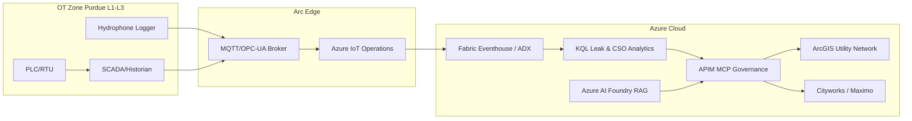
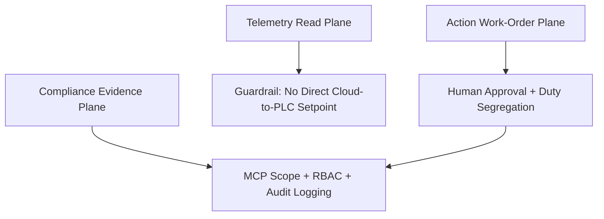

# Municipal Water & Wastewater Utility Agent Selection FAQ: Azure IoT Operations + Fabric Real-Time Hydraulic Twin vs Foundry Permit/LIMS Regulatory RAG vs ArcGIS/Cityworks/Maximo Work-Order Governance

## 1. Problem framing: this is not electric DERMS and not upstream oil & gas EHS

This guide targets **municipal water and wastewater utilities**.

Typical operators include metropolitan water authorities, regional sewer districts, and multi-county utility operators.

Their operational assets include pressurized distribution mains, district-metered areas (DMAs), pump stations, valve networks, treatment trains, and stormwater overflow assets.

The core mission is not generation dispatch.

The core mission is also not upstream drilling safety.

The hard day-2 objectives are:

- sustained non-revenue water (NRW) reduction,
- minimum-night-flow (MNF) anomaly triage,
- acoustic leak false-positive suppression,
- wet-weather CSO consent-decree reporting,
- PFAS/NPDES evidence-chain integrity.

Many programs incorrectly merge platform telemetry architecture and regulatory evidence architecture into one undifferentiated backlog.

That causes ownership ambiguity and operational drift.

This FAQ separates responsibilities into three planes:

- operations plane: telemetry, MNF signals, leak scores, pump/valve status;
- compliance plane: permits, SOP clauses, LIMS certificates, and violation evidence;
- action plane: valve-isolation work orders, dispatch, and accountable approvals.

Only this separation enables high automation without violating public-health control boundaries.

## 2. Regulatory and OT safety constraints: AWIA + ISA/IEC 62443 + Purdue segmentation

For municipal utilities, direct cloud writes to control setpoints are high-risk by default.

That risk is public-health critical, not ordinary IT automation risk.

Common production constraints include:

- Purdue Level 1–3 process-control segmentation,
- default-deny cloud-to-PLC/RTU write paths,
- mandatory human approval for chlorine/coagulant/high-lift actions,
- local DCS/SCADA authority during abnormal states,
- strict unidirectional or brokered telemetry export patterns.

Under U.S. governance patterns, AWIA resilience requirements and NPDES reporting obligations both matter.

PFAS thresholds are in the ppt range, so evidentiary precision is non-negotiable.

Architecture review boards must explicitly define:

which recommendations can be auto-issued,

which actions require operations supervisor approval,

which workflows are permanently human-gated.

This boundary definition is the first decision gate, before model choice.

## 3. Candidate options: define boundaries before technology enthusiasm

### Option A: siloed hydraulic and SCADA vendor analytics

This pattern usually means standalone hydraulic and control analytics suites with limited cross-domain governance.

Strengths:

- lower change-management friction,
- familiar local workflows,
- fast pilot launch.

Weaknesses:

- fragmented evidence chain,
- weak cross-system explainability,
- limited closed-loop linkage to GIS + work-order dispatch,
- difficult enterprise FinOps and audit unification.

### Option B: Purdue-segmented Azure layered architecture

Composition:

- Azure IoT Operations on Arc-enabled edge for OPC-UA/MQTT ingestion,
- Fabric Eventhouse/ADX for DMA and acoustic streaming analytics,
- Azure AI Foundry for permit/SOP/LIMS regulatory RAG,
- APIM-governed MCP access to ArcGIS Utility Network and Cityworks/Maximo.

Strength:

clear separation of duties and auditable control points.

Tradeoff:

higher upfront governance and data-contract engineering.

### Option C: direct cloud-agent writes to SCADA process setpoints

In public utility contexts this is usually a prohibited anti-pattern.

It may look faster in demo automation.

But it breaks separation-of-duty and safety-lockout intent.

For chlorine dosing and critical effluent controls, this pattern is a governance redline.

## 4. 12-dimension selection matrix

| Dimension | Option A: Siloed Analytics | Option B: Azure Layered Governance | Option C: Direct Cloud Setpoint Writes |
|---|---|---|---|
| OT safety-boundary alignment | medium | high | very low |
| NRW leak localization speed | medium | high | medium |
| PFAS/NPDES evidence traceability | low-medium | high | low |
| GIS/work-order closure quality | low | high | medium |
| Audit explainability | medium | high | low |
| Initial rollout complexity | low | medium-high | medium |
| Long-term governance complexity | high | medium | high |
| Streaming analytics scalability | medium | high | medium |
| False-positive reduction potential | medium | high | low |
| 3-year TCO controllability | medium | high | low |
| Regulator acceptance likelihood | medium | high | very low |
| Executive recommendation | transitional only | primary path | prohibited |

The matrix is not a “feature race.”

It is a public-safety and auditability decision framework.

## 5. Reference architecture: read-mostly telemetry, governed actions, no unsafe direct writes



Key architecture intent:

cloud performs analytics and recommendation synthesis,

action execution is mediated through governed work-order rails,

unsafe process-control direct write paths are blocked.

## 6. Plane separation: telemetry read-plane, compliance evidence-plane, action-plane



Architecture gate reviews should verify:

- whether OT paths are strictly read-oriented from cloud perspective,
- whether recommendations can accidentally bypass operational approvals,
- whether API scopes enforce least privilege at tool level,
- whether every action has immutable audit lineage.

These controls matter more than benchmark scores.

## 7. Production snippet: MNF leak triage KQL + APIM policy blocking unsafe write paths

### 7.1 KQL for DMA MNF anomaly and acoustic signal fusion

```kusto
let night_window = 1h;
let baseline_days = 21d;
let mnf_baseline =
    TelemetryFlow
    | where Timestamp > ago(baseline_days)
    | where HourOfDay between (1 .. 4)
    | summarize p50_mnf = percentile(FlowLps, 50), p95_mnf = percentile(FlowLps, 95) by DMAId;
let latest_mnf =
    TelemetryFlow
    | where Timestamp > ago(night_window)
    | where HourOfDay between (1 .. 4)
    | summarize cur_mnf = percentile(FlowLps, 50) by DMAId;
let acoustic =
    AcousticEvents
    | where Timestamp > ago(night_window)
    | summarize acoustic_score = avg(LeakLikelihood), acoustic_events = count() by DMAId;
latest_mnf
| join kind=inner mnf_baseline on DMAId
| join kind=leftouter acoustic on DMAId
| extend mnf_delta_pct = 100.0 * (cur_mnf - p50_mnf) / iif(p50_mnf == 0.0, 1.0, p50_mnf)
| extend acoustic_score = coalesce(acoustic_score, 0.0)
| extend priority = case(mnf_delta_pct > 22 and acoustic_score > 0.75, "P1",
                         mnf_delta_pct > 15 and acoustic_score > 0.60, "P2",
                         mnf_delta_pct > 10, "P3", "P4")
| project DMAId, cur_mnf, p50_mnf, p95_mnf, mnf_delta_pct, acoustic_score, acoustic_events, priority
| order by priority asc, mnf_delta_pct desc
```

### 7.2 APIM policy enforcing work-order scope and denying SCADA setpoint writes

```xml
<policies>
  <inbound>
    <base />
    <validate-jwt header-name="Authorization" require-scheme="Bearer" />
    <choose>
      <when condition="@(!context.Principal.Claims.Any(c => c.Type == &quot;roles&quot; &amp;&amp; c.Value == &quot;utility.workorder.write&quot;))">
        <return-response>
          <set-status code="403" reason="missing utility.workorder.write role" />
        </return-response>
      </when>
    </choose>
    <choose>
      <when condition="@(context.Request.Url.Path.Contains(&quot;/scada/setpoint&quot;))">
        <return-response>
          <set-status code="403" reason="direct cloud-to-scada setpoint writes are blocked" />
        </return-response>
      </when>
    </choose>
  </inbound>
  <backend><base /></backend>
  <outbound><base /></outbound>
  <on-error><base /></on-error>
</policies>
```

This policy converts governance intent into enforceable runtime behavior.

## 8. Option A deep dive: where it works and where it fails

Option A can be effective as a constrained transitional approach.

Example:

a city starts with one treatment district and one DMA cluster pilot.

Short-term execution can be fast if local teams already know the vendor tooling.

However, once cross-domain accountability is required, limits emerge:

- duplicated data semantics across teams,
- manual compliance narrative assembly,
- weak mapping from analytics insights to dispatch execution,
- expensive post-incident forensic reconstruction.

So Option A is acceptable as a short bridge, not as a strategic end-state for multi-year programs.

## 9. Option B deep dive: why it is the primary recommendation

Option B is not “cloud-first at all costs.”

It is **boundary-first architecture** with governed integration.

Role clarity:

- OT retains real-time control and physical safety interlocks,
- cloud handles pattern recognition and compliance synthesis,
- work-order systems own execution traceability and workforce accountability.

For 4,200-DMA city networks, this yields measurable impact:

- faster P1 leak triage ordering,
- topology-aware valve isolation recommendations,
- dispatch-ready work packets with confidence grading,
- explainable compliance outputs citing clause-level evidence.

This is where architecture translates to service-level outcomes.

## 10. Option C risk profile: why it belongs in the forbidden-pattern catalog

Option C is often marketed as “full autonomy.”

In municipal water contexts, it is usually unacceptable.

High-risk failure modes include:

- chemical dosing drift from model misfire,
- unsafe pump sequencing under uncertain state,
- accidental operator over-trust in generated actions,
- legal ambiguity in incident accountability.

Even if technically feasible, governance feasibility fails.

Architecture councils should codify it as a no-go for production.

## 11. Azure sizing and 3-year TCO model (`$k/month`)

### 11.1 Planning assumptions

- 15,000+ km network coverage,
- 4,200 DMA partitions,
- 38,000 acoustic capture points,
- 22 major wastewater facilities,
- 1.8 TB/day telemetry and event payloads,
- 120,000 monthly work-order transitions,
- 2,500 weekly compliance retrieval sessions.

### 11.2 Option A rough cost model

- vendor analytics subscription and support: `$210k/month`
- integration and reconciliation labor: `$46k/month`
- compliance evidence assembly overhead: `$28k/month`
- total: `$284k/month`
- 3-year total: `$10.22M`

### 11.3 Option B rough cost model

- Arc edge and IoT Operations: `$88k/month`
- Fabric Eventhouse/ADX + storage: `$74k/month`
- Foundry RAG and inference workload: `$39k/month`
- APIM governance and security controls: `$21k/month`
- GIS/work-order integration and platform ops: `$44k/month`
- total: `$266k/month`
- 3-year total: `$9.58M`

### 11.4 Option C rough cost model with risk premium

- platform and inference runtime: `$232k/month`
- additional control/audit overlays: `$71k/month`
- modeled risk reserve: `$95k/month`
- total: `$398k/month`
- 3-year total: `$14.33M`

Result:

Option C is not cheaper.

It is higher variance with higher downside.

## 12. Scenario A: metro utility with 4,200 DMA NRW leak localization and valve isolation

Target outcomes:

- major leak localization from 9.5h to 2.2h,
- dispatch false-positive reduction from 28% to 11%,
- night anomaly confirmation from 72 min to 18 min.

Architecture flow:

- edge collects pressure/flow/acoustic summaries,
- Eventhouse performs minute-level aggregation,
- KQL computes MNF deltas + acoustic composite score,
- APIM invokes ArcGIS upstream valve-trace workflows,
- dispatch packets move into Cityworks with confidence bands.

Governance controls:

- P1 actions require dual approval,
- crew evidence upload is mandatory,
- post-closure review records are immutable.

## 13. Scenario B: regional wastewater authority CSO decree operations + 4.0 ppt PFAS compliance

Target outcomes:

- CSO reporting latency from T+24h to T+4h,
- NPDES evidence assembly effort down by 46%,
- PFAS trend-shift detection lead time by 5–7 days.

Architecture flow:

- treatment telemetry streams into governed event plane,
- LIMS certificate records enter compliance evidence corpus,
- Foundry generates clause-evidence-conclusion draft bundles,
- compliance officers perform final sign-off,
- approved outputs are published as reports only, not control commands.

Business impact:

- stronger consistency in regulator-facing narratives,
- faster audit response turnaround,
- lower friction between compliance and operations teams.

## 14. Deep quantitative Q&A

### Q1: how should MNF anomaly thresholds be initialized?

Use seasonality-aware historical baselines first.

A practical starting ladder is `10% / 15% / 22%`.

Then recalibrate monthly based on false-positive and miss-cost tradeoffs.

### Q2: how should conflicting acoustic vs flow signals be triaged?

Use fused scoring, not single-metric triggers.

High flow delta with weak acoustic evidence should route to P2/P3 inspection.

High-high fusion should route to P1 response.

### Q3: can PFAS/NPDES RAG replace accountable human sign-off?

No.

RAG accelerates evidence retrieval and consistency checks.

Regulatory accountability remains with designated human approvers.

### Q4: why not expose ArcGIS and work-order APIs directly to unrestricted agents?

Because least-privilege and auditable authority boundaries are mandatory.

APIM-enforced scopes, roles, and rate controls are required guardrails.

### Q5: what is the safe degradation mode during edge disconnects?

Local SCADA remains authoritative.

Edge buffers telemetry deltas.

Cloud analytics backfills when links recover.

No emergency control dependency is introduced on cloud availability.

### Q6: what cost components are commonly underestimated?

False-dispatch labor and audit-evidence reconstruction costs.

These are often materially reduced in Option B.

### Q7: what KPI quartet best indicates real public-service improvement?

- NRW percentage reduction,
- mean time to major leak containment,
- CSO reporting on-time rate,
- PFAS trend anomaly early-detection rate.

## 15. Five-step implementation guide and Good fit vs Not for

**Step 1: define safety and accountability boundaries before model rollout.**

Codify recommendation-only vs action-capable process boundaries.

**Step 2: establish read-oriented OT ingestion with stable semantic contracts.**

Normalize DMA, valve, station, and lab-batch identifiers.

**Step 3: build the compliance evidence substrate.**

Structure NPDES, SDWA, AWIA, SOP, and LIMS artifacts for auditable retrieval.

**Step 4: route insights into governed work-order execution, not process control writes.**

Use ArcGIS topology and Cityworks/Maximo workflows for accountable dispatch.

**Step 5: run quarterly governance reviews across safety, compliance, cost, and service outcomes.**

Treat architecture as a managed operating model, not a one-time deployment.

### Good fit

- medium-to-large municipal utilities,
- operators with OT/IT governance discipline,
- organizations with strict auditability requirements.

### Not for

- teams seeking direct autonomous process-control writes from cloud agents,
- environments lacking baseline asset registry and dispatch workflows,
- organizations unable to enforce least-privilege and immutable audit logs.

### Final recommendation

In municipal water and wastewater operations, the right goal is not replacing operators with unconstrained autonomy.

The right goal is faster, safer, and more auditable detection-explanation-dispatch-review loops without crossing public-health control redlines.
