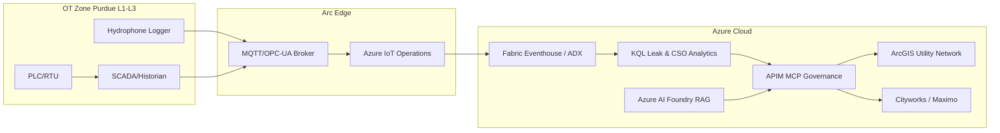
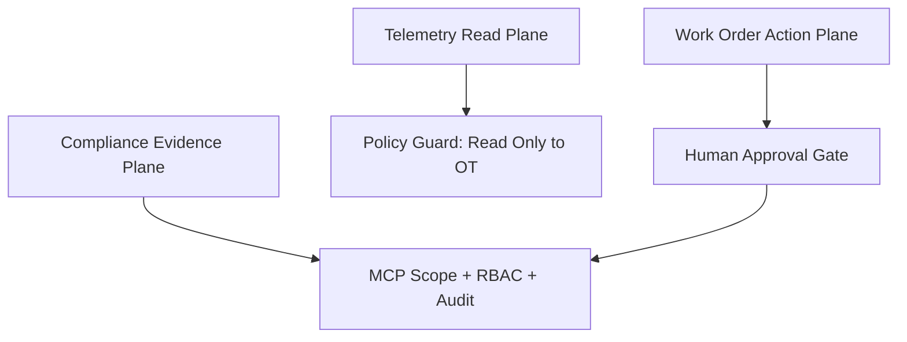

# 市政供水与污水处理智能体选型 FAQ：Azure IoT Operations + Fabric 实时水力数字孪生 vs Foundry 许可/化验合规 RAG vs ArcGIS/Cityworks/Maximo 工单治理平面

## 1. 问题定义：这不是电网 DERMS，也不是油气上游 EHS

本指南聚焦的是**城市供水与污水处理公用事业**。

典型组织是市政水务集团、区域排水管理局、跨县流域运营商。

其运行对象是加压管网、DMA 分区、泵站、阀门、污水厂、雨洪调蓄节点。

它的核心目标不是发电调度。

它的核心目标也不是井口作业风险。

它要解决的是：

- 非收益水（NRW）长期高企；
- 夜间最小流量（MNF）异常定位慢；
- 声学漏损告警误报高；
- 湿天气 CSO 报告压力大；
- PFAS 与 NPDES 合规证据链分散。

很多团队把“数据平台选型”与“监管闭环选型”混成一个项目。

这会导致架构责任边界失焦。

本指南把责任平面拆成三类：

- 运行平面：OT 遥测、MNF、漏损、泵阀状态；
- 合规平面：法规条款、许可条款、LIMS 证书、抽检记录；
- 执行平面：阀门隔离工单、现场派工、复核签批。

只有分层后，才可能在不触碰 OT 高风险控制边界的前提下实现自治增效。

## 2. 监管与 OT 安全硬边界：AWIA + ISA/IEC 62443 + Purdue 分层

市政水务系统对“云端直接控制工艺设定值”极度敏感。

这是公共健康风险，不是普通 IT 自动化风险。

现实要求通常包括：

- Purdue Level 1–3 现场控制层隔离；
- 从云到 PLC/RTU 的写入路径默认禁止；
- 对加氯、混凝剂、高扬程泵等动作实施双人审批与本地联锁；
- 事故态下优先本地 DCS/SCADA 手动接管；
- 关键 OT 网络维持单向数据上送或严格代理。

在美国语境下，AWIA 强调风险评估与韧性计划。

NPDES 对排放报表与越限事件留痕提出明确要求。

PFAS（如 PFOA/PFOS）在饮用水场景下阈值极低。

这意味着“证据链完整性”必须和“实时告警准确性”并重。

架构评审时必须写清楚：

哪些能力可自动执行。

哪些能力只可建议，不可执行。

哪些能力必须由值班长或工艺工程师签批。

这条分界线是所有选型的第一优先级。

## 3. 三种候选路径：A、B、C 的边界先行

### Option A：孤岛式水力/SCADA 厂商分析套件

代表模式是各自独立的水力分析平台和监控分析模块。

优点是本地团队熟悉。

部署快。

短期改造阻力小。

缺点是：

- 跨系统证据汇聚弱；
- 合规语义问答能力不足；
- 与 ArcGIS/工单系统联动割裂；
- 难以形成统一 FinOps 与审计闭环。

### Option B：Purdue 分段的 Azure 组合平面

构成是：

- Azure IoT Operations（Arc 边缘）承接 OPC-UA/MQTT 上送；
- Fabric Eventhouse/ADX 做 DMA 与声学流式分析；
- Foundry 承担许可条款与化验文档 RAG；
- APIM 治理 ArcGIS Utility Network 与 Cityworks/Maximo MCP 工具访问。

优点是层次清晰、治理统一、跨域联动完整。

挑战是前期架构治理与数据契约建设投入较高。

### Option C：云端 Agent 直接写 SCADA 设定值

该路径在公共事业高风险场景下通常应定义为**禁止路线**。

它可能提升“表面自动化速度”。

但会破坏安全联锁、职责分离与事故问责链条。

对于加氯与排放关键动作，直接云写入极易触发监管与安全红线。

本指南将其标记为 Not for。

## 4. 12 维选型矩阵：能力、风险、成本与运维复杂度一体比较

| 维度 | Option A：孤岛分析套件 | Option B：Azure 分层联动 | Option C：云端直写 SCADA |
|---|---|---|---|
| OT 安全边界一致性 | 中 | 高 | 极低 |
| NRW 漏损定位速度 | 中 | 高 | 中 |
| PFAS/NPDES 证据可追溯 | 低-中 | 高 | 低 |
| 跨系统工单闭环 | 低 | 高 | 中 |
| 审计可解释性 | 中 | 高 | 低 |
| 部署初期复杂度 | 低 | 中-高 | 中 |
| 长期治理复杂度 | 高 | 中 | 高 |
| 实时分析扩展性 | 中 | 高 | 中 |
| 误报治理空间 | 中 | 高 | 低 |
| 三年 TCO 可控性 | 中 | 高 | 低 |
| 监管接受度 | 中 | 高 | 极低 |
| 推荐结论 | 过渡可用 | 首选 | 禁止 |

矩阵结论不是“哪个最先进”。

而是“哪个在公共健康风险下可被持续审计与运营”。

## 5. 参考架构：从 OT 只读上送到工单闭环，不跨越危险写边界



该图强调：

云端做分析与建议。

执行动作通过治理网关进入工单系统。

不直接越过 OT 写边界。

## 6. 数据与控制平面分离：读多写少、写必审批



架构审查清单中应明确：

- 读取路径是否只读；
- 告警建议是否被误当成控制命令；
- 工单 API 是否做最小权限；
- 回写动作是否具备审批与留痕。

这类“流程安全设计”比模型分数更关键。

## 7. 生产级片段：MNF 漏损分诊 KQL 与只读工单策略

### 7.1 KQL：DMA 夜间最小流量 + 声学异常联合评分

```kusto
let night_window = 1h;
let baseline_days = 21d;
let mnf_baseline =
    TelemetryFlow
    | where Timestamp > ago(baseline_days)
    | where HourOfDay between (1 .. 4)
    | summarize p50_mnf = percentile(FlowLps, 50), p95_mnf = percentile(FlowLps, 95) by DMAId;
let latest_mnf =
    TelemetryFlow
    | where Timestamp > ago(night_window)
    | where HourOfDay between (1 .. 4)
    | summarize cur_mnf = percentile(FlowLps, 50) by DMAId;
let acoustic =
    AcousticEvents
    | where Timestamp > ago(night_window)
    | summarize acoustic_score = avg(LeakLikelihood), acoustic_events = count() by DMAId;
latest_mnf
| join kind=inner mnf_baseline on DMAId
| join kind=leftouter acoustic on DMAId
| extend mnf_delta_pct = 100.0 * (cur_mnf - p50_mnf) / iif(p50_mnf == 0.0, 1.0, p50_mnf)
| extend acoustic_score = coalesce(acoustic_score, 0.0)
| extend priority = case(mnf_delta_pct > 22 and acoustic_score > 0.75, "P1",
                         mnf_delta_pct > 15 and acoustic_score > 0.60, "P2",
                         mnf_delta_pct > 10, "P3", "P4")
| project DMAId, cur_mnf, p50_mnf, p95_mnf, mnf_delta_pct, acoustic_score, acoustic_events, priority
| order by priority asc, mnf_delta_pct desc
```

### 7.2 APIM 策略：只允许查询与工单创建，禁止 OT 设定值直写

```xml
<policies>
  <inbound>
    <base />
    <validate-jwt header-name="Authorization" require-scheme="Bearer" />
    <choose>
      <when condition="@(!context.Principal.Claims.Any(c => c.Type == &quot;roles&quot; &amp;&amp; c.Value == &quot;utility.workorder.write&quot;))">
        <return-response>
          <set-status code="403" reason="missing utility.workorder.write role" />
        </return-response>
      </when>
    </choose>
    <choose>
      <when condition="@(context.Request.Url.Path.Contains(&quot;/scada/setpoint&quot;))">
        <return-response>
          <set-status code="403" reason="direct cloud-to-scada setpoint writes are blocked" />
        </return-response>
      </when>
    </choose>
  </inbound>
  <backend><base /></backend>
  <outbound><base /></outbound>
  <on-error><base /></on-error>
</policies>
```

这类策略在审计中非常关键。

它把“系统默认安全姿态”落到可执行网关规则。

## 8. Option A 深度分析：何时可作为过渡而非终态

Option A 适合预算受限且短期只求局部提效的团队。

例如某市先做单厂区漏损分析试点。

若缺少跨域数据治理能力，A 可降低起步风险。

但一旦进入监管审计与跨部门协同阶段，A 的结构性短板会放大：

- 数据口径重复定义；
- 合规解释依赖人工汇总；
- 工单与分析结果无法自动映射；
- 事故复盘成本高。

因此 A 更适合作为“局部试点跳板”。

不建议作为五年主架构终态。

## 9. Option B 深度分析：为何是大多数城市水务的首选路线

Option B 的关键不是“把所有系统搬上云”。

而是把职责分层并通过治理网关粘合。

在该模型中：

- OT 负责实时控制与联锁；
- 云负责模式识别、监管映射、资源调度；
- 工单系统负责执行闭环与责任留痕。

对 4,200 DMA 级别的城市网络，B 的优势体现在：

- 夜间告警优先级可自动排序；
- 阀门隔离建议可直接挂到 GIS 拓扑；
- 现场班组可在 Cityworks/Maximo 获取最短处置路径；
- 合规问答可引用具体许可条款与化验证书段落。

这会显著缩短“发现—确认—派工—复核”全链路时间。

## 10. Option C 风险评估：为什么必须写入企业禁用清单

Option C 常被误包装成“更智能的自治”。

但在水务场景，云端 Agent 直写关键设定值的风险不可接受。

风险类型包括：

- 误触发化学加药偏置；
- 泵站异常联动；
- 人员误判自动执行结果；
- 责任归属不清导致事故后追责困难。

即便技术上能做，也不代表合规上可做。

架构委员会应将其定义为红线：

仅允许建议。

禁止直接控制。

## 11. Azure 资源规模与三年 TCO：给采购和财务可落地数字

### 11.1 规模假设

- 15,000+ km 管网；
- 4,200 DMA；
- 38,000 声学采样点；
- 22 座污水处理核心站；
- 每日 1.8 TB 时序与事件数据；
- 每月 120,000 条工单事件；
- 每周 2,500 次监管问答检索。

### 11.2 Option A 粗略成本

- 厂商分析许可与维护：`$210k/month`
- 数据集成与手工对账：`$46k/month`
- 合规与审计加班成本：`$28k/month`
- 合计：`$284k/month`
- 三年：`$10.22M`

### 11.3 Option B 粗略成本

- Arc 边缘与 IoT Operations：`$88k/month`
- Fabric Eventhouse/ADX + 存储：`$74k/month`
- Foundry RAG 与推理：`$39k/month`
- APIM + 安全治理：`$21k/month`
- GIS/工单联动与平台运维：`$44k/month`
- 合计：`$266k/month`
- 三年：`$9.58M`

### 11.4 Option C 粗略成本（含风险溢价）

- 平台运行与模型成本：`$232k/month`
- 安全审计与补偿控制：`$71k/month`
- 风险准备金（估算）：`$95k/month`
- 合计：`$398k/month`
- 三年：`$14.33M`

结论：C 不是便宜路线。

它是高风险高不确定路线。

## 12. 场景一：都会区 4,200 DMA NRW 漏损定位与阀门隔离闭环

业务目标：

- 把大漏定位时间从 9.5 小时降到 2.2 小时；
- 把误派工率从 28% 降到 11%；
- 把夜间漏损告警确认时长从 72 分钟降到 18 分钟。

架构落地：

- Edge 采集水压、流量、声学摘要；
- Eventhouse 做分钟级流式聚合；
- KQL 计算 MNF 偏移与声学联合评分；
- APIM 调用 ArcGIS Utility Network 做上游阀门追踪；
- 工单下发至 Cityworks，并关联风险标签。

治理机制：

- P1 工单必须双签；
- 现场回传照片与关阀时间；
- 复盘记录自动归档至事件簿。

## 13. 场景二：区域污水局 CSO 合规与 4.0 ppt PFAS 证据自动化

业务目标：

- 暴雨期 CSO 事件上报时效从 T+24h 缩短到 T+4h；
- NPDES 证据整编人天降低 46%；
- PFAS 趋势偏移预警提前 5–7 天。

架构落地：

- 污水厂 SCADA 事件进入统一时序流；
- LIMS 证书（含 PFAS 检测）通过文档管道进入 RAG；
- Foundry 生成“条款-证据-结论”三段式草稿；
- 合规人员在审批台完成终审；
- 审批后仅发布报告，不触发控制动作。

关键收益：

- 报告一致性显著提升；
- 审计问询响应更快；
- 合规团队与运维团队沟通摩擦降低。

## 14. 深度量化问答（Q&A）

### Q1：MNF 偏移阈值应如何设定？

建议先按历史季节分层建模。

初始阈值可设在 `10%/15%/22%` 三档。

上线后按误报与漏报成本做月度校准。

### Q2：声学告警与流量异常冲突时如何优先级排序？

采用联合评分而非单指标。

当流量偏移高但声学弱时列为 P2/P3 巡检。

当两者同时高时列为 P1 紧急处置。

### Q3：PFAS 证据 RAG 会不会替代人工签发？

不会。

RAG 负责证据聚合与条款映射。

签发责任仍归属合规责任人。

### Q4：为何不把 ArcGIS 与工单系统直接暴露给任意 Agent？

因为最小权限和审计可追溯要求不可放松。

必须通过 APIM 做 scope、角色、速率、审计统一治理。

### Q5：边缘离线时系统如何退化运行？

本地 SCADA 继续自治。

边缘缓存摘要，链路恢复后补传。

云端分析仅在数据可用后补算，不阻断现场操作。

### Q6：三年预算审查最容易忽略什么？

最容易忽略的是“误报导致的工单浪费”和“审计补证人工成本”。

这两项在 Option B 下通常可显著下降。

### Q7：如何衡量架构是否真正改善公共服务？

建议看四个指标：

- NRW 百分比下降幅度；
- 重大漏损平均处置时长；
- CSO 报告准时率；
- PFAS 趋势异常提前发现率。

## 15. 五步落地与 Good fit / Not for

**步骤一：先定边界，不先定模型。**

明确“可建议动作”与“可执行动作”的组织边界。

**步骤二：建设只读 OT 数据上送与标准化事件语义。**

统一 DMA、阀门、泵站、化验批次等主数据标识。

**步骤三：建立合规证据知识底座。**

把 NPDES、SDWA、AWIA、SOP、LIMS 文档形成可追溯检索链。

**步骤四：把建议转工单，而不是转控制命令。**

用 ArcGIS 拓扑和 Cityworks/Maximo 流程完成执行闭环。

**步骤五：季度治理评审。**

每季度同时复盘安全、合规、成本与服务指标。

### Good fit

- 大中型市政水务与排水集团；
- 具备 OT/IT 协同治理机制；
- 对审计可解释性有明确要求。

### Not for

- 追求“无审批直写控制”的组织；
- 没有基础资产台账与工单流程的团队；
- 无法保障最小权限与审计留痕的环境。

### 收官建议

对于市政供排水智能体，正确目标不是“让模型替代调度员”。

正确目标是“在不突破公共安全红线的前提下，把发现、解释、派工、复核做得更快、更准、更可审计”。
