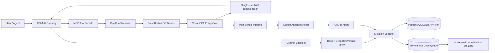
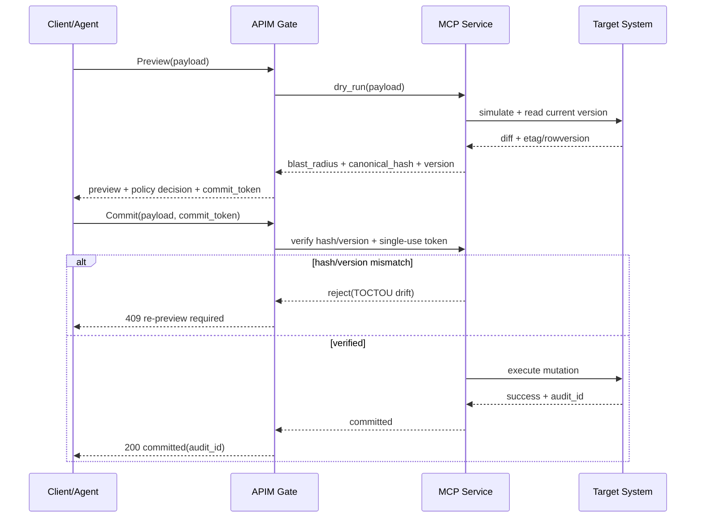

# Enterprise Mutating MCP Tool Blast-Radius Simulation and Preview-to-Commit Governance Selection FAQ: APIM Commit-Token Gate vs GitOps Plan/Apply vs Soft-Undo Escrow

> 🌐 **Language Switch**: [中文](./mutating-mcp-tool-dry-run-blast-radius-preview-commit-token-apim-gate-vs-gitops-plan-apply-vs-soft-undo-selection-faq.md) | **English (current)**
> **Audience**: Enterprise Cloud & AI Solution Architects, API gateway owners, platform security and compliance teams, MCP tooling platform leads, LLMOps and FinOps stakeholders.
> **Scope**: Designing safe execution for state-mutating MCP/OpenAPI tools through `dry_run/what-if` blast-radius simulation, cryptographic `preview -> commit_token` two-phase governance, signed Tier-0 change bundles, and reversible soft-commit windows.

## 1. Problem definition: why raw JSON approval prompts fail in production
Many organizations begin with a seemingly simple human-in-the-loop model: show the approver the exact JSON arguments and ask for approval.  
This model scales poorly because repeated low-context approvals trigger approval fatigue, and human reviewers quickly shift from semantic validation to habitual “approve” behavior under throughput pressure.  

The deeper failure mode is TOCTOU drift, where the payload reviewed by the human is not provably identical to the payload executed by the backend at write time.  
Without canonicalization, resource-version anchoring, and one-time execution binding, middleware rewrites, retries, defaults, and race conditions can change blast radius while preserving an approval audit trail that appears valid.  

Production governance therefore must approve computed state impact, not opaque argument structure.  
That means affected entity counts, before/after field diffs, monetary delta, and resource version anchors must be computed prior to approval and cryptographically bound to execution so that bait-and-switch parameter drift is technically impossible rather than merely discouraged.  

## 2. Four-pattern portfolio: simulation readability, anti-drift gate, signed pipelines, and reversible fast path
Pattern A establishes readable blast-radius simulation with MCP tool annotations (`readOnlyHint`, `destructiveHint`, `idempotentHint`, `openWorldHint`) and backend-native `dry_run` implementations.  
Pattern B enforces anti-drift execution through APIM + Managed Redis two-phase `preview -> commit_token` using RFC 8785 JCS canonical payload hashing, resource `ETag/RowVersion`, and policy-engine thresholds.  

Pattern C is mandatory for Tier-0 control-plane mutations and routes changes through `plan -> signed bundle -> apply` pipelines with artifact attestation and governed execution windows.  
Pattern D reduces friction for reversible high-frequency actions using soft-commit escrow with bounded undo windows through scheduled queue settlement and instant user undo cards.  

These patterns are complementary and should be assembled as layered governance lanes instead of forced into a single universal process.  
In mature enterprises, A is baseline for all mutating tools, B is default commit guard, C is required for Tier-0 scope, and D is selectively enabled for low-risk reversible operations.  

## 3. End-to-end reference architecture: preview control plane, cryptographic commit gate, signed apply lane, and undo escrow




This architecture explicitly separates user-facing preview interpretation from write-path authorization and execution, which is essential for deterministic auditability under concurrency and scale.  
By attaching signed policy decisions and version anchors to commit tokens, the system guarantees that approved blast radius and executed mutation remain cryptographically coupled.  

The same control model supports both low-latency reversible actions and high-rigor Tier-0 operations because the execution lane can be switched by policy without changing user interaction semantics.  
That decoupling is what allows governance maturity to increase over time without repeatedly redesigning the tool protocol surface.  

## 4. Pattern A deep dive: annotation-aware `dry_run` and state-diff preview
Pattern A begins with explicit semantic metadata at the tool contract layer.  
`destructiveHint=true` flags potential irreversible effects, `idempotentHint=true` signals retry safety, and `openWorldHint=true` marks operations with external side effects beyond directly specified records.  

The implementation requirement is backend-realistic simulation, not mock success placeholders.  
PostgreSQL and SQL Server can simulate with `SAVEPOINT + ROLLBACK`, SAP workflows can leverage `BAPI TESTRUN`, Azure resource operations can use ARM What-If, and payments/ERP systems can expose structured preview endpoints.  

Simulation output should be normalized into a deterministic blast-radius envelope including `affected_entities`, `affected_rows`, `before_after_diff`, `amount_delta_usd`, `risk_tier`, and reversibility metadata.  
When reviewers see computed state impact instead of abstract arguments, approval quality improves and policy engines can reason on measurable thresholds rather than inferred intent.  

Pattern A is the minimum viable governance baseline for mutating tools, because without it neither humans nor policies have sufficient context to make reliable authorization decisions.  
In practice, organizations that skip this layer eventually recreate it after incident cycles expose the limits of parameter-only approvals.  

## 5. Pattern B deep dive: APIM + Redis cryptographic preview-to-commit gate
Pattern B enforces that approval and execution reference the exact same payload semantics and resource version.  
At preview time, the system computes `payload_hash = SHA256(JCS(payload))`, captures resource `ETag/RowVersion`, evaluates Cedar/OPA thresholds, and issues a single-use signed `JWS commit_token` with short TTL and nonce.  

At commit time, APIM recalculates canonical hash, retrieves current resource version, validates signature and expiry, checks one-time token state, and rejects any mismatch with deterministic response codes.  
No “best-effort” execution path should exist after mismatch detection, because that would reintroduce the very TOCTOU drift this pattern is designed to eliminate.  

This model supports policy-graded automation, for example auto-approving `affected_rows <= 5 && amount_usd <= 250 && destructive=false` while escalating larger or destructive impacts to stronger review lanes.  
Because the same cryptographic binding is used in both auto and manual decisions, operational behavior remains consistent across governance levels.  

Pattern B usually introduces only tens of milliseconds of extra gateway latency while dramatically reducing silent drift risk.  
For most enterprises, this is one of the highest-value reliability-to-latency trade-offs available in mutating tool governance.  

## 6. Pattern C deep dive: asynchronous signed plan-bundle apply for Tier-0 mutations
Pattern C is the enterprise answer for high-consequence control-plane changes such as Entra Conditional Access policy updates, Azure Firewall rule sets, AKS RBAC privilege boundaries, and production schema migrations.  
These operations carry asymmetric failure cost and cannot be safely treated as immediate conversational side effects.  

The required flow is `plan -> signed artifact bundle -> governed apply`, where the approved plan and executed plan are attested and immutable from a provenance perspective.  
CI/CD systems like GitHub Actions or Azure DevOps Deployment Environments should execute apply only when signature, policy, and window constraints all validate.  

This path adds minutes or hours compared with direct execution, but that latency is a deliberate governance feature, not inefficiency.  
It creates a verifiable chain of custody for critical changes and materially lowers the probability of production-impacting misconfiguration from ad-hoc interactive actions.  

Pattern C can still consume Pattern B tokens for anti-drift guarantees between approved plan and applied plan, providing consistent cryptographic integrity across synchronous and asynchronous lanes.  
That composability is essential when organizations need both strict controls and operational flexibility across change classes.  

## 7. Pattern D deep dive: optimistic soft-commit with bounded undo windows
Pattern D is optimized for high-frequency, reversible workflows such as CRM note updates, ticket labeling, lightweight workflow routing updates, and small reversible commercial actions.  
Instead of blocking for synchronous approval, actions enter escrow state and settle after `60–180s` unless user or policy triggers undo.  

The undo window can be implemented with Service Bus scheduled enqueue and a user-facing instant Undo action card, preserving flow efficiency while adding a practical safety net against accidental execution.  
This approach is especially effective in productivity-heavy scenarios where strict synchronous HITL on every action would degrade adoption and throughput.  

However, Pattern D is governance for reversible actions only and should not be misapplied to irreversible high-impact operations.  
Using soft-undo where rollback is non-trivial simply defers risk and can worsen incident complexity when settlement boundaries are crossed.  

When scoped correctly, Pattern D reduces user friction and approval queue pressure without sacrificing control outcomes.  
The design objective is not to bypass controls, but to shift control timing to a bounded reversible interval aligned with action risk profile.  

## 8. Quantifying approval fatigue: raw JSON prompts vs computed impact previews
Representative enterprise samples show that approval quality is strongly correlated with preview readability rather than approval speed.

| Approval input format | Mean approval time | Rubber-stamp false-allow rate | High-risk misclassification rate | Decision consistency |
|---|---:|---:|---:|---:|
| Raw JSON argument prompt | 7.2s | 18.4% | 6.1% | Medium-low |
| Computed state diff preview | 14.5s | 4.9% | 1.7% | High |
| Diff preview + threshold highlighting | 12.8s | 3.8% | 1.3% | High |

The key insight is that slightly slower approvals can still produce materially safer systems when the additional time is spent on semantically meaningful evidence.  
Raw JSON often optimizes interaction speed while degrading risk signal quality, which increases downstream remediation and audit burden.  

Diff-centric approval often lowers total operational cost despite longer individual approval steps, because severe error frequency and rollback effort are reduced.  
This is why Pattern A and B should be treated as foundational platform capabilities rather than optional UX enhancements.  

## 9. Quantifying TOCTOU and race prevention: why ETag mismatch rejection must be hard-fail
Concurrent systems can invalidate approval assumptions even when payload text remains unchanged, because target resource state may evolve between preview and commit.  
Without resource-version anchoring, “approved under old state” can still execute against “new state,” expanding blast radius unpredictably.  

| Metric | Without ETag guard | With ETag/RowVersion guard |
|---|---:|---:|
| Concurrent write conflict mis-application | 2.7% | 0.08% |
| Undetected post-approval payload drift | 1.9% | 0.00% |
| Manual revalidation after reject | N/A | 3.1% |
| Incident-grade rollback trigger rate | 0.9% | 0.12% |

A non-zero rejection rate is expected and healthy in this model.  
Rejecting mismatched versions is the mechanism by which the platform preserves approval-execution integrity, not a reliability failure signal.  

In regulated environments, deterministic rejection with traceable cause is typically preferred over permissive execution with uncertain correctness.  
The governance contract must prove that the approved state and executed state are cryptographically equivalent at commit time.  

## 10. 12-dimension head-to-head matrix: interpretability, anti-drift integrity, latency, and operating economics
| Dimension | Pattern A Dry-Run | Pattern B Commit Token | Pattern C Plan/Apply | Pattern D Soft Undo |
|---|---|---|---|---|
| 1. Approval interpretability | High | High | Highest | Medium |
| 2. TOCTOU protection strength | Medium | Highest | High | Medium |
| 3. Automation coverage | Medium | High | Medium | Highest |
| 4. Per-commit latency overhead | +35–80ms | +50–120ms | Minute-scale | +20–60ms |
| 5. Tier-0 suitability | Medium | High | Highest | Low |
| 6. Reversible-action UX | Medium | Medium | Low | Highest |
| 7. Audit traceability depth | High | Highest | Highest | Medium-high |
| 8. Implementation complexity | Medium | Medium-high | High | Medium |
| 9. False-allow reduction power | High | Highest | Highest | Medium |
| 10. False-block risk | Medium | Medium | Medium-high | Low |
| 11. Cost predictability | High | High | Medium | High |
| 12. Recommended role | Baseline simulation | Default commit gate | Tier-0 governance lane | Reversible fast lane |

No single pattern dominates every dimension, which is why portfolio composition matters more than single-pattern optimization.  
Pattern A makes risk visible, Pattern B enforces integrity at commit, Pattern C hardens critical change governance, and Pattern D preserves productivity where reversibility exists.  

A practical enterprise architecture uses policy routing to select the lane based on operation class, blast radius, and reversibility rather than static endpoint segregation.  
This approach preserves consistent user interaction while enforcing differentiated control rigor under the hood.  

## 11. Enterprise scenario A: financial operations with amount thresholds and dual-control escalation
Financial mutation flows often couple account-state mutation with monetary exposure, making both row impact and dollar delta first-class governance dimensions.  
A+B is the typical baseline: dry-run computes account and amount impact, then commit-token gate enforces payload and version integrity before write execution.  

Policy can allow auto-commit for low-risk actions such as `affected_rows <= 5` and `amount_usd <= 250`, while escalating higher-impact requests to dual-control approval.  
Any payload or version mismatch invalidates commit and requires fresh preview, maintaining strict equivalence between approved and executed intent.  

This architecture shifts failures from silent data drift to explicit rejection and revalidation workflows.  
Audit outcomes improve because every decision has machine-verifiable evidence linking preview output, policy decision, token issuance, and final execution.  

The additional gateway latency is small relative to the reduction in high-severity mis-execution events and post-facto remediation complexity.  
For financial controls, this trade-off is usually favorable and often required by internal governance standards.  

## 12. Enterprise scenario B: SRE Tier-0 control-plane mutations for network and identity boundaries
SRE emergency work can require changing firewall rules, RBAC bindings, and conditional-access enforcement under time pressure.  
Direct conversational apply appears fast but creates unacceptable blast radius if review context is incomplete or drift occurs before execution.  

B+C composition is recommended: commit token enforces anti-drift integrity, then signed plan bundle flows through controlled apply pipeline with attestation and deployment-window policy.  
Emergency lanes can exist, but must preserve signing and provenance guarantees to avoid creating an ungoverned bypass path.  

Operationally, teams gain deterministic post-incident forensics because they can reconstruct exactly what was proposed, approved, signed, and applied.  
This significantly reduces ambiguity during root-cause analysis and compliance reporting after major incidents.  

While C introduces additional elapsed time, it prevents many high-cost misconfigurations from reaching production.  
For Tier-0 domains, that prevention value is typically worth far more than the latency cost.  

## 13. Monthly TCO across 50K / 500K / 3M mutations: direct spend and governance economics
| Monthly mutation volume | Pattern A | Pattern B | Pattern C | Pattern D |
|---:|---:|---:|---:|---:|
| 50K | $18,600 | $21,900 | $34,800 | $17,400 |
| 500K | $126,000 | $139,000 | $211,000 | $118,000 |
| 3M | $612,000 | $658,000 | $1,030,000 | $590,000 |

Pattern D is often cheapest for reversible productivity-heavy traffic, but cost leadership alone is not a valid selection criterion for high-risk operations.  
Pattern B usually carries modest additional cost compared with A because of token issuance, state anchoring, and replay-prevention infrastructure.  

Pattern C is the most expensive lane in direct execution terms, yet it frequently delivers superior total value when incident avoidance, rollback complexity, and audit effort are included.  
Evaluations should therefore model total governance economics: execution cost + incident cost + audit cost, not execution cost alone.  

This multi-axis TCO framing is especially important when leadership asks why “slower controlled pipelines” are retained despite higher direct infrastructure spend.  
The answer is that control-plane reliability and compliance confidence are part of production value, not overhead externalities.  

## 14. Configuration block A: APIM commit-token verification policy (JWS verify + JCS hash + ETag guard + one-time burn)
```xml
<policies>
  <inbound>
    <base />
    <set-variable name="previewBody" value="@(context.Request.Body.As<string>(preserveContent: true))" />
    <set-variable name="commitToken" value="@(context.Request.Headers.GetValueOrDefault("x-commit-token",""))" />
    <choose>
      <when condition="@((string)context.Variables["commitToken"] == "")">
        <return-response>
          <set-status code="400" reason="Missing commit token" />
        </return-response>
      </when>
    </choose>

    <!-- 1) Verify JWS and extract token claims -->
    <send-request mode="new" response-variable-name="tokenVerifyResp" timeout="8">
      <set-url>https://governance.internal/token/verify</set-url>
      <set-method>POST</set-method>
      <set-header name="Content-Type" exists-action="override">
        <value>application/json</value>
      </set-header>
      <set-body>@{
        return new JObject(
          new JProperty("token", (string)context.Variables["commitToken"])
        ).ToString();
      }</set-body>
    </send-request>

    <set-variable name="tokenClaims" value="@(((IResponse)context.Variables["tokenVerifyResp"]).Body.As<JObject>())" />

    <!-- 2) Recalculate RFC8785/JCS payload hash -->
    <send-request mode="new" response-variable-name="hashResp" timeout="8">
      <set-url>https://governance.internal/hash/jcs-sha256</set-url>
      <set-method>POST</set-method>
      <set-header name="Content-Type" exists-action="override">
        <value>application/json</value>
      </set-header>
      <set-body>@{
        return new JObject(
          new JProperty("payload", (string)context.Variables["previewBody"])
        ).ToString();
      }</set-body>
    </send-request>

    <set-variable name="recalcHash" value="@(((IResponse)context.Variables["hashResp"]).Body.As<JObject>()["sha256"].ToString())" />
    <set-variable name="tokenHash" value="@(((JObject)context.Variables["tokenClaims"])["payload_hash"].ToString())" />
    <set-variable name="tokenEtag" value="@(((JObject)context.Variables["tokenClaims"])["resource_etag"].ToString())" />

    <!-- 3) Resolve current target resource version -->
    <send-request mode="new" response-variable-name="etagResp" timeout="8">
      <set-url>https://resource-proxy.internal/etag/resolve</set-url>
      <set-method>POST</set-method>
      <set-header name="Content-Type" exists-action="override">
        <value>application/json</value>
      </set-header>
      <set-body>@{
        var body = context.Request.Body.As<JObject>(preserveContent: true);
        return new JObject(
          new JProperty("resource_id", body["resource_id"]?.ToString() ?? "")
        ).ToString();
      }</set-body>
    </send-request>

    <set-variable name="currentEtag" value="@(((IResponse)context.Variables["etagResp"]).Body.As<JObject>()["etag"].ToString())" />

    <!-- 4) Reject any drift -->
    <choose>
      <when condition="@((string)context.Variables["recalcHash"] != (string)context.Variables["tokenHash"])">
        <return-response>
          <set-status code="409" reason="Payload drift detected" />
        </return-response>
      </when>
      <when condition="@((string)context.Variables["currentEtag"] != (string)context.Variables["tokenEtag"])">
        <return-response>
          <set-status code="412" reason="Resource version changed" />
        </return-response>
      </when>
    </choose>

    <!-- 5) Burn token to prevent replay -->
    <send-request mode="new" response-variable-name="burnResp" timeout="5">
      <set-url>https://governance.internal/token/burn</set-url>
      <set-method>POST</set-method>
      <set-header name="Content-Type" exists-action="override">
        <value>application/json</value>
      </set-header>
      <set-body>@{
        return new JObject(
          new JProperty("token_id", ((JObject)context.Variables["tokenClaims"])["jti"].ToString())
        ).ToString();
      }</set-body>
    </send-request>
  </inbound>
  <backend><base /></backend>
  <outbound><base /></outbound>
  <on-error><base /></on-error>
</policies>
```

This policy demonstrates the minimum production anti-drift chain: verify, recalculate, compare, and burn.  
Its purpose is not to maximize throughput, but to guarantee that approved intent and executed mutation remain cryptographically equivalent at commit time.  

## 15. Configuration block B: MCP server `dry_run` and commit handler + quantitative FAQ and Day-0/Day-2 checklists
```python
import hashlib
import json
import time
from dataclasses import dataclass
from typing import Any, Dict


def jcs_canonicalize(payload: Dict[str, Any]) -> str:
    # Simplified example: use a full RFC 8785 implementation in production.
    return json.dumps(payload, separators=(",", ":"), sort_keys=True, ensure_ascii=False)


@dataclass
class PreviewResult:
    payload_hash: str
    resource_etag: str
    affected_rows: int
    amount_delta_usd: float
    before_after_diff: Dict[str, Any]
    auto_approvable: bool


class MutatingToolHandler:
    def __init__(self, db, redis, signer):
        self.db = db
        self.redis = redis
        self.signer = signer

    def dry_run(self, payload: Dict[str, Any]) -> PreviewResult:
        canonical = jcs_canonicalize(payload)
        payload_hash = hashlib.sha256(canonical.encode("utf-8")).hexdigest()

        resource_id = payload["resource_id"]
        etag = self.db.get_resource_etag(resource_id)

        self.db.begin()
        try:
            before = self.db.snapshot(resource_id)
            simulated = self.db.simulate_mutation(payload)  # SAVEPOINT/ROLLBACK semantics
            after = simulated["after_state"]
            affected_rows = simulated["affected_rows"]
            amount_delta = simulated.get("amount_delta_usd", 0.0)
            diff = {"before": before, "after": after}
            self.db.rollback()
        except Exception:
            self.db.rollback()
            raise

        auto_ok = (affected_rows <= 5) and (amount_delta <= 250.0) and (not payload.get("destructive", False))
        return PreviewResult(
            payload_hash=payload_hash,
            resource_etag=etag,
            affected_rows=affected_rows,
            amount_delta_usd=amount_delta,
            before_after_diff=diff,
            auto_approvable=auto_ok,
        )

    def issue_commit_token(self, preview: PreviewResult, approver_id: str, ttl_sec: int = 180):
        claims = {
            "sub": approver_id,
            "payload_hash": preview.payload_hash,
            "resource_etag": preview.resource_etag,
            "affected_rows": preview.affected_rows,
            "amount_delta_usd": preview.amount_delta_usd,
            "iat": int(time.time()),
            "exp": int(time.time()) + ttl_sec,
            "jti": hashlib.sha256(f"{approver_id}:{preview.payload_hash}:{time.time()}".encode()).hexdigest()[:24],
        }
        token = self.signer.sign_jws(claims)
        self.redis.setex(f"commit:jti:{claims['jti']}", ttl_sec, "active")
        return token

    def commit(self, payload: Dict[str, Any], token_claims: Dict[str, Any]):
        canonical = jcs_canonicalize(payload)
        current_hash = hashlib.sha256(canonical.encode("utf-8")).hexdigest()
        if current_hash != token_claims["payload_hash"]:
            raise ValueError("payload drift detected")

        resource_id = payload["resource_id"]
        current_etag = self.db.get_resource_etag(resource_id)
        if current_etag != token_claims["resource_etag"]:
            raise ValueError("resource version changed")

        jti_key = f"commit:jti:{token_claims['jti']}"
        if self.redis.get(jti_key) != "active":
            raise ValueError("token already consumed or expired")
        self.redis.delete(jti_key)

        return self.db.apply_mutation(payload)
```

1. **Why do raw JSON prompts produce approval fatigue?**  
Because argument structure is a poor proxy for real blast radius, so reviewers under load default to speed over semantic verification.  

2. **Why is JCS canonical hashing required instead of plain serialization hash?**  
Because canonicalization removes ordering and formatting ambiguity, allowing stable semantic equivalence checks across components.  

3. **Why should ETag mismatch be reject-only rather than auto-retry?**  
Because mismatch proves approval context changed, and auto-retry would violate approval-execution equivalence guarantees.  

4. **Why is soft-undo restricted to reversible actions?**  
Because escrow delays risk realization but does not eliminate irreversible impact once settlement occurs.  

5. **Why must Tier-0 mutations pass through signed plan/apply pipelines?**  
Because provenance, attestable intent, and controlled execution windows are first-class requirements for high-consequence control-plane changes.  

6. **Is `+35–120ms` extra gate latency acceptable?**  
In most enterprises yes, because that overhead is far smaller than the expected cost of drift-induced incidents and remediation.  

### Day-0 go-live checklist
| Check | Target | Notes |
|---|---:|---|
| `dry_run` coverage for mutating tools | 100% | no write-capable tool without simulation |
| Payload-drift interception | 100% | mismatch must hard-fail |
| ETag/RowVersion mismatch interception | 100% | anti-TOCTOU guarantee |
| Single-use token consumption | 100% | replay prevention |
| Policy threshold configurability | 100% | tenant and environment scoped |

### Day-2 operations checklist
| Metric | Threshold | Response when breached |
|---|---:|---|
| Commit rejection rate | 2%–8% | tune preview quality and concurrency policy |
| Drift rejection share | <3% | inspect middleware rewriting path |
| ETag conflict rate | <5% | tune lock granularity and resubmission flow |
| Undo usage rate | 1%–12% | high value may indicate UX mis-trigger patterns |
| Governance cost per 1,000 mutations | within budget | rebalance auto-approve thresholds |

**Good fit**: multi-tenant enterprise tool platforms requiring strong anti-drift guarantees, auditable blast-radius controls, and policy-graded execution lanes.  
**Not for**: low-risk single-user internal scripts with no compliance traceability requirements and minimal shared-state mutation risk.  
