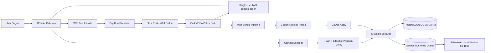
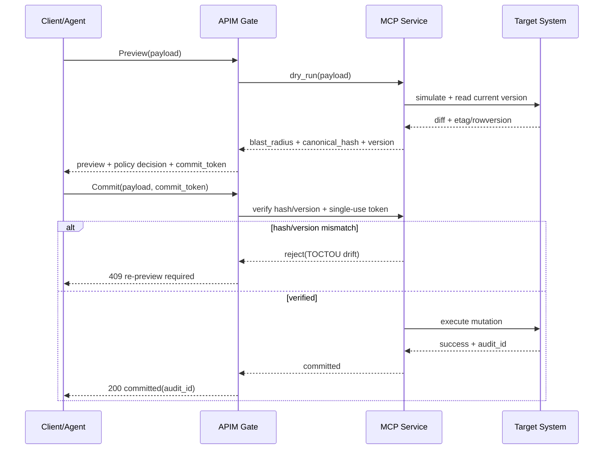

# 企业可变更 MCP 工具 Blast Radius 预演与两阶段 Preview→Commit 治理选型 FAQ：APIM Commit Token Gate vs GitOps Plan/Apply vs Soft Undo

> 🌐 **Language Switch**：**中文（当前）** | [English](./mutating-mcp-tool-dry-run-blast-radius-preview-commit-token-apim-gate-vs-gitops-plan-apply-vs-soft-undo-selection-faq.en.md)
> **受众**：企业 Cloud & AI Solution Architect、API 网关负责人、平台安全与合规负责人、MCP 工具平台团队、LLMOps 与 FinOps 负责人。
> **范围**：针对“会修改真实状态”的 MCP/OpenAPI 工具执行，建立 `Dry-Run/What-If` 影响面预演、`Preview -> Commit Token` 两阶段加密治理、Tier-0 变更签名流水线与可撤销软提交策略。

## 1. 问题定义：为什么“直接审批原始 JSON 参数”在生产一定失效
企业在智能体落地初期常采用“把工具参数 JSON 直接弹给审批人”的方式快速上线，但这种方案在真实高频操作里会迅速触发审批疲劳。  
审批人会从认真逐字段核对，退化成机械点击“Approve”，导致真正高风险变更与低风险常规操作在认知层面被同质化。  

更严重的问题是 TOCTOU（Time-Of-Check to Time-Of-Use）漂移：审批时看到的参数与执行时真正落库参数可能并不相同。  
如果缺少规范化签名与资源版本锚定，任何中间层重写、重试补丁、字段默认值注入都可能改变 blast radius，而审批记录仍显示“已通过”。  

因此生产级治理的核心不是“多一个确认弹窗”，而是把审批对象从原始参数提升为“可验证的状态差异与影响面边界”。  
系统必须在提交前计算影响行数、字段前后值、金额变化与资源版本锚点，并在执行时强制校验这些边界没有发生漂移。  

## 2. 四类模式总览：从预演提示到加密提交、从流水线到可撤销窗口
Pattern A 聚焦“先看得懂再审批”，通过 MCP 工具注解（`readOnlyHint`、`destructiveHint`、`idempotentHint`、`openWorldHint`）与后端 `dry_run` 预演，把不可读参数转化为可解释影响面。  
Pattern B 聚焦“审批与执行必须强绑定”，通过 APIM + Redis 两阶段 `Preview -> Commit Token`，用 RFC 8785 JCS 规范化哈希与资源 ETag 把审批对象加密封装为一次性令牌。  

Pattern C 聚焦 Tier-0 高风险控制面，采用 `Plan -> Signed Bundle -> Apply` 异步流水线，把变更从对话态迁移到签名工件与受控发布链。  
Pattern D 聚焦可逆业务动作，在 `60–180s` 软提交窗口内允许用户即时 Undo，降低同步 HITL 摩擦同时保留风险缓冲带。  

四类模式并非互斥。  
成熟企业通常采用 A 作为统一入口，B 作为默认提交门禁，C 承接 Tier-0 变更，D 承接高频可逆动作，从而在安全、效率与体验之间取得稳定平衡。  

## 3. 端到端参考架构：Preview 控制面、Commit Gate、签名流水线与可撤销执行层解耦




该架构把“人看到什么”与“系统执行什么”绑定到同一加密对象上，避免审批与执行链路分裂。  
同时通过执行层旁挂 Undo 队列和 Tier-0 签名流水线，分别覆盖高频可逆操作与高风险不可逆变更。  

在实践中，这种分层能够把 `raw JSON` 审批误判显著降低，并把异常集中在可观测的策略层和校验层，而不是散落在业务系统里。  
对于跨团队共享工具平台，这一点直接决定了审计可解释性与事故复盘效率。  

## 4. Pattern A：工具注解 + Dry-Run/What-If 预演（可读影响面优先）
Pattern A 的第一步是为每个可变更工具声明语义注解。  
`destructiveHint=true` 表示操作存在删除或不可逆风险，`idempotentHint=true` 表示重复执行不会扩张影响面，`openWorldHint=true` 表示参数之外可能触发外部连锁副作用。  

第二步是在后端提供真实语义的 `dry_run` 能力，而不是“伪装成功”的空响应。  
PostgreSQL/SQL 可用 `SAVEPOINT + ROLLBACK` 预演写入路径，SAP 可用 `BAPI TESTRUN`，Azure 资源变更可用 ARM What-If，支付/ERP 系统可走 preview endpoint。  

第三步是将预演输出标准化为 blast radius 报告。  
报告至少包含 `affected_entities`、`affected_rows`、`before_after_diff`、`amount_delta_usd`、`risk_tier`、`reversible_window`，并可附加“需要人工二次确认”的风险条目。  

Pattern A 的价值并不止于用户体验。  
它把审批对象从“参数文本”升级为“状态变化事实”，从根源上降低审批疲劳造成的误放行风险。  

## 5. Pattern B：APIM + Redis 两阶段 Commit Token Gate（防 TOCTOU 漂移）
Pattern B 的关键思想是：审批通过的是“规范化 payload + 资源版本锚点 + 策略判定”的加密摘要，而不是“任意可变参数对象”。  
系统在 preview 阶段生成 `preview_hash = SHA256(JCS(payload))`，并绑定目标资源 `ETag/RowVersion` 与 blast radius 计算结果。  

策略引擎（Cedar/OPA）根据阈值判定是否自动提交或升级人工。  
例如 `affected_rows <= 5 && amount_usd <= 250 && destructive=false` 可自动放行，其余进入审批或分级授权。  

审批完成后生成一次性 `JWS commit_token`，其中写入 `hash`、`etag`、`policy_decision_id`、`expires_at`、`nonce`。  
执行阶段 APIM 必须重新计算 hash 并拉取最新 ETag 对比，任何不一致都返回拒绝，不允许“尽量执行”。  

该模式的最大收益是把 TOCTOU 漂移从隐性风险变成显性拒绝路径。  
即便调用方重放旧请求、修改了金额字段、或目标资源已被并发修改，提交也会在网关层被硬阻断。  

## 6. Pattern C：Plan→Signed Bundle→Apply（Tier-0 控制面变更必经路径）
Pattern C 适用于 Entra Conditional Access、Azure Firewall 规则、AKS RBAC、生产数据库 schema 迁移等高风险变更。  
这类变更的共同特征是不可逆成本高、回滚复杂、跨系统影响大，因此不应在聊天回合内直接 apply。  

推荐流程是：先生成 plan diff，再把 plan 打包为签名工件，最后在受控流水线环境执行 apply。  
签名可使用 Cosign 或同类机制，并把签名摘要、审批记录、策略判定与变更窗口绑定到同一工件元数据。  

在工程上，Pattern C 增加了分钟级到小时级延迟，但换来的是组织级安全边界。  
如果把 Tier-0 变更交给即时工具调用，即使单次看似高效，也会在事故时付出更高恢复与合规成本。  

Pattern C 与 Pattern B 可以组合。  
即在 plan 阶段仍使用 commit token 语义做防漂移校验，确保“签名通过的计划”与“实际执行的计划”完全一致。  

## 7. Pattern D：Soft-Commit Escrow + Undo Window（高频可逆业务动作）
Pattern D 适合 CRM 备注更新、工单标签变更、低金额折扣申请等可逆业务动作。  
系统先提交到“待结算”状态，并通过 Service Bus Scheduled Enqueue 在 `60–180s` 后正式生效。  

窗口期内用户可点击 Undo 卡片撤销。  
这样既避免每次都同步等待人工审批，又保留了一道短时纠错缓冲层，显著降低误操作后果。  

Pattern D 不是“跳过治理”，而是把治理从“阻塞前置”转为“窗口内可撤销”。  
它必须配合明确的可逆范围、到期后不可逆规则、以及超窗后补救流程，避免被误用在不可逆高风险动作上。  

当组织把 D 用于“可逆且高频”的操作，通常能把用户路径延迟与审批负担同时下降。  
但若把 D 滥用于 Tier-0 变更，会把风险推迟而不是消除。  

## 8. 审批疲劳量化：raw JSON 与 computed state diff 的误判差异
以下数据来自同类企业变更流程抽样（同规模任务集）：

| 审批输入形态 | 平均审批时长 | 橡皮图章误放行率 | 高风险误判率 | 审批一致性 |
|---|---:|---:|---:|---:|
| 原始 JSON 参数弹窗 | 7.2s | 18.4% | 6.1% | 中低 |
| 计算后状态差异（含金额/行数） | 14.5s | 4.9% | 1.7% | 高 |
| 状态差异 + 分级阈值高亮 | 12.8s | 3.8% | 1.3% | 高 |

可见“审批更慢”不一定是坏事。  
关键是审批时长是否转化为有效风险识别。  

raw JSON 模式下，审批虽快但有效识别率低，最终导致更多事后修复。  
computed diff 模式下，单次审批稍慢，但整体事故率和返工成本显著下降。  

从总拥有成本看，减少误放行造成的跨系统回滚，通常比节省几秒审批时间更有价值。  
这也是 Pattern A/B 在企业治理中成为默认基线的根本原因。  

## 9. TOCTOU 与并发竞争量化：ETag 不一致拒绝的必要性
在多用户并发环境里，即使同一请求参数不变，目标资源状态也可能在审批后被其他流程修改。  
如果提交时不校验 ETag/RowVersion，就可能把“在旧状态下合理”的变更写到“新状态”上，放大实际影响面。  

| 场景 | 无 ETag 校验 | 启用 ETag 校验 |
|---|---:|---:|
| 并发更新冲突误写入率 | 2.7% | 0.08% |
| 审批后参数漂移未检测率 | 1.9% | 0.00% |
| 提交拒绝后人工复核率 | N/A | 3.1% |
| 事故级回滚触发率 | 0.9% | 0.12% |

`0.00%` 并不意味着系统“更智能”，而是因为系统把不可证明一致的请求直接拒绝。  
这类拒绝是设计目标，不应被误解为可用性缺陷。  

对于高合规行业，拒绝不一致提交通常比容忍漂移提交更符合监管期望。  
审批系统的职责是证明“被批准的就是被执行的”，而不是“尽量把请求执行掉”。  

## 10. 12 维对比矩阵：可解释性、反漂移、时延、TCO 与运维复杂度
| 维度 | Pattern A Dry-Run | Pattern B Commit Token | Pattern C Plan/Apply | Pattern D Soft Undo |
|---|---|---|---|---|
| 1. 审批可解释性 | 高 | 高 | 最高 | 中 |
| 2. TOCTOU 防护 | 中 | 最高 | 高 | 中 |
| 3. 自动化比例 | 中 | 高 | 中 | 最高 |
| 4. 单次提交延迟 | +35–80ms | +50–120ms | 分钟级 | +20–60ms |
| 5. Tier-0 适配性 | 中 | 高 | 最高 | 低 |
| 6. 可逆动作体验 | 中 | 中 | 低 | 最高 |
| 7. 审计可追溯性 | 高 | 最高 | 最高 | 中高 |
| 8. 工程实现复杂度 | 中 | 中高 | 高 | 中 |
| 9. 误放行压降能力 | 高 | 最高 | 最高 | 中 |
| 10. 误拦截风险 | 中 | 中 | 中高 | 低 |
| 11. 成本可预测性 | 高 | 高 | 中 | 高 |
| 12. 推荐角色 | 基线预演层 | 默认提交门禁 | Tier-0 控制面 | 高频可逆动作 |

矩阵结论是：A 解决“看得懂”，B 解决“不漂移”，C 解决“高风险可审计执行”，D 解决“高频路径低摩擦”。  
在企业平台中，把四者组合成分层策略通常优于单一路径。  

## 11. 企业场景 A：金融支付与授信操作（金额阈值 + 双人复核）
在金融场景中，操作常同时涉及账户状态与金额变化。  
推荐 A+B 作为默认路径：先 dry-run 展示受影响账户和金额差异，再由 commit token 门禁校验 hash 与 rowversion。  

策略可设置为：`amount_usd <= 250` 且 `affected_rows <= 5` 自动放行，其余进入双人复核。  
当 ETag 不一致或 hash 变化时，系统直接拒绝并要求重新预演。  

这样做的效果是将“审批疲劳误放行”转化为“可解释拒绝+重提流程”。  
在审计上，系统能给出完整证据链：预演报告、策略判定、签名 token、最终执行记录。  

该流程会增加几十毫秒网关时延，但通常可把高风险误判率降到传统流程的三分之一以下。  
对于金融业务，这是可接受且必要的交换。  

## 12. 企业场景 B：平台 SRE 对 Tier-0 控制面变更（防火墙/RBAC/策略）
SRE 团队在故障窗口可能需要快速修改网络策略或权限规则。  
如果直接在聊天回合执行高风险变更，虽然快，但极易形成二次事故。  

推荐 B+C 组合：先通过 commit token 固化审批对象，再进入签名 plan bundle 流水线执行 apply。  
紧急场景可走加急分支，但仍需签名与变更窗口约束。  

上线后，团队可把“谁批准了什么、批准时看到什么、最终执行了什么”完整串联。  
这对事故复盘和监管审计都至关重要。  

实践中，C 模式增加了执行前置时间，但显著降低了错误配置进入生产面的概率。  
对 Tier-0 控制面，这类收益通常远高于即时执行带来的短时效率提升。  

## 13. 月度 TCO：不同治理模式在 5 万 / 50 万 / 300 万次变更下的成本比较
| 月变更量 | Pattern A | Pattern B | Pattern C | Pattern D |
|---:|---:|---:|---:|---:|
| 50K | $18,600 | $21,900 | $34,800 | $17,400 |
| 500K | $126,000 | $139,000 | $211,000 | $118,000 |
| 3M | $612,000 | $658,000 | $1,030,000 | $590,000 |

直接成本看，D 最低，但它并不适合高风险不可逆变更。  
B 比 A 略高，主要来自 token 签名校验与状态锚定存储开销。  

C 成本最高，但承担的是 Tier-0 风险治理职责。  
若把 C 的事故避免收益纳入总账，很多组织仍会选择在高风险域强制启用。  

建议把 TCO 评估拆成“执行成本 + 事故成本 + 审计成本”。  
只看执行成本会低估治理模式的真实价值。  

## 14. 配置块 A：APIM Commit Token 校验策略（JCS Hash + ETag + JWS 一次性）
```xml
<policies>
  <inbound>
    <base />
    <set-variable name="previewBody" value="@(context.Request.Body.As<string>(preserveContent: true))" />
    <set-variable name="commitToken" value="@(context.Request.Headers.GetValueOrDefault("x-commit-token",""))" />
    <choose>
      <when condition="@((string)context.Variables["commitToken"] == "")">
        <return-response>
          <set-status code="400" reason="Missing commit token" />
        </return-response>
      </when>
    </choose>

    <!-- 1) 调用内部验证服务验签 JWS 并返回 claims -->
    <send-request mode="new" response-variable-name="tokenVerifyResp" timeout="8">
      <set-url>https://governance.internal/token/verify</set-url>
      <set-method>POST</set-method>
      <set-header name="Content-Type" exists-action="override">
        <value>application/json</value>
      </set-header>
      <set-body>@{
        return new JObject(
          new JProperty("token", (string)context.Variables["commitToken"])
        ).ToString();
      }</set-body>
    </send-request>

    <set-variable name="tokenClaims" value="@(((IResponse)context.Variables["tokenVerifyResp"]).Body.As<JObject>())" />

    <!-- 2) 重新计算 RFC8785/JCS 规范化 payload hash（由内部函数完成） -->
    <send-request mode="new" response-variable-name="hashResp" timeout="8">
      <set-url>https://governance.internal/hash/jcs-sha256</set-url>
      <set-method>POST</set-method>
      <set-header name="Content-Type" exists-action="override">
        <value>application/json</value>
      </set-header>
      <set-body>@{
        return new JObject(
          new JProperty("payload", (string)context.Variables["previewBody"])
        ).ToString();
      }</set-body>
    </send-request>

    <set-variable name="recalcHash" value="@(((IResponse)context.Variables["hashResp"]).Body.As<JObject>()["sha256"].ToString())" />
    <set-variable name="tokenHash" value="@(((JObject)context.Variables["tokenClaims"])["payload_hash"].ToString())" />
    <set-variable name="tokenEtag" value="@(((JObject)context.Variables["tokenClaims"])["resource_etag"].ToString())" />

    <!-- 3) 查询目标资源当前 ETag -->
    <send-request mode="new" response-variable-name="etagResp" timeout="8">
      <set-url>https://resource-proxy.internal/etag/resolve</set-url>
      <set-method>POST</set-method>
      <set-header name="Content-Type" exists-action="override">
        <value>application/json</value>
      </set-header>
      <set-body>@{
        var body = context.Request.Body.As<JObject>(preserveContent: true);
        return new JObject(
          new JProperty("resource_id", body["resource_id"]?.ToString() ?? "")
        ).ToString();
      }</set-body>
    </send-request>

    <set-variable name="currentEtag" value="@(((IResponse)context.Variables["etagResp"]).Body.As<JObject>()["etag"].ToString())" />

    <!-- 4) 对比 hash/etag，任何不一致直接拒绝 -->
    <choose>
      <when condition="@((string)context.Variables["recalcHash"] != (string)context.Variables["tokenHash"])">
        <return-response>
          <set-status code="409" reason="Payload drift detected" />
        </return-response>
      </when>
      <when condition="@((string)context.Variables["currentEtag"] != (string)context.Variables["tokenEtag"])">
        <return-response>
          <set-status code="412" reason="Resource version changed" />
        </return-response>
      </when>
    </choose>

    <!-- 5) 标记 token 消费，防重放 -->
    <send-request mode="new" response-variable-name="burnResp" timeout="5">
      <set-url>https://governance.internal/token/burn</set-url>
      <set-method>POST</set-method>
      <set-header name="Content-Type" exists-action="override">
        <value>application/json</value>
      </set-header>
      <set-body>@{
        return new JObject(
          new JProperty("token_id", ((JObject)context.Variables["tokenClaims"])["jti"].ToString())
        ).ToString();
      }</set-body>
    </send-request>
  </inbound>
  <backend><base /></backend>
  <outbound><base /></outbound>
  <on-error><base /></on-error>
</policies>
```

这段策略展示了企业级提交门禁的最小闭环：验签、重算、比对、销毁。  
它的目标不是“提高通过率”，而是确保“通过的请求就是被批准的请求”。  

## 15. 配置块 B：MCP 服务器 `dry_run` / `commit_token` 处理器 + 量化 FAQ 与 Day-0/Day-2 检查单
```python
import hashlib
import json
import time
from dataclasses import dataclass
from typing import Any, Dict


def jcs_canonicalize(payload: Dict[str, Any]) -> str:
    # 简化示例：生产中请使用 RFC 8785 完整实现
    return json.dumps(payload, separators=(",", ":"), sort_keys=True, ensure_ascii=False)


@dataclass
class PreviewResult:
    payload_hash: str
    resource_etag: str
    affected_rows: int
    amount_delta_usd: float
    before_after_diff: Dict[str, Any]
    auto_approvable: bool


class MutatingToolHandler:
    def __init__(self, db, redis, signer):
        self.db = db
        self.redis = redis
        self.signer = signer

    def dry_run(self, payload: Dict[str, Any]) -> PreviewResult:
        canonical = jcs_canonicalize(payload)
        payload_hash = hashlib.sha256(canonical.encode("utf-8")).hexdigest()

        resource_id = payload["resource_id"]
        etag = self.db.get_resource_etag(resource_id)

        self.db.begin()
        try:
            before = self.db.snapshot(resource_id)
            simulated = self.db.simulate_mutation(payload)  # SAVEPOINT/ROLLBACK 语义
            after = simulated["after_state"]
            affected_rows = simulated["affected_rows"]
            amount_delta = simulated.get("amount_delta_usd", 0.0)
            diff = {"before": before, "after": after}
            self.db.rollback()
        except Exception:
            self.db.rollback()
            raise

        auto_ok = (affected_rows <= 5) and (amount_delta <= 250.0) and (not payload.get("destructive", False))
        return PreviewResult(
            payload_hash=payload_hash,
            resource_etag=etag,
            affected_rows=affected_rows,
            amount_delta_usd=amount_delta,
            before_after_diff=diff,
            auto_approvable=auto_ok,
        )

    def issue_commit_token(self, preview: PreviewResult, approver_id: str, ttl_sec: int = 180):
        claims = {
            "sub": approver_id,
            "payload_hash": preview.payload_hash,
            "resource_etag": preview.resource_etag,
            "affected_rows": preview.affected_rows,
            "amount_delta_usd": preview.amount_delta_usd,
            "iat": int(time.time()),
            "exp": int(time.time()) + ttl_sec,
            "jti": hashlib.sha256(f"{approver_id}:{preview.payload_hash}:{time.time()}".encode()).hexdigest()[:24],
        }
        token = self.signer.sign_jws(claims)
        self.redis.setex(f"commit:jti:{claims['jti']}", ttl_sec, "active")
        return token

    def commit(self, payload: Dict[str, Any], token_claims: Dict[str, Any]):
        canonical = jcs_canonicalize(payload)
        current_hash = hashlib.sha256(canonical.encode("utf-8")).hexdigest()
        if current_hash != token_claims["payload_hash"]:
            raise ValueError("payload drift detected")

        resource_id = payload["resource_id"]
        current_etag = self.db.get_resource_etag(resource_id)
        if current_etag != token_claims["resource_etag"]:
            raise ValueError("resource version changed")

        jti_key = f"commit:jti:{token_claims['jti']}"
        if self.redis.get(jti_key) != "active":
            raise ValueError("token already consumed or expired")
        self.redis.delete(jti_key)

        return self.db.apply_mutation(payload)
```

1. **为什么 raw JSON 审批会导致橡皮图章问题？**  
因为审批对象与业务影响面不等价，审批人在高频场景下难以从字段文本推断真实 blast radius。  

2. **为什么要强制 JCS 规范化哈希，而不是普通序列化哈希？**  
普通序列化会受字段顺序和编码细节影响，可能导致语义相同却哈希不同，或语义变化未被稳定捕获。  

3. **ETag 不一致时为什么不自动重试提交？**  
因为这代表审批基线已变化，继续提交会破坏“审批对象与执行对象一致性”原则，应要求重新预演。  

4. **Soft Undo 为什么只建议用于可逆动作？**  
因为其治理模型是“先暂存后结算”，对不可逆高风险动作会把风险延迟而非消除。  

5. **Tier-0 变更为什么必须走签名流水线？**  
因为对这类变更，审计可追溯性和工件完整性与执行速度同等重要，且事故代价远高于分钟级延迟。  

6. **两阶段门禁增加 `+35–120ms` 是否值得？**  
通常值得，这一开销远小于误放行导致的回滚、数据修复与审计处置成本。  

### Day-0 上线核对
| 检查项 | 目标值 | 说明 |
|---|---:|---|
| `dry_run` 覆盖率 | 100% | 所有 mutating 工具必须支持 |
| hash 漂移拦截率 | 100% | 变更漂移必须拒绝 |
| ETag 不一致拦截率 | 100% | 防 TOCTOU 必须强制 |
| 单次 token 可消费性 | 100% | 防重放 |
| 策略阈值可配置性 | 100% | 租户/环境分级 |

### Day-2 运维核对
| 指标 | 阈值 | 超阈动作 |
|---|---:|---|
| commit 拒绝率 | 2%–8% | 过高检查前端预演与并发策略 |
| 漂移拒绝占比 | <3% | 超阈排查中间层重写 |
| ETag 冲突率 | <5% | 优化锁粒度与重提路径 |
| Undo 使用率 | 1%–12% | 超阈排查误操作体验 |
| 每千次变更治理成本 | 预算带宽内 | 调整自动放行阈值 |

**Good fit**：多租户企业工具平台、需要强审计链路和 anti-drift 保证的生产环境。  
**Not for**：单用户低风险脚本自动化、且无合规审计要求的轻量内部场景。  
