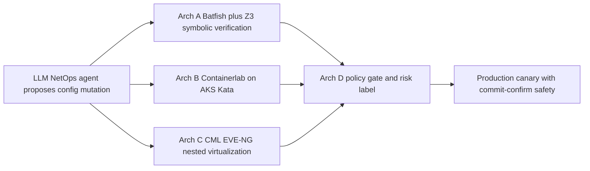
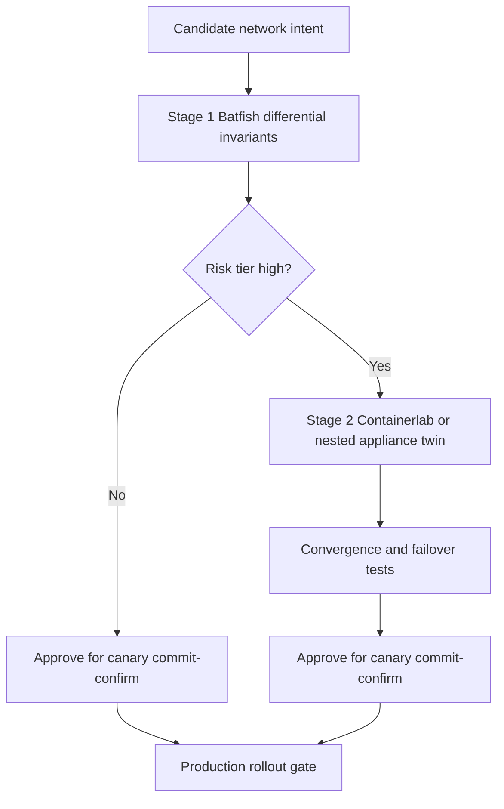
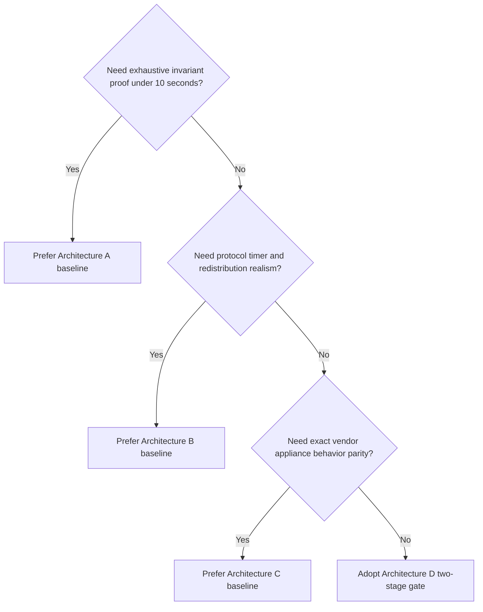

# Enterprise NetOps Network Digital-Twin Verification Sandbox Selection FAQ: Batfish+Z3 on ACA vs Containerlab+SONiC/FRR on AKS Kata vs Nested-Virt CML/EVE-NG
> **Applies to**: telecom operators, global banks, large retail branch networks, and Azure Hub-Spoke/ExpressRoute platform teams.
> **Decision pressure**: validate LLM-synthesized network changes before production to prevent route leaks, asymmetric drops, and regional blackholes.
> **Core objective**: choose a verification sandbox architecture that balances formal completeness, dynamic realism, blast-radius safety, and TCO.

## 1. Executive summary
- Autonomous NetOps agents can accelerate change velocity only if pre-flight verification is deterministic.
- A single malformed `BGP` policy can propagate globally within seconds.
- AI-generated `NSG` or `UDR` mistakes can silently reroute critical traffic paths.
- Verification must cover both control-plane intent and data-plane forwarding outcomes.
- Formal symbolic analysis catches entire equivalence classes, not just sampled packets.
- Dynamic emulation catches timer interactions and daemon race conditions.
- Architecture A is strongest for sub-10s exhaustive policy proofing at low cost.
- Architecture B is strongest for live protocol dynamics under high topology density.
- Architecture C is strongest for vendor appliance parity and proprietary datapath behavior.
- Architecture D is strongest for enterprise risk-tiered pipelines and operating economics.
- Most production programs use D with A as baseline and B/C as escalation lanes.
- Final selection should be driven by failure severity, protocol complexity, and monthly verification volume.

## 2. Applicability and explicit non-goals
- Scope includes autonomous change verification for `BGP`, `EVPN-VXLAN`, `OSPF`, and Azure route policy controls.
- Scope includes pre-commit gating for `Azure Firewall`, `NSG`, and `UDR` updates.
- Scope includes hybrid cloud and on-prem edge routing through `ExpressRoute`.
- Scope includes rollback safety handoff from digital twin pass to production execution.
- Scope is distinct from privileged SSH/kubectl bastion governance in 3.1 (`privileged-infra-ssh-kubectl-agent-bastion...`).
- Scope is distinct from microservice L7 HTTP/gRPC coding sandbox patterns in 3.1 #366.
- Scope is distinct from ARM Deployment Stacks blast-radius guardrails in 3.8.
- Scope excludes end-user desktop synthetic transaction testing.
- Scope excludes procurement/legal workflows for vendor image licenses.

## 3. Scenario and constraint physics
- NetOps teams must validate intent against multi-vendor and multi-domain network state.
- Production fabrics mix cloud route controls with branch and data-center edge policies.
- Change windows are short, but rollback penalties are high.
- Verification latency directly impacts operational throughput and outage risk.
- Route-policy correctness requires coverage beyond ad hoc packet probes.
- Dynamic convergence and flap behavior require timer-aware emulation.
- Security requires strict isolation between generated configs and production credentials.

## 4. Four architecture candidates
- **Architecture A**: symbolic control/data-plane verification using `Batfish` + `Z3` on `ACA Dynamic Sessions/Jobs`.
- **Architecture B**: containerized NOS topology using `Containerlab` with `SONiC/FRR/cEOS/SR Linux` on `AKS Kata`.
- **Architecture C**: nested virtualization with full vendor appliances in `CML/EVE-NG` on `Azure Dv5/Ev5`.
- **Architecture D**: two-stage gate (`Batfish` fast diff first, then selective dynamic twin escalation).
- Arch-A optimizes breadth of invariant coverage and low-cost parallel checks.
- Arch-B optimizes protocol-timer realism and dense topology simulation.
- Arch-C optimizes vendor fidelity for proprietary features and appliance semantics.
- Arch-D optimizes enterprise throughput, cost, and risk governance.

## 5. Architecture A details (Batfish + Z3 on ACA)
- Batfish parses multi-vendor configs into normalized control-plane intent models.
- `Z3` SMT proofing checks reachability, loop freedom, and policy invariants exhaustively.
- Equivalence-class analysis replaces brute-force packet enumeration with symbolic coverage.
- Typical `2–8s` verification windows support high-frequency CI/CD gates.
- Azure exports (`Effective Routes`, `IP Flow Verify`) can be merged into snapshot context.
- ACA ephemeral sessions isolate each verification run with minimal warm-pool overhead.
- Cost per check remains low for high-volume policy linting.
- Arch-A is ideal for first-pass broad-spectrum regression prevention.

## 6. Architecture B details (Containerlab on AKS Kata)
- `Containerlab` builds realistic topologies quickly with containerized NOS images.
- `AKS Kata` provides Pod-VM isolation for untrusted generated config execution.
- Teams can drive live updates through `gNMI`, `NETCONF`, and `RESTCONF`.
- `tc netem` enables packet loss, jitter, and flap fault injection.
- Convergence and failover behavior can be measured directly.
- Memory footprint per node is significantly lower than full VM appliances.
- Dynamic route redistribution and timer interactions are observable.
- Arch-B is ideal for high-density dynamic protocol behavior tests.

## 7. Architecture C details (Nested virtualization CML/EVE-NG)
- Full virtual appliances replicate vendor-specific daemons and proprietary behaviors.
- Supports platforms without viable containerized builds.
- Best fit for firewall and appliance behaviors tied to proprietary datapaths.
- Delivers high realism for complex multi-vendor production incidents.
- Requires nested virtualization hosts with large memory allocations.
- Boot time and seat-license constraints reduce elasticity.
- Operational complexity and cost are higher than A/B.
- Arch-C is ideal for high-criticality vendor-parity change certification.

## 8. Architecture D details (Two-stage risk-tier gate)
- Stage 1 runs fast differential proofs for every candidate mutation.
- Stage 2 runs dynamic twin only for high-blast-radius policy categories.
- Typical Stage-1 filters catch most syntax, shadowing, and route leaks quickly.
- Stage-2 preserves depth where timer or appliance behavior matters.
- Risk labels can map to route domains and business service criticality.
- Cost is minimized by avoiding universal deep simulation.
- Pipeline throughput increases while preserving safety posture.
- Arch-D is the recommended operating model for enterprise NetOps AI programs.

## 9. Twelve-dimension architecture comparison matrix
| Dimension | Architecture A | Architecture B | Architecture C | Architecture D |
|---|---|---|---|---|
| Primary objective | Formal exhaustive policy proof | Dynamic protocol realism | Full appliance fidelity | Risk-tiered throughput and safety |
| Verification latency | Fastest | Fast | Slow-medium | Fast baseline, selective deep |
| Control-plane coverage | Highest | High | High | Highest overall |
| Data-plane realism | Medium | High | Highest | High where escalated |
| Vendor feature parity | Medium | Medium-high | Highest | High |
| Isolation boundary | Session Hyper-V boundary | Pod-VM boundary | Nested hypervisor boundary | Mixed by stage |
| Topology density | High logical | High practical | Medium | High |
| Operational complexity | Medium | Medium-high | Highest | Medium-high |
| Cost at low volume | Lowest | Medium | Highest | Low |
| Cost at high volume | Low | Medium-low | High | Lowest blended |
| Change velocity support | High | High | Medium | Highest |
| Auditability and evidence | High | High | High | Highest |

## 10. Four-architecture topology overview


## 11. Two-stage verification pipeline


## 12. SA decision tree


### Q1. How symbolic BDD/SMT coverage differs from packet-sampling completeness
- Packet sampling validates only tested tuples and can miss hidden policy interactions.
- Symbolic analysis groups header space into equivalence classes and proves class-wide outcomes.
- `BDD` compression makes large policy spaces tractable for deterministic reasoning.
- `SMT` constraints verify invariants under all admissible path conditions.
- Sampling remains useful for smoke tests but cannot guarantee total policy safety.
- Formal proofs are especially effective for ACL shadowing and route-map precedence conflicts.
- Equivalence-class coverage should be treated as baseline correctness evidence.
- Sampled probes should be treated as supplemental observability signals.
- Production pipelines should combine formal proof with selective dynamic replay.

### Q2. How to size memory and boot-time for N-router twins on AKS Kata vs Ev5 nested KVM
- Containerized NOS boot time scales near-linearly with image warm state and node count.
- Nested appliance VM boot time scales with disk I/O, memory pressure, and BIOS/daemon init.
- Practical sizing formula: `Mem_total = N * Mem_router + Mem_fabric + Mem_margin`.
- Boot estimate for container twin: `T_boot_container ~= T_pull + T_init + N * t_node`.
- Boot estimate for nested VM twin: `T_boot_vm ~= T_image + T_vm_init + N * t_vm_node`.
- In `AKS Kata`, `CAP_NET_ADMIN` is confined inside guest kernel namespaces.
- This prevents host `eth0` and CNI dataplane pollution from test mutation side effects.
- In nested `Ev5` KVM, `/dev/kvm` grants realism but increases host sizing requirements.
- Capacity planning should reserve chaos-injection headroom beyond steady-state topology load.

### Q3. How to detect ExpressRoute asymmetric firewall state drops with cloud and on-prem context
- Asymmetry appears when forward and return paths traverse different firewall state domains.
- Azure `Effective Routes` expose route precedence and next-hop decisions by NIC/subnet.
- `IP Flow Verify` validates observed allow/deny posture for specific flow tuples.
- Batfish imports external BGP announcements to model on-prem and WAN edge influence.
- Differential checks compare pre/post mutation path symmetry and stateful inspection continuity.
- Route-map changes can silently shift return path toward unmatched state tables.
- Detection should trigger mandatory escalation before any production apply.
- Evidence bundles should include route diff, flow verdict diff, and affected prefix sets.
- This method catches hybrid-cloud asymmetric drops earlier than post-incident telemetry.

### Q4. How commit-confirm and atomic transaction handoff should be enforced
- Verification pass does not remove need for guarded production execution semantics.
- For network OS targets, use `commit confirmed 5` with automatic rollback timeout.
- For `gNMI`, use atomic replace/set transactions with explicit success acknowledgments.
- Canary scope should start with low-blast-radius prefixes and controlled edge nodes.
- Rollback plans must include previous snapshot references and deterministic reapply paths.
- Abort criteria should include packet loss threshold, BGP flap count, and route churn.
- Production gate should reject execution without verifiable twin evidence attachments.
- Human approval can remain optional for low-risk lanes and mandatory for high-risk lanes.
- Handoff logs should map digital twin run IDs to production change ticket IDs.

### Q5. What a production pybatfish differential verifier plus containerlab topology spec can look like
- A practical pipeline computes baseline and candidate snapshot invariants first.
- On invariant violation, the pipeline blocks promotion and emits explainable diffs.
- High-risk labels can automatically trigger container twin replay for convergence tests.
- Containerlab topology descriptors should version links, address plans, and protocol stanzas.
- Output should include machine-readable verdicts for CI gates and human-readable triage notes.

```python
from pybatfish.client.session import Session
from pybatfish.question import bfq
import yaml

bf = Session(host="batfish-svc", port=9997)
bf.set_network("netops-digital-twin")
bf.init_snapshot("snapshots/base", name="base")
bf.init_snapshot("snapshots/candidate", name="candidate")

def diff_reachability():
    base = bfq.reachability(pathConstraints={"startLocation": "@enter(edge)"}).answer(snapshot="base")
    cand = bfq.reachability(pathConstraints={"startLocation": "@enter(edge)"}).answer(snapshot="candidate")
    return base.frame().compare(cand.frame())

def load_containerlab_topology(path="topology.clab.yml"):
    with open(path, "r", encoding="utf-8") as f:
        topo = yaml.safe_load(f)
    return topo["topology"]["nodes"], topo["topology"]["links"]

delta = diff_reachability()
nodes, links = load_containerlab_topology()
if not delta.empty:
    raise SystemExit(f"BLOCK: reachability regression rows={len(delta)} nodes={len(nodes)} links={len(links)}")
print(f"PASS: no reachability regression; nodes={len(nodes)} links={len(links)}")
```

```json
{
  "stage1_policy": {
    "mandatory_invariants": [
      "no_default_route_leak",
      "expressroute_symmetry_preserved",
      "acl_no_shadow_deny_on_payment_prefixes",
      "firewall_stateful_path_consistency"
    ],
    "max_runtime_seconds": 8,
    "auto_escalate_on_violation": true
  }
}
```

```json
{
  "stage2_escalation": {
    "trigger_labels": ["bgp_redistribution", "evpn_route_target_change", "expressroute_udr_mutation"],
    "containerlab_profile": "spineleaf-32-plus-wan8",
    "nested_vm_profile": "edge-firewall-vendor-parity",
    "commit_confirm_minutes": 5
  }
}
```

### Q6. What three-year TCO looks like at 500, 5,000, and 30,000 verifications per month
- Verification economics shift materially as monthly change volume increases.
- Pure deep simulation for all changes is rarely cost-optimal at enterprise scale.
- Two-stage gating preserves risk controls while reducing expensive deep-lab runtime.
- Cost planning should include compute, storage, image/license, and operations labor.

| Monthly verifications | Architecture A | Architecture B | Architecture C | Architecture D |
|---|---:|---:|---:|---:|
| 500 | \$0.35M–\$0.65M | \$0.55M–\$0.95M | \$1.20M–\$2.10M | \$0.45M–\$0.80M |
| 5,000 | \$2.40M–\$4.10M | \$3.10M–\$5.20M | \$7.80M–\$12.50M | \$2.00M–\$3.60M |
| 30,000 | \$11.80M–\$19.80M | \$14.50M–\$23.00M | \$33.00M–\$52.00M | \$9.50M–\$16.20M |

| Monthly verifications | Typical critical-incident risk reduction with formal-first pipelines | Typical critical-incident risk reduction with two-stage blended pipelines |
|---|---:|---:|
| 500 | 40%–58% | 45%–62% |
| 5,000 | 48%–66% | 55%–72% |
| 30,000 | 52%–70% | 60%–78% |

- Final architecture choice should weight incident severity above raw infra unit cost.
- Teams should re-baseline assumptions quarterly as topology complexity evolves.
- ROI should combine outage avoidance and change throughput improvements.

## 13. Day-0 rollout checklist
- Define mandatory invariants by service tier and route domain criticality.
- Build snapshot ingestion for multi-vendor configs and Azure route exports.
- Implement Stage-1 Batfish differential checks in CI policy gates.
- Define Stage-2 escalation labels and container/vm topology profiles.
- Configure isolated execution identities and secretless config retrieval paths.
- Establish canary and rollback workflows with `commit confirmed` defaults.
- Enable evidence retention for audit and post-incident forensics.
- Publish runbooks for failed-gate triage and emergency bypass governance.

## 14. Day-2 operations checklist
- Recalibrate invariant sets after topology and policy pattern changes.
- Track Stage-1 runtime and false-positive drift across policy classes.
- Validate Stage-2 convergence scenarios after NOS image upgrades.
- Reconcile Batfish parser gaps and vendor-specific stanza exceptions.
- Continuously tune risk labels and escalation routing thresholds.
- Audit rollback execution success and mean time to safe recovery.
- Compare predicted versus observed production route behavior deltas.
- Recompute cost/throughput baseline against current monthly change load.

## 15. Good fit versus not for
| Category | Guidance |
|---|---|
| ✅ Good fit | Enterprises running frequent autonomous or semi-autonomous NetOps changes. |
| ✅ Good fit | Hybrid-cloud networks where route asymmetry and policy drift are outage drivers. |
| ✅ Good fit | Regulated environments requiring deterministic pre-change evidence and rollback safety. |
| ⛔ Not for | Teams unwilling to maintain invariant catalogs and topology snapshots. |
| ⛔ Not for | Very small static networks with rare manual-only change workflows. |
| ⛔ Not for | Programs expecting full production safety from prompt-level checks without twin verification. |

## 16. Five-step implementation guide
1. Classify network changes by blast radius and protocol dynamics.
2. Deploy Stage-1 formal verification as universal pre-flight baseline.
3. Add Stage-2 dynamic twin escalation for high-risk mutation classes.
4. Enforce commit-confirm and atomic transaction semantics for rollout.
5. Operate with quarterly recalibration across invariants, topology, and cost.

## 17. Operational metric pack for quarterly steering
- Track Stage-1 median and p95 verification runtime.
- Track Stage-1 block rate by invariant category.
- Track Stage-1 false-positive review outcomes.
- Track Stage-2 escalation rate by risk label.
- Track Stage-2 convergence success under induced faults.
- Track route leak incidents prevented before production apply.
- Track asymmetric path findings on ExpressRoute-linked services.
- Track rollback success rate within commit-confirm windows.
- Track mean time from failed gate to safe remediation.
- Track parser coverage for vendor-specific config constructs.
- Track containerlab topology boot latency by profile size.
- Track nested VM topology boot latency by appliance mix.
- Track resource utilization per verification lane.
- Track cost per verification for each architecture lane.
- Track incidents with missing evidence artifacts.
- Track canary failure detection latency after apply.
- Track gNMI transaction failure and retry outcomes.
- Track firewall state-drop detections mapped to route drift.
- Track route churn during change windows.
- Track policy exception approvals and expiry hygiene.
- Track operator override frequency of automated blocks.
- Track production incident correlation with gate bypass events.
- Track monthly throughput of verified versus rejected changes.
- Track SLA impact from verification queue backlogs.
- Track quarterly TCO deltas against baseline assumptions.
- Maintain architecture decision logs with rationale and outcomes.

## 18. Provenance
- `anonymized_reported`: metrics, formulas, and control patterns are synthesized from anonymized enterprise NetOps programs and reproducible sizing assumptions.
