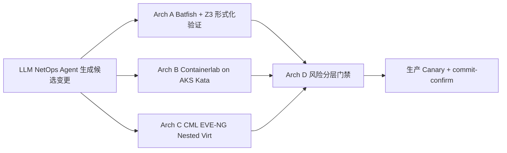
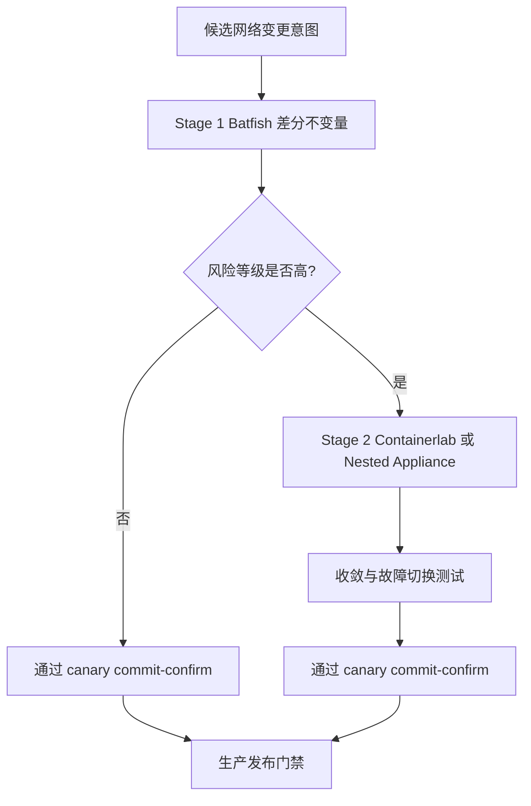
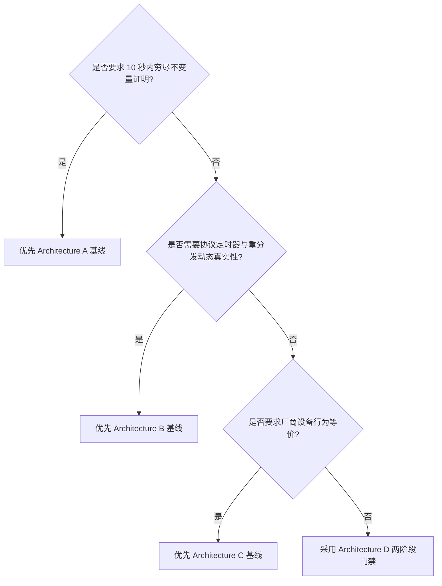

# 企业 NetOps 网络数字孪生验证沙箱选型 FAQ：Batfish+Z3 on ACA vs Containerlab+SONiC/FRR on AKS Kata vs Nested-Virt CML/EVE-NG
> **适用场景**：电信运营商、全球银行、多千门店零售网络与 Azure Hub-Spoke/ExpressRoute 平台团队。
> **决策压力**：在生产变更前验证 LLM 生成网络配置，避免路由泄漏、状态不对称丢包与区域级黑洞。
> **核心目标**：在形式化完备性、动态真实性、变更安全与总体成本之间做生产级平衡。

## 1. 执行摘要
- 自治 NetOps Agent 只有在“先验可证”前提下才值得放大变更速度。
- 一条错误的 `BGP` 策略可能在秒级扩散为全网风险。
- AI 生成的 `NSG` 或 `UDR` 变更可在无明显告警时改变关键路径。
- 验证必须同时覆盖控制平面意图与数据平面转发结果。
- 形式化符号分析可覆盖等价类，不依赖有限采样。
- 动态仿真可揭示定时器与守护进程竞态问题。
- Architecture A 在低成本下提供子 10 秒级广覆盖证明能力。
- Architecture B 在高密拓扑下提供最强动态协议行为可观测性。
- Architecture C 在厂商专有虚拟设备一致性上最具优势。
- Architecture D 在企业级风险分层与运行经济性上最均衡。
- 生产实践通常以 D 为主，A 为默认底线，B/C 为升级车道。
- 最终选型应由故障严重度、协议复杂度与月验证量共同驱动。

## 2. 适用性与明确非目标
- 本文覆盖 `BGP`、`EVPN-VXLAN`、`OSPF` 与 Azure 路由策略的变更验证。
- 本文覆盖 `Azure Firewall`、`NSG`、`UDR` 的预提交门禁。
- 本文覆盖混合云与本地边缘通过 `ExpressRoute` 的联动校验。
- 本文覆盖数字孪生通过后的生产提交与回滚安全交接。
- 本文不同于 3.1 中特权 SSH/kubectl 堡垒治理（`privileged-infra-ssh-kubectl-agent-bastion...`）。
- 本文不同于 3.1 #366 的微服务 L7 HTTP/gRPC 编码沙箱主题。
- 本文不同于 3.8 的 Deployment Stacks ARM 爆炸半径护栏主题。
- 本文不讨论终端用户桌面侧交易回放测试。
- 本文不替代厂商镜像许可与采购法务流程。

## 3. 场景与约束物理
- NetOps 团队需在多厂商、多域网络状态上验证变更意图。
- 生产网络往往混合云路由控制与分支/数据中心边缘策略。
- 变更窗口短，但回滚代价高且时效严苛。
- 验证时延直接决定变更吞吐与故障风险。
- 路由策略正确性需要超越点状探测的覆盖能力。
- 动态收敛与 flap 行为需要定时器感知的仿真机制。
- 安全治理要求生成配置与生产凭据严格隔离。

## 4. 四类候选架构
- **Architecture A**：`Batfish` + `Z3` 形式化控制/数据平面验证，运行于 `ACA Dynamic Sessions/Jobs`。
- **Architecture B**：`Containerlab` 容器化网络拓扑，`SONiC/FRR/cEOS/SR Linux` 运行于 `AKS Kata`。
- **Architecture C**：`CML/EVE-NG` 全虚机厂商设备孪生，运行于 `Azure Dv5/Ev5` 嵌套虚拟化。
- **Architecture D**：两阶段门禁（先 Batfish 快速差分，再按风险升级动态孪生）。
- Arch-A 侧重大范围不变量证明与低成本并行检查。
- Arch-B 侧重协议定时器真实动态行为与高密拓扑可复现。
- Arch-C 侧重厂商专有特性与设备一致性验证。
- Arch-D 侧重企业吞吐、成本与风险治理的综合最优。

## 5. Architecture A 细节（Batfish + Z3 on ACA）
- Batfish 将多厂商配置归一化为可分析控制平面模型。
- `Z3` SMT 可对可达性、无环、策略优先级等不变量做穷尽证明。
- 等价类分析可替代全报文枚举，提升覆盖完整性。
- 常见 `2–8s` 校验窗口适配高频 CI/CD 门禁。
- 可叠加 Azure `Effective Routes` 与 `IP Flow Verify` 上下文。
- ACA 临时会话可隔离每次验证并控制预热成本。
- 单次检查成本低，适合高频策略回归。
- Arch-A 适合做全量变更第一道默认护栏。

## 6. Architecture B 细节（AKS Kata 上的 Containerlab）
- `Containerlab` 可快速拉起真实拓扑并执行动态协议收敛测试。
- `AKS Kata` 提供 Pod-VM 边界隔离不受信配置执行风险。
- 可通过 `gNMI`、`NETCONF`、`RESTCONF` 下发候选配置。
- `tc netem` 可注入抖动、丢包、链路 flap 等混沌场景。
- 可直接观测重分发、收敛与故障切换行为。
- 每节点内存开销远低于全虚机设备仿真。
- 动态行为证据更接近生产事件特征。
- Arch-B 适合协议动态风险高的高密验证场景。

## 7. Architecture C 细节（Nested-Virt CML/EVE-NG）
- 全虚机厂商设备可最大化还原专有行为与控制逻辑。
- 适用于缺乏容器版本的网络 OS 与安全设备。
- 对防火墙/专有数据面场景具有更高一致性价值。
- 可用于高风险多厂商故障复盘与变更前确认。
- 需要更高内存与嵌套虚拟化宿主资源。
- 冷启动与许可座席约束降低弹性效率。
- 运维复杂度与成本显著高于 A/B。
- Arch-C 适合“必须厂商等价”的关键变更认证。

## 8. Architecture D 细节（两阶段风险分层门禁）
- Stage 1 对全部变更执行快速差分不变量证明。
- Stage 2 仅对高爆炸半径变更执行动态深度孪生。
- Stage 1 可快速拦截大多数语法、遮蔽与路由泄漏问题。
- Stage 2 在必要场景补齐定时器与设备行为深度。
- 风险标签可绑定业务关键度与网络域边界。
- 通过“普筛 + 精检”减少深度仿真资源浪费。
- 在保持安全底线下提高整体变更吞吐。
- Arch-D 是企业 NetOps AI 平台的推荐运行范式。

## 9. 12 维架构对比矩阵
| 维度 | Architecture A | Architecture B | Architecture C | Architecture D |
|---|---|---|---|---|
| 主要目标 | 形式化穷尽策略证明 | 动态协议行为真实性 | 厂商设备行为一致性 | 风险分层吞吐与安全 |
| 验证时延 | 最快 | 快 | 中慢 | 快速基线 + 选择性深检 |
| 控制平面覆盖 | 最高 | 高 | 高 | 全局最高 |
| 数据平面真实性 | 中 | 高 | 最高 | 高（升级场景） |
| 厂商特性一致性 | 中 | 中高 | 最高 | 高 |
| 隔离边界 | 会话级 Hyper-V | Pod-VM | 嵌套 Hypervisor | 分阶段混合 |
| 拓扑密度能力 | 高（逻辑） | 高（实践） | 中 | 高 |
| 运维复杂度 | 中 | 中高 | 最高 | 中高 |
| 低流量成本 | 最低 | 中 | 最高 | 低 |
| 高流量成本 | 低 | 中低 | 高 | 混合最低 |
| 变更吞吐支撑 | 高 | 高 | 中 | 最高 |
| 审计证据完整性 | 高 | 高 | 高 | 最高 |

## 10. 四架构拓扑总览


## 11. 两阶段验证流水线


## 12. 架构师决策树


### Q1. 符号化 BDD/SMT 等价类覆盖与报文采样完备性有何差异
- 报文采样只能证明“已测流量”，无法保证“未测空间”安全。
- 符号分析将头域划分为等价类并对整类行为给出证明。
- `BDD` 压缩可让大规模策略空间在可计算时间内完成求解。
- `SMT` 约束可验证路径、策略和优先级组合下的不变量成立性。
- 采样更适合冒烟探测，不适合作为唯一生产安全依据。
- 形式化证明对 ACL 遮蔽与 route-map 优先级冲突尤为有效。
- 等价类覆盖应被视为默认正确性证据底线。
- 采样探测应作为补充观测而非替代证明。
- 生产门禁应采用“形式化优先 + 动态回放补充”的组合。

### Q2. AKS Kata 与 Ev5 Nested KVM 下 N 节点拓扑的内存与启动如何测算
- 容器化 NOS 启动时间主要受镜像预热与节点数影响。
- 嵌套虚机启动时间受磁盘 I/O、内存压力与设备初始化影响更大。
- 内存基线公式：`Mem_total = N * Mem_router + Mem_fabric + Mem_margin`。
- 容器孪生启动估算：`T_boot_container ~= T_pull + T_init + N * t_node`。
- 虚机孪生启动估算：`T_boot_vm ~= T_image + T_vm_init + N * t_vm_node`。
- `AKS Kata` 中 `CAP_NET_ADMIN` 仅在 guest kernel 命名空间生效。
- 该机制可避免测试流量污染宿主 `eth0` 与 CNI 主数据面。
- `Ev5` 嵌套 `/dev/kvm` 具备更高真实性，但对宿主资源要求更高。
- 容量规划需预留混沌注入与并发突发的额外冗余。

### Q3. 如何结合 Azure 与本地视角检测 ExpressRoute 不对称状态丢包
- 前后向路径落在不同状态防火墙域时会出现会话不对称丢包。
- Azure `Effective Routes` 可显示路由优先级与下一跳选择变化。
- `IP Flow Verify` 可验证流级别允许/拒绝判定是否偏移。
- Batfish 可导入外部 BGP 公告并还原本地边缘影响。
- 差分验证可比较变更前后对称性与状态连续性。
- route-map 调整可能在无感知下改变回程路径。
- 检测命中后应强制升级验证并阻断直接生产发布。
- 证据包应包含路由差异、流判定差异与受影响前缀集。
- 该方法比事后遥测更早发现混合云路径不对称风险。

### Q4. 如何将 commit-confirm 与原子事务交接落地到生产
- 验证通过并不代表可跳过生产执行护栏。
- 网络设备侧应默认使用 `commit confirmed 5` 并配置自动回滚。
- `gNMI` 发布应采用原子 replace/set 事务与显式 ACK。
- canary 范围应从低爆炸半径前缀与边缘节点开始。
- 回滚剧本需绑定前版本快照与可重复回放路径。
- 中止条件应包含丢包阈值、flap 次数与路由抖动幅度。
- 生产门禁应要求附带可验证的数字孪生证据。
- 高风险可强制人工审批，低风险可自动放行。
- 交接日志应将孪生运行 ID 绑定到变更工单 ID。

### Q5. pybatfish 差分验证 + Containerlab 拓扑规范的生产示例
- 生产管线先计算 baseline 与 candidate 快照差异不变量。
- 发现回归应阻断晋升并输出可解释的差分结果。
- 高风险标签可自动触发容器孪生收敛复测。
- Containerlab 拓扑规范需版本化节点、链路与协议段。
- 输出需同时支持 CI 机读门禁与人工排障审计。

```python
from pybatfish.client.session import Session
from pybatfish.question import bfq
import yaml

bf = Session(host="batfish-svc", port=9997)
bf.set_network("netops-digital-twin")
bf.init_snapshot("snapshots/base", name="base")
bf.init_snapshot("snapshots/candidate", name="candidate")

def diff_reachability():
    base = bfq.reachability(pathConstraints={"startLocation": "@enter(edge)"}).answer(snapshot="base")
    cand = bfq.reachability(pathConstraints={"startLocation": "@enter(edge)"}).answer(snapshot="candidate")
    return base.frame().compare(cand.frame())

def load_containerlab_topology(path="topology.clab.yml"):
    with open(path, "r", encoding="utf-8") as f:
        topo = yaml.safe_load(f)
    return topo["topology"]["nodes"], topo["topology"]["links"]

delta = diff_reachability()
nodes, links = load_containerlab_topology()
if not delta.empty:
    raise SystemExit(f"BLOCK: reachability regression rows={len(delta)} nodes={len(nodes)} links={len(links)}")
print(f"PASS: no reachability regression; nodes={len(nodes)} links={len(links)}")
```

```json
{
  "stage1_policy": {
    "mandatory_invariants": [
      "no_default_route_leak",
      "expressroute_symmetry_preserved",
      "acl_no_shadow_deny_on_payment_prefixes",
      "firewall_stateful_path_consistency"
    ],
    "max_runtime_seconds": 8,
    "auto_escalate_on_violation": true
  }
}
```

```json
{
  "stage2_escalation": {
    "trigger_labels": ["bgp_redistribution", "evpn_route_target_change", "expressroute_udr_mutation"],
    "containerlab_profile": "spineleaf-32-plus-wan8",
    "nested_vm_profile": "edge-firewall-vendor-parity",
    "commit_confirm_minutes": 5
  }
}
```

### Q6. 500 / 5,000 / 30,000 月验证量三年 TCO 如何对比
- 月验证规模变化会显著改变最优架构边界。
- 对全部变更统一执行深度孪生通常不是成本最优策略。
- 两阶段门禁可在保持风险控制下压降深度仿真开销。
- 成本测算需包含算力、存储、镜像许可与运维人力。

| 月验证次数 | Architecture A | Architecture B | Architecture C | Architecture D |
|---|---:|---:|---:|---:|
| 500 | \$0.35M–\$0.65M | \$0.55M–\$0.95M | \$1.20M–\$2.10M | \$0.45M–\$0.80M |
| 5,000 | \$2.40M–\$4.10M | \$3.10M–\$5.20M | \$7.80M–\$12.50M | \$2.00M–\$3.60M |
| 30,000 | \$11.80M–\$19.80M | \$14.50M–\$23.00M | \$33.00M–\$52.00M | \$9.50M–\$16.20M |

| 月验证次数 | 形式化优先路径典型关键事故风险下降 | 两阶段混合路径典型关键事故风险下降 |
|---|---:|---:|
| 500 | 40%–58% | 45%–62% |
| 5,000 | 48%–66% | 55%–72% |
| 30,000 | 52%–70% | 60%–78% |

- 最终决策应优先考虑事故严重度而非仅看单位算力成本。
- 应按季度基于网络复杂度变化重估模型参数。
- ROI 评估应同时量化故障避免收益与变更吞吐收益。

## 13. Day-0 落地清单
- 按业务关键度定义强制不变量集合与风险等级。
- 建立多厂商配置与 Azure 路由导出的快照采集链路。
- 将 Stage-1 Batfish 差分验证接入 CI 变更门禁。
- 定义 Stage-2 升级标签与容器/虚机拓扑模板。
- 配置隔离执行身份与无密钥配置拉取路径。
- 建立 canary + `commit confirmed` 默认发布策略。
- 启用审计证据归档与事件取证保留策略。
- 发布门禁失败排障与应急 bypass 治理手册。

## 14. Day-2 运营清单
- 随拓扑与策略演化迭代不变量集合。
- 追踪 Stage-1 运行时与误拦截率漂移。
- 在 NOS 升级后复测 Stage-2 收敛基准。
- 持续修正 Batfish 解析盲区与厂商特性例外。
- 动态优化风险标签与升级阈值策略。
- 审计回滚执行成功率与恢复时延。
- 对比孪生预测与生产观测路径偏差。
- 按当前变更量重算成本与吞吐基线。

## 15. Good fit 与 Not for
| 分类 | 指引 |
|---|---|
| ✅ Good fit | 具备高频自治/半自治网络变更需求的企业网络平台。 |
| ✅ Good fit | 混合云场景中路径不对称与策略漂移风险显著的组织。 |
| ✅ Good fit | 需要确定性变更证据与回滚安全闭环的监管行业。 |
| ⛔ Not for | 不愿维护不变量目录与拓扑快照的团队。 |
| ⛔ Not for | 变更频率极低、网络规模很小的纯人工流程。 |
| ⛔ Not for | 仅依赖提示词检查且不建设数字孪生验证能力的项目。 |

## 16. 五步实施路径
1. 按爆炸半径与协议动态性对网络变更分层。
2. 将 Stage-1 形式化验证设为全量默认预检底线。
3. 对高风险变更接入 Stage-2 动态孪生升级验证。
4. 生产发布强制 commit-confirm 与原子事务语义。
5. 以季度节奏重标不变量、拓扑模板与成本模型。

## 17. 季度治理指标包（运营看板建议）
- 跟踪 Stage-1 验证中位与 p95 时延。
- 跟踪 Stage-1 按不变量类别的阻断率。
- 跟踪 Stage-1 误报复核结论分布。
- 跟踪 Stage-2 按风险标签的升级率。
- 跟踪 Stage-2 混沌注入下收敛通过率。
- 跟踪生产前拦截的路由泄漏事件数。
- 跟踪 ExpressRoute 关联业务的不对称路径发现数。
- 跟踪 commit-confirm 窗口内回滚成功率。
- 跟踪门禁失败到安全恢复的平均时长。
- 跟踪厂商特定配置语法解析覆盖率。
- 跟踪 Containerlab 不同规模拓扑启动时延。
- 跟踪 Nested VM 不同设备组合启动时延。
- 跟踪各验证车道资源利用率变化。
- 跟踪各车道单次验证成本变化。
- 跟踪缺失证据工件的变更事件数。
- 跟踪生产 canary 失败检测时延。
- 跟踪 gNMI 原子事务失败与重试结果。
- 跟踪防火墙状态丢包检测与路由漂移关联。
- 跟踪变更窗口内路由抖动幅度。
- 跟踪策略例外审批数量与到期治理质量。
- 跟踪人工覆盖自动阻断的频率。
- 跟踪生产事故与门禁绕过事件相关性。
- 跟踪月度“通过验证/被拒绝”变更吞吐结构。
- 跟踪验证队列积压对 SLA 的影响。
- 跟踪季度 TCO 与基线模型偏差。
- 维护架构决策日志与变更依据。

## 18. Provenance
- `anonymized_reported`：文中指标、公式与治理模式来自匿名化企业 NetOps 项目观察与可复现容量建模假设。
