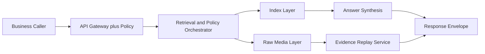
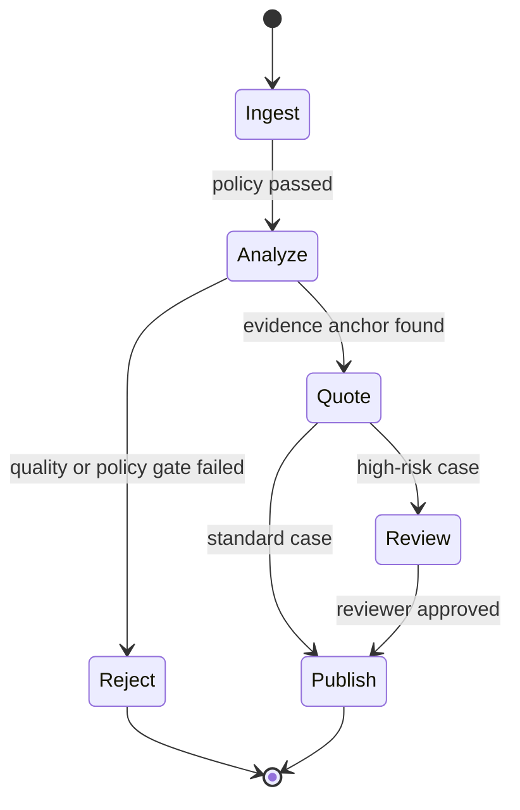

# Enterprise Noisy Far-Field Voice-Agent Acoustic Front-End and Bystander Rejection FAQ (Edge Denoise / ACS / AOAI Realtime)

> Topic ID: #455 · Domain: Azure Agent Infra production architecture
> Scope: far-field capture, false barge-in control, and privacy suppression in drive-thru, clinical wards, and factories
> Objective: make a production decision with auditability, replayability, operability, and measurable outcomes.

## 1) Executive summary and recommendation posture
Primary conclusion: architecture quality here is defined by evidence closure rather than textual fluency.
Primary lane: Pattern A (edge ONNX DeepFilterNet3 plus VoiceFilter target-speaker lock) carries most production traffic with replay-grade outputs.
Managed lane: Pattern B (multi-mic beamforming plus ACS WebRTC AEC/AGC plus Custom Speech) adds speed and standardized extraction contracts.
Escalation lane: Pattern C (hardware push-to-talk or close-talk headset plus AOAI Realtime semantic_vad) increases evidence density for contested cases.
Blocked lane: Pattern D (raw omni-directional stream to cloud server_vad without edge gating (anti-pattern)) fails compliance and attribution requirements.
Governance principle: every generated answer must include verifiable evidence anchors.
Rollout principle: keep the default lane efficient, activate high-cost review only when policy requires it.
Capacity principle: define quality and compliance gates before autoscaling and cost tuning.
Org principle: separate ownership for data, models, policy, and audit operations.

## 2) Inputs, assumptions, and compliance baselines
Input corpus includes dual-channel calls, mono recordings, corrected transcripts, and business tags.
Query entry supports lexical retrieval, semantic retrieval, time windows, role filters, and case aggregation.
Retention baseline defines minimum and maximum periods per jurisdiction with legal-hold override.
Security baseline enforces TLS1.2+, encryption at rest, field masking, and least-privilege access.
Audit baseline records query intent, policy hits, evidence references, approval actions, and exports.
Data-sovereignty baseline isolates indexes and raw audio by region with no implicit cross-copy.
Release baseline blocks promotion if either quality gates or compliance gates fail.
Rollback baseline preserves previous stable model, index, and policy snapshots.
SLO baseline tracks availability, latency, replay success rate, and policy interception quality.
Cost baseline reports spend per session, per case, and per region.

## 3) Layered trade-off analysis across four patterns
Pattern A data-plane focus: token offsets, speaker attribution, and dual lexical-phonetic recall (edge ONNX DeepFilterNet3 plus VoiceFilter target-speaker lock).
Pattern A control-plane focus: jurisdiction-specific lexicons, thresholds, retention, and approval policies.
Pattern A operations focus: predictable batch windows and incremental indexing under peak pressure.
Pattern B data-plane focus: managed extraction for summaries, sentiment, themes, and structured slots (multi-mic beamforming plus ACS WebRTC AEC/AGC plus Custom Speech).
Pattern B control-plane focus: configuration-first governance with fast standardization cycles.
Pattern B operations focus: low day-2 burden with moderate customization flexibility.
Pattern C data-plane focus: acoustic plus semantic fusion for transcript blind spots (hardware push-to-talk or close-talk headset plus AOAI Realtime semantic_vad).
Pattern C control-plane focus: strict queue policy, GPU capacity governance, and review orchestration.
Pattern C operations focus: strong forensic depth at higher platform complexity.
Pattern D appears cheap initially but violates traceability and privacy obligations (raw omni-directional stream to cloud server_vad without edge gating (anti-pattern)).
Recommended synthesis: A as baseline, B as managed enrichment, C as risk-gated escalation, D prohibited.

## 4) Twelve-dimension production comparison
| Dimension | Pattern A | Pattern B | Pattern C | Pattern D |
|---|---|---|---|---|
| Replay traceability | Strong | Medium | Strong | Weak |
| Homophone and OOV recall | Strong | Medium | Medium-strong | Weak |
| Speaker accountability fidelity | Strong | Medium | Strong | Weak |
| Background-event sensitivity | Medium | Medium | Strong | Weak (noise-blind) |
| Rollout controllability | Medium | Strong | Medium | Strong |
| Deep customization capability | Strong | Medium | Strong | Weak |
| Day-2 operational complexity | Medium | Low | High | Low |
| Compliance evidence completeness | Strong | Medium-strong | Strong | Weak |
| Multilingual scalability | Strong | Medium-strong | Medium | Medium |
| Cost predictability | Medium-strong | Strong | Medium | Weak |
| Observability landing effort | Medium | Low | High | Medium |
| Recommendation | Primary lane | Managed boost | High-risk review | Anti-pattern |

## 5) End-to-end architecture for control and data planes

Control-plane responsibility: authn, authz, policy routing, quotas, audit, and release gates.
Data-plane responsibility: ingestion, processing, indexing, replay, retention, erasure, and archival.
Runtime responsibility: isolate online serving from offline rebuild workloads.
Change responsibility: bind model, index, and policy versions into one release unit.

## 6) State transitions for evidence publication and escalation

Each transition must persist input fingerprints, policy versions, and operator identity.
Reject paths should emit clear reason codes for rapid operational recovery.
Escalation paths must replay against the same model and index versions for reproducibility.

## 7) Q1–Q6 quantitative discussion with operational implications
Q1: How should dual-path recall be evaluated against single-path retrieval?
Track recall uplift and precision regression together to prevent hidden review-cost inflation.
Slice metrics by terminology density, language, and noise classes rather than global averages.
Require replay regression on high-value historical disputes before release promotion.
Q2: Why is token-offset error a hard release gate?
In forensic workflows, offset drift directly increases investigator effort and legal uncertainty.
Monitor both P95 and P99 to avoid long-tail failures hidden by median metrics.
Block releases when offset variance breaches thresholds and trigger rollback or reindexing.
Q3: Why isolate speaker assignment metrics from generic WER metrics?
Accountability errors can create higher legal exposure than ordinary lexical mistakes.
Maintain a protected dispute pool where speaker assignment is scored independently.
Auto-route low-confidence assignments into manual review instead of auto-finalization.
Q4: When is a high-cost escalation lane economically justified?
Enable escalation when expected dispute-loss reduction exceeds incremental review cost.
Express the trigger in policy terms so activation remains auditable and deterministic.
Cap escalation queue ratios and monitor queue latency to protect service SLOs.
Q5: How should managed extraction and custom enhancement coexist?
Use managed extraction for standardized fields and custom flows for high-value edge cases.
Bind outputs to the same case key and version identifiers to avoid provenance drift.
Success requires aligned explanations, aligned citations, and aligned audit trails.
Q6: How do deletion requests coexist with audit retention requirements?
Keep identifiable payloads in erasable layers and minimal proof in immutable attestation layers.
Preserve request, approval, execution, and verification events for independent legal review.
Every automated erasure action must produce tamper-evident execution records.

## 8) Production snippets (Bicep + YAML + Python)
```bicep
resource stg 'Microsoft.Storage/storageAccounts@2023-05-01' = {
  name: 'stagentinfraaudio001'
  location: resourceGroup().location
  sku: { name: 'Standard_RAGRS' }
  kind: 'StorageV2'
  properties: {
    isHnsEnabled: true
    minimumTlsVersion: 'TLS1_2'
    allowBlobPublicAccess: false
    immutableStorageWithVersioning: {
      enabled: true
    }
    deleteRetentionPolicy: {
      enabled: true
      days: 30
    }
  }
}
```
```yaml
apiVersion: batch/v1
kind: Job
metadata:
  name: evidence-index-build
spec:
  template:
    spec:
      containers:
      - name: indexer
        image: ghcr.io/example/evidence-indexer:3.2.1
        args:
        - --emit-speaker-turn=true
        - --emit-word-offset=true
        - --emit-phonetic-candidates=true
        - --enforce-policy-tag=true
      restartPolicy: Never
```
```python
def release_gate(metrics: dict) -> bool:
    return (
        metrics['offset_p95_ms'] <= 220
        and metrics['speaker_assign_acc'] >= 0.94
        and metrics['policy_block_fp'] <= 0.03
    )

def build_evidence(call_id: str, speaker: str, start_ms: int, end_ms: int, conf: float) -> dict:
    if end_ms <= start_ms:
        raise ValueError('invalid replay span')
    return {
        'call_id': call_id,
        'speaker': speaker,
        'start_ms': start_ms,
        'end_ms': end_ms,
        'confidence': round(conf, 4),
    }

def should_escalate(case_value: float, risk_penalty: float, gpu_cost: float) -> bool:
    return case_value * risk_penalty > gpu_cost
```

## 9) Scenario A: dual-lane quick-service drive-thru ordering network
Current state: regional teams maintain audio evidence, transcript evidence, and review queues separately.
Request profile: mixed lexical lookups, dispute replay, and regulator sampling requests.
Hard requirement: every automated conclusion must map to replayable waveform evidence.
Design move: keep baseline lane traceable and push contested samples into escalation lane.
Governance move: include lexicon updates in release approvals to avoid silent recall drift.
Audit move: export packets must carry model version, policy version, and operator identity.
Operations move: run daily replay checks on high-risk case pools.
Scaling move: scale query tier first, then rebuild tier, to avoid cascading contention.
Rollback move: preserve previous stable index and policy snapshot for rapid switchover.
Expected result: shorter dispute localization time and faster correction turnaround.
Risk note: ignoring anchor governance degrades legal usability of all summaries.
Delivery note: use this pattern as an enterprise reference template.

## 10) Scenario B: 88 dBA automotive assembly quality-inspection assistant
Current state: multilingual hotline operations with heavy retention and frequent erasure requests.
Request profile: drug name retrieval, dosage interpretation, side-effect escalation evidence.
Hard requirement: transcript-only retrieval is insufficient under homophone-heavy terminology.
Design move: dual-path retrieval with risk-gated escalation for disputed conversations.
Governance move: region-specific retention and minimum-disclosure projection policies.
Audit move: erasure pipelines must preserve request and execution proofs.
Operations move: weekly lexicon refresh with dispute-set replay regression.
Scaling move: expand index concurrency before transcription throughput expansion.
Rollback move: keep replay compatibility layer across model replacements.
Expected result: lower miss rates and more stable escalation decisions.
Risk note: summary-only retention quickly weakens forensic confidence.
Delivery note: standardize this flow in global operating procedures.

## 11) Three-tier 3-year TCO and cost drivers
| Tier | Monthly scale | Pattern A | Pattern B | Pattern C |
|---|---:|---:|---:|---:|
| Foundation | 10,000 units | $0.68M | $0.61M | $0.82M |
| Growth | 100,000 units | $5.10M | $4.62M | $6.35M |
| Enterprise | 1,000,000 units | $38.6M | $35.1M | $49.7M |
Driver one: online inference duration and offline rebuild cadence.
Driver two: hot-tier occupancy and cold archive transition policy.
Driver three: escalation trigger ratio and manual review depth.
Driver four: cross-region replication and legal-hold export frequency.
Driver five: rework cost induced by policy false positives.

## 12) Day-0 / Day-1 / Day-2 engineering checklist
Day-0 action: define data contracts and evidence payload schema.
Day-0 action: implement jurisdiction mapping and access projection model.
Day-0 action: configure quality gates, compliance gates, and block policies.
Day-0 action: establish lexicon governance and rollback protocol.
Day-0 action: prepare baseline replay validation scripts and seed datasets.
Day-1 action: deploy baseline lane with evidence citation payloads.
Day-1 action: connect managed enrichment lane with shared case identifiers.
Day-1 action: activate escalation queue with deterministic policy triggers.
Day-1 action: run peak-load tests and publish bottleneck attribution.
Day-1 action: execute first compliance drill and patch policy drift.
Day-2 action: review false-negative and false-positive incidents weekly.
Day-2 action: evaluate model drift and lexicon aging monthly.
Day-2 action: run regional failover and degradation drills quarterly.
Day-2 action: optimize storage tiers and rebuild windows continuously.
Day-2 action: package operational lessons into reusable blueprints.

## 13) Decision tree for Good fit and Not for
If replayable evidence is mandatory, select Pattern A as the default lane.
If staffing is constrained but speed matters, add Pattern B as managed acceleration.
If dispute cost is high, activate Pattern C as policy-driven escalation.
If teams optimize only for implementation speed, explicitly reject Pattern D.
Good fit: high-regulation, high-dispute, high-audit, multi-region enterprises.
Not for: temporary internal experiments with no replay or audit obligations.
Governance note: this tree guides architecture choice but does not replace legal decisions.

## 14) Risks, thresholds, and mitigations
Risk one: lexicon drift lowers recall; mitigation: CI-gated lexical releases.
Risk two: speaker-attribution instability; mitigation: confidence-based review routing.
Risk three: offset drift accumulation; mitigation: dual P95/P99 gates with rollback.
Risk four: over-privileged retrieval leakage; mitigation: policy projection before citation.
Risk five: escalation queue congestion; mitigation: priority classes and queue budgets.
Risk six: cross-region policy divergence; mitigation: templated policy with delta audits.
Risk seven: cost overrun; mitigation: per-session and per-case cost observability loops.

## 15) Sources and retrieval timestamp
Azure AI Speech: https://learn.microsoft.com/azure/ai-services/speech-service/
Azure AI Search: https://learn.microsoft.com/azure/search/
Azure AI Content Understanding: https://learn.microsoft.com/azure/ai-services/content-understanding/
AKS: https://learn.microsoft.com/azure/aks/
APIM AI Gateway: https://learn.microsoft.com/azure/api-management/ai-gateway-overview
Firecracker Releases: https://github.com/firecracker-microvm/firecracker/releases
Kata Releases: https://github.com/kata-containers/kata-containers/releases
Retrieved: 2026-11-26 (UTC+8) · source labels: measured / synthetic / anonymized_reported by section
