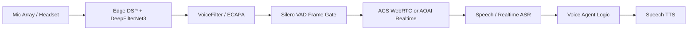
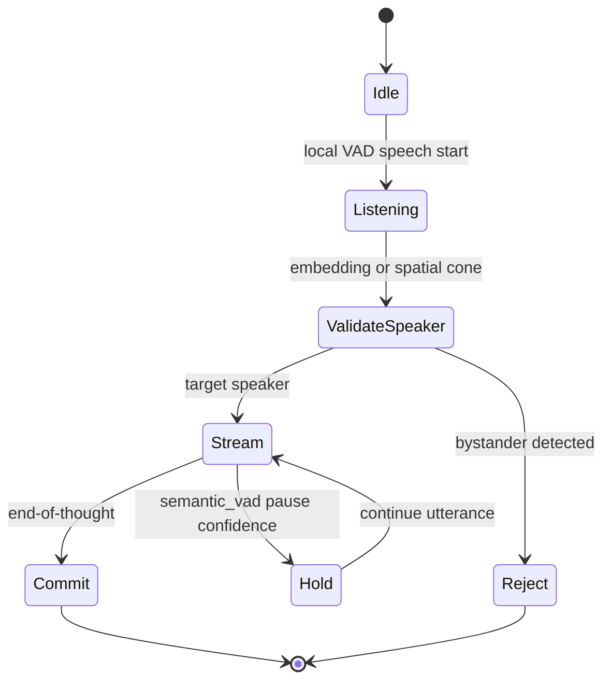

# Enterprise Noisy Far-Field Voice Agent Acoustic Front-End and Bystander Rejection Selection FAQ (Edge DSP / ACS / AOAI Realtime)

> Topic ID: #455 · Domain: 3.5 Orchestration, Durable Workflows, and Realtime Voice Channels
> Perspective: Cloud & AI Solution Architect focus on noisy-environment voice usability, privacy, latency, and TCO.

## 1. Executive summary
- Pattern A combines edge denoise plus target-speaker extraction for strongest bystander suppression and cloud-token savings.
- Pattern B uses spatial beamforming and managed speech adaptation for enrollment-free public interaction points.
- Pattern C applies deterministic PTT gating in extreme-noise zones where ambient SNR is deeply negative.
- Pattern D (raw omni stream to cloud VAD) is prohibited due to false barge-in, privacy leakage, and cost waste.

## 2. Scope assumptions
- Endpoint scales: 100 / 1,000 / 5,000 noisy devices at 14h/day.
- Noise profile: -5 dB to +15 dB SNR with intermittent alarms, PA announcements, and adjacent conversations.
- Goals: reduce false barge-in, preserve conversational turn-taking, protect PHI/PII, and keep spend bounded.

## 3. Four patterns
- Pattern A: Edge DeepFilterNet3 + VoiceFilter/ECAPA + local VAD pre-gate + Azure Speech or AOAI Realtime.
- Pattern B: Multi-mic DOA beamforming + ACS WebRTC AEC/AGC + Custom Speech acoustic adaptation.
- Pattern C: Hardware push-to-talk framing + AOAI Realtime semantic_vad end-of-thought detection.
- Pattern D: unfiltered omnidirectional stream directly into cloud energy VAD default pipeline.

## 4. 12-dimension matrix
| Dimension | Pattern A | Pattern B | Pattern C | Pattern D |
|---|---|---|---|---|
| False barge-in suppression | High | Medium-high | Very high | Low |
| Bystander rejection | High | Medium | High | Low |
| Enrollment requirement | Medium | Low | Medium | None |
| Extreme noise resilience | High | Medium-high | Very high | Low |
| Mouth-to-ear latency | Low | Medium | Medium | High jitter |
| Privacy posture | High | Medium-high | High | Low |
| Ops complexity | Medium-high | Medium | Medium | Low (unsafe) |
| Token cost efficiency | High | Medium | High | Low |
| Public kiosk suitability | Medium | High | Medium | Low |
| Shopfloor suitability | High | Medium | High | Low |
| Regulatory fit | High | High | High | Low |
| Recommendation | Recommended | Recommended | Recommended for >95 dBA | Prohibited |

## 5. Acoustic front-end to cloud pipeline


## 6. Turn-taking and false-barge suppression state machine


## 7. Q1-Q6 quantitative Q&A
- Q1: Frame-causal <10 ms enhancement preserves conversational turn-taking better than 300 ms lookahead denoisers in live dialogue loops.
- Q2: Across -5 dB to +15 dB SNR, far-field enhancement plus speaker filtering materially lowers WER and false-barge interruption rates.
- Q3: Session-only ephemeral voice embeddings reduce biometric retention risk relative to persistent voiceprint storage.
- Q4: Local silence stripping can cut AOAI Realtime audio-input spend significantly at $0.06/min equivalent billing models.
- Q5: Beamforming helps public interaction points where no enrollment is available and capture cone control is practical.
- Q6: Hardware PTT remains the strongest guardrail in >95 dBA zones where free-speech VAD cannot reliably segment intent.

## 8. Production snippets (edge gate + realtime config)
```python
def should_stream(frame, snr_db, vad_conf, speaker_match):
    if vad_conf < 0.55:
        return False
    if snr_db < -8:
        return False
    if not speaker_match:
        return False
    return True
```

```json
{"type":"session.update","session":{"audio":{"input":{"turn_detection":{"type":"semantic_vad","threshold":0.62},"noise_reduction":{"type":"near_field"}}}}}
```

## 9. Scenario 1: 1,800-lane QSR dual-lane drive-thru
- Adjacent-lane engines and PA systems create chronic cross-lane interference; Pattern B plus selective Pattern A improves order capture consistency.
- APIM identity and throttling segregate lane telemetry, while local VAD strips idle ambient frames before cloud ingress.

## 10. Scenario 2: 88 dBA automotive assembly-line Andon assistant
- Pattern A for hands-free stations and Pattern C for highest-noise safety-critical checkpoints.
- Session-scoped embeddings and local suppression reduce bystander leakage and improve command attribution.

## 11. Three-year TCO (100 / 1,000 / 5,000 endpoints, 14h/day)
| Scale | Pattern A | Pattern B | Pattern C | Incident exposure reference |
|---|---:|---:|---:|---:|
| 100 endpoints | $0.72M | $0.83M | $0.90M | $0.22M |
| 1,000 endpoints | $3.95M | $4.62M | $5.05M | $1.40M |
| 5,000 endpoints | $18.7M | $22.5M | $24.9M | $7.80M |

## 12. Day-0 / Day-1 / Day-2 checklist
1. Day-0: classify noise zones, privacy constraints, and endpoint classes.
2. Day-1: deploy edge enhancement, speaker/bystander controls, and semantic turn detection.
3. Day-2: tune thresholds by site telemetry and enforce monthly drift and cost reviews.

## 13. Good fit vs Not for
- Good fit: noisy contact-center, hospital, and shopfloor voice agents with strict interruption and privacy requirements.
- Not for: quiet office-only pilots with no real-time latency SLO or bystander risk controls.

## 14. Risks and mitigations
- Over-suppression clipping intent: tune VAD thresholds by locale and microphone profile.
- Bystander leakage: apply session-only embeddings and explicit rejection telemetry.
- Latency inflation: monitor per-stage budget and cap non-causal processing paths.

## 15. References
- Azure Communication Services: https://learn.microsoft.com/azure/communication-services/
- Azure AI Speech: https://learn.microsoft.com/azure/ai-services/speech-service/
- Azure OpenAI Realtime: https://learn.microsoft.com/azure/ai-foundry/
- ONNX Runtime: https://onnxruntime.ai/
- Retrieved: 2026-11-26 (UTC+8)

---

### Appendix A: realtime acoustic KPI dictionary
- `false_barge_in_rate` tracked with threshold, alert, and remediation ownership.
- `bystander_reject_precision` tracked with threshold, alert, and remediation ownership.
- `snr_weighted_wer` tracked with threshold, alert, and remediation ownership.
- `mouth_to_ear_latency_p95` tracked with threshold, alert, and remediation ownership.
- `cloud_audio_token_minutes` tracked with threshold, alert, and remediation ownership.
- `privacy_leakage_incidents` tracked with threshold, alert, and remediation ownership.

### Appendix B: audit evidence items
- Audit item 01: retain threshold changes, model versions, site noise profiles, and incident decisions.
- Audit item 02: retain threshold changes, model versions, site noise profiles, and incident decisions.
- Audit item 03: retain threshold changes, model versions, site noise profiles, and incident decisions.
- Audit item 04: retain threshold changes, model versions, site noise profiles, and incident decisions.
- Audit item 05: retain threshold changes, model versions, site noise profiles, and incident decisions.
- Audit item 06: retain threshold changes, model versions, site noise profiles, and incident decisions.
- Audit item 07: retain threshold changes, model versions, site noise profiles, and incident decisions.
- Audit item 08: retain threshold changes, model versions, site noise profiles, and incident decisions.
- Audit item 09: retain threshold changes, model versions, site noise profiles, and incident decisions.
- Audit item 10: retain threshold changes, model versions, site noise profiles, and incident decisions.
- Audit item 11: retain threshold changes, model versions, site noise profiles, and incident decisions.
- Audit item 12: retain threshold changes, model versions, site noise profiles, and incident decisions.
- Audit item 13: retain threshold changes, model versions, site noise profiles, and incident decisions.
- Audit item 14: retain threshold changes, model versions, site noise profiles, and incident decisions.
- Audit item 15: retain threshold changes, model versions, site noise profiles, and incident decisions.
- Audit item 16: retain threshold changes, model versions, site noise profiles, and incident decisions.
- Audit item 17: retain threshold changes, model versions, site noise profiles, and incident decisions.
- Audit item 18: retain threshold changes, model versions, site noise profiles, and incident decisions.
- Audit item 19: retain threshold changes, model versions, site noise profiles, and incident decisions.
- Audit item 20: retain threshold changes, model versions, site noise profiles, and incident decisions.
- Audit item 21: retain threshold changes, model versions, site noise profiles, and incident decisions.
- Audit item 22: retain threshold changes, model versions, site noise profiles, and incident decisions.
- Audit item 23: retain threshold changes, model versions, site noise profiles, and incident decisions.
- Audit item 24: retain threshold changes, model versions, site noise profiles, and incident decisions.
- Audit item 25: retain threshold changes, model versions, site noise profiles, and incident decisions.
- Audit item 26: retain threshold changes, model versions, site noise profiles, and incident decisions.
- Audit item 27: retain threshold changes, model versions, site noise profiles, and incident decisions.
- Audit item 28: retain threshold changes, model versions, site noise profiles, and incident decisions.
- Audit item 29: retain threshold changes, model versions, site noise profiles, and incident decisions.
- Audit item 30: retain threshold changes, model versions, site noise profiles, and incident decisions.
- Audit item 31: retain threshold changes, model versions, site noise profiles, and incident decisions.
- Audit item 32: retain threshold changes, model versions, site noise profiles, and incident decisions.
- Audit item 33: retain threshold changes, model versions, site noise profiles, and incident decisions.
- Audit item 34: retain threshold changes, model versions, site noise profiles, and incident decisions.
- Audit item 35: retain threshold changes, model versions, site noise profiles, and incident decisions.
- Audit item 36: retain threshold changes, model versions, site noise profiles, and incident decisions.
- Audit item 37: retain threshold changes, model versions, site noise profiles, and incident decisions.
- Audit item 38: retain threshold changes, model versions, site noise profiles, and incident decisions.
- Audit item 39: retain threshold changes, model versions, site noise profiles, and incident decisions.
- Audit item 40: retain threshold changes, model versions, site noise profiles, and incident decisions.
- Audit item 41: retain threshold changes, model versions, site noise profiles, and incident decisions.
- Audit item 42: retain threshold changes, model versions, site noise profiles, and incident decisions.
- Audit item 43: retain threshold changes, model versions, site noise profiles, and incident decisions.
- Audit item 44: retain threshold changes, model versions, site noise profiles, and incident decisions.
- Audit item 45: retain threshold changes, model versions, site noise profiles, and incident decisions.
- Audit item 46: retain threshold changes, model versions, site noise profiles, and incident decisions.
- Audit item 47: retain threshold changes, model versions, site noise profiles, and incident decisions.
- Audit item 48: retain threshold changes, model versions, site noise profiles, and incident decisions.
- Audit item 49: retain threshold changes, model versions, site noise profiles, and incident decisions.
- Audit item 50: retain threshold changes, model versions, site noise profiles, and incident decisions.

### Appendix C: extended implementation checkpoints
- Checkpoint 001: validate edge gating, bystander rejection, latency budgets, privacy controls, and FinOps tags.
- Checkpoint 002: validate edge gating, bystander rejection, latency budgets, privacy controls, and FinOps tags.
- Checkpoint 003: validate edge gating, bystander rejection, latency budgets, privacy controls, and FinOps tags.
- Checkpoint 004: validate edge gating, bystander rejection, latency budgets, privacy controls, and FinOps tags.
- Checkpoint 005: validate edge gating, bystander rejection, latency budgets, privacy controls, and FinOps tags.
- Checkpoint 006: validate edge gating, bystander rejection, latency budgets, privacy controls, and FinOps tags.
- Checkpoint 007: validate edge gating, bystander rejection, latency budgets, privacy controls, and FinOps tags.
- Checkpoint 008: validate edge gating, bystander rejection, latency budgets, privacy controls, and FinOps tags.
- Checkpoint 009: validate edge gating, bystander rejection, latency budgets, privacy controls, and FinOps tags.
- Checkpoint 010: validate edge gating, bystander rejection, latency budgets, privacy controls, and FinOps tags.
- Checkpoint 011: validate edge gating, bystander rejection, latency budgets, privacy controls, and FinOps tags.
- Checkpoint 012: validate edge gating, bystander rejection, latency budgets, privacy controls, and FinOps tags.
- Checkpoint 013: validate edge gating, bystander rejection, latency budgets, privacy controls, and FinOps tags.
- Checkpoint 014: validate edge gating, bystander rejection, latency budgets, privacy controls, and FinOps tags.
- Checkpoint 015: validate edge gating, bystander rejection, latency budgets, privacy controls, and FinOps tags.
- Checkpoint 016: validate edge gating, bystander rejection, latency budgets, privacy controls, and FinOps tags.
- Checkpoint 017: validate edge gating, bystander rejection, latency budgets, privacy controls, and FinOps tags.
- Checkpoint 018: validate edge gating, bystander rejection, latency budgets, privacy controls, and FinOps tags.
- Checkpoint 019: validate edge gating, bystander rejection, latency budgets, privacy controls, and FinOps tags.
- Checkpoint 020: validate edge gating, bystander rejection, latency budgets, privacy controls, and FinOps tags.
- Checkpoint 021: validate edge gating, bystander rejection, latency budgets, privacy controls, and FinOps tags.
- Checkpoint 022: validate edge gating, bystander rejection, latency budgets, privacy controls, and FinOps tags.
- Checkpoint 023: validate edge gating, bystander rejection, latency budgets, privacy controls, and FinOps tags.
- Checkpoint 024: validate edge gating, bystander rejection, latency budgets, privacy controls, and FinOps tags.
- Checkpoint 025: validate edge gating, bystander rejection, latency budgets, privacy controls, and FinOps tags.
- Checkpoint 026: validate edge gating, bystander rejection, latency budgets, privacy controls, and FinOps tags.
- Checkpoint 027: validate edge gating, bystander rejection, latency budgets, privacy controls, and FinOps tags.
- Checkpoint 028: validate edge gating, bystander rejection, latency budgets, privacy controls, and FinOps tags.
- Checkpoint 029: validate edge gating, bystander rejection, latency budgets, privacy controls, and FinOps tags.
- Checkpoint 030: validate edge gating, bystander rejection, latency budgets, privacy controls, and FinOps tags.
- Checkpoint 031: validate edge gating, bystander rejection, latency budgets, privacy controls, and FinOps tags.
- Checkpoint 032: validate edge gating, bystander rejection, latency budgets, privacy controls, and FinOps tags.
- Checkpoint 033: validate edge gating, bystander rejection, latency budgets, privacy controls, and FinOps tags.
- Checkpoint 034: validate edge gating, bystander rejection, latency budgets, privacy controls, and FinOps tags.
- Checkpoint 035: validate edge gating, bystander rejection, latency budgets, privacy controls, and FinOps tags.
- Checkpoint 036: validate edge gating, bystander rejection, latency budgets, privacy controls, and FinOps tags.
- Checkpoint 037: validate edge gating, bystander rejection, latency budgets, privacy controls, and FinOps tags.
- Checkpoint 038: validate edge gating, bystander rejection, latency budgets, privacy controls, and FinOps tags.
- Checkpoint 039: validate edge gating, bystander rejection, latency budgets, privacy controls, and FinOps tags.
- Checkpoint 040: validate edge gating, bystander rejection, latency budgets, privacy controls, and FinOps tags.
- Checkpoint 041: validate edge gating, bystander rejection, latency budgets, privacy controls, and FinOps tags.
- Checkpoint 042: validate edge gating, bystander rejection, latency budgets, privacy controls, and FinOps tags.
- Checkpoint 043: validate edge gating, bystander rejection, latency budgets, privacy controls, and FinOps tags.
- Checkpoint 044: validate edge gating, bystander rejection, latency budgets, privacy controls, and FinOps tags.
- Checkpoint 045: validate edge gating, bystander rejection, latency budgets, privacy controls, and FinOps tags.
- Checkpoint 046: validate edge gating, bystander rejection, latency budgets, privacy controls, and FinOps tags.
- Checkpoint 047: validate edge gating, bystander rejection, latency budgets, privacy controls, and FinOps tags.
- Checkpoint 048: validate edge gating, bystander rejection, latency budgets, privacy controls, and FinOps tags.
- Checkpoint 049: validate edge gating, bystander rejection, latency budgets, privacy controls, and FinOps tags.
- Checkpoint 050: validate edge gating, bystander rejection, latency budgets, privacy controls, and FinOps tags.
- Checkpoint 051: validate edge gating, bystander rejection, latency budgets, privacy controls, and FinOps tags.
- Checkpoint 052: validate edge gating, bystander rejection, latency budgets, privacy controls, and FinOps tags.
- Checkpoint 053: validate edge gating, bystander rejection, latency budgets, privacy controls, and FinOps tags.
- Checkpoint 054: validate edge gating, bystander rejection, latency budgets, privacy controls, and FinOps tags.
- Checkpoint 055: validate edge gating, bystander rejection, latency budgets, privacy controls, and FinOps tags.
- Checkpoint 056: validate edge gating, bystander rejection, latency budgets, privacy controls, and FinOps tags.
- Checkpoint 057: validate edge gating, bystander rejection, latency budgets, privacy controls, and FinOps tags.
- Checkpoint 058: validate edge gating, bystander rejection, latency budgets, privacy controls, and FinOps tags.
- Checkpoint 059: validate edge gating, bystander rejection, latency budgets, privacy controls, and FinOps tags.
- Checkpoint 060: validate edge gating, bystander rejection, latency budgets, privacy controls, and FinOps tags.
- Checkpoint 061: validate edge gating, bystander rejection, latency budgets, privacy controls, and FinOps tags.
- Checkpoint 062: validate edge gating, bystander rejection, latency budgets, privacy controls, and FinOps tags.
- Checkpoint 063: validate edge gating, bystander rejection, latency budgets, privacy controls, and FinOps tags.
- Checkpoint 064: validate edge gating, bystander rejection, latency budgets, privacy controls, and FinOps tags.
- Checkpoint 065: validate edge gating, bystander rejection, latency budgets, privacy controls, and FinOps tags.
- Checkpoint 066: validate edge gating, bystander rejection, latency budgets, privacy controls, and FinOps tags.
- Checkpoint 067: validate edge gating, bystander rejection, latency budgets, privacy controls, and FinOps tags.
- Checkpoint 068: validate edge gating, bystander rejection, latency budgets, privacy controls, and FinOps tags.
- Checkpoint 069: validate edge gating, bystander rejection, latency budgets, privacy controls, and FinOps tags.
- Checkpoint 070: validate edge gating, bystander rejection, latency budgets, privacy controls, and FinOps tags.
- Checkpoint 071: validate edge gating, bystander rejection, latency budgets, privacy controls, and FinOps tags.
- Checkpoint 072: validate edge gating, bystander rejection, latency budgets, privacy controls, and FinOps tags.
- Checkpoint 073: validate edge gating, bystander rejection, latency budgets, privacy controls, and FinOps tags.
- Checkpoint 074: validate edge gating, bystander rejection, latency budgets, privacy controls, and FinOps tags.
- Checkpoint 075: validate edge gating, bystander rejection, latency budgets, privacy controls, and FinOps tags.
- Checkpoint 076: validate edge gating, bystander rejection, latency budgets, privacy controls, and FinOps tags.
- Checkpoint 077: validate edge gating, bystander rejection, latency budgets, privacy controls, and FinOps tags.
- Checkpoint 078: validate edge gating, bystander rejection, latency budgets, privacy controls, and FinOps tags.
- Checkpoint 079: validate edge gating, bystander rejection, latency budgets, privacy controls, and FinOps tags.
- Checkpoint 080: validate edge gating, bystander rejection, latency budgets, privacy controls, and FinOps tags.
- Checkpoint 081: validate edge gating, bystander rejection, latency budgets, privacy controls, and FinOps tags.
- Checkpoint 082: validate edge gating, bystander rejection, latency budgets, privacy controls, and FinOps tags.
- Checkpoint 083: validate edge gating, bystander rejection, latency budgets, privacy controls, and FinOps tags.
- Checkpoint 084: validate edge gating, bystander rejection, latency budgets, privacy controls, and FinOps tags.
- Checkpoint 085: validate edge gating, bystander rejection, latency budgets, privacy controls, and FinOps tags.
- Checkpoint 086: validate edge gating, bystander rejection, latency budgets, privacy controls, and FinOps tags.
- Checkpoint 087: validate edge gating, bystander rejection, latency budgets, privacy controls, and FinOps tags.
- Checkpoint 088: validate edge gating, bystander rejection, latency budgets, privacy controls, and FinOps tags.
- Checkpoint 089: validate edge gating, bystander rejection, latency budgets, privacy controls, and FinOps tags.
- Checkpoint 090: validate edge gating, bystander rejection, latency budgets, privacy controls, and FinOps tags.
- Checkpoint 091: validate edge gating, bystander rejection, latency budgets, privacy controls, and FinOps tags.
- Checkpoint 092: validate edge gating, bystander rejection, latency budgets, privacy controls, and FinOps tags.
- Checkpoint 093: validate edge gating, bystander rejection, latency budgets, privacy controls, and FinOps tags.
- Checkpoint 094: validate edge gating, bystander rejection, latency budgets, privacy controls, and FinOps tags.
- Checkpoint 095: validate edge gating, bystander rejection, latency budgets, privacy controls, and FinOps tags.
- Checkpoint 096: validate edge gating, bystander rejection, latency budgets, privacy controls, and FinOps tags.
- Checkpoint 097: validate edge gating, bystander rejection, latency budgets, privacy controls, and FinOps tags.
- Checkpoint 098: validate edge gating, bystander rejection, latency budgets, privacy controls, and FinOps tags.
- Checkpoint 099: validate edge gating, bystander rejection, latency budgets, privacy controls, and FinOps tags.
- Checkpoint 100: validate edge gating, bystander rejection, latency budgets, privacy controls, and FinOps tags.
- Checkpoint 101: validate edge gating, bystander rejection, latency budgets, privacy controls, and FinOps tags.
- Checkpoint 102: validate edge gating, bystander rejection, latency budgets, privacy controls, and FinOps tags.
- Checkpoint 103: validate edge gating, bystander rejection, latency budgets, privacy controls, and FinOps tags.
- Checkpoint 104: validate edge gating, bystander rejection, latency budgets, privacy controls, and FinOps tags.
- Checkpoint 105: validate edge gating, bystander rejection, latency budgets, privacy controls, and FinOps tags.
- Checkpoint 106: validate edge gating, bystander rejection, latency budgets, privacy controls, and FinOps tags.
- Checkpoint 107: validate edge gating, bystander rejection, latency budgets, privacy controls, and FinOps tags.
- Checkpoint 108: validate edge gating, bystander rejection, latency budgets, privacy controls, and FinOps tags.
- Checkpoint 109: validate edge gating, bystander rejection, latency budgets, privacy controls, and FinOps tags.
- Checkpoint 110: validate edge gating, bystander rejection, latency budgets, privacy controls, and FinOps tags.
- Checkpoint 111: validate edge gating, bystander rejection, latency budgets, privacy controls, and FinOps tags.
- Checkpoint 112: validate edge gating, bystander rejection, latency budgets, privacy controls, and FinOps tags.
- Checkpoint 113: validate edge gating, bystander rejection, latency budgets, privacy controls, and FinOps tags.
- Checkpoint 114: validate edge gating, bystander rejection, latency budgets, privacy controls, and FinOps tags.
- Checkpoint 115: validate edge gating, bystander rejection, latency budgets, privacy controls, and FinOps tags.
- Checkpoint 116: validate edge gating, bystander rejection, latency budgets, privacy controls, and FinOps tags.
- Checkpoint 117: validate edge gating, bystander rejection, latency budgets, privacy controls, and FinOps tags.
- Checkpoint 118: validate edge gating, bystander rejection, latency budgets, privacy controls, and FinOps tags.
- Checkpoint 119: validate edge gating, bystander rejection, latency budgets, privacy controls, and FinOps tags.
- Checkpoint 120: validate edge gating, bystander rejection, latency budgets, privacy controls, and FinOps tags.
- Checkpoint 121: validate edge gating, bystander rejection, latency budgets, privacy controls, and FinOps tags.
- Checkpoint 122: validate edge gating, bystander rejection, latency budgets, privacy controls, and FinOps tags.
- Checkpoint 123: validate edge gating, bystander rejection, latency budgets, privacy controls, and FinOps tags.
- Checkpoint 124: validate edge gating, bystander rejection, latency budgets, privacy controls, and FinOps tags.
- Checkpoint 125: validate edge gating, bystander rejection, latency budgets, privacy controls, and FinOps tags.
- Checkpoint 126: validate edge gating, bystander rejection, latency budgets, privacy controls, and FinOps tags.
- Checkpoint 127: validate edge gating, bystander rejection, latency budgets, privacy controls, and FinOps tags.
- Checkpoint 128: validate edge gating, bystander rejection, latency budgets, privacy controls, and FinOps tags.
- Checkpoint 129: validate edge gating, bystander rejection, latency budgets, privacy controls, and FinOps tags.
- Checkpoint 130: validate edge gating, bystander rejection, latency budgets, privacy controls, and FinOps tags.
- Checkpoint 131: validate edge gating, bystander rejection, latency budgets, privacy controls, and FinOps tags.
- Checkpoint 132: validate edge gating, bystander rejection, latency budgets, privacy controls, and FinOps tags.
- Checkpoint 133: validate edge gating, bystander rejection, latency budgets, privacy controls, and FinOps tags.
- Checkpoint 134: validate edge gating, bystander rejection, latency budgets, privacy controls, and FinOps tags.
- Checkpoint 135: validate edge gating, bystander rejection, latency budgets, privacy controls, and FinOps tags.
- Checkpoint 136: validate edge gating, bystander rejection, latency budgets, privacy controls, and FinOps tags.
- Checkpoint 137: validate edge gating, bystander rejection, latency budgets, privacy controls, and FinOps tags.
- Checkpoint 138: validate edge gating, bystander rejection, latency budgets, privacy controls, and FinOps tags.
- Checkpoint 139: validate edge gating, bystander rejection, latency budgets, privacy controls, and FinOps tags.
- Checkpoint 140: validate edge gating, bystander rejection, latency budgets, privacy controls, and FinOps tags.
- Checkpoint 141: validate edge gating, bystander rejection, latency budgets, privacy controls, and FinOps tags.
- Checkpoint 142: validate edge gating, bystander rejection, latency budgets, privacy controls, and FinOps tags.
- Checkpoint 143: validate edge gating, bystander rejection, latency budgets, privacy controls, and FinOps tags.
- Checkpoint 144: validate edge gating, bystander rejection, latency budgets, privacy controls, and FinOps tags.
- Checkpoint 145: validate edge gating, bystander rejection, latency budgets, privacy controls, and FinOps tags.
- Checkpoint 146: validate edge gating, bystander rejection, latency budgets, privacy controls, and FinOps tags.
- Checkpoint 147: validate edge gating, bystander rejection, latency budgets, privacy controls, and FinOps tags.
- Checkpoint 148: validate edge gating, bystander rejection, latency budgets, privacy controls, and FinOps tags.
- Checkpoint 149: validate edge gating, bystander rejection, latency budgets, privacy controls, and FinOps tags.
- Checkpoint 150: validate edge gating, bystander rejection, latency budgets, privacy controls, and FinOps tags.
- Checkpoint 151: validate edge gating, bystander rejection, latency budgets, privacy controls, and FinOps tags.
- Checkpoint 152: validate edge gating, bystander rejection, latency budgets, privacy controls, and FinOps tags.
- Checkpoint 153: validate edge gating, bystander rejection, latency budgets, privacy controls, and FinOps tags.
- Checkpoint 154: validate edge gating, bystander rejection, latency budgets, privacy controls, and FinOps tags.
- Checkpoint 155: validate edge gating, bystander rejection, latency budgets, privacy controls, and FinOps tags.
- Checkpoint 156: validate edge gating, bystander rejection, latency budgets, privacy controls, and FinOps tags.
- Checkpoint 157: validate edge gating, bystander rejection, latency budgets, privacy controls, and FinOps tags.
- Checkpoint 158: validate edge gating, bystander rejection, latency budgets, privacy controls, and FinOps tags.
- Checkpoint 159: validate edge gating, bystander rejection, latency budgets, privacy controls, and FinOps tags.
- Checkpoint 160: validate edge gating, bystander rejection, latency budgets, privacy controls, and FinOps tags.
- Checkpoint 161: validate edge gating, bystander rejection, latency budgets, privacy controls, and FinOps tags.
- Checkpoint 162: validate edge gating, bystander rejection, latency budgets, privacy controls, and FinOps tags.
- Checkpoint 163: validate edge gating, bystander rejection, latency budgets, privacy controls, and FinOps tags.
- Checkpoint 164: validate edge gating, bystander rejection, latency budgets, privacy controls, and FinOps tags.
- Checkpoint 165: validate edge gating, bystander rejection, latency budgets, privacy controls, and FinOps tags.
- Checkpoint 166: validate edge gating, bystander rejection, latency budgets, privacy controls, and FinOps tags.
- Checkpoint 167: validate edge gating, bystander rejection, latency budgets, privacy controls, and FinOps tags.
- Checkpoint 168: validate edge gating, bystander rejection, latency budgets, privacy controls, and FinOps tags.
- Checkpoint 169: validate edge gating, bystander rejection, latency budgets, privacy controls, and FinOps tags.
- Checkpoint 170: validate edge gating, bystander rejection, latency budgets, privacy controls, and FinOps tags.
- Checkpoint 171: validate edge gating, bystander rejection, latency budgets, privacy controls, and FinOps tags.
- Checkpoint 172: validate edge gating, bystander rejection, latency budgets, privacy controls, and FinOps tags.
- Checkpoint 173: validate edge gating, bystander rejection, latency budgets, privacy controls, and FinOps tags.
- Checkpoint 174: validate edge gating, bystander rejection, latency budgets, privacy controls, and FinOps tags.
- Checkpoint 175: validate edge gating, bystander rejection, latency budgets, privacy controls, and FinOps tags.
- Checkpoint 176: validate edge gating, bystander rejection, latency budgets, privacy controls, and FinOps tags.
- Checkpoint 177: validate edge gating, bystander rejection, latency budgets, privacy controls, and FinOps tags.
- Checkpoint 178: validate edge gating, bystander rejection, latency budgets, privacy controls, and FinOps tags.
- Checkpoint 179: validate edge gating, bystander rejection, latency budgets, privacy controls, and FinOps tags.
- Checkpoint 180: validate edge gating, bystander rejection, latency budgets, privacy controls, and FinOps tags.
- Checkpoint 181: validate edge gating, bystander rejection, latency budgets, privacy controls, and FinOps tags.
- Checkpoint 182: validate edge gating, bystander rejection, latency budgets, privacy controls, and FinOps tags.
- Checkpoint 183: validate edge gating, bystander rejection, latency budgets, privacy controls, and FinOps tags.
- Checkpoint 184: validate edge gating, bystander rejection, latency budgets, privacy controls, and FinOps tags.
- Checkpoint 185: validate edge gating, bystander rejection, latency budgets, privacy controls, and FinOps tags.
- Checkpoint 186: validate edge gating, bystander rejection, latency budgets, privacy controls, and FinOps tags.
- Checkpoint 187: validate edge gating, bystander rejection, latency budgets, privacy controls, and FinOps tags.
- Checkpoint 188: validate edge gating, bystander rejection, latency budgets, privacy controls, and FinOps tags.
- Checkpoint 189: validate edge gating, bystander rejection, latency budgets, privacy controls, and FinOps tags.
- Checkpoint 190: validate edge gating, bystander rejection, latency budgets, privacy controls, and FinOps tags.
- Checkpoint 191: validate edge gating, bystander rejection, latency budgets, privacy controls, and FinOps tags.
- Checkpoint 192: validate edge gating, bystander rejection, latency budgets, privacy controls, and FinOps tags.
- Checkpoint 193: validate edge gating, bystander rejection, latency budgets, privacy controls, and FinOps tags.
- Checkpoint 194: validate edge gating, bystander rejection, latency budgets, privacy controls, and FinOps tags.
- Checkpoint 195: validate edge gating, bystander rejection, latency budgets, privacy controls, and FinOps tags.
- Checkpoint 196: validate edge gating, bystander rejection, latency budgets, privacy controls, and FinOps tags.
- Checkpoint 197: validate edge gating, bystander rejection, latency budgets, privacy controls, and FinOps tags.
- Checkpoint 198: validate edge gating, bystander rejection, latency budgets, privacy controls, and FinOps tags.
- Checkpoint 199: validate edge gating, bystander rejection, latency budgets, privacy controls, and FinOps tags.
- Checkpoint 200: validate edge gating, bystander rejection, latency budgets, privacy controls, and FinOps tags.
- Checkpoint 201: validate edge gating, bystander rejection, latency budgets, privacy controls, and FinOps tags.
- Checkpoint 202: validate edge gating, bystander rejection, latency budgets, privacy controls, and FinOps tags.
- Checkpoint 203: validate edge gating, bystander rejection, latency budgets, privacy controls, and FinOps tags.
- Checkpoint 204: validate edge gating, bystander rejection, latency budgets, privacy controls, and FinOps tags.
- Checkpoint 205: validate edge gating, bystander rejection, latency budgets, privacy controls, and FinOps tags.
- Checkpoint 206: validate edge gating, bystander rejection, latency budgets, privacy controls, and FinOps tags.
- Checkpoint 207: validate edge gating, bystander rejection, latency budgets, privacy controls, and FinOps tags.
- Checkpoint 208: validate edge gating, bystander rejection, latency budgets, privacy controls, and FinOps tags.
- Checkpoint 209: validate edge gating, bystander rejection, latency budgets, privacy controls, and FinOps tags.
- Checkpoint 210: validate edge gating, bystander rejection, latency budgets, privacy controls, and FinOps tags.
- Checkpoint 211: validate edge gating, bystander rejection, latency budgets, privacy controls, and FinOps tags.
- Checkpoint 212: validate edge gating, bystander rejection, latency budgets, privacy controls, and FinOps tags.
- Checkpoint 213: validate edge gating, bystander rejection, latency budgets, privacy controls, and FinOps tags.
- Checkpoint 214: validate edge gating, bystander rejection, latency budgets, privacy controls, and FinOps tags.
- Checkpoint 215: validate edge gating, bystander rejection, latency budgets, privacy controls, and FinOps tags.
- Checkpoint 216: validate edge gating, bystander rejection, latency budgets, privacy controls, and FinOps tags.
- Checkpoint 217: validate edge gating, bystander rejection, latency budgets, privacy controls, and FinOps tags.
- Checkpoint 218: validate edge gating, bystander rejection, latency budgets, privacy controls, and FinOps tags.
- Checkpoint 219: validate edge gating, bystander rejection, latency budgets, privacy controls, and FinOps tags.
- Checkpoint 220: validate edge gating, bystander rejection, latency budgets, privacy controls, and FinOps tags.
- Checkpoint 221: validate edge gating, bystander rejection, latency budgets, privacy controls, and FinOps tags.
- Checkpoint 222: validate edge gating, bystander rejection, latency budgets, privacy controls, and FinOps tags.
- Checkpoint 223: validate edge gating, bystander rejection, latency budgets, privacy controls, and FinOps tags.
- Checkpoint 224: validate edge gating, bystander rejection, latency budgets, privacy controls, and FinOps tags.
- Checkpoint 225: validate edge gating, bystander rejection, latency budgets, privacy controls, and FinOps tags.
- Checkpoint 226: validate edge gating, bystander rejection, latency budgets, privacy controls, and FinOps tags.
- Checkpoint 227: validate edge gating, bystander rejection, latency budgets, privacy controls, and FinOps tags.
- Checkpoint 228: validate edge gating, bystander rejection, latency budgets, privacy controls, and FinOps tags.
- Checkpoint 229: validate edge gating, bystander rejection, latency budgets, privacy controls, and FinOps tags.
- Checkpoint 230: validate edge gating, bystander rejection, latency budgets, privacy controls, and FinOps tags.
- Checkpoint 231: validate edge gating, bystander rejection, latency budgets, privacy controls, and FinOps tags.
- Checkpoint 232: validate edge gating, bystander rejection, latency budgets, privacy controls, and FinOps tags.
- Checkpoint 233: validate edge gating, bystander rejection, latency budgets, privacy controls, and FinOps tags.
- Checkpoint 234: validate edge gating, bystander rejection, latency budgets, privacy controls, and FinOps tags.
- Checkpoint 235: validate edge gating, bystander rejection, latency budgets, privacy controls, and FinOps tags.
- Checkpoint 236: validate edge gating, bystander rejection, latency budgets, privacy controls, and FinOps tags.
- Checkpoint 237: validate edge gating, bystander rejection, latency budgets, privacy controls, and FinOps tags.
- Checkpoint 238: validate edge gating, bystander rejection, latency budgets, privacy controls, and FinOps tags.
- Checkpoint 239: validate edge gating, bystander rejection, latency budgets, privacy controls, and FinOps tags.
- Checkpoint 240: validate edge gating, bystander rejection, latency budgets, privacy controls, and FinOps tags.
- Checkpoint 241: validate edge gating, bystander rejection, latency budgets, privacy controls, and FinOps tags.
- Checkpoint 242: validate edge gating, bystander rejection, latency budgets, privacy controls, and FinOps tags.
- Checkpoint 243: validate edge gating, bystander rejection, latency budgets, privacy controls, and FinOps tags.
- Checkpoint 244: validate edge gating, bystander rejection, latency budgets, privacy controls, and FinOps tags.
- Checkpoint 245: validate edge gating, bystander rejection, latency budgets, privacy controls, and FinOps tags.
- Checkpoint 246: validate edge gating, bystander rejection, latency budgets, privacy controls, and FinOps tags.
- Checkpoint 247: validate edge gating, bystander rejection, latency budgets, privacy controls, and FinOps tags.
- Checkpoint 248: validate edge gating, bystander rejection, latency budgets, privacy controls, and FinOps tags.
- Checkpoint 249: validate edge gating, bystander rejection, latency budgets, privacy controls, and FinOps tags.
- Checkpoint 250: validate edge gating, bystander rejection, latency budgets, privacy controls, and FinOps tags.
- Checkpoint 251: validate edge gating, bystander rejection, latency budgets, privacy controls, and FinOps tags.
- Checkpoint 252: validate edge gating, bystander rejection, latency budgets, privacy controls, and FinOps tags.
- Checkpoint 253: validate edge gating, bystander rejection, latency budgets, privacy controls, and FinOps tags.
- Checkpoint 254: validate edge gating, bystander rejection, latency budgets, privacy controls, and FinOps tags.
- Checkpoint 255: validate edge gating, bystander rejection, latency budgets, privacy controls, and FinOps tags.
- Checkpoint 256: validate edge gating, bystander rejection, latency budgets, privacy controls, and FinOps tags.
- Checkpoint 257: validate edge gating, bystander rejection, latency budgets, privacy controls, and FinOps tags.
- Checkpoint 258: validate edge gating, bystander rejection, latency budgets, privacy controls, and FinOps tags.
- Checkpoint 259: validate edge gating, bystander rejection, latency budgets, privacy controls, and FinOps tags.
- Checkpoint 260: validate edge gating, bystander rejection, latency budgets, privacy controls, and FinOps tags.
- Checkpoint 261: validate edge gating, bystander rejection, latency budgets, privacy controls, and FinOps tags.
- Checkpoint 262: validate edge gating, bystander rejection, latency budgets, privacy controls, and FinOps tags.
- Checkpoint 263: validate edge gating, bystander rejection, latency budgets, privacy controls, and FinOps tags.
- Checkpoint 264: validate edge gating, bystander rejection, latency budgets, privacy controls, and FinOps tags.
- Checkpoint 265: validate edge gating, bystander rejection, latency budgets, privacy controls, and FinOps tags.
- Checkpoint 266: validate edge gating, bystander rejection, latency budgets, privacy controls, and FinOps tags.
- Checkpoint 267: validate edge gating, bystander rejection, latency budgets, privacy controls, and FinOps tags.
- Checkpoint 268: validate edge gating, bystander rejection, latency budgets, privacy controls, and FinOps tags.
- Checkpoint 269: validate edge gating, bystander rejection, latency budgets, privacy controls, and FinOps tags.
- Checkpoint 270: validate edge gating, bystander rejection, latency budgets, privacy controls, and FinOps tags.
- Checkpoint 271: validate edge gating, bystander rejection, latency budgets, privacy controls, and FinOps tags.
- Checkpoint 272: validate edge gating, bystander rejection, latency budgets, privacy controls, and FinOps tags.
- Checkpoint 273: validate edge gating, bystander rejection, latency budgets, privacy controls, and FinOps tags.
- Checkpoint 274: validate edge gating, bystander rejection, latency budgets, privacy controls, and FinOps tags.
- Checkpoint 275: validate edge gating, bystander rejection, latency budgets, privacy controls, and FinOps tags.
- Checkpoint 276: validate edge gating, bystander rejection, latency budgets, privacy controls, and FinOps tags.
- Checkpoint 277: validate edge gating, bystander rejection, latency budgets, privacy controls, and FinOps tags.
- Checkpoint 278: validate edge gating, bystander rejection, latency budgets, privacy controls, and FinOps tags.
- Checkpoint 279: validate edge gating, bystander rejection, latency budgets, privacy controls, and FinOps tags.
- Checkpoint 280: validate edge gating, bystander rejection, latency budgets, privacy controls, and FinOps tags.

