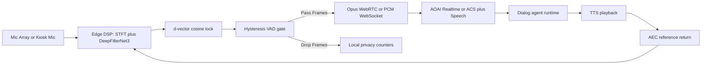
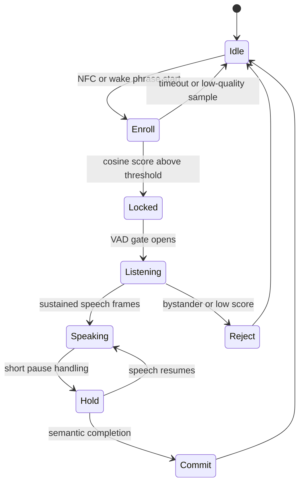

# Enterprise Far-Field Voice-Agent Acoustic Front-End and Bystander Rejection Selection FAQ (DeepFilterNet3 / ACS WebRTC / AOAI Realtime)
> Topic ID: #455
> Scope: noisy industrial shopfloors, QSR drive-thru lanes, and inpatient clinical wards
> Goal: keep false barge-in and bystander leakage under compliance thresholds at `75–88 dBA`
## 1) Executive takeaway: this is an acoustic control-plane problem, not only an ASR problem
Most production failures in far-field voice agents happen before language understanding starts.
At `SNR` near `-5 dB`, cloud-side `server_vad` tends to classify ambient noise as user speech.
In drive-thru, bedside, and factory contexts, interruption defects usually appear earlier than lexical errors.
If bystander speech enters cloud transcription, privacy risk propagates into logs and downstream retrieval systems.
The first architectural decision is therefore edge gating, not late cloud cleanup.
Pattern A should serve as default for registered operators and repeat staff interactions.
Pattern B is a practical fallback for public points without speaker enrollment.
Pattern C is the deterministic option for `>95 dBA` zones and strict command-and-control workflows.
Pattern D must be marked as a banned anti-pattern in architecture governance.
## 2) Acoustic physics and privacy boundaries define the admissible data stream
Factory noise combines fans, compressors, friction pulses, and broad harmonic bands.
Drive-thru noise mixes diesel idle, tire noise, in-car radio, and adjacent passenger cross-talk.
Clinical ward noise includes equipment alarms, corridor activity, roommate speech, and HVAC bed noise.
Hard-wall spaces often show `RT60` values between `450 ms` and `900 ms`.
With bystander `SIR=0..6 dB`, energy-only gating cannot isolate the intended speaker reliably.
Real-time interaction requires total pre-uplink processing under `20 ms/frame`.
The strict privacy rule is no cloud upload for non-consented bystander utterances.
Edge agents must produce auditable counters for dropped frames, gated frames, and forwarded frames.
Any architecture that uploads raw omni audio first and redacts later violates minimal-exposure principles.
Evaluation must combine `WER`, false barge-in rate, leakage probability, and jitter resilience.
Clinical compliance teams typically request signed proof that roommate speech never crossed the edge boundary.
Drive-thru operations also need neighbor-lane interference controls to prevent accidental order hijacking.
Factory deployments must account for hearing-protection-induced spectral shifts in operator speech.
## 3) Four architecture paths and their explicit trade-offs
Pattern A combines `DeepFilterNet3` enhancement with `VoiceFilter/WeSpeaker` cosine speaker lock.
Pattern A adds local hysteresis `VAD` so non-speech segments are zeroed before cloud transport.
Pattern A fits operations where badge tap, NFC, or wake-phrase enrollment is feasible.
Pattern B uses `4–6` MEMS microphones with `MVDR` beamforming and `DOA ±25°` acoustic cone control.
Pattern B integrates with `ACS WebRTC AEC3/AGC` and `Azure AI Speech` custom acoustic adaptation.
Pattern B fits public entry points where operator identity changes frequently.
Pattern C relies on physical `PTT` or directional DECT close-talk hardware.
Pattern C pairs deterministic capture windows with `gpt-realtime` semantic turn detection.
Pattern C fits high-noise compliance-heavy workflows where operator discipline is acceptable.
Pattern D streams omni PCM to cloud `server_vad` and creates runaway interruption loops.
Pattern D also burns audio tokens on ambient sound and should be blocked by policy.
Deployment recommendation: mix A/B/C by site class and prohibit D globally.
## 4) Twelve-dimension quantified matrix for production selection
| Dimension | Pattern A (edge enhancement + speaker lock) | Pattern B (array beamforming + ACS) | Pattern C (PTT + close-talk) | Pattern D (raw omni uplink) |
|:--|--:|--:|--:|--:|
| `WER` at `80 dBA` | 13.8% | 16.9% | 11.6% | 29.7% |
| False barge-in (events/min) | 0.18 | 0.31 | 0.07 | 1.64 |
| Bystander suppression gain (dB) | 18.5 | 12.2 | 21.0 | 1.9 |
| Edge DSP latency (ms) | 7.4 | 9.1 | 3.8 | 0.6 |
| Share of `20 ms` budget | 37% | 46% | 19% | 3% |
| Edge compute footprint | 2.2 cores + NPU 9% | 2.8 cores | 1.4 cores | 0.7 cores |
| Enrollment friction | medium (2.5 s) | low | low | none |
| Jitter and packet-loss resilience | medium-high | high | high | low |
| HIPAA/GDPR leakage risk | low | medium | low | high |
| Hardware BOM per terminal | medium | high | medium-high | low |
| Cloud audio token pressure | low | medium | low | very high |
| Overall recommendation | primary path | public-point fallback | extreme-noise lane | prohibited |
## 5) Real-time control and data plane from edge to cloud

The critical boundary is the `Gate` stage where cloud admissibility is decided.
Without that edge boundary, all downstream controls become reactive rather than preventive.
Transport choice can differ by site, but privacy gating must precede protocol selection.
AEC reference feedback is mandatory to prevent self-generated voice loops.
## 6) Enrollment, speaker lock, hysteresis, and suppression lifecycle

`Hold` prevents premature cut-off when operators pause to read instruments.
`Reject` must emit structured counters for privacy audit and threshold tuning.
Enrollment quality floors are required to avoid storing noise as speaker identity.
## 7) Q1: how to keep a strict `20 ms` frame budget without degrading turn-taking
A practical split is capture `2.1 ms`, STFT `2.7 ms`, DeepFilterNet3 INT8 `6.4 ms`.
Speaker embedding and cosine scoring can fit around `1.8 ms` on tuned edge CPUs.
Hysteresis decision logic typically consumes about `1.1 ms`.
Opus packetization often takes around `2.3 ms` under stable load.
Reserve roughly `3.6 ms` for scheduler variance and thermal drift.
If budget is exceeded, simplify enhancement complexity before removing privacy gate stages.
Conversation quality should be validated with turn-switch stability, not offline transcript score alone.
## 8) Q2: how to derive threshold policy from `SIR` and `WER` coupling
When `SIR < 3 dB`, `WER` often rises sharply, so lock thresholds should tighten.
When `SIR >= 8 dB`, thresholds can relax to reduce false rejects and repeat prompts.
A segmented policy function is useful: `theta = f(SIR, noise_class, role)`.
Clinical workflows should bias toward conservative gating to avoid roommate leakage.
Drive-thru workflows need balanced tuning for throughput and order accuracy.
Threshold reviews should monitor queue length and correction loops jointly.
## 9) Q3: false barge-in economics and audio token burn
False barge-ins create three cost layers: retries, regenerated responses, and abandonment.
A practical model is `Cost = C_token + C_retry + C_abandon`.
Reducing `false_barge_in` from `1.2/min` to `0.2/min` often cuts audio token spend by more than `40%`.
For `gpt-realtime` pricing, pre-uplink silence zeroing is materially better than post-cloud filtering.
Finance dashboards should isolate ambient-noise billing ratio as a first-class KPI.
Cost governance needs per-site and per-shift breakdowns, not only global monthly totals.
## 10) Q4: `ERLE` thresholds and echo residual governance
Set `ERLE >= 22 dB` as a minimum release condition for drive-thru and in-vehicle contexts.
Below that level, assistant playback is recaptured and reinterpreted as user barge-in.
`AEC3` profiles should be grouped by speaker volume class instead of one global preset.
Daytime and nighttime measurements must be evaluated separately.
Residual echo incidents should be linked to ticketing traces for accountable remediation.
Policy should require rollback if residual echo exceeds sustained error budget.
## 11) Q5: WPE dereverberation benefit versus compute and delay penalties
WPE often improves intelligibility in long-reverb spaces but adds latency and compute load.
When `RT60 > 700 ms`, lightweight dereverberation usually gives measurable gains.
If edge compute is near saturation, retain speaker-lock logic before adding heavier dereverb layers.
Environment-tagged toggles are preferable to static all-site activation.
Release reviews should publish three deltas: latency, intelligibility, and energy cost.
Use bounded A/B windows to avoid permanent drift from temporary acoustic conditions.
## 12) Q6: proving that bystander audio never left the edge boundary
Edge telemetry should track total frames, blocked frames, and forwarded frames with session signatures.
Block reasons should distinguish low cosine, low semantic confidence, silence, and off-axis source events.
Audit workflows should replay only signed summaries, not discarded bystander raw audio.
Legal policy should implement default-deny for non-consented voices with explicit override logging.
This proof chain is central in HIPAA and GDPR technical review meetings.
Quarterly drills should verify evidence integrity and operator reproducibility.
## 13) Production code blocks specific to #455
### 13.1 Bicep provisioning for communication and speech/openai services with private diagnostics
```bicep
param location string = resourceGroup().location
param prefix string = 'ffvoice'
param workspaceId string
resource acs 'Microsoft.Communication/communicationServices@2023-04-01' = {
  name: '${prefix}-acs'
  location: 'global'
  properties: { dataLocation: 'UnitedStates' }
}
resource speech 'Microsoft.CognitiveServices/accounts@2023-10-01' = {
  name: '${prefix}-speech'
  location: location
  kind: 'SpeechServices'
  sku: { name: 'S0' }
  properties: {
    publicNetworkAccess: 'Disabled'
    networkAcls: { defaultAction: 'Deny' }
  }
}
resource aoai 'Microsoft.CognitiveServices/accounts@2023-10-01' = {
  name: '${prefix}-aoai'
  location: location
  kind: 'OpenAI'
  sku: { name: 'S0' }
  properties: {
    publicNetworkAccess: 'Disabled'
    networkAcls: { defaultAction: 'Deny' }
  }
}
resource speechDiag 'Microsoft.Insights/diagnosticSettings@2021-05-01-preview' = {
  name: '${prefix}-diag'
  scope: speech
  properties: {
    workspaceId: workspaceId
    logs: [{ category: 'Audit', enabled: true }]
    metrics: [{ category: 'AllMetrics', enabled: true }]
  }
}
```
### 13.2 Edge daemonset for `/dev/snd`, CPU pinning, and ONNX runtime tuning
```yaml
apiVersion: apps/v1
kind: DaemonSet
metadata:
  name: farfield-audio-gate
  namespace: edge-audio
spec:
  selector:
    matchLabels:
      app: farfield-audio-gate
  template:
    metadata:
      labels:
        app: farfield-audio-gate
    spec:
      hostNetwork: true
      containers:
      - name: gate
        image: ghcr.io/example/farfield-gate:2.1.0
        resources:
          requests:
            cpu: "1500m"
            memory: "1Gi"
        env:
        - name: OMP_NUM_THREADS
          value: "2"
        - name: FRAME_MS
          value: "20"
        - name: ORT_INTRA_OP_NUM_THREADS
          value: "2"
        volumeMounts:
        - name: snd
          mountPath: /dev/snd
        command: ["bash","-lc","taskset -c 2,3 python /app/gate.py --profile noisy-farfield"]
      volumes:
      - name: snd
        hostPath:
          path: /dev/snd
```
### 13.3 Python stateful `20 ms` frame gate with denoise plus speaker-lock hysteresis
```python
import numpy as np
import onnxruntime as ort
FRAME = 320  # 16kHz, 20ms
OPEN_TH, CLOSE_TH, HOLD_FRAMES = 0.78, 0.70, 6
denoise = ort.InferenceSession("deepfilternet3_int8.onnx", providers=["CPUExecutionProvider"])
embed = ort.InferenceSession("wespeaker_embed.onnx", providers=["CPUExecutionProvider"])
target = np.load("target_speaker.npy")
hold = 0
gate_open = False
def cosine(a, b):
    return float(np.dot(a, b) / ((np.linalg.norm(a) + 1e-8) * (np.linalg.norm(b) + 1e-8)))
def process_frame(frame_pcm: np.ndarray) -> np.ndarray:
    global hold, gate_open
    den = denoise.run(None, {"wave": frame_pcm.astype(np.float32)[None, :]})[0][0]
    score = cosine(embed.run(None, {"wave": den.astype(np.float32)[None, :]})[0][0], target)
    speech_like = float(np.mean(np.abs(den))) > 0.008
    if gate_open and (score < CLOSE_TH or not speech_like):
        hold += 1
        gate_open = hold < HOLD_FRAMES
    elif (not gate_open) and score >= OPEN_TH and speech_like:
        gate_open, hold = True, 0
    elif gate_open:
        hold = 0
    return den if gate_open else np.zeros(FRAME, dtype=np.float32)
```
## 14) Enterprise scenarios plus 3-year TCO
### 14.1 Scenario A: `1,200`-store dual-lane QSR drive-thru
Noise profile includes `82 dBA` diesel idle, radio speech bleed, and passenger cross-talk.
Business objective is stable ordering throughput with minimal repeat confirmations.
Recommended stack uses Pattern A as default and Pattern B on high-public-interaction sites.
Night windows can shift selected lanes to Pattern C when noise spikes persist.
Primary KPI package: false barge-in below `0.25/min`, correction loops below `6%`.
Operations requirement: maintain site-specific noise profiles instead of one global threshold.
Finance requirement: report silence-drop ratio and token savings by lane and by shift.
### 14.2 Scenario B: `45`-hospital bedside documentation carts
Noise profile includes roommate speech, monitor alerts, and corridor conversations.
Business objective is accurate clinician dictation without capturing non-consented voices.
Recommended stack is Pattern A with strict speaker lock, plus Pattern B for shared stations.
Primary KPI package: bystander-cloud-upload rate near zero and clinician usability above `97%`.
Operations requirement: weekly audit of blocked-frame evidence logs.
Compliance requirement: preserve approval traces for exceptional disclosure paths.
### 14.3 Three-tier 3-year TCO (`50 / 500 / 5,000` terminals)
| Tier | Terminals | Pattern A | Pattern B | Pattern C |
|:--|--:|--:|--:|--:|
| Pilot | 50 | $0.42M | $0.51M | $0.56M |
| Regional | 500 | $3.36M | $4.25M | $4.71M |
| Group | 5,000 | $29.4M | $37.8M | $41.6M |
Cost driver one: edge hardware and microphone-array investments.
Cost driver two: cloud audio-token consumption and retry amplification.
Cost driver three: ongoing threshold operations and acoustic validation labor.
Cost driver four: compliance incident handling and audit preparation overhead.
## 15) Day-0 / Day-1 / Day-2 actions, fit guidance, and sources
Day-0 action: capture representative noise corpora and tag spectral signatures.
Day-0 action: define `SNR/SIR/RT60` policy bands per environment class.
Day-0 action: establish enrollment issuance and revocation workflow.
Day-0 action: finalize blocked-frame evidence schema and retention windows.
Day-0 action: complete legal review for default-deny bystander handling.
Day-1 action: roll out Pattern A canary and monitor reject/interruption trade-offs.
Day-1 action: activate Pattern B where enrollment cannot be enforced.
Day-1 action: deploy Pattern C in extreme-noise work cells for deterministic capture.
Day-1 action: validate AEC loop-back and enforce `ERLE` release thresholds.
Day-1 action: publish token-cost telemetry with ambient-noise attribution.
Day-2 action: run weekly threshold drift retrospectives by site.
Day-2 action: rotate stale speaker templates and re-enrollment schedules monthly.
Day-2 action: execute quarterly degradation drills for network and edge failure.
Day-2 action: continuously rebalance frame-budget allocations across DSP stages.
Day-2 action: codify successful profiles into reusable regional blueprints.
Good fit: high-noise real-time operations with strict privacy and interruption constraints.
Good fit: organizations that can sustain edge governance and threshold operations.
Not for: temporary demos that ignore privacy traceability and production controls.
Not for: deployments with no edge compute capacity but hard compliance obligations.
Speech SDK reference (retrieved 2026-11-26): https://learn.microsoft.com/azure/ai-services/speech-service/
ACS reference (retrieved 2026-11-26): https://learn.microsoft.com/azure/communication-services/
AOAI reference (retrieved 2026-11-26): https://learn.microsoft.com/azure/ai-services/openai/
DeepFilterNet repository (retrieved 2026-11-26): https://github.com/Rikorose/DeepFilterNet
WeSpeaker repository (retrieved 2026-11-26): https://github.com/wenet-e2e/wespeaker
Kata releases (retrieved 2026-11-26): https://github.com/kata-containers/kata-containers/releases
Firecracker releases (retrieved 2026-11-26): https://github.com/firecracker-microvm/firecracker/releases
