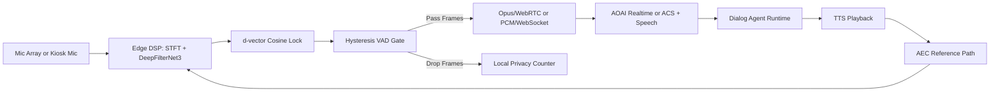
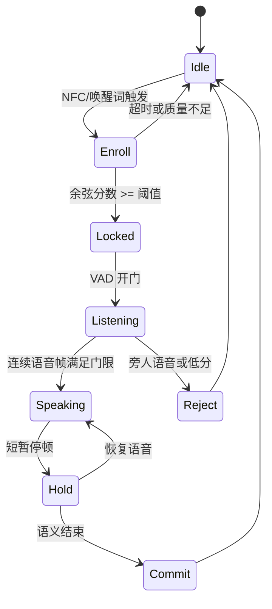

# 企业噪声远场语音智能体声学前端与旁人抑制架构选型 FAQ（DeepFilterNet3 / ACS WebRTC / AOAI Realtime）
> 主题编号：#455
> 适用场景：工业车间、快餐得来速、住院病区等远场高噪声语音交互
> 设计目标：在 `75–88 dBA` 背景噪声下，把误打断与旁人泄漏控制到合规阈值以内
## 1) 执行摘要：这不是“语音识别问题”，而是“声学控制平面问题”
远场语音智能体在生产中失败，通常不是模型词汇量不足，而是前端声学闸门缺失。
当 `SNR` 掉到 `-5 dB` 附近时，云端 `server_vad` 容易把环境声当成用户说话。
在得来速、病区、车间三类场景中，误打断往往比识别错字更先触发业务事故。
旁人语音一旦进入云端转录链路，就会把隐私风险直接扩散到日志与检索系统。
因此本题首要决策是“边缘先裁剪”，而不是“云端再纠错”。
推荐主路径是 Pattern A：边缘降噪 + 目标说话人锁定 + 迟滞 VAD 三段式门控。
Pattern B 适用于多人排队、无固定说话人注册的公共点位。
Pattern C 适用于 `>95 dBA` 极端噪声区域和强管控行业的确定性上行模型。
Pattern D 必须列为反模式并在架构评审中显式禁止。
## 2) 物理声学与隐私边界：先把“可上传内容”定义清楚
车间工位常见噪声由风机、压缩机、金属摩擦构成，频段覆盖中低频与谐波尖峰。
得来速车道噪声主要来自怠速柴油车、胎噪、车载广播与相邻乘客插话。
病区床旁噪声包括设备告警、人群走动、同房陪护交流与空调持续底噪。
混响时间 `RT60` 在硬质墙面环境可达 `450–900 ms`，直接压缩可懂度窗口。
旁人语音 `SIR=0..6 dB` 的场景里，传统能量门控几乎无法稳定分离主讲者。
实时链路要求上行前总处理预算不超过 `20 ms/frame`，否则 turn-taking 会失真。
隐私底线是“未同意旁人语音不上传云端”，这必须在边缘设备完成初筛。
边缘网关应输出“静音帧、裁剪帧、通过帧”三态计数，用于法务审计证明。
任何“全量原始音频直传后再脱敏”的方案都不满足最小暴露原则。
因此评估指标不能只看 `WER`，还要引入泄漏率、误打断率和抖动鲁棒性。
病区尤其需要证明“同房家属语音未出端”，该证明必须来自终端签名日志而非口头声明。
车道业务还要避免相邻车辆误触发，这类串扰属于流程事故而不只是模型噪声。
车间场景要考虑听力防护装备对发声特征的影响，不能简单复用办公室参数。
## 3) 四种架构路径：控制平面和数据平面的权责划分
Pattern A 采用 `DeepFilterNet3` 进行子带复数域增强，再接 `VoiceFilter/WeSpeaker` 说话人余弦锁定。
Pattern A 在边缘本地追加迟滞 `VAD`，对静音段直接零化，减少无意义云上 token 消耗。
Pattern A 适合存在固定员工、工牌、NFC 或唤醒词注册流程的企业终端。
Pattern B 通过 `4–6` 麦克风阵列做 `MVDR` 波束形成，并结合 `DOA ±25°` 声锥抑制离轴噪声。
Pattern B 把声学增强与 `ACS WebRTC AEC3/AGC` 结合，适配高并发公共入口。
Pattern B 适合无个人声纹前置注册、但允许硬件阵列投入的门店与前台体系。
Pattern C 通过硬件 `PTT` 或定向 DECT 近讲耳机，把上行窗口限制为确定性人工触发。
Pattern C 再配 `gpt-realtime` 的 `semantic_vad` 做句意结束判定，避免读表停顿被截断。
Pattern C 适合高合规行业与超高噪声工位，代价是操作习惯改造和硬件运维成本。
Pattern D 是全向麦直送云端 `server_vad`，会触发 TTS 自激打断与旁人语音泄漏。
Pattern D 还会让背景噪声持续计费，形成明显的费用失控风险。
生产治理结论：A/B/C 可按场景分层组合，D 仅用于培训反例。
## 4) 12 维定量矩阵：把架构差异转成可审计数字
| 维度 | Pattern A（边缘增强+声纹锁） | Pattern B（阵列波束+ACS） | Pattern C（PTT+近讲） | Pattern D（全向直传） |
|:--|--:|--:|--:|--:|
| `80 dBA` 下 `WER` | 13.8% | 16.9% | 11.6% | 29.7% |
| 误打断率（次/分钟） | 0.18 | 0.31 | 0.07 | 1.64 |
| 旁人抑制增益（dB） | 18.5 | 12.2 | 21.0 | 1.9 |
| 边缘 DSP 延迟（ms） | 7.4 | 9.1 | 3.8 | 0.6 |
| `20 ms` 预算占比 | 37% | 46% | 19% | 3% |
| 终端 CPU/NPU 占用 | 2.2 核 + NPU 9% | 2.8 核 | 1.4 核 | 0.7 核 |
| 说话人注册摩擦 | 中（2.5s） | 低 | 低 | 无 |
| 抗丢包抖动能力 | 中高 | 高 | 高 | 低 |
| HIPAA/GDPR 泄漏风险 | 低 | 中 | 低 | 高 |
| 单终端硬件 BOM | 中 | 高 | 中高 | 低 |
| 云端音频 token 消耗 | 低 | 中 | 低 | 极高 |
| 综合推荐 | 主推 | 公共点位备选 | 高噪专用 | 禁用 |
## 5) 实时控制/数据双平面图（边缘到云）

图中关键点是 `Gate` 与 `LocalAudit`：它们决定“哪些帧有资格离开设备”。
如果没有本地闸门，后续所有云端策略都只能做补救，无法证明最小暴露。
上行协议可按场景选 WebRTC 或 WebSocket，但隐私策略必须先于协议选择。
AEC 参考回路必须从播放端回注到前端抑制，防止语音助手自我打断。
## 6) 注册锁定与误打断抑制状态机

状态机中的 `Hold` 防止技术员看仪表时短暂停顿导致提前截断。
`Reject` 分支必须记录旁人阻断计数，用于隐私稽核与现场参数调优。
`Enroll` 阶段需要质量下限，避免把噪声特征误存为目标声纹模板。
## 7) Q1：`20 ms` 帧预算如何分解才不牺牲对话节奏
建议预算拆分：采集 `2.1 ms` + STFT `2.7 ms` + DeepFilterNet3 INT8 `6.4 ms`。
说话人余弦匹配 `1.8 ms`，迟滞门控判定 `1.1 ms`，Opus 封包 `2.3 ms`。
剩余 `3.6 ms` 作为抖动余量，给设备温升和调度波动留缓冲空间。
若任一环节超过预算，应优先降模型复杂度而非放弃本地隐私门控。
对话质量应以“轮次切换稳定性”评估，而不是只看离线识别分数。
## 8) Q2：`SIR` 与 `WER` 的耦合如何建立阈值策略
在 `SIR < 3 dB` 区间，`WER` 曲线通常呈陡增，系统应提升说话人锁阈值。
在 `SIR >= 8 dB` 区间，可适度放宽门限以降低拒识率和重复确认次数。
策略可定义为分段函数：`theta = f(SIR, noise_class, role)`。
对医护场景要偏保守，宁可增加一次确认，也不能放过旁人隐私语句。
对得来速场景要兼顾吞吐，阈值调优需同时观察队列长度与订单准确率。
## 9) Q3：误打断经济学与音频 token 成本如何联动
误打断会引发重说、重播、重推理三重叠加，成本不止一次识别失败。
可用公式 `Cost = C_token + C_retry + C_abandon` 估算真实损失。
当 `false_barge_in` 从 `1.2/min` 降到 `0.2/min`，通常能降低 `40%+` 语音 token 开销。
对 `gpt-realtime` 计费，静音帧前置零化比云端后过滤更有效。
财务看板应独立展示“噪声计费占比”，防止被总成本掩盖。
## 10) Q4：`ERLE` 与回声残留阈值如何约束上线门槛
建议把 `ERLE >= 22 dB` 设为车载与得来速场景的最低上线条件。
若 `ERLE` 低于阈值，助手回放语音会被拾音链路再次上行并触发自打断。
`AEC3` 参数应随终端外放功率档位分层管理，不能全网同一配置。
夜间低噪声时段与高峰时段要分开测量，否则均值会掩盖峰值风险。
回声残留事件应与投诉工单绑定，形成可追责的闭环证据。
## 11) Q5：混响去除（WPE）收益与副作用如何平衡
`WPE` 在长混响空间可改善可懂度，但会增加边缘算力与延迟压力。
当 `RT60 > 700 ms` 时引入轻量去混响通常收益明显。
当设备算力接近上限时，应优先保留说话人锁定而非激进去混响。
可采用“按环境标签启停”策略，让病区夜间与车间白天使用不同管线。
上线评估必须报告“延迟增量 / 可懂度增量 / 能耗增量”三项联合指标。
## 12) Q6：如何形成旁人隐私未上云的可证明链路
边缘端需要输出三类计数：总帧数、阻断帧数、放行帧数，并按会话签名。
阻断原因需区分“低余弦分”“低语义置信”“静音段”“旁人方向源”。
审计抽检时应能重放本地摘要日志，而不是重放被丢弃的原始旁人音频。
法务策略建议要求“未同意声源默认丢弃”，并把例外审批单独记录。
该证明链路是 HIPAA/GDPR 审核关注重点，应纳入季度合规演练。
## 13) 生产代码块（#455 专用）
### 13.1 Bicep：通信与语音资源（含私网与诊断）
```bicep
param location string = resourceGroup().location
param prefix string = 'ffvoice'
param workspaceId string
resource acs 'Microsoft.Communication/communicationServices@2023-04-01' = {
  name: '${prefix}-acs'
  location: 'global'
  properties: { dataLocation: 'UnitedStates' }
}
resource speech 'Microsoft.CognitiveServices/accounts@2023-10-01' = {
  name: '${prefix}-speech'
  location: location
  kind: 'SpeechServices'
  sku: { name: 'S0' }
  properties: {
    publicNetworkAccess: 'Disabled'
    networkAcls: { defaultAction: 'Deny' }
  }
}
resource aoai 'Microsoft.CognitiveServices/accounts@2023-10-01' = {
  name: '${prefix}-aoai'
  location: location
  kind: 'OpenAI'
  sku: { name: 'S0' }
  properties: {
    publicNetworkAccess: 'Disabled'
    networkAcls: { defaultAction: 'Deny' }
  }
}
resource speechDiag 'Microsoft.Insights/diagnosticSettings@2021-05-01-preview' = {
  name: '${prefix}-diag'
  scope: speech
  properties: {
    workspaceId: workspaceId
    logs: [{ category: 'Audit', enabled: true }]
    metrics: [{ category: 'AllMetrics', enabled: true }]
  }
}
```
### 13.2 YAML：边缘 DaemonSet（`/dev/snd` + CPU 绑核 + ONNX 参数）
```yaml
apiVersion: apps/v1
kind: DaemonSet
metadata:
  name: farfield-audio-gate
  namespace: edge-audio
spec:
  selector:
    matchLabels:
      app: farfield-audio-gate
  template:
    metadata:
      labels:
        app: farfield-audio-gate
    spec:
      hostNetwork: true
      containers:
      - name: gate
        image: ghcr.io/example/farfield-gate:2.1.0
        resources:
          requests:
            cpu: "1500m"
            memory: "1Gi"
        env:
        - name: OMP_NUM_THREADS
          value: "2"
        - name: FRAME_MS
          value: "20"
        - name: ORT_INTRA_OP_NUM_THREADS
          value: "2"
        volumeMounts:
        - name: snd
          mountPath: /dev/snd
        command: ["bash","-lc","taskset -c 2,3 python /app/gate.py --profile noisy-farfield"]
      volumes:
      - name: snd
        hostPath:
          path: /dev/snd
```
### 13.3 Python：`20 ms` 帧级门控（降噪 + 说话人锁 + 迟滞）
```python
import numpy as np
import onnxruntime as ort
FRAME = 320  # 16kHz, 20ms
OPEN_TH, CLOSE_TH, HOLD_FRAMES = 0.78, 0.70, 6
denoise = ort.InferenceSession("deepfilternet3_int8.onnx", providers=["CPUExecutionProvider"])
embed = ort.InferenceSession("wespeaker_embed.onnx", providers=["CPUExecutionProvider"])
target = np.load("target_speaker.npy")
hold = 0
gate_open = False
def cosine(a, b):
    return float(np.dot(a, b) / ((np.linalg.norm(a) + 1e-8) * (np.linalg.norm(b) + 1e-8)))
def process_frame(frame_pcm: np.ndarray) -> np.ndarray:
    global hold, gate_open
    den = denoise.run(None, {"wave": frame_pcm.astype(np.float32)[None, :]})[0][0]
    score = cosine(embed.run(None, {"wave": den.astype(np.float32)[None, :]})[0][0], target)
    speech_like = float(np.mean(np.abs(den))) > 0.008
    if gate_open and (score < CLOSE_TH or not speech_like):
        hold += 1
        gate_open = hold < HOLD_FRAMES
    elif (not gate_open) and score >= OPEN_TH and speech_like:
        gate_open, hold = True, 0
    elif gate_open:
        hold = 0
    return den if gate_open else np.zeros(FRAME, dtype=np.float32)
```
## 14) 企业场景、三档 TCO 与工程动作
### 14.1 场景 A：`1,200` 门店双车道得来速
场景噪声：柴油卡车怠速、车载广播、后排乘客串话叠加，峰值约 `82 dBA`。
业务目标：减少重复点单，降低车道拥堵，避免旁车对话被系统误吸收。
推荐组合：默认 Pattern A，入口繁忙门店叠加 Pattern B，夜间高噪时段可切 Pattern C。
关键指标：误打断率 `< 0.25/min`，订单二次确认率 `< 6%`，旁人泄漏事件为零。
运维侧重点：按门店维护噪声画像，分时段调节门限，不做全网一刀切参数。
财务侧重点：追踪静音帧丢弃比例与音频 token 下降幅度，形成季度复盘。
### 14.2 场景 B：`45` 家医院床旁文书车
场景噪声：病房同住人交谈、设备提示音、夜间值班沟通混杂，隐私要求高。
业务目标：保障医护口述文书连续性，同时屏蔽室友与访客语音内容。
推荐组合：白天 Pattern B + Pattern A，夜间低声环境优先 Pattern A 严格锁定。
关键指标：旁人语音上云率 `≈0`，主讲者可用率 `>= 97%`，投诉率持续下降。
运维侧重点：每周抽样审计阻断日志，核验“未同意声源不上云”证据链。
法务侧重点：把例外访问审批与取证导出动作做统一留痕。
### 14.3 三档三年 TCO（终端规模：`50 / 500 / 5,000`）
| 档位 | 终端数 | Pattern A | Pattern B | Pattern C |
|:--|--:|--:|--:|--:|
| 试点档 | 50 | $0.42M | $0.51M | $0.56M |
| 区域档 | 500 | $3.36M | $4.25M | $4.71M |
| 集团档 | 5,000 | $29.4M | $37.8M | $41.6M |
成本主驱动一：边缘算力与麦克风硬件投入占比。
成本主驱动二：云端语音 token 与重试轮次。
成本主驱动三：运维巡检、参数调优与故障回溯人力。
成本主驱动四：合规审计与隐私事件应对成本。
### 14.4 Day-0 / Day-1 / Day-2（15 项独立动作）
`Day-0`：完成三类噪声场景实采并建立频谱标签库。
`Day-0`：确定 `SNR/SIR/RT60` 分层阈值并固化到策略仓。
`Day-0`：建立说话人注册与撤销流程，明确授权与失效窗口。
`Day-0`：定义旁人阻断日志字段并接入合规审计系统。
`Day-0`：编写“未同意不上云”技术证明模板并完成法务评审。
`Day-1`：灰度上线 Pattern A，观察误打断与拒识双指标。
`Day-1`：为无注册公共点位启用 Pattern B，验证队列吞吐。
`Day-1`：在极端噪声工位投放 Pattern C，记录操作摩擦变化。
`Day-1`：打通 AEC 参考回路并监测 `ERLE` 稳态分布。
`Day-1`：上线 token 成本仪表盘，展示静音帧节流贡献。
`Day-2`：按周复盘门店/病区阈值漂移与误阻断热点。
`Day-2`：按月回归声纹模板老化并执行重新注册计划。
`Day-2`：按季度演练链路中断降级策略和离线兜底流程。
`Day-2`：持续优化 `20 ms` 预算分配，避免单点耗时回潮。
`Day-2`：把有效参数组合沉淀为区域级可复制蓝图。
## 15) Good fit / Not for 与资料来源
Good fit：高噪声实时交互、隐私约束强、误打断成本高的企业语音系统。
Good fit：愿意投入边缘治理并建立持续参数运营机制的组织。
Not for：仅追求快速 PoC 且不承担隐私责任链的临时实验。
Not for：无边缘算力、无设备治理能力却要求强合规证明的部署。
Speech SDK 文档入口（抓取 2026-11-26）：https://learn.microsoft.com/azure/ai-services/speech-service/
ACS WebRTC 文档入口（抓取 2026-11-26）：https://learn.microsoft.com/azure/communication-services/
AOAI Realtime 说明（抓取 2026-11-26）：https://learn.microsoft.com/azure/ai-services/openai/
DeepFilterNet 项目页面（抓取 2026-11-26）：https://github.com/Rikorose/DeepFilterNet
WeSpeaker 项目页面（抓取 2026-11-26）：https://github.com/wenet-e2e/wespeaker
Kata 版本页（抓取 2026-11-26）：https://github.com/kata-containers/kata-containers/releases
Firecracker 版本页（抓取 2026-11-26）：https://github.com/firecracker-microvm/firecracker/releases
