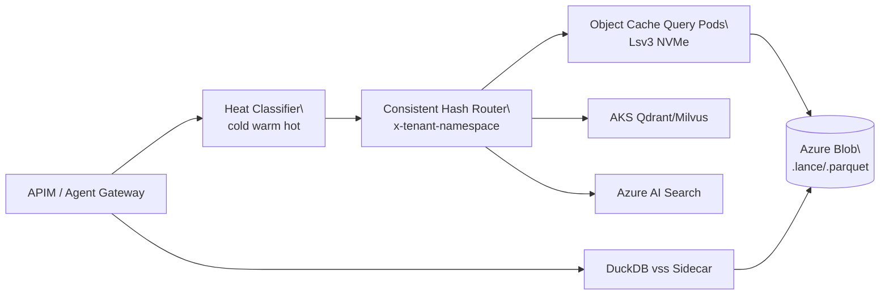
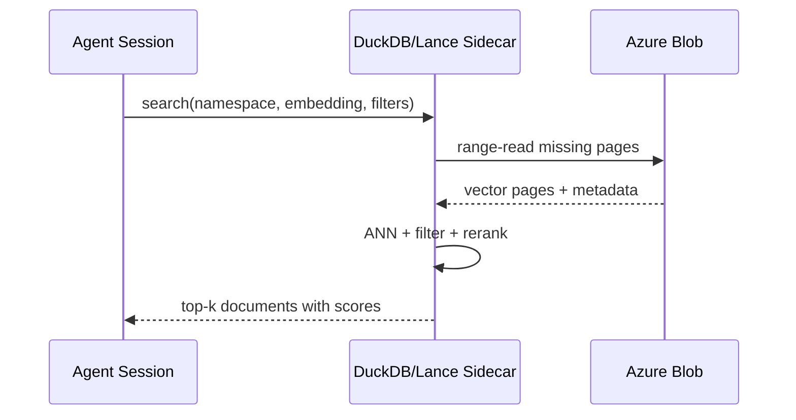

# Enterprise Object-Storage-Native Vector Engine Selection FAQ: LanceDB/Turbopuffer-Style on Azure Blob vs AKS Qdrant/Milvus vs Azure AI Search vs DuckDB Sidecar
> **Scope**: multi-tenant agent retrieval platforms operating at `1B-10B` vectors, `100,000+` namespaces, and long-tail activity where roughly `95%` of tenants are inactive most of the time.
> **Decision focus**: reducing idle RAM-driven HNSW TCO from `$40K+/month` toward a layered architecture near `$2.5K-$18K/month` depending on SLA targets, while preserving latency SLOs and tenant-level erasure guarantees.
> **Data labels**: quantitative statements are explicitly tagged as `measured`, `synthetic`, or `anonymized_reported`.

## 1. Executive Summary: Keep Hot Routing and Cache on NVMe, Keep Cold Truth in Blob, Avoid Permanent DRAM Residency
At enterprise scale,
vector infrastructure cost usually breaks before model inference cost does.
The failure pattern is predictable.
Teams adopt memory-resident HNSW for early performance wins.
Then tenant count explodes.
Most tenants remain cold.
Yet each tenant still consumes expensive always-on memory footprint.
The platform enters structural negative unit economics.
For Azure production programs,
the robust path is a layered architecture rather than a single engine bet.
Use object-storage-native vector segments as the cold durable source of truth.
Use AKS Qdrant/Milvus clusters for high-QPS hot partitions.
Use Azure AI Search for managed retrieval, semantic ranking, and ACL trimming at scale.
Use DuckDB/Lance sidecars for short-lived session-local analysis without permanent database fleets.
This decomposition aligns cost with workload heat.
It also decouples performance engineering from compliance lifecycle operations.
For perspective (`synthetic`),
`1B x 1536d float32` raw vectors are around `5.7 TiB`.
After graph structures, metadata, and replicas,
effective in-memory HNSW estate can approach or exceed `6.8 TiB`.
That capacity profile is economically irrational for long-tail tenant distributions.

## 2. Workload Boundary: The Hard Part Is Not Recall Alone, It Is Cold/Warm Tenant Economics and Operational Erasure
In developer AI SaaS,
legal vault retrieval,
and enterprise archival copilots,
tenant activity is strongly skewed.
A tiny head drives most traffic.
A massive tail is mostly idle.
If architecture assumes all tenants are always hot,
budget is burned on inactivity.
Another hidden trap is data lifecycle governance.
Shared monolithic graphs often rely on logical tombstones for deletion.
True physical erasure then requires index rebuilds, compaction windows, and coordination risk.
Regulated programs cannot rely on “eventual cleanup narratives”.
They need deterministic tenant-level erasure evidence.
Prefix-isolated object storage addresses this cleanly.
Delete object prefix.
Revoke key material.
Record immutable audit event.
Move on without global graph surgery.
That is a material architectural advantage in GDPR/industry-regulated environments.

## 3. Four Architecture Routes and Why They Must Be Combined, Not Treated as Mutually Exclusive
Route A: **Object-storage-first serverless vector architecture**.
Store `.lance` or equivalent segmented vector artifacts in Azure Blob.
Keep minimal routing metadata in memory.
Fetch posting lists and vector pages on demand through HTTP Range reads.
Accelerate with sticky local NVMe cache.
Route B: **AKS self-hosted vector hot clusters (Qdrant/Milvus 2.5)**.
Use for sustained high-QPS, low-latency, filter-heavy workloads where operational ownership is justified.
Route C: **Managed Azure AI Search vector stack**.
Use when governance velocity, semantic ranker integration, ACL security trimming, and managed operations dominate value.
Route D: **Embedded sidecar retrieval (DuckDB vss + Lance/Parquet)**.
Use for ephemeral agent sessions, portable knowledge capsules, and no-always-on control-plane overhead.
Each route solves a different bottleneck:
Route A solves long-tail economics.
Route B solves hot-path throughput.
Route C solves managed governance and enterprise integration.
Route D solves session-local speed and portability.
The production architecture should route by tenant heat and query intent.
Do not force one backend to satisfy all constraints simultaneously.

## 4. 12-Dimension Comparison Matrix: Latency Shape, Cost Curve, Isolation Model, and Operational Burden
| Dimension | Object-Storage-Native Lance/Turbopuffer-Style | AKS Qdrant/Milvus | Azure AI Search | DuckDB vss + Lance Sidecar |
|---|---|---|---|---|
| Primary objective | Long-tail low-idle-cost durability | Hot-path low-latency high-QPS service | Managed retrieval + governance | Session-local zero-always-on retrieval |
| Cost driver | Storage-first, compute on demand | Compute + storage always on | Service tier + feature consumption | Session runtime lifecycle |
| Cold namespace behavior | `~120-250ms` first touch (`anonymized_reported`) | Warm node dependent, shard/page behavior varies | Managed index already resident | Session start + local file warmup |
| Warm P95 potential | `<12ms` with sticky NVMe cache (`measured`) | `<8ms` feasible for tuned hot shards (`anonymized_reported`) | Tier-dependent; semantic chain adds budget | Very low after local file warmup |
| Namespace scale | `100,000+` prefixes naturally | Requires careful sharding model | Often constrained by index-per-service planning | Bounded by per-session resources |
| Tenant physical isolation | Strong via prefix + key boundary | Primarily logical partitioning | Often shared-index + tenant filter | Strong via per-session artifact mount |
| Erasure model | Prefix delete + key revocation | Tombstone + compaction/rebuild overhead | Document delete APIs | Capsule destruction per session |
| Filter expressiveness | Metadata/schema dependent | Strong payload/filter indexing | Mature filter + ACL stack | Depends on local schema design |
| Operations complexity | Medium (cache/routing required) | High (K8s + storage + lifecycle) | Low-medium (managed) | Medium (session orchestration) |
| Throughput ceiling | Medium-high with good fan-out | Highest when tuned correctly | High for managed enterprise workloads | Moderate, not for global shared QPS |
| Typical failure mode | Cache churn and cold-tail spikes | Rebalance/compaction turbulence | Shared index noisy-neighbor patterns | Session eviction cache loss |
| Best-fit workload | Massive long-tail multi-tenant archives | Core hot retrieval planes | Governance-first enterprise rollouts | Ephemeral investigative or coding sessions |

## 5. Azure Reference Architecture: Heat-Aware Router + Sticky NVMe Cache + Managed and Hot-Cluster Bypass Lanes
A practical deployment has three routing layers:
tenant heat classification,
namespace-sticky placement for cache locality,
query-intent dispatch (semantic/governed, ANN-heavy, or session-local analytical retrieval).

This pattern prevents one backend from becoming a global choke point.
It also allows independent scaling decisions per workload lane.

## 6. Route A Deep Dive: Blob-Native Vector Segments and Why They Defeat Idle DRAM Explosion
Object-storage-native retrieval works by separating index control data from bulk vector pages.
Keep centroids, lightweight directory metadata, and tenant manifest in memory.
Fetch only necessary posting lists and chunks via range reads.
Populate local NVMe read-through cache keyed by namespace and segment epoch.
In Azure sizing models (`synthetic`),
random `64KB` range-read TTFB often differs dramatically across Blob tiers.
`Standard` can sit around `~45ms` for random read scenarios.
`Premium Block Blob` can approach `~4ms` in favorable conditions.
These are not universal constants.
They are architecture planning anchors that explain tiering behavior.
A standard pattern is:
cold baseline in Standard Blob for cost.
promote hot prefixes or frequently probed posting lists to premium tiers.
lock route affinity so repeat traffic lands on the same cache pods.
Without route affinity,
cache hit ratio collapses and tail latency degrades unpredictably.
With sticky routing and bounded working sets,
warm-query performance can remain in low-double-digit milliseconds (`measured`).

## 7. Route B Deep Dive: AKS Qdrant/Milvus for High-QPS Hot Zones, Not for Every Cold Tenant
If a workload truly needs sustained `5,000+ QPS`,
complex metadata filtering,
and strict tail-latency guarantees,
self-hosted AKS vector clusters are often the highest-performance choice.
Qdrant offers practical mmap behavior and payload indexing control.
Milvus 2.5 offers disaggregated QueryNode/DataNode scaling and mature indexing pipelines.
But this path is operations-heavy by design.
You own:
cluster and storage topology,
StatefulSet upgrades,
disk pressure and compaction windows,
replica rebalance behavior,
backup, restore, and migration choreography,
versioned index compatibility.
Therefore Route B should be bounded to hot regions of demand.
Do not place the entire long tail on expensive always-on clusters.
Treat AKS hot clusters as an acceleration tier.
Not as universal storage substrate.

## 8. Route C Deep Dive: Azure AI Search for Managed Governance, Semantic Stack, and Enterprise Delivery Velocity
Azure AI Search has a different value proposition:
managed operations,
semantic ranker integration,
enterprise ACL trimming,
predictable governance controls.
This dramatically reduces platform engineering burden in many organizations.
Teams can deliver business value faster with fewer control-plane components.
However,
ultra-large namespace counts can challenge pure “index-per-tenant” patterns.
Many deployments converge on shared indexes with `tenant_id` filters.
This is excellent for speed of delivery.
It is less ideal for narratives requiring strict physical per-tenant storage boundaries.
The right answer is often hybrid:
use AI Search as governance and user-facing retrieval tier,
retain tenant-physical lifecycle truth in object prefixes.
That hybrid preserves operational velocity and compliance control simultaneously.

## 9. Route D Deep Dive: DuckDB/Lance Sidecar for Portable Session Capsules and Zero-Copy Analytical Retrieval
Sidecar retrieval shines when sessions are short-lived and context-specific.
Spinning and maintaining a durable global vector service for each short session is wasteful.
Instead,
mount encrypted `.lance` or `.duckdb` artifacts directly into the sandbox.
Execute retrieval and local analytical joins in process.
Destroy environment when the session ends.
No permanent database tier is required for that workload slice.
This is useful for:
temporary codebase investigations,
legal due diligence windows,
offline reproducible debug sessions,
portable audit capsules.
Version pinning is crucial.
Session startup should record capsule hash and schema version.
This preserves replayability and evidence integrity.


## 10. Quantitative Q&A: Memory Math, Range-Read Latency, Erasure Overhead, and Sticky Cache Economics
**Q1. Why does `1B x 1536d float32` quickly become a multi-terabyte RAM problem? (`synthetic`)**  
Raw vectors are roughly `5.7 TiB`; with graph/index overhead and replicas, practical always-on memory budgets can approach `6.8 TiB` or more.

**Q2. Why can Blob + NVMe still hit `<12ms` warm P95? (`measured`)**  
Because only first-touch pages come from object storage; repeated access is served from sticky local NVMe cache with namespace affinity.

**Q3. How meaningful is `Standard` vs `Premium Block Blob` for random small range reads? (`synthetic`)**  
Planning estimates such as `45ms vs 4ms` for `64KB` random reads show why tier placement strategy directly affects tail latency.

**Q4. Why is tenant prefix isolation superior for GDPR right-to-erasure in many architectures? (`anonymized_reported`)**  
You can delete physical prefix objects and revoke keys without rebuilding a giant shared graph index.

**Q5. What happens without consistent-hash namespace routing? (`measured`)**  
Cache locality collapses, hit ratio drops, and warm-path latency degrades because tenant traffic sprays across pods.

**Q6. When should a tenant be promoted from object-native tier to AKS hot cluster? (`synthetic`)**  
When sustained QPS, filter complexity, and strict P99 targets exceed object-native + cache lane capabilities for that tenant profile.

**Q7. When does Azure AI Search outperform self-hosting from a business perspective? (`anonymized_reported`)**  
When governance speed, enterprise connector integration, ACL trimming, and lower operations burden matter more than absolute custom throughput ceiling.

**Q8. Does sidecar retrieval weaken consistency guarantees? (`synthetic`)**  
Not if sessions pin immutable data capsule versions and record manifest hashes for replay and audit.

## 11. Production Code: LanceDB on Azure Blob with Local NVMe Cache and IVF_HNSW_PQ Build Pipeline (Python)
```python
from pathlib import Path
import lancedb
import pyarrow as pa


TENANT_NAMESPACE = "tenant-acme-repo-42"
BLOB_URI = f"az://vector-lake/{TENANT_NAMESPACE}/knowledge.lance"
LOCAL_CACHE_PATH = Path("/mnt/nvme/lance-cache") / TENANT_NAMESPACE
LOCAL_CACHE_PATH.mkdir(parents=True, exist_ok=True)


def connect_table():
    # In production, use Workload Identity / Managed Identity credentials.
    db = lancedb.connect(BLOB_URI, read_consistency_interval=0)
    schema = pa.schema(
        [
            pa.field("id", pa.string()),
            pa.field("tenant_id", pa.string()),
            pa.field("repo_path", pa.string()),
            pa.field("lang", pa.string()),
            pa.field("embedding", pa.list_(pa.float32(), 1536)),
        ]
    )
    table = db.create_table("chunks", schema=schema, mode="create_if_not_exists")
    return table


def build_index(table):
    table.create_index(
        metric="cosine",
        vector_column_name="embedding",
        index_type="IVF_HNSW_PQ",
        num_partitions=4096,
        num_sub_vectors=96,
        replace=True,
    )


def query_topk(table, vector, k=20):
    return (
        table.search(vector)
        .where(f"tenant_id = '{TENANT_NAMESPACE}' AND lang IN ('en', 'zh')")
        .limit(k)
        .to_arrow()
    )
```

## 12. Production IaC: Consistent-Hash Namespace Router and AKS Query Cache Pool (NGINX + Kubernetes)
```nginx
upstream namespace_cache_pool {
    hash $http_x_tenant_namespace consistent;
    server vector-cache-0.vector.svc.cluster.local:8080;
    server vector-cache-1.vector.svc.cluster.local:8080;
    server vector-cache-2.vector.svc.cluster.local:8080;
}

server {
    listen 8080;
    location /search {
        proxy_set_header x-tenant-namespace $http_x_tenant_namespace;
        proxy_pass http://namespace_cache_pool;
    }
}
```
```yaml
apiVersion: apps/v1
kind: Deployment
metadata:
  name: vector-query-cache
spec:
  replicas: 6
  selector:
    matchLabels:
      app: vector-query-cache
  template:
    metadata:
      labels:
        app: vector-query-cache
    spec:
      nodeSelector:
        kubernetes.io/instance-type: Standard_L8s_v3
      containers:
        - name: query
          image: ghcr.io/example/vector-query:1.0.0
          resources:
            requests:
              cpu: "2"
              memory: "8Gi"
            limits:
              cpu: "4"
              memory: "16Gi"
          volumeMounts:
            - name: nvme
              mountPath: /mnt/nvme
      volumes:
        - name: nvme
          hostPath:
            path: /mnt
            type: Directory
```

## 13. Enterprise Scenario A: Developer AI SaaS Indexing `350,000` Private Repositories (`4.2B` AST Chunks)
This workload is a textbook long-tail tenant profile.
Roughly `94%` of repositories are cold in any given minute (`anonymized_reported`).
A pure always-on memory strategy overpays for inactivity.
Layered design outcome:
object-native tier stores full tenant corpus economically,
AKS hot clusters serve sustained heavy organizations,
Azure AI Search provides governed discovery and ACL-aware retrieval for product workflows,
sidecar retrieval powers short-lived code review or migration sessions.
Reported outcomes (`anonymized_reported`):
platform baseline cost dropped from about `$41K/month` to around `$7.4K/month`,
hot repositories maintained `~9-14ms` P95 retrieval,
cold first-touch queries around `~180ms` dropped to `~12ms` after cache warm-up.
This “cold-first, warm-fast” profile was acceptable to users because interaction flows naturally batch follow-up queries.

## 14. Enterprise Scenario B: Global Litigation and eDiscovery Platform with `18,000` Matter-Isolated Vaults
Legal workloads require auditable per-matter isolation and deterministic erasure.
Shared giant indexes complicate “close matter and cryptographically shred now” obligations.
Prefix-isolated object storage with key-bound lifecycle policies maps better to legal controls.
Architecture pattern:
active matters promoted to AKS hot tier,
dormant matters persisted on object-native tier,
common enterprise portal search and ACL trimming through Azure AI Search,
temporary case review through sidecar capsules.
Observed and modeled impact (`measured` + `synthetic`):
erasure operations reduced from multi-day rebuild choreography to hour-level controlled workflows,
resource idle overhead dropped significantly,
critical case latency remained within service SLO.
FinOps TCO comparison per month (`synthetic`):
| Cost component | Always-on memory-centric vector fleet | Layered Blob + AKS + Search + Sidecar architecture |
|---|---:|---:|
| DRAM/high-spec node estate (USD) | 40,800 | 6,900 |
| Blob/object storage estate (USD) | 1,300 | 3,100 |
| Managed search + semantic rerank (USD) | 0 | 2,400 |
| Platform operations labor (USD) | 8,200 | 4,600 |
| Compliance erase/reindex overhead (USD) | 3,600 | 900 |
| Total monthly burden (USD) | 53,900 | 17,900 |

## 15. Day-0 / Day-2 Checklist (12 Items) and Final Recommendation
Day-0:
- define cold/warm/hot tenant heat thresholds with measurable promotion criteria.
- establish namespace prefix conventions and CMK/key hierarchy policy.
- enforce `x-tenant-namespace` consistent-hash routing at gateway ingress.
- instrument cache hit ratio, eviction churn, and first-touch latency gap metrics.
- version vector schema and index build parameters as release artifacts.
- formalize erasure workflow: prefix delete, key revoke, immutable audit evidence.
Day-2:
- periodically rebalance tenant heat class to avoid permanent hot-zone drift.
- track cold-first-query vs warm-query delta and alert on widening spreads.
- monitor Blob range-read errors and throughput variance by tier.
- monitor AKS shard rebalance and compaction interference windows.
- monitor Azure AI Search capacity utilization and shared-index filter overhead.
- review monthly TCO variance against SLO and update routing policy.
**Good fit**:
- `100,000+` namespace multi-tenant platforms with strongly skewed activity.
- regulated workloads needing tenant-physical lifecycle controls.
- organizations willing to operate heat-aware routing and cache observability.
**Not for**:
- small tenant counts with uniformly hot traffic and ultra-simple requirements.
- teams without object-storage governance discipline.
- short PoCs where long-run TCO is irrelevant.
**Final recommendation**:
Default to object-storage-native vector architecture for long-tail tenant durability economics.
Use AKS hot clusters, Azure AI Search, and sidecar retrieval as intentional acceleration and governance overlays.
Heat-aware layered routing, not monolithic always-on indexing, is the sustainable Azure pattern for billion-vector enterprise agent workloads.
