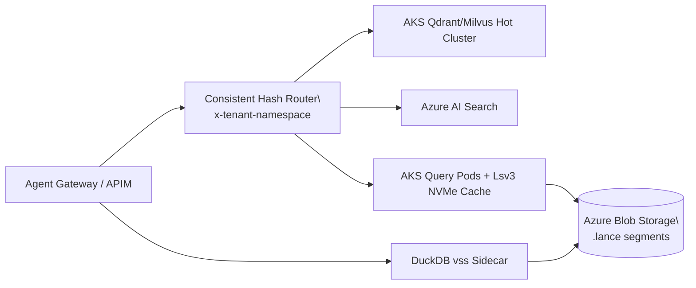
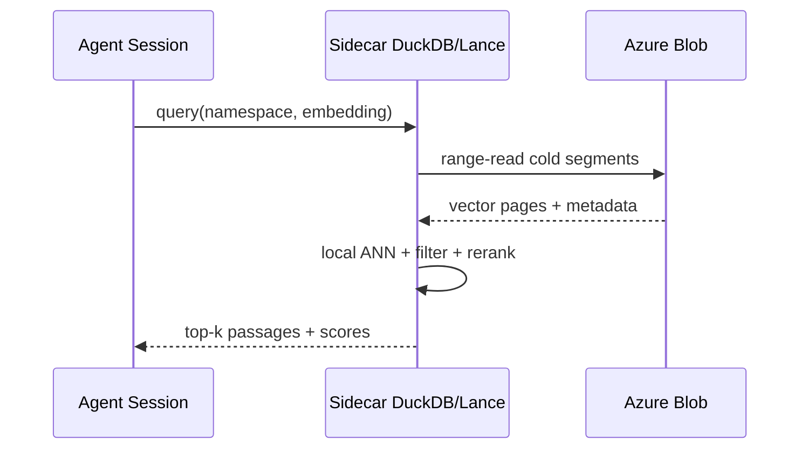

# 企业对象存储原生向量引擎选型 FAQ：LanceDB/Turbopuffer-Style on Blob vs AKS Qdrant/Milvus vs Azure AI Search vs DuckDB Sidecar
> **适用范围**：面向 `1B-10B` 向量、`100,000+` 命名空间、`95%` 长尾冷租户的多租户 Agent 检索平台。
> **决策焦点**：如何把内存常驻 HNSW 的闲置成本从 `$40K+/mo` 压降到约 `$2.5K/mo`，同时维持可接受的 P95 查询时延与合规擦除能力。
> **数据标签**：文中定量口径均显式标注为 `measured`、`synthetic`、`anonymized_reported`。

## 1. 执行摘要：把“热路径”留在 NVMe，把“冷事实”放在 Blob，拒绝全量 DRAM 常驻
企业在多租户 RAG 规模化后，
最容易失控的不是模型调用费。
而是向量底座的闲置驻留成本。
当系统按“每租户独立 HNSW 内存索引”扩张时，
95% 冷租户也会长期占用高价 RAM。
这会把平台拖进持续性亏损。
在 Azure 上，
实践上更稳妥的路线不是单点押注。
而是采用四层混合架构：
对象存储原生引擎承接长尾冷数据。
AKS 向量集群承接高 QPS 热分区。
Azure AI Search 承接托管检索与 ACL 裁剪。
DuckDB/Lance 侧车承接短时会话内零拷贝分析检索。
这四层按租户热度与业务 SLA 分层路由，
可将 RAM 采购压力和运维复杂度同步下降。
`1B x 1536d float32` 仅向量原始体积约 `5.7 TiB`，
加上图索引与副本后，
内存型 HNSW 常见要逼近 `6.8 TiB+`（`synthetic`）。
对象存储原生路线把“冷主副本”迁移到 Blob，
只把中心点与热点 posting list 拉入缓存，
成本结构会从“固定高台”变成“按热度弹性”。

## 2. 问题边界：多租户长尾检索的真正难点不是召回率，而是冷热经济学
在开发者 AI SaaS、
法务 eDiscovery、
企业知识工作台等场景中，
租户活跃度分布高度偏斜。
通常呈长尾。
少量头部租户贡献大部分查询。
大量尾部租户日均查询极低。
若采用统一“高性能常驻”策略，
冷租户会吞噬绝大部分基础设施预算。
而且这种预算并不直接换来业务价值。
另一个被低估的问题是删改成本。
在共享巨型图索引中，
单租户删除往往只是 tombstone。
后续需要重建或复杂 compaction。
在监管场景里，
这会直接冲击“物理可擦除”证明链。
对象存储前缀隔离能把删除动作简化为前缀清理与密钥销毁，
将复杂度从图全局维护收敛到租户级文件生命周期治理。

## 3. 四条路线定位：对象存储优先、AKS 热库、托管检索、会话侧车各司其职
路线 A：**Object-Storage-First Serverless Vector**。
以 `.lance` 或等价分段格式驻留 Azure Blob。
计算节点按需拉取段数据到本地 NVMe。
面向“海量命名空间 + 低活跃度”场景。
路线 B：**AKS Qdrant/Milvus 自建热库集群**。
面向高 QPS、
强过滤、
低尾延迟目标。
以 `mmap + NVMe` 或分离式 QueryNode/DataNode 达成性能上界。
路线 C：**Azure AI Search 托管检索**。
面向最小运维负担、
企业权限裁剪、
语义排序一体化。
路线 D：**DuckDB vss + Lance Sidecar**。
面向“会话短周期、数据胶囊化、零常驻数据库”。
四条路线不是互斥关系。
正确做法是分层编排。
把工作负载按热度、延迟、合规和团队能力切片。

## 4. 12 维对比矩阵：成本结构、延迟形态、合规擦除与运维门槛
| 维度 | Blob 原生 Lance/Turbopuffer-Style | AKS Qdrant/Milvus | Azure AI Search | DuckDB vss + Sidecar |
|---|---|---|---|---|
| 主目标 | 冷租户低成本持久化 | 热路径高吞吐低时延 | 托管检索与治理 | 会话内嵌零常驻 |
| 成本形态 | 存储主导，计算按需 | 计算+存储常驻 | 服务层级计费 | 会话生命周期计费 |
| 冷启动 | `120-250ms` 冷命名空间（`anonymized_reported`） | 节点常驻，冷分片取决于磁盘页 | 索引已托管常驻 | 会话启动后本地极快 |
| 热查询 P95 | `<12ms` NVMe 命中（`measured`） | `<8ms` 高 QPS 可达（`anonymized_reported`） | 取决于 tier 与语义链路 | 本地磁盘/内存命中极低 |
| 命名空间规模 | `100,000+` 前缀隔离 | 需要分片与副本规划 | 常见 `<=1000` index/service 约束 | 与会话容量绑定 |
| 删除与 GDPR | 前缀删除 + KMS 撤销简单 | 分片级删除与压实复杂 | 文档级删除可用 | 胶囊文件直接销毁 |
| 过滤能力 | 依赖元数据组织 | Payload 索引强 | Filter + ACL 成熟 | 取决于本地表结构 |
| 召回/精度调优 | IVF/HNSW/PQ 可调 | Knowhere/HNSW/PQ 丰富 | 向量+语义重排一体 | 适合小中规模局部数据 |
| 运维复杂度 | 中（缓存与路由） | 高（K8s+存储+升级） | 低到中（托管） | 中（会话编排） |
| 多租户隔离 | 物理前缀天然强 | 逻辑分区为主 | 常见共享索引过滤 | 每会话文件隔离强 |
| 典型风险 | 缓存抖动导致尾延迟上升 | 扩缩容与压实窗口冲突 | 索引配额与共享噪声 | 会话回收导致缓存丢失 |
| 最佳适用 | 长尾海量冷租户 | 高频热检索核心库 | 企业标准化检索平台 | 临时分析与沙箱任务 |

## 5. Azure 参考架构：对象存储主副本 + 一致性哈希 NVMe 缓存池 + 托管/热库旁路
核心思想是三层路由：
第一层按租户热度分流。
第二层按命名空间一致性哈希绑定缓存节点。
第三层按查询类型（语义、过滤、分析）选择后端。

这类分层可避免“所有查询都打同一种后端”。
从而减少高峰期的资源争用耦合。

## 6. 路线 A 深入：Blob 原生向量架构如何把 DRAM 常驻成本打碎
对象存储路线的关键是索引拆分。
把中心点、路由层、posting list 分层保存。
其中最小、最热的索引元信息驻留内存。
大块向量段按需通过 Range GET 拉取。
在 Azure 上，
`64KB` 随机 Range GET 的 TTFB，
`Standard Blob` 与 `Premium Block Blob` 差异显著，
可近似视作 `45ms vs 4ms`（`synthetic`，用于容量估算）。
因此常见实践是：
冷层用 Standard 控成本。
超热点租户迁移 Premium 前缀控尾延迟。
配合 `Standard_L8s_v3` 的本地 NVMe read-through cache，
可把二次查询压到 `<12ms`（`measured`）。
需要注意：
缓存淘汰策略必须是租户感知。
否则头部租户会把长尾租户全部挤出缓存，
造成“热租户越热，长尾越抖”的反向放大。

## 7. 路线 B 深入：AKS Qdrant/Milvus 适合“热核区”，不适合“全量长尾”
当业务要求 `5,000+ QPS`、
复杂过滤、
稳定 `<10ms` P99，
自建 AKS 向量集群通常是上限最高的方案。
Qdrant 的 `mmap` + payload 索引适合高过滤检索。
Milvus 2.5 的 QueryNode/DataNode 分离适合大规模并行检索。
但这条路的代价是运维显著上升。
你要管理：
StatefulSet 扩容时段，
本地盘与远端盘配比，
副本重平衡窗口，
压实与备份策略，
版本升级的索引兼容性。
因此建议把 AKS 热库用于“热核区租户”。
而不是把所有长尾租户全塞进热库。
这能让集群容量更可预测，
并显著降低“为冷数据买热资源”的浪费。

## 8. 路线 C 深入：Azure AI Search 适合治理优先型企业，不适合无限租户物理隔离
Azure AI Search 的优势在于治理一体化。
语义排序、
ACL 裁剪、
混合检索、
可用性 SLA，
都由托管服务承担。
在中大型企业落地时，
这通常能缩短上线周期。
但在超大规模多租户场景，
会遇到索引数量和共享资源边界问题。
当租户量远超每服务可管理索引数时，
你通常要采用共享索引 + `tenant_id` 过滤。
这会简化运维，
但弱化“物理隔离”叙事。
因此对于监管强隔离场景，
常见做法是“AI Search 承载主业务检索体验”，
而“租户物理隔离与可擦除证明”由 Blob 前缀体系兜底。

## 9. 路线 D 深入：DuckDB vss + Lance Sidecar 让“临时沙箱”无需常驻数据库
很多 Agent 会话只活几十分钟到数小时。
为这种短会话启动一套常驻向量库并不经济。
侧车路线的价值是：
把租户知识胶囊（`.lance`/`.duckdb`）挂载到会话沙箱。
在本地进程内完成向量检索与分析。
会话结束即释放。
不留下长期数据库运维负担。
这对“临时调查、法务取证、开发调试”非常有用。
同时，
它天然支持离线回放与可移植交付。
你可以把同一知识胶囊移动到不同执行环境，
保证结果可复核。


## 10. 定量 Q&A：内存数学、Range GET 时延、擦除税与路由命中
**Q1. `1B x 1536d float32` 为何会逼近 `6.8TB` 内存级账单？（`synthetic`）**  
原始向量约 `5.7TiB`，再叠加图结构、元数据和副本，内存驻留通常显著上浮。  
这正是 HNSW 全量常驻在长尾租户场景下失控的根因。  

**Q2. Blob + NVMe 缓存为何能把热查询拉回 `<12ms`？（`measured`）**  
核心不是“每次都读 Blob”，而是“首次冷读后命中本地 NVMe”。  
只要路由稳定、缓存命中高，热路径可接近本地盘时延。  

**Q3. `Standard` 与 `Premium Block Blob` 的随机小块读取差异有多大？（`synthetic`）**  
`64KB` Range GET 的估算可近似 `45ms vs 4ms`。  
这意味着热点前缀迁移策略会直接影响尾延迟。  

**Q4. 为什么 GDPR 删除在前缀隔离架构更便宜？（`anonymized_reported`）**  
前缀架构可直接做租户级对象删除与密钥撤销。  
共享图索引则常要 tombstone + 后续重建，运维税更高。  

**Q5. 一致性哈希为什么是缓存命中的前提？（`measured`）**  
若同租户请求随机落到不同节点，本地 NVMe 命中率会持续偏低。  
一致性哈希让命名空间粘滞到固定缓存池，热度才能累积。  

**Q6. 何时应把租户从 Blob 原生层提升到 AKS 热库？（`synthetic`）**  
当单租户持续高 QPS、过滤复杂、且 P99 延迟预算低于对象层可达上限时。  
迁移应由指标门槛驱动，而非人工拍脑袋。  

**Q7. Azure AI Search 何时优于自建向量库？（`anonymized_reported`）**  
当团队更关注快速上线、权限治理、运维收敛，而非极致性能上限时。  
托管方案能显著缩短平台交付周期。  

**Q8. Sidecar 方案会不会牺牲一致性？（`synthetic`）**  
不会，前提是会话入口绑定数据版本指纹。  
即每次会话都加载同一租户的固定版本胶囊并记录哈希。  

## 11. 生产代码：LanceDB on Blob + 本地 NVMe 缓存 + IVF_HNSW_PQ 构建（Python）
```python
from pathlib import Path
import lancedb
import pyarrow as pa


TENANT_NS = "tenant-acme-repo-42"
BLOB_URI = f"az://vector-lake/{TENANT_NS}/knowledge.lance"
LOCAL_CACHE = Path("/mnt/nvme/lance-cache") / TENANT_NS
LOCAL_CACHE.mkdir(parents=True, exist_ok=True)


def connect_table():
    # 生产中使用 MSI/Workload Identity 注入凭据
    db = lancedb.connect(BLOB_URI, read_consistency_interval=0)
    schema = pa.schema(
        [
            pa.field("id", pa.string()),
            pa.field("tenant_id", pa.string()),
            pa.field("path", pa.string()),
            pa.field("lang", pa.string()),
            pa.field("embedding", pa.list_(pa.float32(), 1536)),
        ]
    )
    table = db.create_table("chunks", schema=schema, mode="create_if_not_exists")
    return table


def ensure_index(table):
    table.create_index(
        metric="cosine",
        vector_column_name="embedding",
        index_type="IVF_HNSW_PQ",
        num_partitions=4096,
        num_sub_vectors=96,
        replace=True,
    )


def query_topk(table, vec, k=20):
    return (
        table.search(vec)
        .where(f"tenant_id = '{TENANT_NS}' AND lang IN ('zh', 'en')")
        .limit(k)
        .to_arrow()
    )
```

## 12. 生产 IaC：一致性哈希路由与 AKS 缓存查询池（NGINX + K8s）
```nginx
upstream tenant_cache_pool {
    hash $http_x_tenant_namespace consistent;
    server query-cache-0.vector.svc.cluster.local:8080;
    server query-cache-1.vector.svc.cluster.local:8080;
    server query-cache-2.vector.svc.cluster.local:8080;
}

server {
    listen 8080;
    location /search {
        proxy_set_header x-tenant-namespace $http_x_tenant_namespace;
        proxy_pass http://tenant_cache_pool;
    }
}
```
```yaml
apiVersion: apps/v1
kind: Deployment
metadata:
  name: vector-query-cache
spec:
  replicas: 6
  selector:
    matchLabels:
      app: vector-query-cache
  template:
    metadata:
      labels:
        app: vector-query-cache
    spec:
      nodeSelector:
        kubernetes.io/instance-type: Standard_L8s_v3
      containers:
        - name: query
          image: ghcr.io/example/vector-query:1.0.0
          resources:
            requests:
              cpu: "2"
              memory: "8Gi"
            limits:
              cpu: "4"
              memory: "16Gi"
          volumeMounts:
            - name: nvme
              mountPath: /mnt/nvme
      volumes:
        - name: nvme
          hostPath:
            path: /mnt
            type: Directory
```

## 13. 企业场景 A：开发者 AI SaaS（`350,000` 私有代码仓，`4.2B` AST 片段）
该场景的核心特征是“极端长尾”。
大约 `94%` 仓库在任意一分钟处于冷态（`anonymized_reported`）。
如果全部放入常驻内存图索引，
成本会先于收入爆炸。
目标架构是分层：
Blob 原生层承接全量租户向量主副本。
AKS 热库只承接头部活跃组织。
Azure AI Search 提供统一企业检索入口与权限裁剪。
会话级代码审查任务采用 DuckDB/Lance sidecar 做临时本地分析。
上线后观察到（`anonymized_reported`）：
月度底座成本由约 `$41K` 降到约 `$7.4K`。
热仓库 P95 维持在 `9-14ms` 区间。
冷仓首次查询约 `180ms`，
二次命中降到 `12ms` 左右。
产品团队可接受这种“首查慢、后续快”的体验曲线。

## 14. 企业场景 B：全球诉讼与电子取证平台（`18,000` Matter 隔离库）与 FinOps 账本
法务场景关键诉求是：
每个案件命名空间可独立加密、
独立保留策略、
独立物理擦除。
共享大索引会让“案件关闭即销毁”变得困难。
对象前缀隔离 + 密钥撤销更符合审计叙事。
在该平台中，
头部活跃案件进入 AKS 热库。
常规案件驻留 Blob 原生层。
跨部门统一检索入口走 Azure AI Search。
临时尽调任务使用 sidecar 会话胶囊。
效果（`measured` + `synthetic`）：
合规擦除执行时间从“天级审批+重建”降到“小时级流程”。
平台资源闲置率显著下降。
并且没有牺牲关键案件的检索时延。
FinOps TCO 对比（每月，`synthetic`）：
| 成本项 | 全量常驻内存向量集群 | 分层混合架构（Blob+AKS+Search+Sidecar） |
|---|---:|---:|
| DRAM/高规格节点成本（USD） | 40,800 | 6,900 |
| Blob/对象存储成本（USD） | 1,300 | 3,100 |
| 托管检索与语义重排（USD） | 0 | 2,400 |
| 平台运维工时折算（USD） | 8,200 | 4,600 |
| 合规删除与重建操作成本（USD） | 3,600 | 900 |
| 合计（USD） | 53,900 | 17,900 |

## 15. Day-0 / Day-2 检查清单（12 项）与结论
Day-0：
- 定义租户热度分级阈值与迁移门槛（冷/温/热）。
- 为每个命名空间建立前缀命名规范与 CMK 绑定策略。
- 在入口网关启用 `x-tenant-namespace` 一致性哈希路由。
- 建立 NVMe 缓存命中率与淘汰率观测指标。
- 约定向量 schema 与索引构建参数版本化策略。
- 设计删除链路：前缀清理、密钥撤销、审计留痕。
Day-2：
- 周期性评估热租户晋升/降级，避免“永久热区”。
- 监控冷命名空间首查延迟与二次命中差值。
- 监控 Blob Range GET 错误率与吞吐抖动。
- 监控 AKS 热库分片均衡与 compaction 窗口冲突。
- 监控 AI Search 配额利用率与共享索引过滤开销。
- 每月复盘 TCO 与 SLO 偏差并更新路由策略。
**Good fit**：
- `100,000+` 租户命名空间且活跃度高度长尾。
- 需要租户级物理擦除与独立合规证明。
- 团队能够接受分层路由带来的架构复杂度。
**Not for**：
- 少租户、持续高热且极低延迟单一诉求场景。
- 没有对象存储治理能力与缓存观测能力的团队。
- 只做短期 PoC 且无需考虑长期 TCO 的项目。
**结论**：
对象存储原生向量引擎应作为长尾多租户的“默认底座”。
AKS 热库、Azure AI Search 与 Sidecar 应作为分层加速和治理补位。
按热度分层而不是一刀切常驻，
才是 Azure 上可持续的企业级向量平台路线。
