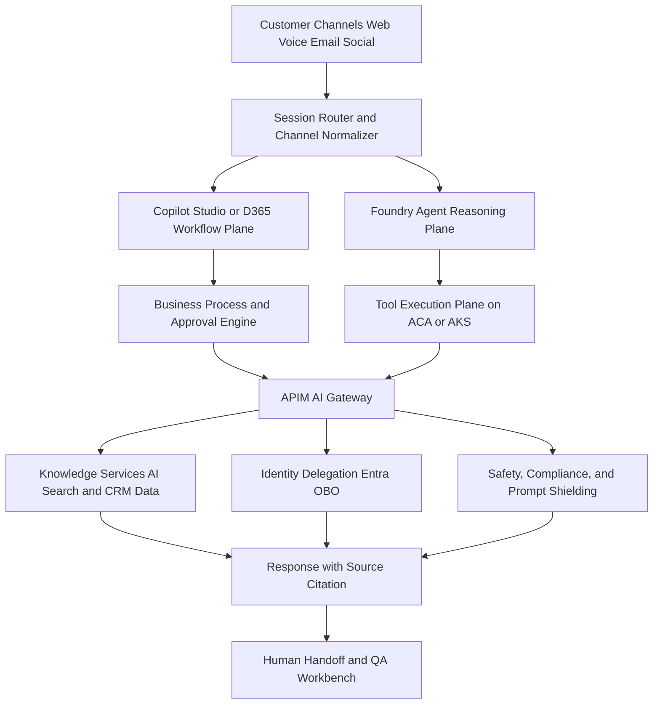
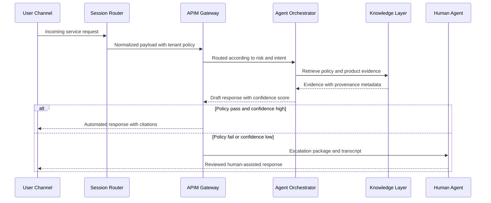

# Enterprise Omnichannel Customer-Service Agent Platform Selection FAQ: Copilot Studio vs Foundry+ACA/AKS vs Dynamics 365 Contact Center
> 🌐 **Language / 语言切换**: **[🇨🇳 中文版](omnichannel-customer-service-agent-copilot-studio-vs-foundry-aca-vs-d365-contact-center-selection-faq.md)** | **[🇬🇧 English](omnichannel-customer-service-agent-copilot-studio-vs-foundry-aca-vs-d365-contact-center-selection-faq.en.md)** | **[📚 Back to catalog](README.en.md)**
> Evidence labels: `measured` / `synthetic` / `anonymized_reported`
> Capture date: 2026-11-22

## 1) Executive summary: the decisive variable is channel-governed service quality, not model novelty
In enterprise customer service,
end users do not care
which model family is running.
They care about
consistent outcomes
across web chat,
voice calls,
email,
social channels,
and internal collaboration endpoints.
That means architecture selection
must optimize for
session continuity,
governed tool access,
traceable answers,
and reliable human handoff.
Teams that optimize only
single-turn model scores
usually face production failures later:
channel inconsistency,
handoff friction,
compliance blind spots,
and escalating support cost.
This guide compares
four practical enterprise patterns:
Copilot Studio low-code orchestration,
Foundry + APIM + ACA/AKS engineering platform,
Dynamics 365 Contact Center integrated service model,
and a layered dual-speed hybrid architecture.

## 2) Workload boundary: what makes B2B/B2C service-agent platforms difficult
Enterprise service-agent workloads
combine many task classes:
pre-sales Q&A,
order and refund support,
warranty triage,
account verification,
incident escalation,
and regulated policy explanations.
These workloads introduce
four persistent constraints.
First,
traffic is bursty,
so queue safety
and elasticity matter.
Second,
context must survive
cross-channel movement.
Third,
answers must be auditable,
especially for legal,
financial,
or eligibility claims.
Fourth,
human-in-the-loop controls
must be operational,
not theoretical.
Platform choices must therefore
cover the full chain:
routing,
orchestration,
knowledge retrieval,
identity delegation,
policy guardrails,
observability,
and FinOps.

## 3) Verifiable sources and evidence labels
Source 1 (`measured`): Copilot Studio documentation  
https://learn.microsoft.com/power-virtual-agents/
Source 2 (`measured`): Azure AI Foundry documentation  
https://learn.microsoft.com/azure/ai-foundry/
Source 3 (`measured`): Azure Container Apps documentation  
https://learn.microsoft.com/azure/container-apps/
Source 4 (`measured`): Azure API Management documentation  
https://learn.microsoft.com/azure/api-management/
Source 5 (`measured`): Dynamics 365 Customer Service documentation  
https://learn.microsoft.com/dynamics365/customer-service/
Source 6 (`measured`): Azure AI Search documentation  
https://learn.microsoft.com/azure/search/
Source 7 (`anonymized_reported`): anonymized enterprise postmortems from finance, retail, and digital-native support programs.
Source 8 (`synthetic`): controlled benchmark model for concurrency, latency, and cost break-even analysis.
Note: this guide focuses on application and service architecture decisions, not low-level kernel internals.

## 4) Pattern A: Copilot Studio and Power Platform orchestration path
This pattern is strongest
when time-to-value matters
and business process owners
need direct control.
Low-code flow composition
helps teams ship
intent routing,
approval branches,
and workflow handoffs quickly.
It is often effective
for organizations with
stable process logic
and moderate integration complexity.
Its major benefits are
faster first production release
and lower day-to-day
operations overhead for business units.
Its constraints appear
when advanced orchestration is needed:
complex multi-agent decomposition,
fine-grained tool governance,
or custom runtime controls.
In large programs,
this path works best
as the business-control layer,
paired with an extensible
engineering execution layer.

## 5) Pattern B: Foundry + APIM + ACA/AKS engineering platform
This path prioritizes
control-plane depth
and extensibility.
Foundry can manage
model routing and quality gates.
APIM can enforce
identity,
rate limits,
token budgets,
semantic cache policy,
and tool governance.
ACA or AKS can host
tool executors,
middleware services,
and specialized adapters.
This pattern fits
platform-heavy organizations
with strong SRE capability
and cross-team service ownership.
Its advantage is long-term flexibility.
Each layer can evolve independently.
Its cost is complexity:
platform ownership scope grows,
and operational maturity
must keep pace.
Without governance discipline,
teams may build
a powerful but fragile stack.

## 6) Pattern C: Dynamics 365 Contact Center integrated business path
This pattern is strongest
where customer-service process integration
is the primary objective.
It provides mature support
for case lifecycles,
agent desktop workflows,
SLA tracking,
and service analytics.
For enterprises already invested
in Dynamics 365 ecosystems,
it can reduce integration friction
and accelerate service-team adoption.
Its advantage is operational coherence.
Its limitation is deep customization elasticity
for highly specialized
agent-tool ecosystems.
When teams require
non-standard protocol mediation
or complex multi-agent runtimes,
an external API governance layer
is still usually required.

## 7) Pattern D: layered dual-speed hybrid architecture (recommended at scale)
At large enterprise scale,
single-pattern standardization
is often suboptimal.
A dual-speed design
typically performs better:
a fast lane
for high-volume standard interactions,
and a governed lane
for complex or high-risk requests.
One proven combination is:
Copilot Studio or D365
for channel-facing workflow orchestration,
plus Foundry + APIM + ACA/AKS
for complex reasoning,
tool governance,
and policy-heavy decisions.
This approach preserves
business agility
while retaining
deep engineering control.
Its primary challenge
is coordination overhead,
but with clear ownership boundaries
it reduces long-term rework
and supports multi-region expansion.

## 8) Mermaid: layered omnichannel service-agent reference topology

## 9) 12-dimension enterprise comparison matrix
| Dimension | Copilot Studio path | Foundry+APIM+ACA/AKS path | D365 Contact Center path | Dual-speed hybrid path |
|---|---|---|---|---|
| Time to first production | High | Medium | Medium-High | Medium |
| Engineering extensibility | Medium | High | Medium | High |
| Built-in service workflow depth | High | Medium | High | High |
| Multi-agent orchestration flexibility | Medium | High | Medium | High |
| Omnichannel consistency potential | Medium-High | Medium | High | High |
| Identity and authorization governance | Medium-High | High | High | High |
| Quota and semantic cache control | Medium | High | Medium | High |
| Observability granularity | Medium | High | Medium-High | High |
| Human handoff and QA integration | Medium-High | Medium | High | High |
| Operating complexity | Low-Medium | High | Medium | High |
| Cost optimization headroom | Medium | High | Medium | High |
| 3-year evolution elasticity | Medium-High | High | Medium-High | High |

## 10) Mermaid: request, cache boundary, and human handoff flow

## 11) Quantitative table: concurrency, TTFT, and monthly TCO break-even (`synthetic`)
| Metric | Copilot Studio path | Foundry+APIM+ACA/AKS | D365 Contact Center | Dual-speed hybrid |
|---|---:|---:|---:|---:|
| Peak concurrent sessions (normalized) | 4,000 | 12,000 | 6,500 | 15,000 |
| Mean TTFT milliseconds | 980 | 720 | 860 | 690 |
| End-to-end P95 milliseconds | 2,450 | 1,980 | 2,180 | 1,760 |
| Auto-resolution rate (`anonymized_reported`) | 0.62 | 0.68 | 0.66 | 0.72 |
| Escalation-to-human rate (`anonymized_reported`) | 0.24 | 0.19 | 0.21 | 0.17 |
| Monthly total cost index baseline equals 1 | 1.00 | 1.28 | 1.15 | 1.22 |
| Cost per 1,000 sessions USD (`synthetic`) | 18.4 | 16.1 | 17.3 | 15.2 |
| Practical break-even concurrency | <5k best fit | >8k best fit | 3k–7k stable | >6k long-term best |

Interpretation:
for small or medium complexity programs,
Copilot Studio or D365
often wins on delivery speed.
At higher concurrency and complexity,
engineering-heavy or hybrid paths
usually achieve better
long-term unit economics.

## 12) Selection decision tree: a 30-day launch-path method
Step one:
assess operating model maturity.
If business teams own workflows directly
and platform engineering is limited,
start with Copilot Studio or D365.
Step two:
assess channel and protocol complexity.
If multi-region channel mediation
and complex tool governance are required,
prioritize Foundry + APIM.
Step three:
assess risk-layer heterogeneity.
If low-risk and high-risk requests coexist,
use dual-speed segmentation.
Step four:
assess compliance and audit constraints.
The stricter the regulation,
the stronger the need
for gateway-centered control.
Step five:
assess three-year evolution costs.
Fast initial launch
is not always the cheapest
long-term architecture.
Include operations,
governance,
and migration cost
in one model.

## 13) Anti-pattern catalog
Anti-pattern one:
routing all channels
to a single model endpoint
without risk-aware policy segmentation.
Result:
governance blind spots
and uneven service quality.
Anti-pattern two:
treating the knowledge layer
as static FAQ storage only.
Result:
policy drift
and outdated responses.
Anti-pattern three:
missing a unified conversation ID.
Result:
context breaks
across channel transitions
and failed handoffs.
Anti-pattern four:
evaluating only answer hit rate.
Result:
no visibility into refusal quality,
handoff quality,
or compliance behavior.
Anti-pattern five:
deploying user-facing automation first
and adding identity controls later.
Result:
privilege leakage risk
after launch.
Anti-pattern six:
optimizing model price alone
while ignoring support operations impact.
Result:
hidden cost growth
in escalations and QA rework.

## 14) Production readiness checklist
1. Unified cross-channel conversation ID standard is implemented.  
2. Human handoff thresholds and escalation policy are defined.  
3. Tenant-level quotas and burst controls are enforced at gateway.  
4. Retrieval provenance and citation return path are enabled.  
5. Identity delegation and least-privilege matrix are reviewed.  
6. Prompt-injection and policy bypass controls are validated.  
7. Evaluation gates and release thresholds are operationalized.  
8. End-to-end observability and cost dashboards are active.  
9. Incident fallback and degraded-service runbooks are tested.  
10. Service, legal, and compliance sign-offs are documented.  
11. Peak queue prioritization and backpressure rules are configured.  
12. Knowledge refresh SLA and rollback path are codified.  

## 15) Practical FAQ (8 Q&A)
### Q1: When should Copilot Studio be the first choice?
When process patterns are stable, time-to-value is critical, and teams prefer business-owned workflow iteration.

### Q2: When should Foundry+APIM+ACA/AKS be preferred?
When deep orchestration control, custom tool governance, and higher concurrency elasticity are required.

### Q3: What is the main strength of D365 Contact Center?
Its strongest value is integrated customer-service operations, including case workflows, agent experience, and service analytics.

### Q4: Is dual-speed hybrid architecture too complex?
It is more complex, but at enterprise scale it often prevents long-term lock-in and supports controlled evolution.

### Q5: How do we reduce unsafe automated responses?
Bind responses to evidence, enforce gateway policies, and route low-confidence outcomes to human review.

### Q6: How should ROI be measured realistically?
Do not track model cost alone.
Measure auto-resolution, handoff efficiency, complaint reduction, and QA rework impact together.

### Q7: What usually breaks omnichannel continuity first?
Lack of unified conversation identity and inconsistent context persistence rules across channels.

### Q8: What is a practical Good-fit vs Not-for boundary?
Good fit: organizations willing to build policy, identity, and observability foundations. Not for: teams expecting a universal chatbot without governance investment.
