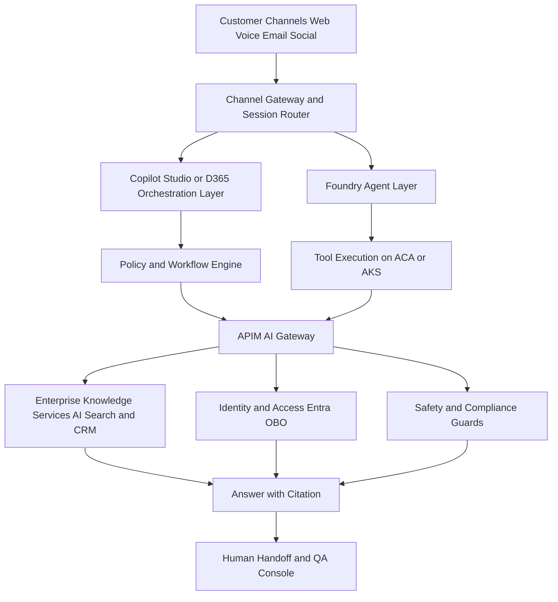
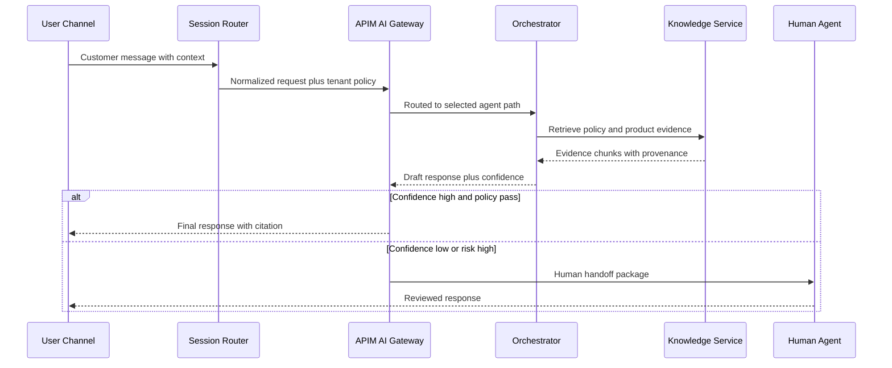

# 企业全渠道客服智能体平台选型 FAQ：Copilot Studio vs Foundry+ACA/AKS vs Dynamics 365 Contact Center
> 🌐 **Language / 语言切换**: **[🇨🇳 中文版](omnichannel-customer-service-agent-copilot-studio-vs-foundry-aca-vs-d365-contact-center-selection-faq.md)** | **[🇬🇧 English](omnichannel-customer-service-agent-copilot-studio-vs-foundry-aca-vs-d365-contact-center-selection-faq.en.md)** | **[📚 返回目录](README.md)**
> 证据标签：`measured` / `synthetic` / `anonymized_reported`
> 抓取日期：2026-11-22

## 1) 执行摘要：客服智能体平台不是“模型优先”，而是“渠道一致性 + 治理闭环”优先
在企业客服场景里，
用户并不关心你用了哪款模型。
用户只关心
网页聊天、
电话语音、
邮件、
社媒私信、
企业微信或 Teams
是否得到一致且可信的回答。
因此，
平台选型的主轴
不是单点推理性能，
而是跨渠道会话连续性、
权限边界、
知识检索可追溯性、
以及人工接管可用性。
若只追求“单轮回答分数”，
往往会在生产期暴露
路由混乱、
上下文丢失、
质检不可审计、
和成本不可控问题。
本指南将企业常见四种路径
放在同一张架构决策面板中比较：
Copilot Studio 低代码编排路径、
Foundry + APIM + ACA/AKS 工程化路径、
Dynamics 365 Contact Center 业务一体路径、
以及分层混合双速架构。

## 2) 场景边界：B2B/B2C 客服智能体的核心约束
全渠道客服智能体
通常同时承担
售前咨询、
订单售后、
退款纠纷、
会员权益、
故障工单、
以及敏感账户核验任务。
这类工作负载
有四个典型特征。
第一，
高峰期并发跳变明显，
要求弹性容量与队列保护。
第二，
跨渠道会话要连续，
避免重复收集客户信息。
第三，
需要可审计回答来源，
尤其涉及政策条款与金额。
第四，
必须支持人机协同闭环，
包括排队转人工、
工单接续、
和质检回放。
因此，
选型必须覆盖
编排、
检索、
网关、
身份、
观测、
和成本治理全链条。

## 3) 可验证来源与证据标签
来源 1（`measured`）：Copilot Studio 文档  
https://learn.microsoft.com/power-virtual-agents/

来源 2（`measured`）：Azure AI Foundry 文档  
https://learn.microsoft.com/azure/ai-foundry/

来源 3（`measured`）：Azure Container Apps 文档  
https://learn.microsoft.com/azure/container-apps/

来源 4（`measured`）：Azure API Management 文档  
https://learn.microsoft.com/azure/api-management/

来源 5（`measured`）：Dynamics 365 Contact Center 文档  
https://learn.microsoft.com/dynamics365/customer-service/

来源 6（`measured`）：Azure AI Search 文档  
https://learn.microsoft.com/azure/search/

来源 7（`anonymized_reported`）：匿名化金融、零售、互联网客服平台复盘。  
来源 8（`synthetic`）：并发与成本测算模型（用于 break-even 分析）。  
说明：
本文聚焦企业应用与服务架构，
不展开底层内核与驱动细节。

## 4) 路径 A：Copilot Studio + Power Platform 企业流程编排
该路径的优势是
上线速度与业务可维护性。
业务团队可在低代码平面
快速编排意图流转、
审批分支、
以及工单触发逻辑。
它非常适合
流程稳定、
治理要求明确、
且 IT 与业务协作紧密的组织。
典型收益是
首版上线周期短，
迭代频率可控，
运营人员介入门槛低。
但它并非万能方案。
若你需要
高度自定义工具链、
复杂多代理推理、
或重度模型路由策略，
就会碰到扩展边界。
因此该路径通常定位为
“业务编排控制层”，
与专业推理层配合使用
能获得更高上限。

## 5) 路径 B：Foundry + APIM + ACA/AKS 工程化平台
该路径强调工程灵活性
与可控扩展能力。
你可以在 Foundry 中
管理模型与评测门禁，
在 APIM 层执行
统一认证、
配额、
语义缓存、
和内容过滤策略，
再由 ACA 或 AKS 承载
工具执行与中间服务。
该方案适合
多团队协作、
复杂工具协议、
以及高定制运营策略。
它的强项是可演进性，
可以细粒度拆分
检索层、
推理层、
路由层、
和审计层。
代价是平台工程复杂度上升。
如果组织缺少
稳定 SRE 与平台治理能力，
容易出现
“能力很强但运维负担重”的情况。

## 6) 路径 C：Dynamics 365 Contact Center 业务一体化路径
该路径强调客服业务闭环，
尤其在座席管理、
工单生命周期、
服务级别指标、
和质检流程上
有天然优势。
对于已经深度使用
Dynamics 365 生态的企业，
它能降低系统拼接成本，
并缩短交付链路。
在统一报表、
统一知识库治理、
和统一客服运营看板方面，
该路径的业务价值突出。
其边界在于
跨平台深度定制能力
相对有限。
当企业需要
多云工具融合、
非标准推理编排、
或复杂代理协同时，
通常需要引入
外部网关与扩展服务层。

## 7) 路径 D：分层混合双速架构（推荐的大型企业模式）
在大型企业里，
常见的最优实践
不是单路径收敛，
而是分层混合。
“快层”承载
高频标准问答与流程自动化，
“稳层”承载
复杂推理与高风险决策。
一个常见组合是：
Copilot Studio 或 D365
负责前台渠道与业务流，
Foundry + APIM + ACA/AKS
负责复杂任务编排与工具治理。
这样做的好处是
既保留业务敏捷迭代，
又获得工程可扩展能力。
通过统一身份与审计链路，
还能避免“双平台数据孤岛”。
这类双速架构
对组织协同要求更高，
但在多品牌、多区域、
多监管环境下
往往是长期最稳妥解法。

## 8) Mermaid：全渠道客服智能体分层参考架构

## 9) 12 维企业选型对比矩阵
| 维度 | Copilot Studio 路径 | Foundry+APIM+ACA/AKS 路径 | D365 Contact Center 路径 | 混合双速路径 |
|---|---|---|---|---|
| 首版上线速度 | 高 | 中 | 中高 | 中 |
| 工程可扩展性 | 中 | 高 | 中 | 高 |
| 业务流程内建能力 | 高 | 中 | 高 | 高 |
| 多代理编排灵活度 | 中 | 高 | 中 | 高 |
| 渠道一体化能力 | 中高 | 中 | 高 | 高 |
| 身份与权限治理 | 中高 | 高 | 高 | 高 |
| 语义缓存与配额治理 | 中 | 高 | 中 | 高 |
| 可观测与审计颗粒度 | 中 | 高 | 中高 | 高 |
| 人工接管与质检闭环 | 中高 | 中 | 高 | 高 |
| 运维复杂度 | 低中 | 高 | 中 | 高 |
| 单会话成本优化空间 | 中 | 高 | 中 | 高 |
| 三年演进弹性 | 中高 | 高 | 中高 | 高 |

## 10) Mermaid：请求路径、缓存边界与人工接管流

## 11) 量化表：并发、TTFT 与月度 TCO break-even（`synthetic`）
| 指标 | Copilot Studio 路径 | Foundry+APIM+ACA/AKS | D365 Contact Center | 混合双速路径 |
|---|---:|---:|---:|---:|
| 峰值并发可承载会话（标准化） | 4,000 | 12,000 | 6,500 | 15,000 |
| 首 token 平均时延 TTFT（ms） | 980 | 720 | 860 | 690 |
| P95 端到端时延（ms） | 2,450 | 1,980 | 2,180 | 1,760 |
| 自动解决率（`anonymized_reported`） | 0.62 | 0.68 | 0.66 | 0.72 |
| 人工转接率（`anonymized_reported`） | 0.24 | 0.19 | 0.21 | 0.17 |
| 月度总成本指数（基线=1） | 1.00 | 1.28 | 1.15 | 1.22 |
| 每千会话平均成本（美元，`synthetic`） | 18.4 | 16.1 | 17.3 | 15.2 |
| 规模拐点（并发会话） | <5k 优势 | >8k 优势 | 3k–7k 稳定 | >6k 长期最优 |

解读：
小规模或流程稳定团队，
Copilot Studio 与 D365
通常更快见效。
当并发与复杂度提升后，
Foundry 工程化路径
和混合双速模式
在单位成本与可扩展性上
更容易形成长期优势。

## 12) 决策树：如何在 30 天内确定首发路径
第一步看组织能力结构。
若业务团队自驱强、
平台工程人力有限，
优先考虑 Copilot Studio 或 D365。
第二步看渠道复杂度。
若渠道多、
协议杂、
跨区域治理严格，
优先考虑 Foundry + APIM。
第三步看风险分层。
若存在高风险问答与低风险问答并存，
优先混合双速架构。
第四步看数据主权与审计要求。
监管越强，
越需要网关层集中治理。
第五步看三年演进预算。
短期上线优先
不代表长期总成本最优，
必须把平台维护与改造成本
纳入同一张预算表。

## 13) 常见反模式
反模式一：
把所有渠道都直接接到同一模型端点。
结果是策略边界无法细分，
高风险请求容易绕过治理。
反模式二：
把客服知识库当静态 FAQ 文档仓。
结果是新政策发布时间滞后，
回答与真实条款错位。
反模式三：
没有统一会话 ID 与追踪链路。
结果是跨渠道上下文断裂，
人工接管难以还原现场。
反模式四：
仅用命中率评估智能体质量。
结果是看不到拒答质量、
转人工质量、
和合规一致性。
反模式五：
先做前台炫技对话，
后补权限模型。
结果是敏感信息暴露风险
在上线后放大。

## 14) 生产就绪检查清单
1. 已建立跨渠道统一会话 ID 与追踪规范。  
2. 已定义转人工标准与高风险触发阈值。  
3. 已在网关层配置租户级配额与速率保护。  
4. 已实现检索证据溯源与引用回传。  
5. 已完成身份委派与最小权限矩阵梳理。  
6. 已建立提示注入与越权访问拦截策略。  
7. 已建立模型评测基线与上线门禁阈值。  
8. 已接入端到端可观测与成本看板。  
9. 已定义灾备降级路径与故障演练机制。  
10. 已完成客服、法务、合规三方签核。  
11. 已配置高峰限流与排队优先级策略。  
12. 已建立知识库更新 SLA 与回滚方案。  

## 15) 实战 FAQ（8 问）
### Q1：什么时候优先 Copilot Studio？
当流程稳定、
跨系统复杂度中等、
且追求快速上线时，
Copilot Studio 往往性价比最高。

### Q2：什么时候优先 Foundry+APIM+ACA/AKS？
当你需要
多代理编排、
复杂工具链治理、
和高并发弹性时，
工程化路径更具扩展性。

### Q3：D365 Contact Center 的核心优势是什么？
它在客服业务对象、
座席协同、
和运营闭环上
天然一体化，
适合 CRM 深度场景。

### Q4：混合双速架构会不会过于复杂？
确实更复杂，
但在多品牌多区域企业里，
它能把“快速交付”
与“长期治理”
拆分在不同层，
长期风险更低。

### Q5：如何避免客服智能体胡乱回答？
必须绑定检索证据、
策略门禁、
和低置信度转人工机制，
三者缺一不可。

### Q6：如何评估客服智能体是否真正降本？
不要只看模型调用费用，
要同时看
人工转接率、
一次解决率、
投诉率变化、
以及质检返工成本。

### Q7：跨渠道会话一致性最常见的失败点是什么？
没有统一会话主键与上下文归档策略，
导致 Web、语音、邮件
分别维护孤立状态。

### Q8：Good fit vs Not for 如何界定？
Good fit：
有明确客服流程、
可管理知识库、
并愿意建设治理闭环的企业。
Not for：
把智能体当成“万能聊天机器人”
且拒绝建立审计与权限边界的组织。
